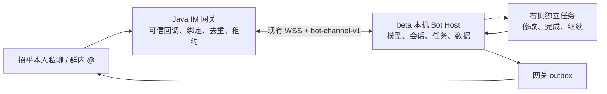

# Bot 接入 IM 网关：设计与实施清单

更新：2026-10-23。客户端继续在 `devclaw-bot-beta` 开发；网关代码位于 `LF39_devclaw_im_gateway_0821`，以本机现有 `e744c6d` 为起点。网关原有未提交的 Dockerfile、README.md、pom.xml 不属于本次修改。

## 目标与职责

新招乎机器人 CMBDevCaw Bot 的个人消息或群内 @，经现有 Java IM 网关送达本机 Bot；原 CMBDevClaw 保留项目/对话入口，两者共用网关与桌面连接。Bot 可自主直接回复或创建独立任务，后续修改、完成、继续与结果回传沿用已有闭环。

| 对象 | 保存位置与职责 |
| --- | --- |
| Bot、职责、模型/key、会话、任务、工作目录、记忆 | beta 客户端本地，保留现有 UI 与数据库 |
| IM 身份、Bot 绑定、接入授权及版本、路由 | 网关；只保存路由必需标识，不保存 Bot 模型配置和私人记忆 |
| 接收去重、排序、设备连接、执行租约、回传 outbox | 复用网关现有机制；结果未知不能自动重跑模型或重新发送非幂等消息 |
| 外部受众的执行与任务隔离 | 客户端 Host 再次校验绑定，沿用外部文字能力范围；不能借群消息取得桌面文件、私人记忆或其他群任务 |

旧 `services/bot-control` 中的任务中心、需求/设计模式、专家配置版本和成果审核表不迁入网关。复用其绑定授权、幂等和撤销思路，落到现有网关模块，避免并存两套任务事实源。

原服务仍完整保留在 `codex/devclaw-bot-integration:services/bot-control`，本机位置是 `/Users/heyirui/.codex/worktrees/devclaw-bot-integration/cmbCowork/services/bot-control`。本次检查了其中的 Bot/RuntimeNode 应用服务、IdentityPolicy 与运行授权协议；迁移的是渠道职责，未复制旧任务数据库或另起一套专家服务。

## 使用流程

1. 在 beta Bot 菜单进入“IM 接入”，选择个人或群并生成一次性绑定指令。
2. 本人私聊 CMBDevCaw Bot 或在目标群 @CMBDevCaw Bot 发送绑定指令。网关用已验证的 IM 回调与已登录桌面身份核对绑定人；不接受客户端填入的群 ID 作为已获授权的依据。
3. 私聊绑定后消息进入指定 Bot；群绑定后，只接收平台回调的群 @机器人消息。群内同一绑定共享一个受众会话，发送人保留可区分标识。
4. Bot 直接回复，或按模型判断调用现有任务工具。创建的任务出现在右侧；不同绑定的任务、消息和结果不能互相引用。
5. 回复回到原私聊/群。独立任务后续结果也经同一绑定回传。用户完成业务任务与模型本轮执行结束仍分别记录。
6. 桌面撤销绑定后，旧版本的排队执行及待发结果失效；重新绑定产生新受众，不复用撤销前任务上下文。

第一阶段每个外部会话/平台机器人只绑定一个本地 Bot，避免多个桌面重复回复。个人绑定先支持已验证桌面使用者本人；群绑定人需要从目标群发送匹配指令，绑定授予该群成员文字交办权限。更复杂的群管理员审批和跨用户 Bot 发布另行扩展。

**个人绑定仅作用于新 CMBDevCaw Bot**；未绑定/撤销后提示绑定，不进入原项目/对话路由。原 CMBDevClaw 始终保留项目/普通对话及卡片能力。beta 本地项目、普通对话、多 Bot 群、例行任务及其他入口保留。群绑定不会创建本地多 Bot 群。

## 协议与兼容

- 普通 beta IM 的 `REMOTE_EVENT`、项目/对话授权、审批卡片与 Markdown 回复保持原协议。
- 新增显式协商的 `bot-channel-v1` 能力与独立 Bot 事件。旧桌面不会把群消息误当成本人的普通 IM 命令，也不会收到无法理解的 Bot 事件。
- Bot 事件携带网关确认的 bindingId、绑定版本、botId、受众类型、发送人标识和原事件；桌面不能从正文选择执行身份。
- Bot 路由与原个人默认路由区分。原 `ensureDefaultRoute` 的停用逻辑和默认路由同步只作用于普通路由，不能停掉 Bot 群绑定。
- 回复仍使用原事件/会话、分段与幂等键。接收和平台实际送达分别记录；不能把“网关已接收”显示成“招乎已送达”。
- 绑定创建/查询/撤销复用已认证的桌面连接；绑定指令短时有效、单次消费，重试不能创建第二份绑定；操作只允许当前会话身份管理自己的绑定。
- 启用 Bot 接入必须配置可信 webhook 直连来源 IP。原网关联调阶段放行所有来源的策略不能用于 Bot 授权；Bot 启用但未配置来源时拒绝启动。反向代理还必须在入口限制真正的平台请求，不能把公共代理地址当作身份凭证。

## 一致性与故障处理

- 绑定与受众在创建后固定；变更目标先撤销再创建。绑定版本参与入站、执行和出站校验。
- 原平台消息去重在创建 Bot 任务前完成；本地事件再幂等入库，重连重投不得重复调用模型。
- 离线消息由网关持久排队；恢复连接后按会话顺序投递，客户端执行前取得租约。
- 租约丢失、设备切换、执行中崩溃的结果进入明确未知状态；不自动从头执行有副作用的任务。
- 撤销必须同时挡住新消息、未开始执行和未发送回传；在途外部请求无法撤回，保留真实送达状态。
- 不把 IM 群映射成 beta 本机多 Bot 群聊；前者是外部受众，后者是客户端原有协作功能。
- 已结束执行遇到迟到的租约撤销仍保留结果。Bot 平台发送超时、发送进程中断等不确定状态留在 `UNKNOWN`，不自动重发；原普通 IM 的重试策略不变。
- 桌面用户在已有外部任务中继续修改，授予的是本次本机发起的执行资格，仍沿用原外部受众和工具限制，不继承过期的远程事件租约。

## 分步实施与验收

- [x] S0：核对三套现有代码，冻结职责边界与迁入范围。
- [x] S1：网关 Bot 绑定、短时绑定指令、身份校验、撤销、数据库迁移及测试。
- [x] S2：Bot 事件协议、群路由、旧路由隔离、执行许可和群文本回传。
- [x] S3：beta 真实渠道适配，接入现有 Bot Host、任务工具与右侧列表；模拟渠道继续独立可用。
- [x] S4：beta Bot 菜单的真实绑定入口、连接状态、接入记录及撤销交互。
- [x] S5：临时 MySQL 5.7 + 真实 Java 网关 + beta WSS/Host 进程联调：本人/群绑定、拒绝其他人消费绑定码、去重、独立任务创建/修改/完成/继续、个人/群回传、双机器人独立回复及撤销不影响旧入口。
- [x] S6：旧 beta IM/Bot 回归、变更与部署说明。
- [ ] S7：内网 BEE 工程构建、环境配置、招乎真实个人/群测试及平台送达核对。

验收使用隔离数据库、测试身份与本地假平台，不读取用户模型 key、不修改用户现有绑定、不向真实群发消息。Java 原工程使用内部 parent/依赖；如本机无法解析，采用单独验证工程编译同一份生产源码，并明确区分本机结果与内部构建/招乎实测。

## 已验证与剩余边界

| 验证 | 结果与范围 |
| --- | --- |
| `npm run test:bot-integration:core` | 89 个文件、1,162 项通过；覆盖现有 Bot、任务、权限与共享数据路径。之后增加的两个状态回归另在下行运行。 |
| `npm run test:bot-im` | 10 项新适配/真实本地 WebSocket 测试及独立 Electron 对话框测试通过；包括去重、拒绝伪造、许可、断线、过期、撤销、迟到通知、发送未知。 |
| `npm run test:im-v1` | 19 个原 IM 测试脚本通过。 |
| `npm run typecheck`、隔离构建 | Node/web 类型检查与隔离 app 构建通过。 |
| `bots-local-work-app.spec.ts` | 隔离 Electron 真界面、假模型，委派、文件、任务修改/完成/继续通过。 |
| `bots-mock-channel-app.spec.ts` | 隔离 Electron 模拟渠道主流程、受众隔离及受限运行时通过。 |
| Java 公共依赖验证工程 | 29 项通过（含原 17 项），编译同一份生产业务源码；内部启动类和企业认证 Filter 不在本机替代验证范围内。详情与运行命令见网关 `BOT_IM_INTEGRATION.md`。 |
| Java/MySQL/客户端进程联调 | 实际 MySQL 5.7.24 执行 V2/V3/V4，真实 Java WSS/HTTP/调度与 beta Host/SQLite 互通；8 个事件 `COMPLETED`、15 条回传 `SENT`。两套虚拟凭据由假平台核对发送身份，并验证同一用户/相同消息 ID 的双入口并存。平台与模型为本地测试桩，不等于真实招乎或模型质量验收。 |

首期仅接个人文本和带 `groupOpenId` 的群 `at` 回调，不支持附件、语音、引用消息，也不把只有数字群 ID 的消息降级成私聊。群绑定证明绑定人在群里，不等于群管理员审批。绑定失败不会进入模型，会提示重新生成指令和核对登录账号；未绑定或撤销后只提示绑定。

仍沿用网关“一个身份一个在线桌面”的规则。Bot 定义不在设备间自动同步，另一台没有该 Bot 的设备不会接管执行。接入记录保存在本地，在“IM 接入”内查看；外部任务在右侧展示，外部消息不会混入本人私有主对话。

数据库/调度采用绑定每页 40 条、事件最多 16 个、续租并发最多 4 个、历史每页 40 条；续租过期检查与慢网络请求分开。无 ES 改动，也未声称生产吞吐或耗时结果。

## 部署与下一步

网关分支：`codex/bot-im-integration`。先在现有数据库依次执行 `V3__bot_channel_binding.sql`、`V4__bot_robot_reply_identity.sql`（V2 已有），再部署 Java，即使 Bot 开关关闭也必须先有新表/列。新机器人凭据申请前保持 `im.gateway.bot-channel.enabled=false`。开启时必须配置独立的 `im.gateway.bot-channel.robot.open-id/client-id/client-secret-ref` 与 `trusted-callback-ips`；同时升级 beta 客户端。原 Java 服务无需并行运行。

本机原工程的离线构建被未缓存的内部 `ZA21:bee-starter-parent:6.0.5` 阻断，不能将公共依赖验证当成内网构建成功。现有 `LocalCryptoService` 是 Base64 开发适配器；正式环境需要已有的内部 Crypto/Secret 实现、身份认证及平台回调网络边界，不能按本地假身份服务器部署。没有修改模型 key、用户现有绑定或向真实群发消息。

下一步在内网完成 S7，优先测试：两个机器人各自私聊、Bot 绑定/撤销不影响旧入口、群内绑定与不同成员交办、离线排队/重连、任务修改/完成/继续、撤销，以及平台实际送达。不确定发送应人工核对，不能为消除未知状态直接重放。

## 双机器人配置与路由

| 项目 | 原 CMBDevClaw | 新 CMBDevCaw Bot |
| --- | --- | --- |
| 功能 | 原项目/普通对话、审批与卡片 | Bot 文字交办及独立任务 |
| 回调 | `/api/v1/platform/zhaohu/callback` | `/api/v1/platform/zhaohu/bot/callback` |
| 身份 | 原 `zhaohu.message.robot-open-id` | `im.gateway.bot-channel.robot.open-id` |
| client-id | 原 `zhaohu.token.client-id` | `im.gateway.bot-channel.robot.client-id` |
| SecretPort 引用 | 原 `zhaohu.client-secret` | 默认 `zhaohu.bot.client-secret` |
| 未绑定 | 原有项目/对话流程 | 提示在 App 生成绑定指令 |

凭据只在服务端配置，不下发桌面，不进入 Git。平台 API 地址/超时可共用，令牌缓存与刷新锁按机器人独立。新 Bot 回调显式 toId 与端点不符时拒绝；缺失时只用该端点对应身份。Bot 消息 ID 按机器人隔离，旧消息去重键不变。

回复按绑定/会话持久化的机器人指纹选择身份；未绑定提示也持久化身份与个人/群目标。关闭、撤销、配置变化和失败重试不能转用旧机器人。之前同机器人试验的绑定不自动迁移，使用新身份重新绑定。

部署前须执行 V4，即使 Bot 开关关闭。具体环境变量、SecretPort 注入和回滚要求见网关仓库 `BOT_IM_INTEGRATION.md`。本次不更改用户现有配置，真实凭据和平台注册留待申请后完成。
