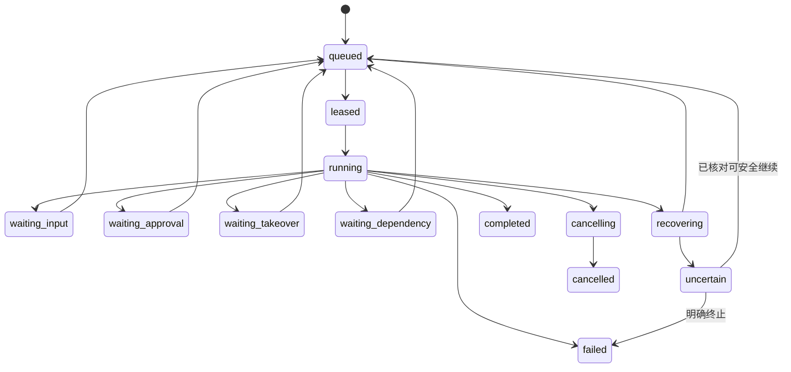

# 架构与技术设计

**当前部署基线（按用户 2026-10-02 补充）：首版支持 macOS 与纯 Windows 原生本机运行；Windows 禁止依赖 WSL2/Linux 容器，后续服务端为 Linux K8s。** 平台适配、存储与迁移以 [当前实施基线](12-windows-local-first.md) 为准；公共执行、恢复和授权契约继续适用。本文全量扩展保留为后续参考，不自动纳入本机首版。

以下是 CmbCowork 的拟实施设计。原版事实及其证据见 [源码结论](01-source-findings.md)；这里的接口、表名、部署拓扑和性能目标不冒充 Grok Bot 闭源服务端的实际实现。

本文件保留全量架构。核心版本按 [逐项范围](core-scope.json) 实施；checkpoint、Bot 级并发、最终动作 fence、接管排空、同步水位和时间默认值，以 [最终复核](11-core-final-review.md) 的具体契约补充和约束本文件。M12/M14/M17/M18 等可选模块不因出现在架构图中就变成本次依赖。

各模块优先由已有代码复用或移植适配形成，按 [代码复用与移植计划](08-code-reuse-plan.md) 选择来源。下文的新目录表示接入后的职责归属，不要求重新实现已经存在的算法、组件或状态机；可保留适合的上游模块结构，通过适配器接入 Cmb。

## 1. 架构决策

| 决策 | 采用方案 | 原因与边界 |
| --- | --- | --- |
| Agent 内核 | 复用 CmbCowork DeepAgents/LangGraph、工具、Skills、Mods、Goal、Coordinator、Workflow | 已有能力和项目上下文保留；新建 Bot 运行服务，不另接一套必需 Agent 平台 |
| 产品对象 | Bot / Conversation / Run / Computer 分离 | 长期角色、多次任务、群聊和 Team Bot 都需要不同生命周期 |
| 默认执行位置 | 首版 Windows 本机独立 Host；后续 Linux K8s Host | UI 关闭与 Host 停止分开；本机关机/休眠期间不执行 |
| 个人电脑边界 | 用户级持久电脑，Bot 级屏幕 | 与官方个人 Bots 的共享登录和文件语义一致 |
| Team Bot 电脑 | 根据 conversation、principal、隐私策略选择 | 成员私聊和群聊/Slack 不能共用一个不加区分的电脑映射 |
| 权威数据 | 首版 Host SQLite + 本机对象目录；后续 PostgreSQL + 对象存储 | 同一存储端口和事务契约；客户端只缓存，不能成为第二写入方 |
| 队列 | 数据库任务表、事务 outbox、lease/fence、后台对账 | 保留可查询事实，通知只用于降低延迟；避免队列与业务记录双写丢任务 |
| 执行边界 | 统一 Action Gateway | 所有 Shell/浏览器/电脑/MCP/委托经权限、审核、审计和运行有效性校验 |
| 交互协议 | 有版本的 Command + Event + Snapshot | 同一协议覆盖桌面、手机、IM、后台恢复；事件可重放，消息 ID 稳定 |
| 发布基准 | 固定版本功能 + 真机行为 + 故障验收 | UI 还原、实际执行与可靠性分别过关 |

## 2. 模块与部署单元

| 模块 | 职责 | 建议代码位置（含移植代码与适配层） |
| --- | --- | --- |
| M01 Registry / Identity | 账号、Bot、资料、分区、成员与生命周期 | `services/bot-api/src/registry/` |
| M02 Runtime Host | 任务领取、运行、checkpoint、暂停/恢复、子任务 | `services/bot-host/` + `src/runtime/` |
| M03 Conversation / Sync | 消息、分支、事件序列、未读、搜索 | `services/bot-api/src/conversations/` |
| M04 Computer | 电脑租用、多屏、浏览器、Shell、远程查看/控制 | `services/computer-agent/` + `services/bot-api/src/computers/` |
| M05 Collaboration | 信箱、交接、群聊编排、结果返回 | `services/bot-api/src/collaboration/` |
| M06 Memory | 分域记忆、证据、提炼、修订、删除 | `src/runtime/memory/` + API 存储适配 |
| M07 Skills / Teach | 技能版本、录制、学习、试跑、发布 | `services/bot-api/src/skills/`、`src/runtime/teach/` |
| M08 Automation | 定时、事件、Webhook、发生记录和触发消费 | `services/bot-api/src/automations/` |
| M09 Connectors | 插件目录、OAuth、工具路由、凭据服务 | `services/bot-api/src/connectors/` |
| M10 Policy / Interaction | 动作意图、审批、问题、安全输入、审核、审计 | `src/runtime/actions/` + `services/bot-api/src/interactions/` |
| M11 Artifacts | 上传、下载、预览、产物版本、受控文件引用 | `services/bot-api/src/artifacts/` |
| M12 Voice | ASR、实时通话、TTS、便笺、通话事件 | `services/bot-api/src/voice/` |
| M13 Desktop | Bot 专用工作区、桌面桥、IPC、缓存 | `src/renderer/src/components/bots/`、`src/main/bot-client/` |
| M14 Mobile | 移动聊天、电脑查看、审批、语音、推送 | `apps/bot-mobile/` |
| M15 Admin | 策略、成员、受管环境、用量、批量电脑管理 | `apps/bot-admin/` + API admin 模块 |
| M16 Operations | 部署、备份、升级、迁移、遥测、预算 | `deploy/bot/`、`services/bot-api/src/operations/` |
| M17 Team Bots | 发布、成员私聊、资源委托、团队记忆和分发 | `services/bot-api/src/team-bots/` |
| M18 Templates | 模板快照、分享链接、市场、导入 | `services/bot-api/src/templates/` |
| M19 Device Bridge | 本地执行、设备出口、WebAuthn 代理 | `src/main/bot-device-bridge/` |

共享类型放 `src/shared/bot/`，运行时与远端服务均引用它。先通过独立 tsconfig/build target 管住依赖；是否把 `src/runtime/` 后续拆为 workspace package，由代码抽离规模决定，不先做无关的全仓重构。

### 后续 Linux K8s 远程部署参考

- **Bot API：** Node/TypeScript 多副本，无用户工作文件，负责鉴权、领域命令、同步和管理；事件流连接状态可重建。
- **Scheduler / Reconciler：** 可与 API 使用同一代码包，但作为独立进程运行；通过数据库锁或分片保证调度唯一性。
- **Bot Host：** 每个用户电脑对应一个受监管运行宿主，调度多个 Bot；同 Bot 的主运行跨会话串行、同会话写入串行，专项 worker 在授权/屏幕约束内并行。可信派发和授权裁决优先放用户 VM 外，不能让任意 Agent Shell 获得控制凭据。Team Bot 的特殊 placement 属于延期扩展。
- **Computer Agent：** 宿主上的可信控制服务，管理显示、终端、浏览器和工作盘。任意 Agent Shell 不得取得其服务密钥或数据库全权限。
- **PostgreSQL：** 任务、身份、策略、消息、交互、元数据；使用迁移、事务和备份。初期不为“实时”再加一套 Redis 权威队列。
- **对象存储：** 附件、录屏、成果、浏览器/工作区快照、较大 checkpoint blobs；均带 owner/scope/version。
- **密钥服务：** 组织批准的 Vault/KMS 等能力，保存连接器、Bot Secrets、设备凭据；模型无法读取原值。
- **远程画面：** 先用独立鉴权的 VNC/WebSocket viewer；语音与后续低延迟画面使用实时媒体通道。API、媒体和电脑健康状态分开监测。

以下仅指后续 Linux 服务环境；Windows 本机首版不使用 Linux 容器。若服务端需要硬件隔离，采用具备该边界的 VM/microVM 或现有企业虚拟化能力；容器加目录权限不能宣称等价于原版的用户级 microVM 隔离。具体接入现有虚拟化平台还是 Firecracker，在 P0 以可运维性、镜像/磁盘和恢复测试决定，ComputerProvider 接口保持稳定。

可信服务使用独立服务身份/进程用户，动作授权和凭据选择的最终裁决放在用户 Shell 无法改写的服务中。Host 到控制面使用有 scope、有效期和运行代次的凭证；用户电脑不持有全库连接串、KMS 主密钥或其他成员的长效 token。若某类运行允许提权到整机管理员，其信任边界必须上移到 VM 外的网关；不能只靠文件权限声称同机凭据绝对安全。

## 3. 领域模型与关键约束

### 3.1 核心实体

| 实体 | 关键字段 / 约束 |
| --- | --- |
| Bot | `id, ownerUserId, teamId?, kind(personal/team/system), profile, revision, publishedRevision?, deletedAt` |
| BotResourceGrant | Bot 可用插件账号、secret handle、技能版本、共享文件范围；记录授予人和版本 |
| BotUserView | `botId,userId,pinnedOrder,sectionId,hidden,notifyEnabled,readCursor,manualUnread,adminPinned`；不放在共享 Bot 全局资料里 |
| Conversation | `id,kind(direct/group/team-private/team-channel/shared-room),subjectBotId?,participantUserId?,groupId?,revision` |
| GroupMember | 稳定 Bot ID、加入版本和可见范围；移出后新动作重新验证，不给旧成员群新消息 |
| Message | `id,conversationId,seq,senderKind,senderId,replyToId,blocks,clientNonce,requestId,createdAt` |
| Run | `id,botId,conversationId,trigger,initiatorId,payerId,placementId,generation,status,checkpointRef,policyVersion` |
| RunAttempt | `runId,attempt,workerId,leaseFence,leaseExpiresAt,startedAt,finishedAt,errorCode` |
| CommandReceipt | `accountId,clientNonce,inputDigest,status,runId,resultRef`；唯一键防重 |
| Event | `scopeId,seq,eventId,type,entityId,revision,payload,schemaVersion`；按 scope 有序 |
| Outbox / Inbox | 投递 ID、来源、目标、关联消息、ack、去重 key、下次尝试、终态 |
| ActionIntent / Effect | 最终工具参数摘要、资源 ID/版本、凭据 handle、允许决策、执行收据、`unknown` 状态 |
| Interaction | `id,runId,kind,actionId,revision,expiresAt,eligibleResponders,state,answer` |
| Computer | `id,scopeKind,scopeId,provider,imageVersion,diskRef,state,generation,snapshotManifestRef` |
| ScreenLease | `computerId,screenId,actor,runId,fence,expiresAt`；人类与 Bot 互斥 |
| Routine / Occurrence | 例程定义与 `routineId+triggerOccurrenceKey` 唯一发生记录；关联 run |
| SkillVersion / TeachSession | 结构化步骤、内容、来源、版本；录制对象、生成任务、评审和验证结果 |
| MemoryFact | scope、内容、origin、sourceEvidenceIds、有效时间、revision、tombstone |
| ArtifactVersion | 归属会话/团队、object key、MIME、hash、大小、来源任务、修订关系 |
| ConnectorAccount | provider、授权主体、scope、凭据 handle、状态；不存明文到会话 |
| VoiceSession | participant、bot、会话、媒体 token、状态、转写游标、终止原因、时长 |
| Policy / Usage / Audit | 有版本 effective policy、用量账本、脱敏审计事件 |

Bot ID 与原有 thread ID 通过显式映射连接。个人 Bot 可以拥有长期主会话和回复分支；不能假设所有 Bot 只有一个 thread。Team Bot 的每位成员私聊必须拥有独立 conversation、checkpoint 和私有记忆。

### 3.2 事务不变量

1. 接收用户任务时，在同一事务写消息、CommandReceipt、Run 和 outbox，提交后应答；接收不是完成。
2. 同会话 `seq` 唯一递增；客户端使用稳定 message/event ID 合并。事件重复或乱序不得生成重复消息。
3. worker 的运行/checkpoint/效果持久变更必须携带当前 `leaseFence`，电脑和连接器最终派发也检查有效代次；旧 worker 的迟到结果不能更新运行状态。用户直接编辑资料等领域命令使用身份、revision/CAS 校验，不伪造 worker lease。
4. Bot 删除留下 tombstone，阻止消息、例程、恢复器再次创建同 ID 活跃实例。
5. 工具执行不能与数据库组成跨系统原子事务；使用 intent、幂等 key 和 effect receipt，承认结果不确定的窗口。
6. 私聊 ACL 与 Bot 管理权限不同。Team Bot owner 拥有配置权，不拥有成员会话读取权。
7. 被批准的是具体动作及其上下文。消息表中的“已批准”文本不是执行凭据。

## 4. 从当前执行链抽出独立 Host

### 4.1 当前依赖

现有 [agent-run-service.ts](/Users/chenqiang/Desktop/projects/CmbCoworkAgent/src/main/agent/agent-run-service.ts:1) 是合适接入点，但实现仍由 [agent.ts](/Users/chenqiang/Desktop/projects/CmbCoworkAgent/src/main/ipc/agent.ts:5735) 注册。[runtime.ts](/Users/chenqiang/Desktop/projects/CmbCoworkAgent/src/main/agent/runtime.ts:159) 直接依赖 Electron；调度器也随应用退出停止。`managed-transport-delivery` 的无窗口 shim 解决了无 renderer 调用，并没有消除 Electron 进程依赖。

### 4.2 抽离顺序

1. 冻结 invoke/resume/interrupt/cancel、Goal、子任务、审批、输出流的行为测试与入口清单。
2. 把运行函数移到可注入 HostPorts 的模块；IPC 与 IM 都调用它。先保持旧桌面行为，不同时重写所有工具。
3. 将 `app.getPath`、BrowserWindow 广播、存储、密钥、浏览器、通知、工作区、checkpoint 工厂替换为端口。
4. 为 desktop 和 service 分别提供适配器。服务端 bundle 的完整传递依赖树不能含 Electron；加静态构建门禁与无 DISPLAY 启动测试。
5. 用同一 PreparedTurn 结构执行 Bot 任务，注入角色、成员权限、项目绑定、记忆作用域、技能版本和运行身份。
6. 把进程内 lease 保留给旧桌面 thread，云端 Bot thread 使用持久 lease。一个 thread 只能有一种执行所有权，不能双启动。
7. 将 checkpoint 生命周期与 run attempt 绑定，等待工具/worker 结算后释放；后台等待交互需落盘并释放可释放的算力。

建议端口：

```ts
interface BotHostPorts {
  identity: ExecutionIdentityPort;
  state: RunStatePort;
  checkpoints: CheckpointPort;
  events: EventSink;
  tools: AuthorizedToolGateway;
  computer: ComputerPort;
  artifacts: ArtifactPort;
  interactions: InteractionPort;
  memory: ScopedMemoryPort;
  secrets: SecretHandlePort;
  clock: ClockPort;
}
```

端口传递的是受限能力，不是数据库管理员连接或可随意调用的 IPC。保留 Cmb 已有的 `verifyResolvedThread`、Mods grant epoch 和执行前复核；项目 scope 变化后拒绝旧授权。

## 5. 命令、事件与多端同步

### 5.1 对外协议

重建版 GR16 的通信链是：桌面协调进程通过后台 `ensureSandBox` 获得网关描述，HTTP POST `/api/<method>` 发送命令，GET `/events` 接收 SSE，电脑画面通过独立 VNC 地址/代理连接。本地执行和 WebAuthn 也有单独请求/响应通路。这里能看到调用协议，不能据此获得官方 VM 调度与托管模型服务的完整实现。

本方案优先采用 HTTPS 命令 + SSE 事件流；SSE 使用受认证的流式客户端、cursor 补发与心跳。设备双向桥、远程画面使用独立 WebSocket 通道，实时语音使用独立媒体会话。若部署网关要求将事件改用 WS，维持相同事件与补发契约，不影响用户交互；不将所有状态塞进单条无持久记录的连接。

建议 `/v1/bots`、`/v1/conversations`、`/v1/runs`、`/v1/interactions`、`/v1/computers`、`/v1/routines`、`/v1/connectors`、`/v1/team-bots`、`/v1/templates`、`/v1/artifacts`；所有变更使用 nonce/idempotency key，资料编辑使用 revision/If-Match。

```ts
type BotCommand = {
  version: 1;
  clientNonce: string;
  kind: string;
  targetId: string;
  expectedRevision?: number;
  payload: unknown;
};
type BotEvent = {
  version: 1;
  eventId: string;
  scopeId: string;
  seq: number;
  kind: string;
  entityId: string;
  entityRevision: number;
  payload: unknown;
};
```

至少覆盖 `command.accepted/rejected`、`message.created/updated`、`run.queued/started/steered/completed/failed`、`interaction.opened/resolved/expired`、`computer.state/controlChanged`、`routine.changed`、`artifact.ready`、`bot.changed/deleted`、`voice.state`、`usage.changed`。鉴权身份由服务端上下文得出，不相信 payload 自报 owner。

### 5.2 断线行为

- 客户端保存已确认 cursor 和发送 receipt；断开时保留草稿，已发命令进入“确认中”。
- 重连带 cursor 订阅，补齐事件后再显示实时流；服务端压缩过旧事件时返回完整 snapshot + 新 cursor。
- 流式 delta 可丢弃重建，消息终态、审批、任务状态和成果引用必须持久。
- 客户端 cache 只做读取加速；授权撤回清缓存，搜索/下载/媒体票据服务端再次检查。
- 同一业务事件只能有一个生成通知的 owner；IM 和移动端不各自重新生成“任务完成”。

## 6. 执行状态与恢复



持久队列不承诺任意外部效果 exactly-once。可保证本系统接收与投递去重；外部 API 支持幂等时使用稳定 effect key；无幂等支持时记录提交前后证据，断在中间则暂停核对。

Reconciler 负责：过期 lease、排队但未发布任务、例程漏唤醒、Bot 消息未回执、完成结果未返回、过期人工控制、待审批失效、录制后未学习、电脑升级/备份中断。恢复动作均需业务去重 key，不以“重跑整个提示词”作为统一恢复办法。

### 用户改口与取消

- 普通补充：在工具安全边界读取新消息，更新目标 epoch，必要时排到下一轮。
- Stop：停止派发新动作，取消可取消的进程/子任务，并等待已开始动作结算；UI 显示 cancelling 到 terminal。
- 不能取消的外部提交：回报事实，保留 receipt，不把取消等同于回滚。
- 用户优先于 Bot 消息和计划，但后台任务不会被永久饿死；使用配额和公平队列。

## 7. 持久电脑和浏览器

### 7.1 Provider 接口

`ensure / status / wake / suspend / snapshot / recreate / terminate / deleteData / allocateScreen / releaseScreen / issueViewerTicket / acquireControl / releaseControl / execute / observe`。

持久盘包括工作区、浏览器持久状态和允许保留的配置；系统镜像包含可替换的软件。安装包是否保留按路径明确规定。每次快照有 manifest、hash、版本、时间和完整性状态；数据库 checkpoint 与文件引用通过 manifest 关联，不能只复制正在写入的 SQLite 文件。

### 7.2 多屏与共享登录的工程难点

普通 Chromium user-data-dir 不能被多个浏览器进程安全并发写入。优先验证 **一个用户 Browser Broker、一个受管理 profile、多个 Bot 页面/窗口与显示面**，按窗口映射到各 Bot 电脑画面。浏览器窗口渲染、多显示器输入路由需做原型；不能用每个 Bot 全新 incognito context 冒充共享登录。

若现有显示栈不能实现“共享 profile + Bot 独立屏幕”，备选是受控凭据/会话同步，但这对网站状态存在差异，必须作为技术阻断项测试，不能默认宣称与原版一致。P0/P2 要同时登录同一应用并行完成两个任务，验证 profile 锁、窗口焦点、下载和账号登出行为。

同屏 lease 控制 GUI；共享文件、Git 索引、外部业务记录还需要资源锁/乐观并发。多个 Bot 各有屏幕不代表共享文件可以无冲突写入。编码工作采用独立 worktree/工作目录，合并阶段再校验。

### 7.3 人工接管

请求接管 → 服务端转移控制 lease → 停止同屏新的 Bot 输入 → UI 获得短期 viewer/control 票据 → 用户完成 → 归还 → Bot 重新截图/读页面 → 继续。

设备断线不能无限持有控制；过期后回到等待状态或按已授权策略归还，不能在用户尚未完成敏感输入时盲目继续。普通看屏不取得控制权。

### 7.4 升级与恢复

区分客户端更新、Host 代码更新、电脑镜像更新和用户主动恢复。

镜像更新：准备目标 → 停止新任务准入 → 运行安全点 checkpoint → 刷盘/冻结快照 → 目标健康检查 → 单一 generation 切换 → 重连 → 恢复。不能安全暂停则中止升级并保留旧环境。恢复用到较旧快照时显示恢复时间与可能丢失范围。

## 8. Bot 协作与 Team Bots

### 8.1 个人 Bot 协作

信箱消息至少包括 `messageId, senderBotId, recipientBotId, intent, originConversationId, correlationId, causationId, hop, payloadRefs, scopeGrant, dedupeKey`。发送事务同时写双方可见投影和目标任务；结果通过 correlationId 回到原请求。支持明确拒绝、超时、失败、取消及找不到接收 Bot。

群聊保留独立 transcript 和成员版本。用户 @ 指定 responder；普通消息由群编排器决定。参考原版的有界轮次，不无限让所有 Bot 对每条消息答复。发言和任务执行分开：可并行做事，按因果顺序发布依赖结果。

Bot peer 和 task worker 的区别体现在生命周期：peer 有独立身份、记忆、收件箱和后续对话；worker 属于某个运行，服从父任务的权限和预算。两者可组合，不能互相冒充。

GR17 还区分主 Bot、Computer-use 子任务、Browser-use 子任务和 shared-room 工具集。Cmb 沿用主 Bot 负责目标/协作、专项 worker 负责屏幕/页面的分工；每个 worker 绑定 computer/screen/resource scope。Bot peer 的优先消息只可中断对方非用户工作，群聊不继承此优先标记。客户端能删除 Bot，不等于模型要获得删除其他 Bot 的工具。

### 8.2 Team Bot 运行上下文

每次运行生成不可由模型改写的上下文：

```ts
type TeamExecutionContext = {
  botId: string;
  botOwnerId: string;
  initiatingUserId: string;
  conversationId: string;
  surface: 'owner-private' | 'member-private' | 'team-channel' | 'group';
  teamId: string;
  payerId: string;
  computerId: string;
  privateMemoryScope?: string;
  sharedMemoryScope: string;
  connectorGrantIds: string[];
  publicationRevision: number;
  effectivePolicyVersion: number;
};
```

发布者可共享的资源形成发布清单；成员个人账号通过 Allow 卡另行授权，作用域可为本次、此 Bot 或所有 Team Bots。凭据选择器按请求者解析，不能让 A 的账号成为 B 的执行账号。

成员私聊内容及 checkpoint 仅成员可读。公共记忆写入需经过范围分类与证据核验，展示更新提示；不得把整段私聊复制到共同记忆或发布者工作盘。对成员私有电脑与 Team Bot 公共电脑之间的产物传输要有显式 ArtifactGrant。

非 owner 私聊或公共通道不能回答 owner 的普通审批卡时：只执行已授权动作，需额外审批的动作阻断或形成清晰待处理事项；不能“没有人能审批，所以自动通过”。管理员强制审核仍生效。当前官方个人连接器在公共通道的行为存在文本歧义，P0 实测后冻结；本设计不以模糊授权填补。

## 9. 记忆、技能和示范学习

### 记忆

复用当前检索与汇总服务，增加 ScopedMemoryPort。读取先过滤 scope；写入携带 evidence、origin、version；每次提炼先生成变更提案，再核验是否受证据支持，CAS 提交。显式事实只接受明确修改，自动删除保留 tombstone。Team Bot 私有记忆与共享记忆在存储和检索层均隔离。

### 示范学习流水线

`prepare → recording → finalizing → learning → draft → testing → ready / needs_revision`。

输入：用户目标、受控视频、结构化浏览器/电脑事件、前后界面状态。输出：参数 schema、稳定定位、决策分支、重试边界、完成检查、成果格式、所需权限。复用现有浏览器录制中的语义 locator；屏幕应用用截图理解补齐。不是所有示范都能可靠泛化，失败应保留可编辑草稿和失败步骤。

录制最大 10 分钟；秘密路径暂停采集或受控遮挡，不让模型收到明文。学习任务使用 durable job，录制 ID 作为幂等输入；生成技能版本前做校验。试跑使用不同输入、真实工具和验证标准；通过后用户可将其配置为 routine。

## 10. Routines、Webhook 与外部入口

调度定义与执行记录分离。标准发生 key 为 `routineId + scheduleInstant` 或 `provider + subscriptionId + providerEventId`；Webhook 支持调用方幂等键及签名/Bearer 验证。触发消息只提供任务数据，不继承发件人的任意操作指令。

时间语义：保存 IANA timezone 和触发规则，按数据库时间计算。核心采用最终复核第 8 节明确的 DST、漏跑、复制和更新规则，并记录待原版对照的差异；不能在未观察时声称默认值已经核实为原版行为。

统一接入 Slack、GitHub、Linear、Sentry、PagerDuty、邮箱和通用 Webhook；源事件的认证、重放防护、订阅游标、取消和 provider 限流分别实现。招乎作为 Cmb 增强通道接入同一 Inbox API，保留原有身份/Feature 授权链。

启用、改写、测试例程经过动作权限检查。控制运行频率、并发、总步骤和费用；用户停用后阻止尚未领取的发生任务。已开始动作按 Run 状态结算，不伪造“全部撤销”。

## 11. 动作、审批和秘密

执行链：**解析真实目标 → 验证 actor/scope/运行代次 → 现有工具权限与 Mods 校验 → 自动审核/用户交互 → 复核最终参数与授权版本 → 写执行意图 → 调用 → 保存收据 → 发布结果**。

动作身份同时包含 user/team/Bot/conversation/run/toolCall/device/credentialOwner。工具 schema 中的 readOnly 提示只作辅助，不能绕过强制权限。DOM ref、文件路径和外部资源由可信适配器解析，防止模型把高风险按钮改名后骗过策略。

Secrets 分三种：连接器 token（连接器服务持有）、Bot Secret（受限工具/页面填充持有）、Team Setup Secret（脚本进程短期环境）。模型仅获名称和用途。对“Shell 看不到秘密”的体验使用受控代理/凭据注入通道；不能直接把秘密放到任意 Agent Shell 的 env 后宣称不可读。

普通填写卡和安全输入卡使用不同 payload；安全输入不进入消息库、语音转写、Teach 视频或普通日志。链接/模板和日志导出前再做脱敏，但脱敏不是权限隔离的替代。

该承诺依赖受控安全输入前暂停所有相关采集通道；任意页面出现未知秘密时不能承诺自动识别全部内容，必须支持暂停、丢弃分段与学习前预览。同用户共享电脑的登录、文件和 CLI 凭据也不能虚称按 Bot 隔离，详见最终复核第 6、9 节。

## 12. 插件、市场和媒体

- 插件目录提供安装版本、工具、Skills、变量、授权 provider、团队策略及多账号能力；不把供应商全部工具直接塞进提示词。
- OAuth 使用 state/PKCE、回调设备/账号绑定；完成后从服务端状态刷新，不相信客户端“登录成功”提示。
- Webhook 订阅授权与同服务 MCP 登录分别管理；断开其中一个不能错误地显示另一个已断开。
- 模板是配置快照；Team Bot 是共享运行角色。导入模板重新获取依赖和授权，分享链接只解析允许字段。
- 文件经上传服务检查大小、类型和归属；预览位于隔离 origin，不持有宿主 API 权限。
- 音频、视频、图像能力按实际供应商适配并做任务评测；不能把协议里的 generateImage 当作已经接入可用图像模型。

### 12.1 连接器与事件的基线目录

官方帮助当前明确涉及以下服务；它们是可核实的起点，不冒充登录后完整插件目录。每个 provider 都登记授权方式、scope、工具、只读/写入边界、账号数量、触发能力、限流和回执查询支持。P0 导出/登记实际客户端目录后继续补齐。

| 服务 | 目前可确认的范围 | Cmb 验收重点 |
| --- | --- | --- |
| Gmail | 邮件插件、单邮箱；另有邮件触发类别 | 搜索/读信/草稿/发送/标签，发送收据和账号切换 |
| Google Calendar | 日历插件 | 读取、空闲时间、事件与邀请；不能把 Meet/Zoom 管理算作已有权限 |
| Google Drive | 文件发现/读取插件 | 与 Docs/Sheets/Slides 的编辑能力分别授权和验证 |
| Google Docs / Sheets / Slides | 官方列出的 Google 插件 | 实际工具清单与授权后验证；Sheets 只读文件不能修改 |
| Slack | 插件、例程事件、Team Bot 通道 | 三类身份/授权分开；普通插件以所连用户身份操作 |
| Notion | 插件，支持添加另一账号的示例 | 账号选择、内容权限与断开某一账号 |
| Zoom | 插件，当前帮助记录授权错误 | 记录供应商问题；Cmb 用自己的合法 OAuth 应用，不复刻错误 |
| GitHub | 例程事件、代码相关任务 | 订阅/权限/事件去重；是否有同名 MCP 插件以实际目录为准 |
| Linear / Sentry / PagerDuty | 当前例程帮助列出的事件源 | 独立适配和真实事件样本，不只配置一个通用 Webhook 标签 |
| 通用 Webhook / 邮箱事件 | 外部触发入口 | 认证、幂等、接收回执、内容到 Run 的映射 |

插件能力依据 [连接器帮助](https://cursor.com/help/grok-bot/connect-plugins)，触发能力依据 [例程帮助](https://cursor.com/help/grok-bot/routines)。原版模板市场的分类/搜索/导入功能纳入复刻；第三方作者的模板内容不直接当作 Cmb 自有模板发布。

## 13. 语音与移动端

听写服务输出文本草稿。实时语音服务独立维护会话、媒体传输、转写和播放，所有工具请求仍进入同一 Bot run/Action Gateway。语音中断音频播放不自动取消已经开始的工具；用户 Stop 则走统一任务取消路径。客户端全局管理唯一通话，切换 Bot 不销毁媒体会话。

移动端建议 React Native + TypeScript 共享协议、状态归约器和领域校验，不直接复用 Electron DOM UI。视频查看、麦克风、文件分享、推送、OAuth 深链接需要原生适配。是否最终采用现有企业移动壳由 P0 真机原型验证；只有文字入口的招乎不满足手机电脑接管、编辑草稿与实时语音的验收。

## 14. 企业控制面与运维

管理员 effective policy 应可解释：组织访问、团队能力、组例外、锁定、个人更严格规则分别计算。官方组策略可放宽团队配置的行为需要显式模式；Cmb 如采用更严格组织底线，应记录为适配差异，不默默改变群组覆盖规则。

Team Setup 使用可版本化 manifest，串行运行 check/setup，单脚本超时、退出码、日志脱敏和重新安装可查看。多团队共同电脑的秘密注入按原版限制处理。批量 recreate/terminate/delete-data 采用 durable operation + 每成员 item，失败逐项重试。

区分控制面审计、动作元数据、对话内容和 MCP I/O 导出。默认输出最小元数据，内容导出独立 opt-in；断开导出不补历史。Cmb 采用自己的 OTel 属性命名与 SIEM 接口，不假称 Cursor 后端已提供。

用量按真实 serving model、token、电脑与语音消耗记账；每个 run 固定 payer。预算可有软阈值与硬阈值，运行中是否允许完成、何时暂停由策略明确，不能把模型调用数等同于用户消息数。

部署需要管理入口、任务 API、电脑连接、媒体和对象存储均可达。对企业代理验证真实流式/WS/媒体路径与证书，不通过关闭 TLS 校验解决问题。准备镜像/发行签名、灰度渠道、数据库迁移、备份还原、宿主隔离与容量告警。

## 15. 可单独验证的工程风险

| 风险 | 先做的验证 | 不通过时的处理 |
| --- | --- | --- |
| Runtime 仍间接依赖 Electron | 无 Electron/无 DISPLAY 的构建与执行，含审批/子任务/记忆 | 继续抽端口；不能打包一个隐藏 Electron 当作完成云端架构 |
| 同用户共享登录与多屏冲突 | 两 Bot 同网站并行、不同窗口/下载/登出测试 | 调整 Browser Broker；将差异明示，不降级为每 Bot 独立登录后隐瞒 |
| 模型能力不足 | 跨工具、长任务、示范泛化、中文研发任务对照 | 调整模型/工具/上下文；不能用 UI 对齐宣称效果对齐 |
| Team Bot 隐私泄漏 | 成员 A/B/owner 交叉读取、共享记忆污染、凭据替换 | 发布前阻断；重新划分存储和运行上下文 |
| 外部动作重复 | 在提交前/后/回执前注入崩溃 | 进入 uncertain 并核对；不放大自动重试范围 |
| 多端体验和恢复 | 弱网、应用挂起、通知跳转、媒体断线 | 保留草稿/receipt/cursor，恢复确定状态后再放开操作 |
| 当前官方与 0.18 差异 | 固定目标版本、账号开关和平台截图/录像 | 更新矩阵和 UX 基准，记录哪些旧源码仅作机制参考 |

这些风险都有对应阶段门槛，不能用“后续优化”跳过后宣布完整复刻。
