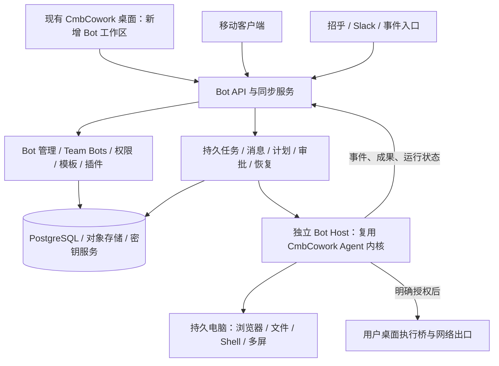

# CmbCowork Bot 完整复刻方案

版本：2026-09-30 / 已进入实现。产品代码与验证状态见 [实施记录](15-implementation-status.md)；下文的范围矩阵和复核报告保留为建设基线，不代表已完成验收。

本次整理为 **20 类、260 个建设/验收检查项**；对重建版两张 RPC 方法表的 **210 个接口** 做了范围映射。来源索引定位到 **71 份本地代码/证据文件**，并保留 **52 份官方文档**的获取摘要。数量用于检查覆盖，不代表所有代码都逐行审计、所有功能都已真机验证。

**当前核心实施基线：** 以 [macOS/Windows 本机与 Linux K8s 设计](12-windows-local-first.md) 和 [逐项范围](core-scope.json) 为准，通用工程契约见 [复核记录](11-core-final-review.md)。260 项分为 124 项完整核心、53 项部分核心、10 项条件纳入、73 项延期；另有 14 条工程契约检查、12 条核心旅程。条件项已明确本机首版不启用，后续选用时再验收。手机、语音、公开市场和 Team Bots 发布延期；基础身份、权限、恢复保留。

**2026-10-07 Mac 范围调整（用户明确决定）：** Mac 必须纯原生，不内置 Linux 虚拟机。Mac Bot 保留专用工作浏览器、文件、浏览器示范和人工接管；首版不开放任意系统命令及独立通用原生桌面。命令依赖的后台进程、服务、项目命令检查和可执行技能依赖检查同时关闭，历史仍保留。Windows 原生及后续 Linux 服务端目标继续保留。此决定覆盖旧文档中 Mac 对上述电脑能力的要求，不代表原 177 项全部验收通过；旧未确认进程收据及恢复、维护保护仍须遵守。

**复核状态：** 用户已确定 macOS 与纯 Windows 原生、本机优先、后续 Linux K8s、模型由用户配置，不预设必须新增的内部系统。原版 0.57.1 官方服务已连通，实测浏览器、Bot 直接通信、群聊协作、Teach 生成技能与更换网址执行，见 [原版观察](13-original-app-observations.md)。产品代码已进入实现，Host、执行器、浏览器及协作已有运行验证，验收范围见实施记录；Windows 通用桌面多屏并行（G2B）仍缺实现证据，不能宣称方案已全部实证。

**环境区分（按用户 2026-10-02 补充）：当前开发机是 macOS，产品须支持 macOS 与纯 Windows 原生本机运行，后续服务端为 Linux K8s。** 用户已有 Windows 测试机，待代码完成后验收。本次原版交互观察均来自 Mac。已追加例程创建、编辑、暂停及菜单核验，共 14 个局部观察项；没有把 Mac 实测算作 Windows 验收。

持续证据见 [复核记录](11-core-final-review.md) 与 [本轮证据数据](core-review-continuation.json)。此前原版重连失败已恢复；Rakazo 独立 profile 不能替代共享登录；复制例程一律暂停的无依据决定已撤回。完整原版故障/恢复与 Windows 体验对照尚未完成。

**本轮书面复核收尾：** 功能范围、复用路线和已发现的工程缺口已纳入实施基线；Host 抽离已补到具体依赖位置。尚未闭合的架构问题是 G2B（纯 Windows 通用桌面独立并行）。G1～G4 的产品运行验收属于实施工作，不再以产品尚未实现为由重复扩大书面复核。当前不宣称“100% 已验证”或降低电脑功能目标。

## 1. 结论与实施方向

**以 Grok Bot 的功能、操作路径和运行行为为产品基准，优先复用、移植已有代码，在 CmbCowork 中完成集成。** CmbCowork 已有能力直接沿用；Grok Bot、Rakazo、OpenBot 中满足要求的实现作为代码移植来源，改造必要的依赖和接口后使用。只有功能缺失、实现不完整或适配成本明显高于新实现时，才补写相应部分。

**实施优先级：现有代码直接复用 → 完整模块移植并适配 → 提取可用子模块 → 补写缺口。** 对同一能力，比较实际代码与适配成本后确定来源；不预先限制只能借鉴思路，也不因方案里写了“新建模块”就从零实现。完整移植更合适时可以保留原模块结构。具体采用范围见 [代码复用与移植计划](08-code-reuse-plan.md)。

全量目标最终应使用户能够：创建有固定职责的 Bot，长期与它协作；让多个 Bot 直接沟通和分工；在持久电脑上完成跨系统工作；通过示范形成技能，通过计划或事件继续执行；从桌面和手机查看、接管、审批；把成熟的 Bot 发布给团队使用。当前核心交付按上方范围裁剪端和扩展。对应依据见 [官方介绍](https://x.ai/bot)、[产品文档](https://docs.x.ai/grok-bot/overview) 和 [Team Bots 帮助](https://cursor.com/help/grok-bot/team-bots)。

**不能把完成标准设成“增加一个 Bot 菜单、接入 IM、支持定时运行”。** 当前验收包含所选核心功能及其异常和恢复；全量目标另外保留移动端、团队使用和管理能力。

## 2. 方案怎么读

| 文档 | 内容 |
| --- | --- |
| [源码结论与证据](01-source-findings.md) | 四份代码的实际职责、可复用点、已发现的不完整实现、版本差异 |
| [功能与验收矩阵](02-feature-matrix.md) | 逐项功能、现有基础、实现归属、阶段、可检查的验收条件 |
| [架构与技术设计](03-architecture.md) | 领域模型、独立宿主、云端电脑、消息、恢复、权限、Team Bots、部署 |
| [交互与体验规格](04-interaction-spec.md) | 页面结构、操作流程、状态、快捷键、桌面和移动端差异 |
| [实施顺序与验收](05-delivery-and-acceptance.md) | 分阶段改造、文件落点、验证门槛、关键故障场景、待核实项 |
| [可点击来源索引](06-source-index.md) | 官方页面、代码定位和开源固定版本链接 |
| [RPC 与工具覆盖](07-contract-coverage.md) | 210 个接口对应的需求、内部/扩展/待观察分类，以及实际工具组装边界 |
| [代码复用与移植计划](08-code-reuse-plan.md) | 优先取用哪些代码、需要改哪些依赖、哪些部分确实需要补写 |
| [代码量与完整交付估算](09-code-size-estimate.md) | 全量与核心范围的新增/移植/修改量区间、Grok 完整计数，以及一次完整交办的执行方式 |
| [必做与可选范围](10-scope-priorities.md) | 核心必须、场景条件和可独立选择的端/生态；区分多 Bot 协作与 Team Bots |
| [macOS/Windows 本机与 Linux K8s 设计](12-windows-local-first.md) | 当前环境、原生电脑层、用户模型配置、跨 OS 迁移及验证门槛 |
| [原版运行观察](13-original-app-observations.md) | 官方 0.57.1 实际执行、协作和 Teach 路径，以及未验证范围 |
| [核心方案最终复核](11-core-final-review.md) | 12 类缺口的修订、关键工程契约、四项原型门槛和核心端到端验收 |
| [Windows 原生电脑可行性](14-windows-computer-feasibility.md) | 子会话限制、Microsoft 组件源码核查、页面身份/输入域/截图及本机控制面修订 |
| [核心范围数据](core-scope.json) | 全部需求、RPC、原故障和旅程的核心映射，以及新增契约检查 |
| [复核证据与结果](core-review-report.json) | 来源摘要、结构校验、交叉引用及明确未运行的产品验证 |
| [机器可读需求表](requirements.json) | 可导入研发任务系统，逐条跟踪实现和验收 |
| [来源元数据](sources.json) / [RPC 映射数据](rpc-coverage.json) | 版本与摘要、接口和需求的可检查关联 |

矩阵中的“已有基础”仅表示存在可复用实现，**不表示已经满足 Grok Bot 的完整语义**。每一项都要按对应验收条件重新验证。

## 3. 本次核对改变了哪些具体设计

1. **Bot、会话和运行实例必须分开。** 一个 Bot 长期存在，能接收多次任务，也能参与群聊。Team Bot 还会对应多位成员的私有会话，不能直接用一个 `threadId` 充当 Bot 身份。
2. **个人 Bots 默认共用用户的持久电脑。** 共享文件、浏览器登录态；每个 Bot 有独立屏幕和操作队列。生产环境按用户隔离，不能按每个 Bot 分配全新电脑后声称体验相同。[官方电脑模型](https://docs.x.ai/grok-bot/computer-and-apps)
3. **Team Bot 是特殊运行模式。** 成员私聊、群聊和 Slack 场景的电脑、凭据、记忆和用量归属不同，需要单独的运行上下文和授权选择器。[官方 Team Bots](https://cursor.com/help/grok-bot/team-bots)
4. **桌面必须成为后台服务的客户端。** 目前 CmbCowork 的运行入口、调度器和浏览器仍依赖 Electron。必须抽离运行宿主，云端才能在桌面退出后继续工作。
5. **Bot 协作必须能恢复。** 消息入库、接收方唤醒、回执、结果返回应有持久记录；不能只在内存里调用另一个 Agent。
6. **示范学习包含理解、整理和验证。** 现有浏览器录制可复用，但要增加视频/事件理解、参数和决策提取、技能草稿、真实试跑、失败修订，才能实现“教一次、换输入再做”。
7. **语音输入、实时语音、语音便笺分别实现。** 0.18 重建的可读前端主要能证明听写，不能据此宣称当前官方的实时通话已具备可移植实现。
8. **审批绑定到具体动作。** 多端审批、用户改口、权限撤销、电脑重建后，都要重新检查动作参数、资源和运行代次，防止旧批准执行新动作。
9. **普通复制、模板分享、Team Bot 发布、跨用户房间分别建模。** 分享模板不会带走登录态和历史；发布 Team Bot 则有明确的共享资源范围。
10. **体验一致必须通过真机基线验收。** 可读前端只是部分重建。截图、页面布局、加载/错误/恢复状态和实际操作步数，需要与固定版本的原版应用逐项比较。

## 4. 完整远端目标与当前本机范围

下图保留最终远端目标，手机、专用消息入口及集群数据服务不属于当前首版前置条件。当前结构为 macOS/Windows 桌面 → 独立本机 Host → 原生电脑适配器，使用本机 SQLite 和文件对象目录；准确边界以第 12 文档为准。

第一阶段可以在开发机上启动独立服务验证架构；“关闭笔记本仍运行”的验收必须在远程宿主完成。CmbCowork 的招乎机器人继续作为消息入口，接入同一服务；它本身不能替代远程宿主或移动客户端。

## 5. 全量目标的依赖顺序

下表保留原全量路线；当前交付采用已选核心范围，本机实现不以远端或移动端上线为前提。G1～G4 是核心方案验证门槛，不要求用户分多次交办。

| 阶段 | 交付结果 | 退出条件 |
| --- | --- | --- |
| P0 基准冻结 | 功能、版本、页面、异常状态、原版任务样本 | 已核实项可追溯；未核实项有验证方法和责任归属 |
| P1 独立执行与数据模型 | Bot 身份、会话、持久任务、协议、无窗口运行 | 同一任务经桌面/后台入口执行一致；故障重启不丢已接收任务 |
| P2 个人 Bot 与持久电脑 | Bot 工作区、电脑操作、接管、审批、文件与同步 | 远程运行；退出桌面、重连、换设备后工作连续 |
| P3 多 Bot 与长期能力 | 群聊、直接通信、记忆、插件、示范学习、计划和事件 | 协作不循环失控；换输入复用技能；离线触发能完成 |
| P4 完整产品表面 | 实时语音、移动端、模板市场、Team Bots | 个人/团队与桌面/手机操作、资源归属通过矩阵验收 |
| P5 企业交付与一致性收尾 | 管理后台、身份/网络/审计、升级恢复、全平台分发 | 完整回归和体验对照通过；官方已确认功能无未交付项 |

分期用于安排依赖。当前“核心完成”按第 12 文档和 core-scope 验收；全量 Grok 复刻另需补齐被明确延期的能力。仅源码出现、官方尚未确认的能力保留显式证据状态。

## 6. “同款甚至超过”的判定

- **同款：** 矩阵内已确认的功能、使用路径、权限边界和异常恢复均通过；桌面/移动端可协同完成同一工作。
- **效果：** 用相同输入、相同账号权限和同样的完成标准对照原版。分别统计任务完成率、人工介入次数、完成时间和成本。相同按钮不能证明相同任务能力。
- **超过：** 完成同款后，再证明内网部署、研发项目关联、组织技能分发、模型约束等增强带来的收益。增强功能不能抵扣任何缺失功能。

原版的托管模型、服务端控制面和当前所有界面，并不全部包含在本地 0.18 重建源码中。当前方案能给出完整建设路线和逐项验证清单，不能把未实测部分写成“已经证明与原版一致”。

方案文档与数据的结构检查见 [validation-report.json](validation-report.json)。实现期已运行部分 Cmb 产品测试，具体命令、结果和限制见 [实施记录](15-implementation-status.md)。原版对照及 Windows 平台验收尚未全部完成。
