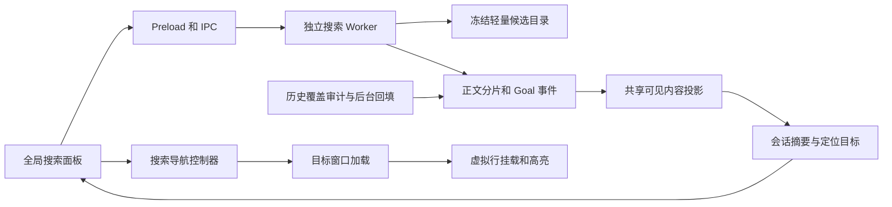

# 跨会话搜索实施方案

本方案为 CMBDevClaw 增加跨会话搜索：用户从全局入口搜索已保存的会话标题和可见对话内容，查看摘要，并打开命中消息。实现复用现有 SQLite 存储、可见内容规则、消息窗口加载和高亮能力，新增独立搜索 Worker、历史覆盖审计及搜索导航控制器。

| 项目 | 内容 |
| --- | --- |
| 目标分支 | `uat-without-mods` |
| 分析基线 | `f0bcc2a4a` |
| 目标工作目录 | `C:\ai\CmbCoworkAgent-uat-hook-encoding` |
| Codex 参考 | `C:\ai\codex`，提交 `ddf8a67ab0` |
| 日期 | 2026 年 11 月 17 日 |
| 文档版本 | 1.0 |
| 评审状态 | 三方最终设计评审通过，无剩余设计阻塞项 |
| 交付边界 | 开发实施方案；功能代码和性能指标仍须实现、测试及验收 |

## 一 设计决策

1. 首版覆盖所有普通侧栏会话的标题和已保存可见正文，包括可见 Goal 用户事件。搜索范围不受前端目录分页限制。
2. 搜索在独立 Worker 中执行，不通过循环调用主进程现有单会话搜索实现，不与前台消息加载共用执行队列。
3. 采用短事务冻结候选目录，正文按批次短事务读取。候选顺序固定，正文采用弱一致语义，新增内容通过刷新发现。
4. 分离扫描状态与内容覆盖状态。扫描结束不代表历史来源已完整纳入。
5. 搜索导航使用独立控制器，管理目录补齐、会话和 tab 切换、初始化就绪、消息窗口定位及高亮。
6. 有界扫描先作为可验证实现；达到约定规模的性能不合格时，搜索投影索引升级为首版前置任务，不能以“不完整”提示代替验收。

## 二 现有基础与参考边界

### 本工程已有能力

| 能力 | 实现位置 | 复用方式 |
| --- | --- | --- |
| 会话与消息存储 | `src/main/db/index.ts` | 使用 `threads`、`thread_messages` 和正文分片；不扫描完整 `thread_values` |
| 单会话历史搜索 | `src/main/db/index.ts` 的 `searchThreadMessages` | 抽取标准化、分片恢复、可见内容投影与匹配规则 |
| 搜索协议 | `src/main/types.ts`、`src/preload/index.ts` | 保持原 `threads:search-messages` 兼容，新增跨会话接口 |
| 搜索位置与摘要 | `src/shared/chat-search-types.ts`、`chat-search-plan.ts`、`chat-search-index.ts` | 复用 UTF-16 位置、片段 revision、上下文和字面匹配 |
| 后台读取模式 | `src/main/thread-message-hydration/`、`thread-metadata-hydration/` | 借鉴资源上限、短读事务和 Atomics 取消机制 |
| 历史窗口定位 | `src/renderer/src/lib/thread-context.tsx` 的 `loadMessageWindowAround` | 按消息 ID 加载目标附近有界窗口 |
| 虚拟列表和高亮 | `ChatContainer.tsx`、`ChatSearchOverlay.tsx` | 复用挂载、位置校验及 CSS 高亮，增加外部导航契约 |
| 会话身份 | `src/main/services/thread-incarnation.ts` | 使用 incarnation 防止删除重建后的错误导航 |
| Goal 气泡恢复 | `src/shared/goal-events.ts`、`src/renderer/src/lib/goal-transcript.ts` | 复用可见性、格式化、锚点和去重规则 |

现有单会话持久化搜索同步运行在主进程，每次限制 32 条和 512 KiB 扫描预算。其逻辑跨越数据库标准化、分片恢复、内部通知过滤和 Markdown 投影；抽取共享投影是独立开发任务，不能视为调用一个现成纯函数。

### Codex 可借鉴的部分

Codex 的 `thread/search` 返回会话、摘要和游标，`thread/searchOccurrences` 返回单会话内的命中位置和目标轮次游标。其本地跨会话实现使用 `rg` 对 JSONL 粗筛，再解析正文确认；标题筛选另有 `thread/list` 路径。

本工程借鉴接口分层、紧凑摘要、按需定位和游标分页。存储实现采用 SQLite，搜索语义沿用本工程可见内容规则。Codex 的会话内命中接口范围与本工程工具摘要范围不同，不照搬过滤规则。本地参考是协议及后端源码，不代表已取得 Codex 桌面端完整 UI 实现。

## 三 首版产品范围

### 会话和内容范围

| 对象 | 首版行为 |
| --- | --- |
| 普通侧栏中的会话 | 纳入，包括该侧栏内的远程收件箱、定时会话；不能仅按手工创建来源筛选 |
| Harness 项目和特性会话 | 排除；后续接通对应导航后单独扩展 |
| 已保存标题 | 纳入，采用侧栏一致的显示标题规则 |
| 用户、助手可见正文 | 纳入，包含已恢复的正文分片及代码块可见文本 |
| 可见工具摘要 | 纳入，与现有会话内搜索保持一致 |
| 可见 Goal 用户气泡 | 纳入独立事件源，过滤 status、pause、clear 等不构成气泡的事件 |
| 隐藏内部消息、工具原始输出、独立 reasoning、隐藏附件载荷 | 排除；以现有显示规则为准 |
| 子代理独立转录、附件文件全文 | 排除，主对话中已经展示的摘要仍按原规则搜索 |
| 未保存草稿、尚未持久化流式尾部 | 排除，界面说明“搜索已保存内容，最新生成内容保存后可刷新” |

普通会话分类必须抽成共享谓词或保持可验证的等价实现，主进程、Worker 和侧栏使用同一口径。工作区筛选沿用现有存储路径匹配语义，不引入新的路径大小写或归一化规则。

### 交互

- 全局入口放在 App 层，侧栏顶部显示“搜索会话”；文件预览或其他主视图下仍可打开。
- 快捷键为 `Ctrl/Cmd+Shift+F`，输入防抖初值 200 ms。原会话内 `Ctrl/Cmd+F` 显式排除 Shift/Alt，并在全局搜索打开时停用。
- 默认所有普通会话，可筛选当前工作区或无工作区会话。`undefined` 表示不筛选，`null` 表示无工作区。
- 匹配为大小写不敏感的字面子串，沿用现有 Unicode 匹配与 UTF-16 坐标规则。首版不提供正则、语义搜索和分词相关度排序。
- 每个会话一条结果：标题、工作区、冻结的更新时间、命中来源和摘要。默认按冻结更新时间倒序，再按会话 ID 倒序。
- 第一阶段先检索候选标题并发布；第二阶段扫描未通过标题命中的会话正文。标题已命中时无需继续扫描其正文来判断该会话是否命中，也不宣称已枚举该会话所有出现位置。
- 正文取该会话第一个确认的代表性命中，返回后跳过该会话剩余正文。单会话内更多出现位置由现有搜索继续处理。
- 结果增量到达时按固定排序键合并，选中状态以会话身份维持，不能用数组下标维持。用户选中项不得因插入较新结果发生变化。
- 方向键选择，Enter 打开，Esc 关闭；中文输入法 composing 期间 Enter 不执行打开。关闭后恢复入口焦点，打开结果成功后将焦点交给聊天搜索。
- 查询和列表位置只保留在当前窗口内存中。正在执行的导航不跨应用重启恢复。

## 四 系统结构与接口



### 新增接口

共享类型放在 `src/shared/thread-search-types.ts`。以下为需要落实的协议骨架，现有 `ChatSearchLocation`、`ThreadIncarnationSnapshot` 用 import 引用，不重复定义。

```ts
type ThreadSearchTarget =
  | {
      kind: "durableMessage"
      messageId: string
      ordinalHint: number
      structureEpoch: number
      location: ChatSearchLocation
    }
  | {
      kind: "goalEvent"
      eventId: string
      anchorMessageId: string | null
      ordinalHint: number | null
      structureEpoch: number
      location: ChatSearchLocation
    }

interface ThreadSearchStartRequest {
  query: string
  workspacePath?: string | null
  limit?: number
}

interface ThreadSearchContinueRequest {
  cursor: string
}

interface ThreadSearchResult {
  threadId: string
  incarnation: ThreadIncarnationSnapshot
  title: string
  workspacePath: string | null
  frozenUpdatedAt: number
  matchedBy: "title" | "message"
  snippet: string
  snippetRanges: Array<{ start: number; end: number }>
  target: ThreadSearchTarget | null
  navigation: "exact" | "threadOnly"
}

type SearchCoverageReason =
  | "legacy-unverified"
  | "legacy-pending"
  | "oversized-row"
  | "projection-truncated"
  | "candidate-limit"
  | "scan-budget"
  | "unavailable-source"
  | "changed-during-search"

interface ThreadSearchPage {
  sessionId: string
  results: ThreadSearchResult[]
  nextCursor: string | null
  scanStatus: "running" | "complete" | "cancelled" | "expired" | "failed" | "limited"
  coverage: {
    basis: "durable-visible"
    completeness: "complete" | "partial" | "unknown"
    reasons: SearchCoverageReason[]
    pendingThreads: number
    failedThreads: number
    skippedRows: number
  }
  scannedThreads: number
}
```

| IPC | 作用 |
| --- | --- |
| `threads:search-start` | 验证参数、取消同窗口旧查询、创建 session 并返回首批结果 |
| `threads:search-continue` | 根据 opaque cursor 继续有界扫描；不再接受可变查询条件 |
| `threads:search-cancel` | 取消当前 session，幂等处理 |
| `threads:search-summary` | 按 threadId 和 incarnation 读取受限目录摘要，供导航 adopt 使用 |
| `threads:search-target-window` | 验证会话身份及目标，解析 durable/Goal 目标并读取有界窗口 |

`search-target-window` 返回已解析目标身份、当前结构 epoch、目标窗口及明确的结果状态；不能把任意 `goalEvent` ID 直接传给已有 durable `targetMessageId` 接口。durable 路径内部复用现有窗口读取器，Goal 路径增加目标事件读取和投影。返回状态至少包括 `resolved`、`threadOnly`、`notFound`、`staleIdentity`、`changed`、`failed`。

结果类型和 IPC 运行时校验须保证：`navigation: exact` 必须有非空 target，`target: null` 必须为 threadOnly。标题命中和无法精确定位的 Goal 命中走 threadOnly 分支，只打开会话，不自动跳转正文第一条命中。目标窗口响应沿用现有消息窗口的 4 MiB 硬预算，额外的目标事件、状态和响应封装也计入总额；超长内容返回截断标记。搜索结果页单独采用 128 KiB 预算，不能把两种响应混为同一个上限；目录 summary 响应上限为 32 KiB。

所有接口由主进程根据 `event.sender.id` 绑定窗口；客户端不能指定数据库路径、窗口所有权、SQL 或任意文件路径。校验 query、游标大小、limit 和 ID，query 上限沿用 256 个 UTF-16 code units。参数错误、Worker 不可用及游标过期使用可识别错误码，不记录查询正文和命中正文到普通日志。

## 五 检索执行与一致性

### 查询生命周期

1. 在独立 Worker 的短只读事务中捕获轻量候选目录，字段为 threadId、incarnation、createdAt、frozenUpdatedAt、显示标题和必要的分类/工作区字段。
2. 使用字段投影和字节上限，不能为了读取 incarnation 或筛选字段把整个巨大 metadata 传入主进程或 renderer。按固定排序生成有界数组后立即结束事务。
3. session 保存候选数组、当前候选位置、源类型、正文复合位置、已发布会话身份、累计覆盖状态和当前序号。正文每批读取开启独立短事务，不能维持整个搜索期间的 SQLite 快照阻碍 WAL 回收。
4. 客户端游标绑定 sessionId、Worker generation 和 sequence；继续请求必须属于同一窗口且匹配期待序号。重复 sequence 可返回上一页有界缓存，禁止二次推进；乱序返回 `SEARCH_CURSOR_INVALID`。
5. 每窗口最多一个活动查询；Worker 全局活动 session 先限制为两个，超出返回可重试 busy，不无界排队。单页生成后主动让出执行权，前端按需继续，空匹配页有 cursor 时继续扫描。
6. session 空闲 TTL 初值五分钟。新查询、取消、关闭面板或窗口销毁释放执行资源；面板可保留结果快照，但重开时建立新查询，不能继续失效游标。
7. Worker 重启、TTL 到期或 session 被释放后返回 `SEARCH_CURSOR_EXPIRED`；界面清楚提示并重新查询，不从头继续却复用旧结果游标。

### 写入期间的语义

候选列表顺序固定；新会话、标题修改和普通正文追加不保证进入本轮结果，刷新后发现。每批正文按读取时的已提交内容搜索，结果打开时重新校验。因此 `coverage.complete` 表示本轮定义的候选和适用来源没有已知覆盖缺口，不表示全库处于同一时间点。

新增持久化结构版本表 `thread_search_structure_versions`，键为 threadId 和 incarnation，保存单调 epoch。迁移导致 ordinal 改变、消息重排、删除/替换身份、会话恢复及影响 Goal 定位结构的修改，必须与 epoch 增长在同一写事务提交。普通正文追加、流式文本分片追加不增长该 epoch；不能使用 `threads.updated_at` 代替正文版本。

结构版本表和覆盖表的 incarnation 键统一编码为非空字符串：新会话使用带类型前缀的 UUID，旧会话使用带 legacy 前缀的已验证创建时间编码。使用共享编码函数，不将 nullable token 直接放入 SQLite 复合主键。

扫描批次前后验证结构 epoch。变化时丢弃该会话未发布的扫描状态并重扫，最多两次；已发布会话按 incarnation 去重。持续变化则将覆盖标记为 `partial/changed-during-search`，提供刷新入口。导航以 messageId/eventId 和当前身份为权威，ordinal 只作提示，必须重新验证 location revision。

正文内容被覆盖但结构不变时仍遵守弱一致规则：不承诺本轮重扫已完成会话；打开已失效的命中反馈“内容已变化”，不能显示旧片段为当前事实。

### 预算和失败

下列为实现初值，性能阶段可在保持有界性和验收指标的条件下调整：

| 项目 | 初值或要求 |
| --- | --- |
| 候选目录 | 最多 50,000 条、32 MiB，构建耗时预算两秒；超过任一值明确 limited/partial |
| 单批正文 | 先沿用 32 条、512 KiB；单页时间片目标 50 ms，在每行/分片边界检查取消 |
| 单页结果 | 默认 20 条，最多 50 条；序列化后最多 128 KiB |
| 单会话投影 | 保留现有可见文本、块数和坐标预算，超限计入 coverage |
| 全查询结果 | 最多 1,000 个会话，达到上限返回 limited 并提示缩小范围，不宣称总数等于 1,000 |
| 全轮扫描 | 活跃执行预算初值 30 秒，达到上限返回 partial/scan-budget |
| Worker | V8 old generation 上限 256 MiB；独立 heap，异常可重建 |
| 取消 | SharedArrayBuffer/Atomics 标志，客户端也按 generation 丢弃迟到响应 |

行头预算检查必须发生在读取/解析大正文之前；禁止 `GROUP_CONCAT` 汇总全部分片、整库 JSON 拉取或无界结果集合。同步 SQLite 的单条语句不能只依赖下一条消息通知取消，超时 Worker 的受控终止/重建应作为兜底，旧 session 随之过期。

Worker 失败不能退回主进程全库解析。单次重建后仍失败，返回错误和重试入口。达到预算与真实空结果必须有不同状态；达到代表性支持规模的预算上限视为发布失败，正常广泛查询的显式结果数量上限除外。

## 六 历史覆盖与 Goal 事件

### 最小覆盖审计

首版实现覆盖审计和必要的后台兼容回填。审计分页读取普通会话的 durable/fragment 头、迁移标记、Goal 事件头以及 checkpoint 来源存在性和可读性，不把所有会话打开到 renderer，也不全文解析 `thread_values`。

| 源状态 | 处理 |
| --- | --- |
| 迁移完成且源身份一致 | 复用 durable 数据，来源已核实 |
| 无迁移记录 | 不能由 durable 非空推断完整，检查是否存在适用旧来源 |
| checkpoint 不存在或已确认没有可恢复主对话 | 记录 notApplicable，允许该来源完成核实，不永久 pending |
| 需要旧前缀回填或迁移中断 | 记录 pendingMigration，后台恢复 |
| 来源读取/校验失败 | failed，提供重试，coverage 不可 complete |
| 回填来源 checkpoint 改变 | 使旧审计结果失效，重新确认，不从过时来源恢复 |

新增 `thread_search_coverage` 缓存表，至少记录 threadId、incarnation、投影版本、checkpoint 来源身份和核实状态。状态采用 `verified | notApplicable | pendingMigration | failed`。缓存失效依据来源变化和结构 epoch，不能把一次检查永久应用于后续恢复。

后台回填复用现有 checkpoint bootstrap，但使用独立后台任务 scope，并经现有会话 mutation lease/锁及运行状态校验。只处理安全的空闲会话，工作开始、提交前和恢复批次边界重新确认会话身份、来源和运行状态；忙碌会话保留 pending，空闲后重试。搜索键入请求不得同步触发全量迁移。

回填不能复用 foreground hydration 的取消 scope，不能抢占用户刚打开的会话。删除时终止回填且禁止重新创建记录；结构变更与 epoch 在同事务更新，通知相关搜索会话重扫。无 checkpoint 的空返回与成功迁移区分处理，避免永久显示待迁移。

### Goal 内容和定位

将 `isVisibleGoalUserEventMessage`、格式化及与 durable 去重所需纯逻辑抽入 shared，前后端保持一致。搜索独立读取符合可见条件的 Goal 事件，不能受当前 UI 仅恢复最近事件的数量上限限制。

Goal 与 durable 表示同一条用户内容时，优先使用 durable 身份和定位目标；否则保留 `goalEvent` target。优先使用 `transcript_message_id`，再使用有效的 ordinal 锚点读取邻近 durable 窗口，并按现有合并规则恢复 `goal-user-event-${event_id}` 气泡。位置坐标按该气泡实际格式化后的正文计算。

增加按 eventId 读取目标事件的有界路径，避免旧事件不在恢复尾窗口而丢失。无法确认有效锚点或重建位置时，结果仍可展示已确认的文本命中，设置 `navigation: threadOnly`，按钮明确为“打开会话”；不得调用假 messageId、伪造邻近顺序或声称精准跳转。若事件文本本身无法核实，则同时标记对应覆盖异常。定位能力与文本覆盖分别记录。

### 用户状态文案

- running 且暂无结果：“正在搜索已保存内容…”；空页有 nextCursor 时继续。
- complete 且 coverage complete 且没有结果：“未找到匹配的已保存内容”。
- pendingMigration 或 legacy-unverified：“部分历史正在准备，当前结果可能不完整”。
- oversized/projection-truncated：“部分超长内容未搜索完整”。
- failed/unavailable-source：“部分历史读取失败，可重试”。
- limited：“已达到本次搜索范围上限，请缩小范围”。
- expired：“搜索已过期，正在重新搜索”。

存在结果也应保留覆盖提示。显示的数量是“已找到的会话”，不是未经完整统计的全库总命中数。

## 七 跨会话导航契约

### 控制器与状态机

新增 App/store 层的搜索导航控制器，持有 requestId、threadId、incarnation、query、target、初始化 generation 和执行阶段。requestId 在第一次 await 之前生成。

```text
idle → resolvingSummary → selectingThread → waitingForReady
     → resolvingTarget → mounting → highlighting → acknowledged
任一阶段 → failed 或 cancelled
```

1. 校验会话身份；目录中缺失时，通过受限 summary 接口读取。
2. 使用独立的只读 adopt 操作合并摘要。保留已有较新/更丰富对象，遵守目录请求 epoch、删除栅栏和 incarnation；不把 SearchResult 伪装成 Thread，不调用持久化 updateThread，不改变 updated_at 或目录分页游标。
3. 切换会话与主视图，显式激活目标会话的 `agent` tab。仅调用 selectThread 不足以使文件 tab 下的 ChatContainer 挂载。
4. 等待首次转录发布且初始化 generation 一致的 readiness。不能仅判断 initializedThreads，也不能用固定延时猜测；首次 hydrate 失败进入明确失败/重试状态，target 不能提前取消其恢复职责。
5. 解析 target 并发起消息窗口 target 意图，使用现有协调器。Goal 目标采用上一节的专用解析；结构 epoch 已变则重读定位身份。
6. 等待 React commit 和目标虚拟行挂载，校验 location revision，进入高亮。
7. 显式返回 acknowledged、failed 或 cancelled 并清理命令。失效位置不得静默跳到第一条命中。

threadOnly 分支在第 4 步会话和 agent tab 就绪后直接 acknowledged，跳过 resolvingTarget、mounting 和 highlighting，不自动打开会话内正文搜索。

所有异步完成和副作用之前都验证 requestId、会话身份及导航代次。普通侧栏切换、新搜索点击、用户切换 tab、会话删除，以及命令所属消费者/lease 的失效，都取消对应旧命令。控制器主动切换会话所导致的旧 ChatContainer 卸载只废弃旧消费者 token，不得取消正在等待新消费者挂载的新命令。低层未提供即时取消的读取允许完成，但其迟到结果不得修改页面或目录状态。

### 高亮和滚动

ChatContainer 与 ChatSearchOverlay 消费一次性的 `externalNavigationRequest`，不能只添加 initialQuery/initialTarget 后沿用默认行为。

- 外部导航采用命令 query，禁用本次打开时的选中文本 seed。
- 选中的 target 优先，禁用本次 first-hit auto reveal；后续本地/历史结果合并保留目标身份，不能抢回第一条。
- 本次位置确认成功后，才恢复用户正常的上下命中导航。若目标暂未进入已扫描列表，可固定其身份和上下文，不能用错误计数假装其已经位于列表首项。
- 无论目标是否已 resident，先清理旧 session anchor 与 bottom frame，发送 USER_DETACH 并建立 pending reveal lease，再挂载/定位。
- 用户滚轮、拖动、返回底部、主动改查询等行为取消尚未完成的自动定位。
- 命中消息、会话或 revision 失效时显示对应反馈；支持保留当前会话并重新搜索，不重放旧坐标。

## 八 文件改动清单

下列新文件名为实施约定，开发时按现有导出结构调整 import；避免继续把大量功能堆入 `db/index.ts` 和 `ChatContainer.tsx`。

| 文件或目录 | 工作 |
| --- | --- |
| 新增 `src/shared/thread-search-types.ts` | 检索、覆盖、导航 target 和错误码 |
| 新增 `src/shared/thread-search-projection.ts` | 共享正文投影入口，组合既有可见性、附件和 Markdown 规则 |
| 新增 `src/shared/thread-search-scope.ts` | 普通会话分类和工作区过滤口径 |
| 修改 `src/shared/goal-events.ts` 及抽取 Goal 合并纯逻辑 | 可见事件文本、去重身份和定位映射 |
| 新增 `src/main/thread-search/{client,protocol,reader,session,thread-search-worker}.ts` | Worker 生命周期、查询 session、扫描、预算及取消 |
| 新增 `src/main/db/thread-search-schema.ts` | 结构 epoch 和来源覆盖表，幂等迁移 |
| 新增 `src/main/services/thread-search-coverage.ts` | 覆盖审计、后台回填调度和失效 |
| 新增 `src/main/ipc/thread-search.ts` | 参数、窗口所有权、搜索和目标解析接口 |
| 修改主进程 IPC 注册和退出流程 | 注册接口、窗口销毁清理、应用退出停止 worker |
| 修改 `src/main/db/index.ts` 及相关恢复写入点 | 抽取原投影、事务内结构 epoch 更新、删除清理 |
| 修改 `src/main/checkpointer/runtime-projection-store.ts` 等恢复路径 | 迁移/恢复的结构版本与来源核实 |
| 修改 `src/preload/index.ts` 及现有类型声明 | 暴露受限 API |
| 新增 `src/renderer/src/components/search/ThreadSearchDialog.tsx` | 全局输入、筛选、结果和覆盖状态 |
| 新增 `src/renderer/src/lib/thread-search-controller.ts` | 搜索请求、防抖、分页、结果身份和取消 |
| 新增 `src/renderer/src/lib/thread-search-navigation.ts` | 跨会话定位状态机 |
| 修改 `src/renderer/src/App.tsx`、侧栏和 tabs 连接点 | 全局挂载、快捷键、入口、激活 agent tab |
| 修改 `src/renderer/src/lib/store.ts` | 只读摘要 adopt，删除/导航代次联动 |
| 修改 `thread-context.tsx`、`ChatContainer.tsx`、`ChatSearchOverlay.tsx` | readiness、外部命令、窗口恢复、高亮终态及滚动隔离 |

## 九 开发阶段与完成条件

各阶段允许独立提交，但 P0 至 P4 全部完成后才发布跨会话搜索入口。

| 阶段 | 实施工作 | 完成条件 |
| --- | --- | --- |
| P0 契约与规模验证 | 固化 scope/target/coverage、投影抽取设计、基准夹具、打包 runtime Worker 探针 | 原单会话搜索行为测试通过；明确是否需要索引作为首版前置 |
| P1 数据读取与完整性 | 共享投影、Goal 源、epoch、覆盖审计、必要回填 | 旧前缀与新尾部可检索；Goal 去重与来源身份正确；故障不误报完整 |
| P2 搜索引擎与 IPC | 查询 session、候选快照、分批扫描、取消、TTL、预算和错误码 | 分页/取消/过期/多窗口/结构变化测试通过，主进程无全量解析回退 |
| P3 界面与导航 | 搜索面板、目录 adopt、agent tab、readiness、外部高亮命令 | 未加载会话、文件 tab、慢加载竞态和非首个命中可准确打开 |
| P4 发布验证 | 完整测试、性能、实际 Electron Worker、录屏及兼容检查 | 本文验收矩阵和性能门槛全部满足，异常状态有明确反馈 |

P0 使用抽取后的代表性读取/投影进行基准验证，不能只测 SQL LIKE 或空函数 Worker。若确定需要索引，先落实下一节的索引与同步任务，再继续依赖其性能的发布验收。

## 十 性能门槛与索引升级

以下是待实测的发布目标，不是现有性能结论。基线设备按 4 核 CPU、16 GB 内存、SSD，记录具体 CPU、系统、Electron/SQLite 版本和夹具生成种子。

主夹具为 10,000 会话、100,000 条消息、约 256 MiB 可见正文；另有单会话 10,000 条、接近 512 KiB 的大行、超限行、Goal 事件和旧 checkpoint 夹具。已完成迁移的常规夹具不得因候选或扫描预算而漏搜。

| 指标 | 发布目标 |
| --- | --- |
| 热态标题及近期正文首批结果 p95 | 不超过一秒，不含输入防抖 |
| 最老会话唯一命中及无命中整轮 p95 | 不超过十秒 |
| 取消到停止继续扫描 p95 | 不超过 200 ms |
| 扫描期间并发正常聊天 | 主进程 event-loop p95 不超过 50 ms，不能出现持续超过 100 ms 的阻塞 |
| 搜索 Worker 内存 | V8 old generation 限 256 MiB，增量 RSS 目标不超过 384 MiB |
| search-start / search-continue 结果页响应 | 不超过 128 KiB，检查真实序列化字节 |
| search-summary / search-target-window 响应 | 分别不超过 32 KiB / 4 MiB，额外事件和响应封装计入预算 |

每组至少 30 次测量，分别记录冷态首开、热态和并发聊天结果。冷态目标设为标题/近期首批 p95 不超过两秒、最老唯一命中/无命中整轮 p95 不超过二十秒；包含 Worker 首次启动，仍不包含输入防抖。极端输入的超限反馈要测试；常规代表性数据的性能失败不能靠调成 partial 放行。P0 保存实际基线，不能在未说明产品影响的情况下放宽这些发布目标。

若扫描不达标，引入可重建的搜索投影表及候选索引。索引始终是派生缓存，原始 durable/Goal 来源仍为权威。索引须保存来源身份、投影版本、原文到位置的映射、完整性状态，并在候选命中后重新验证实际可见文本。

不能默认 SQLite 默认 tokenizer 满足中文和任意子串。先在实际打包 Electron 验证 FTS5/tokenizer 可用性，再以 1 字、2 字中文、英文子串、大小写扩展字符和 emoji 夹具选择方案。可采用 n-gram 候选检索加精确匹配，但短词回退也必须有界且通过相同门槛。

索引任务包括：历史批量回填、断点续跑、投影版本升级、标题修改、消息覆盖/删除/分片、Goal 事件、分叉/恢复、会话删除及旧来源切换。流式更新合并写入，读取反映“已索引的保存内容”；未追平期间必须暴露 lag/coverage，不宣称立即完整。索引损坏可重建，不影响会话原始数据。

## 十一 回归和验收矩阵

| 类别 | 必须验证的行为 |
| --- | --- |
| 匹配和投影 | 中文、大小写、emoji、特殊字符字面匹配、代码块、跨分片命中、UTF-16 高亮；隐藏内部文本和附件载荷不出现 |
| 与会话内搜索一致 | 使用相同 corpus 比较投影与位置；原有工具摘要、长答案中段、跨页工具分组测试保留 |
| 目录与分页 | 前端未加载会话仍命中；相同更新时间、空结果页但有后续、页字节截断、重复和乱序 cursor 无重复推进 |
| 查询生命周期 | 防抖、真实取消、面板关闭、窗口销毁、双窗口所有权、TTL、Worker 崩溃/重建、资源上限 |
| 写入并发 | 新增/重命名/删除、同 ID 重建、流式追加、结构 epoch 改变、有限重扫及持续变动反馈 |
| 旧历史 | checkpoint 前缀加 durable 尾部；迁移中断恢复；无 checkpoint/无 marker；来源变化；删除期间回填不复活 |
| Goal | 只有事件源命中、与 durable 重复、缺少 anchor、目标事件超出 UI 恢复尾窗口、非可见控制事件过滤 |
| 导航状态 | 未加载目录、文件 tab、首 hydrate 慢或失败、A 慢/B 快/普通侧栏切换、非首个命中、选中文本不覆盖 query；threadOnly 不触发正文定位，控制器主动切换不误取消新命令 |
| 滚动 | resident 和非 resident 命中、旧 scroll anchor、流式自动跟随、用户手动滚动/返回底部取消定位 |
| 失败与覆盖 | source failed/unknown/pending、超长正文、候选上限均不显示最终全历史无结果；定位不可用与覆盖不足分开 |
| 性能 | 近期首批、最老唯一命中、无命中全轮、大行、单长会话、并发聊天、RSS、真实响应大小 |
| 打包 | 在实际 Electron 中启动、取消、退出和重建 Worker，验证 node:sqlite 和 worker 打包路径；涉及索引时验证 tokenizer |

测试放在被测模块旁 `*.test.ts`，跨模块回归放 `tests/*.spec.ts`。优先编写行为与状态机测试，不依赖只检查源码字符串存在的断言。

执行顺序：先运行新增及受影响的窄测试，再执行 `npm test`、`npm run lint`、`npm run typecheck`、`npm run build`。renderer 变化提供搜索、未加载旧会话定位和文件 tab 切换的录屏/截图。打包 smoke 单独记录目标平台、Electron 版本和结果。

## 十二 兼容与回退

- 保留原会话内 Ctrl/Cmd+F 和 `threads:search-messages` 协议，抽取逻辑后原行为测试必须通过。
- schema 仅新增派生状态表，迁移幂等，删除会话时同步清理；不删除或改写原消息来生成搜索文本。
- 历史兼容回填使用既有恢复机制及写入保护，不建立另一套未受保护的恢复路径。
- 全局入口用功能开关控制。关闭后停止新查询、后台搜索维护和 pending navigation；原会话内搜索继续可用。
- 回退保留 epoch/coverage/可选索引表即可，后续可重建派生数据。不能为回退删除原始 checkpoint、正文、Goal 事件或会话元数据。
- 本功能无需模型 API、外部检索服务或新增网络权限。日志仅记录计数、耗时、状态和必要的非正文诊断。

## 十三 评审记录

评审分为数据检索与性能、界面导航、交付与兼容三路，由三个独立子 agent 分别核查源码并复审本文。2026 年 11 月 17 日完成最终复审，三方均通过，无剩余设计阻塞项。

| 评审方向 | 初审问题 | 本版落实位置 | 最终结论 |
| --- | --- | --- | --- |
| 数据检索与性能 | 游标生命周期未定、扫描完成与历史完整混淆、缺性能门槛 | 第四至六节、第十节 | 通过 |
| 界面与导航 | 文件 tab、首次 hydration、自动首命中、选中文本、滚动和目录竞态 | 第三节、第七节 | 通过 |
| 交付与兼容 | checkpoint 前缀漏搜、Goal 独立来源、普通会话来源范围、打包测试 | 第三节、第六节、第九至十二节 | 通过 |

文档复审进一步修正了搜索结果页与目标窗口响应预算的区别、threadOnly 分支的完成条件、控制器主动切换时消费者卸载的归属，并补充非空 incarnation 数据库键和冷态性能目标。三个评审方均复核了这些修订。

设计通过表示开发契约与验收要求完整，不替代实现后的测试和性能达标。

## 十四 代码依据

行号对应前述基线，实施后以符号定位为准。

| 代码位置 | 依据 |
| --- | --- |
| `src/main/db/index.ts:1968` | 单会话有界历史搜索 |
| `src/main/db/index.ts:2224` | 先恢复分片，再应用显示过滤 |
| `src/main/thread-message-hydration/page-reader.ts:828` | 无迁移记录不代表已完成恢复 |
| `src/main/services/thread-incarnation.ts:28` | 删除重建会话的身份判定 |
| `src/main/checkpointer/runtime-projection-store.ts:1460` | 历史回填可能调整消息 ordinal |
| `src/main/checkpointer/runtime-projection-store.ts:1917` | 无 checkpoint 的空返回不统一写 complete 标记 |
| `src/shared/goal-events.ts:39` | Goal 可见用户事件独立持久化 |
| `src/renderer/src/lib/goal-transcript.ts:70` | Goal 虚拟气泡 ID 和正文生成 |
| `src/renderer/src/lib/thread-hydration.ts:167` | durable 非空不能证明旧前缀已迁移 |
| `src/renderer/src/lib/store.ts:1412` | selectThread 主要负责切换状态 |
| `src/renderer/src/components/tabs/TabbedPanel.tsx:47` | 文件 tab 与聊天组件挂载关系 |
| `src/renderer/src/components/chat/ChatSearchOverlay.tsx:849` | 默认首命中自动导航 |
| `src/renderer/src/components/chat/ChatContainer.tsx:4261` | 历史命中加载和滚动隔离 |
| `src/renderer/src/components/chat/ChatContainer.tsx:4876` | 既有 Ctrl/Cmd+F 监听 |
| `C:\ai\codex\codex-rs\app-server-protocol\src\protocol\v2\thread.rs:1440` | Codex 搜索协议 |
| `C:\ai\codex\codex-rs\thread-store\src\local\search_threads.rs:33` | Codex 跨会话检索 |
| `C:\ai\codex\codex-rs\rollout\src\search.rs:43` | JSONL 候选粗筛和摘要 |
