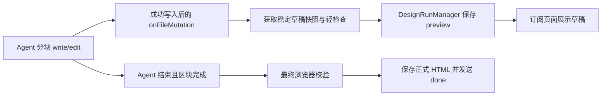

# Design 页面渐进生成方案

日期：2026-10-23。状态：两阶段实现已落地，含生成期间 Tweaks；具体行为与验证见 [实现说明](design-progressive-generation.md)。以下保留原方案及设计取舍，性能目标尚待真实模型采样。

## 1. 建议与目标

采用「完整 HTML 骨架 → 按语义区块增量写入 → 草稿持续预览 → 校验后定稿」。继续交付现有单文件 HTML，复用 Agent Runtime、DesignRunManager、SQLite 会话与 iframe 预览。

第一阶段通过现有 write_file / edit_file 和 onFileMutation 完成；第二阶段再把区块更新改为 iframe 内局部更新。这样可以先交付逐步出现的页面，再改善刷新时的闪烁与状态保持。

Tweaks 同步纳入改造：新协议由模型声明参数及绑定，宿主提供参数面板与通用运行时，微调值单独持久化。生成按区块更新、微调按属性更新，复用同一套预览身份与版本机制。详见第 10 节。

需要分别优化两个时间：

- **首个有效区块可见时间**：用户何时看到包含实际内容的导航、首屏或主要工作区。骨架出现单独计时，不把空占位当成有效设计。
- **整页完成时间**：从开始执行到全部内容生成、校验、保存完成。分批本身会增加模型与工具往返，不能承诺自动缩短总耗时。

## 2. WorkBuddy 借鉴点

本地参考：`/Users/liuxuyang/Downloads/workbuddy-design`。

| 参考机制 | 当前项目中的对应做法 |
| --- | --- |
| batch_edit 每批最多 25 个操作，按逻辑区块拆分 | 每次提交一个可预览区块；长页面通常拆成 4–8 批，小表单允许一批完成。25 是对方画布工具的限制，不照搬到 HTML |
| structure → content → style → verify | 先确定全页结构和视觉 token，再按区块完成内容与样式，最后统一校验 |
| 每批成功后保留已经完成的画布状态 | 每次成功写入后发布草稿快照，后续失败保留上一份可预览状态 |
| T1–T5 分级校验与修复收敛 | 中间批次做轻检查，整页完成运行现有浏览器校验，避免每批打开隐藏窗口 |

依据是 `skills/ardot-design-core/tool-usage/batch-edit.md`、`workflows/ardot-workflow.md`、`rules/design-rules.md`。这些 skill 描述的是分批操作契约；缺少 WorkBuddy 编辑器实现和性能日志，无法据此确认其实际渲染延迟。

## 3. 当前首屏为什么要等

以下结论来自当前分支代码，尚未进行真实模型性能采样。

| 位置 | 当前行为 | 影响 |
| --- | --- | --- |
| `src/main/ipc/design.ts:277–282`、`:2477` | 提示词优先要求一次 write_file 写完整产物；仅过大时才允许骨架加分块写入 | 分段生成没有成为默认工作流 |
| `src/main/ipc/design.ts:3690` 附近 | onFileMutation 只把 wroteCandidateDraft 设为 true | 已写出的内容不会立即成为预览 |
| `src/main/ipc/design.ts:4080`、`:4134`、`:4162` | 等 runDesignAgentOnce 返回，再读取候选产物、浏览器校验，最后发送 done + html | 即使中途已经写出骨架或区块，也要等待全流程结束 |
| `src/main/services/design/run-manager.ts:320` 附近 | 只有 done 分支更新 state.html | 现有 100 ms 消息推送只更新执行记录，没有中间页面状态 |
| `src/renderer/src/components/design/DesignView.tsx:4768` | generating 且 html 为空时只显示「正在生成方案」 | 首次生成没有可见页面 |
| `src/renderer/src/components/design/DesignView.tsx:4936` | iframe 的 key 依赖 reloadKey，页面来自 srcDoc | 若直接按 token 更新 html，会频繁重新加载整个文档 |

因此，单改提示词或者加快消息推送都不够；需要同时改生成约定、草稿事件和预览状态。

## 4. 用户看到的过程

以 Dashboard 为例：

1. 整理必要上下文，确定主题、导航和主要区块；不新增一轮让用户确认的规划问答。
2. 出现整页骨架：背景、侧栏、顶部栏、主要内容区域与占位。
3. 首屏内容出现：标题、关键指标和主要操作完成。
4. 图表区出现，随后是表格或其他次要内容；每完成一块就刷新。
5. 显示「正在检查页面」，完成校验后开放完整交互与编辑。

状态条使用「首屏已完成 · 正在生成图表 · 2/5 区块」，不根据模型 token 数推算百分比。图片先保留固定尺寸占位，资源完成后替换，避免等待图片阻塞主体布局。

新建页从骨架开始；修改现有页时先展示旧版本，在新草稿可预览后切换。生成过程中可以滚动查看，修改、批注和 Tweaks 等写操作等定稿后开放，避免用户编辑与生成互相覆盖。

## 5. 第一阶段：分段文件写入与草稿快照

### 5.1 生成约定

仅对支持此协议的 HTML 生成启用渐进模式，导入与图片生成继续沿用现有路径。

- 第一次 write_file 写出**闭合且可独立加载的 HTML 骨架**，包含基础 token、布局和稳定区块 ID。
- 骨架只包含必要的共享样式，不要求先生成整页所有 CSS。先完成首屏，再完成后续区块。
- 后续使用 edit_file 替换唯一的区块占位；每次成功写入后的文件仍然是完整 HTML。
- 一批按语义区块组织，不拆成每个按钮、每条文字一次工具调用；小页面可以直接一次完成。
- 大体视觉系统在开始时固定，后续区块复用 token，减少最后全页返工。
- 交互脚本集中在末尾补齐，最后移除所有生成中标记。

建议预留专用标记：

```html
<!DOCTYPE html>
<html lang="zh-CN">
<head><!-- 基础 token 与共享样式 --></head>
<body data-design-build="building">
  <header data-design-section="header" data-design-pending></header>
  <main>
    <section data-design-section="overview" data-design-pending></section>
    <section data-design-section="charts" data-design-pending></section>
    <section data-design-section="table" data-design-pending></section>
  </main>
</body>
</html>
```

`data-design-section` 是稳定寻址信息；`data-design-build`、`data-design-pending` 是临时构建状态。完成区块时替换占位并移除其 pending；全部完成后移除 building 标记。宿主记录首份骨架的预期区块集合，定稿时检查这些区块仍然存在且已经完成。

**必须新增最终完成判定。** 当前 isCompleteHtmlDocument 只检查文档开头与闭合，骨架也会通过。渐进模式应使用 isFinalizableDesignDraft：文档完整、预期区块齐全、没有 building/pending 标记，且 Agent 已结束本轮生成，然后才进入最终浏览器校验。continuation、write recovery、auto fix 和旧产物兜底都必须遵守同一个判定，避免把骨架或旧版本报告为本轮成功。

### 5.2 写入后的发布流程



复用 onFileMutation；该回调在 local-sandbox 的成功 write/edit 之后触发，不需要监听整个工作区目录。

具体约束：

1. 只处理本次执行所属的候选草稿路径。相对路径以 runtime workspace 解析，并沿用文件访问边界。
2. 回调只安排快照任务，不阻塞文件工具。通过文件锁或稳定读取检查，避免读到下一次 edit 的中间状态。
3. 合并短时间重复变更，初始可设 150 ms 节流；保留首批和最后一批，按实测调整。读取结果计算 hash，相同内容不重复发布。
4. 每份快照携带 runId、递增 revision 与草稿路径版本。异步读取返回后再次检查，旧 run、旧候选文件或旧 revision 的结果丢弃。
5. 轻检查只确认文档可解析、所需结构未被破坏、没有控制 token；允许合法 pending。失败时继续保留上一份可预览草稿，不打断生成。
6. 通过现有管理器保存后发布，复用其会话隔离、订阅、排队和取消机制。

恢复流程会更换 candidateDraftPath，需要同时使旧读取任务失效，并把新候选路径绑定到当前执行。不能只在初次 runtime 创建时捕获一次路径。

### 5.3 增加草稿状态，保留正式产物

新增事件和状态示意，具体类型放在共享协议中：

```ts
type DesignPreviewEvent = {
  type: "preview"
  runId: string
  revision: number
  html: string
  draftPath: string
  phase: "scaffold" | "sections" | "validating"
  completedSections: string[]
  totalSections: number
}

type DesignDraftPreview = Omit<DesignPreviewEvent, "type"> & {
  status: "building" | "incomplete"
}
```

- `state.html`、`artifactPath` 继续代表已经定稿的版本。
- `state.draftPreview` 保存当前草稿。由主进程写入，UI patch 不得伪造；运行开始时清理上一次草稿。
- preview 不更新正式文件、apiHistory、成功文案或版本历史，不把 generationState 改成 done。
- 现有 session seq 负责整个会话的更新顺序；runId + revision 负责草稿身份与顺序。
- 完成时在同一会话事务里更新正式状态、清理活动草稿、结束任务。保持现有最终校验门槛。

首版只在有意义的区块更新时保存完整草稿快照，复用现有 SQLite 快照与事件机制。记录快照大小、序列化、数据库写入和 IPC 耗时；若放大明显，再把事件日志改成 revision/hash 引用，避免重复存储整份 HTML。不能每个 token 都持久化、广播一份完整文档。

### 5.4 预览接入

DesignView 通过统一 selector 选择可见内容：当前生成中的有效 draftPreview → 正式 state.html → 空状态。相关 previewVisible、容器尺寸测量和加载文案一并改用这个 selector。

第一阶段仍使用 srcDoc，在区块提交时刷新一次；刷新前记录并恢复滚动位置、缩放和活动方案。保留旧 iframe 的显示直到新文档可展示，减少白屏。现有异步资源内联逻辑也要加入 runId/revision 校验，防止旧文档处理结果覆盖较新的草稿。

草稿使用独立的静态预览构建路径，业务脚本在定稿时再执行。由 JavaScript 生成的图表或 Canvas 在草稿中先显示占位；最终页面继续使用现有完整交互预览。提示「生成中」放在宿主 UI，避免进入导出源码。

此阶段会有区块级的文档重载，已能实现逐步呈现；如果验收要求全程没有文档重载，则第二阶段也属于交付范围。

### 5.5 停止、失败与恢复

| 情况 | 行为 |
| --- | --- |
| 用户离开页面或切换会话 | 任务继续，回来读取最新草稿快照 |
| 用户停止或任务失败 | 保留最后一份可预览草稿，标记 incomplete；已有正式版本继续保留 |
| 旧模型、旧文件读取或旧资源处理结果迟到 | 根据运行身份和 revision 丢弃 |
| 应用退出或崩溃 | 复用 interrupted 机制，恢复已持久化的草稿；不自动重跑模型 |
| 最终校验失败 | 保留草稿预览，显示失败原因；不覆盖正式产物 |
| 导出 | 默认导出已定稿版本；无定稿版本时提示尚未完成，不静默导出骨架 |

当前错误分支可能执行 rollback，需要显式保留本轮最后可预览草稿，避免整体回滚把它一并抹掉。保留草稿不等于实现断点续跑；继续生成可作为后续独立能力。

## 6. 第二阶段：保持 iframe，局部更新区块

保留第一阶段的源文件与快照作为事实来源，传输和预览逐步变成局部更新：

- iframe 初次加载宿主控制的 preview runtime，后续按稳定 section ID 替换对应 DOM，并更新受管样式。
- 支持 replaceSection、setTokens 等有限操作；不支持模型通过更新消息执行任意脚本。交互脚本在最终完整文档加载时运行一次。
- 消息包含 runId、baseRevision、revision，校验来源窗口与消息身份，iframe 返回 applied ACK。
- 宿主记录已确认 revision。缺失 ACK、基线不匹配或 iframe 重建时，以完整草稿快照恢复，不依赖重放每条补丁。
- 原有滚动、缩放和未改区块 DOM 得以保留；定稿时执行一次完整加载以启用业务交互。

长期若需要 WorkBuddy 那种节点级编辑体验，再考虑封装设计专用提交工具，提供显式批次与事务。它不是本次逐步刷新页面的前置条件。

## 7. 同时控制总耗时

分段会增加串行调用，以下措施用于避免总耗时明显恶化：

- 在同一次 Agent 执行中连续调用工具完成多个区块，不为每个区块新建 Agent、重置线程或重新注入全部上下文。
- 首屏优先；必要上下文读完即可搭骨架，后续按需读取领域材料。减少重复读文件的效果需要埋点验证。
- 共享样式和 token 复用，重复内容通过已有组件结构和数据表达，减少模型输出体积。
- 每批合并相邻小区块，允许简单页面一次完成；不固定执行所有阶段和所有校验。
- 中间批次不运行现有隐藏浏览器完整校验；定稿运行一次，失败后沿用现有一次自动修复。
- 将「合法 pending」识别为仍在构建，不能触发换新文件从头生成。区分有内容进展、读取/解释活动与停滞；不要把任意工具调用都当成设计进展。
- 当前有 30 次 continuation、2 次 write recovery、模型请求层最多 11 次尝试等上限。先统计各层实际触发和耗时，再按故障原因处理，避免简单下调阈值导致原本可完成的页面失败。

## 8. 改造落点

| 文件或模块 | 改造内容 |
| --- | --- |
| `src/main/ipc/design.ts` | 渐进生成提示词、onFileMutation 接入、候选路径切换、最终完成判定、done 发布 |
| 新增 `src/main/services/design/draft-preview.ts` | 稳定读取、合并/hash、轻检查、草稿进度提取、迟到任务丢弃 |
| `src/shared/managed-design-session.ts` | preview 事件及草稿状态契约，与既有 seq 机制衔接 |
| `src/renderer/src/components/design/types.ts` | TabState 的 draftPreview；主进程拥有该字段 |
| `src/main/services/design/run-manager.ts` | preview reducer、持久化、终态清理、rollback 保留草稿 |
| `src/main/services/design/session-store.ts` | 复用 JSON 状态保存草稿，处理旧记录缺少新字段的默认值 |
| `src/renderer/src/components/design/DesignView.tsx` | 选择可见草稿、区块进度、滚动恢复、隔离草稿和编辑、异步版本检查 |
| `src/renderer/src/lib/design-html-srcdoc.ts` 或独立草稿 builder | 草稿静态展示与正式交互预览分别处理 |
| 第二阶段新增 preview runtime | 区块补丁、ACK、版本校验与完整快照恢复 |
| 新增宿主参数面板、Tweaks runtime 与 HTML source adapter | 声明式参数控件、属性级更新、微调状态保存，以及导出/下一轮生成时合成有效源码 |

仓库已有未跟踪的 `src/shared/design-protocol.ts` 和多框架协议草案；本方案以当前实际 HTML 路径为基础，不把这些草案当成已落地能力。后续 React/Vue 应使用各自的编译与预览适配器。

## 9. 验收与推进顺序

先埋点记录：排队结束/开始执行、首次模型输出、首次文件写入、骨架可见、首个有效区块可见、最后区块可见、校验起止、最终完成。预览渲染的耗时由渲染进程确认，不能以主进程 send 时间代替。需求问答、排队、模型执行分别计时。

同一模型、相同输入与配置，对 Dashboard、长落地页、简单表单、现有页面修改分别采样，比较 P50/P95、模型输入输出 token、调用次数、失败率。

建议先以这些目标试验，再根据基线确定正式指标，以下不是已测结果：

- 较复杂页面：首个有效区块的等待时间压到旧版整页完成等待的 30% 左右。
- 本地「成功提交 → 对应预览可见」P95 争取控制在 500 ms 内，记录大文档例外。
- 整页完成耗时 P50 不超过旧版约 1.15 倍；若不满足，优先合并批次和减少重复上下文，而不是只追求更新次数。
- 中断、切换、迟到事件和最终校验失败均不覆盖已有正式版本；骨架不能被当成成功产物。

实现时补充有意义的集成用例：成功写入才推送、非法草稿不替换上一版、重复 hash 去重、乱序/旧 run 丢弃、切换会话恢复、取消后的迟到读取、rollback 保留草稿、带 pending 的骨架不能定稿、旧产物兜底不能假成功、最终 scripts 只在定稿预览执行。

复用 `npm run test:design-sessions`、`npm run test:design-html`、`npm run typecheck`、`npm run build` 做回归，并用真实模型验证提示词是否稳定分批。

推进顺序：先把 preview 事件从成功文件写入贯通到页面；再切换渐进提示词与最终完成判定，补齐终态和恢复；测量首屏与总耗时；最后按体验要求实施 iframe 局部更新。

## 10. Tweaks 配套改造

### 10.1 当前能力与改造目的

当前已经支持即时修改 DOM，不需要让模型重新生成才能改变颜色或字号。需要调整的是生成责任、状态保存与预览更新之间的关系：

- `src/main/ipc/design.ts` 的 Tweaks 提示词要求每个页面都由模型编写参数默认值、iframe 内控件面板、postMessage 监听器和 applyTweaks；这些重复代码会增加模型输出。
- `DesignView.tsx` 的 `__edit_mode_set_keys` 分支通过 mergeEditModeKeys 修改 HTML 中的 EDITMODE 默认值，再更新页面状态并安排文件保存。参数编辑与整份预览源码绑定，会进入 srcDoc 更新链路。
- `ensureEditMode` 在协议缺失时推导参数、注入脚本。若对每个中间草稿重新推导，参数定义可能随区块出现而变化。
- 名为 `TweaksFloatingPanel.tsx` 的现有组件实际上负责方案切换；它不是通用参数编辑器。新参数面板应单独实现，避免混淆两个职责。

目标是：用户拖动滑块即时看到局部变化；刷新草稿、重新打开页面和下一轮 AI 修改都保留该值；模型不必为每个页面重复生成面板和通用通信代码。

### 10.2 声明参数，宿主负责控件和执行

新 HTML 协议由模型生成 defaults、schema 和 bindings。宿主基于 schema 展示颜色、数字、文本、布尔值和选项控件，并注入固定版本的 runtime。

参数声明示意：

```json
{
  "defaults": { "primaryColor": "#2563eb", "radius": 12, "ctaText": "开始使用" },
  "schema": {
    "primaryColor": { "type": "color", "label": "主色" },
    "radius": { "type": "number", "label": "圆角", "min": 0, "max": 32, "step": 1 },
    "ctaText": { "type": "text", "label": "按钮文案", "maxLength": 30 }
  },
  "bindings": {
    "primaryColor": [{ "type": "css-var", "name": "--primary" }],
    "radius": [{ "type": "css-var", "name": "--radius", "unit": "px" }],
    "ctaText": [{ "type": "text", "selector": "[data-design-tweak='ctaText']" }]
  }
}
```

bindings 是待新增的契约。首版支持 CSS 变量和指定文本节点；文本绑定要求目标为专用叶子节点，使用 textContent，避免覆盖按钮里的图标等子节点。所有可调样式必须真实引用对应变量，不能仅声明参数却没有效果。数字单位、范围与文案长度由 schema/binding 明确，不依赖运行时猜测。

第一批骨架即可声明全局 token；区块参数随对应区块完成后出现。运行过程中保持 key 和已有参数类型稳定，禁止每批重新推断、重命名或重置全部 defaults。已选设计系统的约束用于限定可开放参数及范围。

新的 v2 HTML 不再要求模型生成通用面板、监听器与 applyTweaks。宿主在最终校验前补入确定的独立运行代码；普通导出页能自行初始化有效参数，不依赖编辑器在线，也不携带宿主参数面板。

### 10.3 分开保存模型默认值与用户修改

建议状态分为：

```ts
type TweaksState = {
  defaults: Record<string, string | number | boolean>
  overrides: Record<string, string | number | boolean>
  revision: number
}
// current/effective 是派生结果，不作为另一份独立事实来源。
const effective = { ...defaults, ...overrides }
```

- 模型维护 defaults 与绑定；主进程维护用户 overrides。后续模型区块不能隐式覆盖 overrides。
- 重置某参数时删除对应 override，恢复该版本模型的默认值；支持一次操作的撤销与重做。
- 第一版多方案采用 shared 参数作用域，与已有多框架草案保持一致；不要隐式混用全局和单方案值。
- 参数 key 被移除或类型变更时，旧 override 暂存为不兼容项并提示，不把它错误应用到其他属性。
- 用户明确要求 AI 修改已调过的同一参数时，按本轮明确指令更新或清除该 override；其他值继续保留。不能用一条“用户 override 永远优先”的规则阻止后续明确修改。

主进程的会话存储是微调状态的事实来源，artifact.json 可作为文件侧投影。拖动时先乐观更新预览，参数变化合并后保存；松手、失焦、导出、开始新一轮生成时提交最后一次值。保存失败应显示未保存并允许重试，不能把即时显示当成已经持久化。

参数更新不修改 state.html 或 reloadKey，不在每次 input 时重写整份 HTML。正式产物的有效状态由“已定稿源码 + 已保存 overrides”构成；需要独立源码时再由 adapter 合成。

### 10.4 属性更新与区块刷新如何配合

```text
参数控件变化
  → 合法性检查与有效值合并
  → runtime 修改 CSS 变量 / 指定文本节点
  → 立即显示
  → 主进程合并保存 overrides
```

沿用多框架草案提出的 `__design_set_tweak_keys` 等 v2 消息命名，补充 previewInstanceId、artifactRevision、tweakRevision 和应用确认消息。宿主及 runtime 校验消息来源；迟到 iframe 的参数事件不能修改当前设计。

参数消息与结构消息维护独立的 revision：更新颜色无需让所有区块补丁的基线失效；替换区块后必须重新应用最新 effective 值。iframe 重载、握手恢复和完整快照恢复后也做相同处理。传递完整有效参数或在 runtime 内累计合并，避免只合并 defaults 与本次 edits 导致其他已调参数被重置。

首版继续在生成期间关闭参数写操作，完成后开放宿主面板；这与前述静态草稿预览一致。后续若开放边生成边微调，需要先接入宿主控制的草稿 runtime：只开放稳定全局 token 和已完成区块参数，未生成区块显示待就绪；结构新增、删除、布局重排仍走 Agent 区块生成。生成失败时本轮参数保留在对应草稿分支，不能自动污染之前的正式版本。

### 10.5 下一轮生成、校验与导出

开始下一轮 AI 修改前，宿主先提交待保存参数，用 HTML adapter 生成包含当前 effective 值的源快照，同时传入参数 schema/overrides。currentHtml 与 sourceArtifactPath 必须指向同一份有效版本，不能出现聊天中传了新值、模型读文件却看到旧值的情况。

输出定稿前，先合并仍兼容的 overrides、注入 runtime，再运行现有浏览器校验，并检查参数绑定是否存在及类型/单位是否合法。需要抽查非默认值是否产生预期效果；仅有声明而绑定无效不能算通过。保存、导出和后续生成使用同一 adapter，避免三个地方各自实现回写。

导出时把当前有效值固化为独立 HTML 的初始状态，移除宿主编辑 UI 和临时标记，保持原有业务脚本及交互。元素级样式编辑继续保留独立通道；逐步给它增加稳定节点 ID 与结构化 patch，不把所有元素属性强行当成全局 token。它与全局 Tweaks 编辑同一属性时应明确采用局部覆盖或重置继承，不能留下无法解释的样式优先级。

### 10.6 协议兼容与实施顺序

已有 `docs/design-multi-framework-tweaks-protocol.md` 与未跟踪的 `src/shared/design-protocol.ts` 已提出 defaults/current/schema 及 v1/v2 的方向，但尚未接入当前 HTML 主路径。本节在该方向上补足 overrides、bindings 和渐进预览协作机制，实现时统一协议定义，不另外引入互相竞争的版本体系。

存量 v1 的 EDITMODE 标记和旧消息继续走原适配器；新的宿主面板先服务 v2，避免同时出现宿主与 iframe 两套参数面板。自动兼容解析不等于自动重写旧页面的应用逻辑。新协议 runtime 就绪后再切换生成提示词，保证新产物仍可交互和独立导出。

建议随第一阶段交付：独立 Tweaks 状态、宿主参数面板、固定 runtime、下一轮生成/导出适配，以及“不因微调重新加载 iframe”的回归测试。生成期间微调、区块替换后重新应用参数放在第二阶段完成。

新增验收例子：连续修改主色与圆角互不重置；拖动滑块不重建 iframe；重开页面和导出保持当前值；AI 增加表格后仍保留调好的主色；明确要求 AI 改主色能更新旧 override；切换会话后旧消息无效；保存失败可恢复；v1 历史产物仍能使用。
