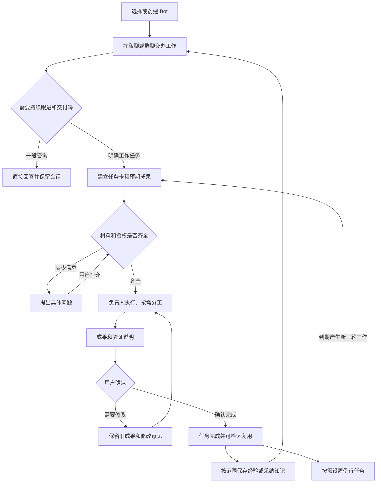

# beta 客户端与 integration 后端功能闭环设计

> 历史方案，2026-10-19 已由 `M05-beta-local-unification-design.md` 替代。用户明确保留 beta 全功能及本地业务数据/Runtime，独立任务放右侧；Java 仅渠道接入，本轮可 mock，真实后端以后合入 LF39 IM 工程。下文 Java 业务权威及强制成果确认/退回流程不再作为实施依据。

保留 beta 的 Bot 工作区、私聊、群聊、文件、浏览器、记忆和例行任务体验，以 integration 的 Java 服务承接身份、权限、任务、执行记录和正式专家知识。融合后的核心用户流程是：**找到合适的 Bot → 交办工作 → 澄清或协作 → 获得成果 → 确认或退回修改 → 在后续任务中复用成果与经验。**

本方案依据 2026 年 10 月 18 日核对的代码快照：beta `91554cbc7df0b78e37c48d31b72628c16662911a`，integration `d76f30201b8bca9cdf9d26daed1c710ce8c3c1aa`。以下“现有”指该快照中的实现，“建议”与目标流程属于待实现设计。本次为源码功能梳理，未对新融合链路进行端到端验收。

## 产品主线

用户继续通过 beta 的对话界面使用 Bot。服务端的任务和权限通过任务卡、工作记录、可用状态体现，无需把 integration 的本地测试面板搬进来。

需要明确三个产品对象：

| 对象 | 用户理解 | 功能边界 |
| --- | --- | --- |
| Bot | 有长期职责、能力和记忆的工作伙伴 | 一个 Bot 可处理多件事；改职责不能悄悄改掉正在处理的任务要求 |
| 会话 | 与 Bot 或一组 Bot 交流的地方 | 同一会话可以讨论多个任务；历史消息不会自动全部成为当前任务材料 |
| 任务 | 一件可以持续跟进、有明确结果的工作 | 包含目标、材料、负责人、进展、成果和确认记录，可跨多轮交流和多次执行 |

beta 的 `BotTask` 主要是一次排队输入或执行，integration 的 `Task` 才接近上述持续工作对象。不能直接把前者的“已完成”显示成业务任务已验收。integration 当前虽然创建多个阶段记录，但业务实现仍限定在文本需求阶段；通用工作任务、成果确认和跨阶段流转需要补齐。[B1][I1]

## 当前代码的功能基础

| 功能 | beta 已有 | integration 已有 | 融合后尚缺的闭环 |
| --- | --- | --- | --- |
| 创建和维护 Bot | 名称、职责、模型、外观、归档、删除；自然语言维护相关工具 | Bot 身份、维护者、不可变配置版本、能力范围 | 多 Bot 列表与管理接入、可用状态、归档与历史保留、版本变化的用户反馈 |
| 交办与追问 | 私聊、引用、附件、运行中补充、最近工作 | 任务编号、目标、澄清消息、版本、事件 | 会话中明确关联任务；保存消息与启动执行形成一次完整操作 |
| 实际工作 | 真实模型、文件和命令工具、浏览器、人接管、后台工作 | 指定节点、授权、心跳、排队、领取、结果持久化 | 真实执行接入服务端任务，澄清、审批、停止和恢复的统一状态 |
| 多 Bot 协作 | 群聊、@、定向委派、协作回执、已验证文件回传 | Group 的人类成员、角色、Bot 版本绑定、限额 | 谁负责最终交付、协作任务如何汇总、失败怎么处理、成果由谁确认 |
| 成果交付 | 附件、文件预览、导出、实际文件验证 | 文本分析结果持久化 | 不可变成果版本、确认与退回、修改后再次交付 |
| 长期记忆 | 私有记忆管理和分享、成功回合后的自动提取及独立模型校验 | 维护者手工专家知识、版本、执行时冻结 | 私有偏好与共享知识的边界、候选采纳、修改或遗忘的效果 |
| 例行任务 | 一次、每日、每周、间隔执行；触发记录和静默结果 | 可复用的任务、节点与执行控制 | 每次触发的完整业务记录、离线策略、授权失效提示与通知策略 |
| 需求到设计 | 通用 Bot 可产出资料和文件 | 独立需求、PRD、设计界面已合入 | 已确认 PRD 交给设计、设计反馈回到任务、开发交接的完整链路 |
| 重启和查询 | 本地持久化、收件回执、中断和结果未知状态 | 服务端业务记录、本地 attempt 记录、结果重复回传保护 | 用户重开 App 后看到同一任务的真实进展和可用成果 |

beta 的新提交已经加强了协作输出文件验证，以及自动记忆的“提取后再校验”。不能继续把它描述成只返回一段协作文字，或完全不校验就写入记忆。但文件引用仍指向当前工作区，模型校验也不等于共享知识获得维护者确认。[B2][B3]

integration 的当前伙伴页面明确是模拟测试：发送仅保存，点击分析才运行，固定模拟模型、一次调用、零工具。服务端基础可以复用，当前页面的限制不能直接成为融合产品的使用方式。[I2][I3]

## 完整用户流程

### 创建并使用一个 Bot

用户设置名称、职责和模型，按需指定资料及可用工具，随后进入原有聊天界面。默认自己是维护者与任务确认人，执行设备默认为当前电脑；只有共享使用或更换设备时才需要调整这些关系。

现有 beta 已有较完整的创建、编辑和会话入口；integration 能保存维护者、版本和授权，但当前开发控制器围绕一组 Bot/Group 配置工作，公共业务操作也没有完整的列表、改名、归档与删除接口。[B1][I4][I5]

建议补齐以下产品行为：

- 清楚区分“已创建”“可以工作”“等待启用设备”“需要重新授权”。名称出现在侧栏，不代表已经能够执行。
- 名称、头像等展示变更及时生效；职责、模型、工具范围影响后续执行，正在进行的工作显示实际使用的配置。
- 保留 beta 的归档与删除入口。服务端管理的 Bot 停用后不再接新任务，历史任务、成果和确认记录仍可查；删除与个人隐藏分开处理。
- 自然语言创建或调整 Bot 继续可用，但必须调用同一套管理能力，且由具有维护权限的人发起。

验收场景：创建两个不同职责的 Bot，重启后仍可选择；编辑其中一个不改变另一个；停用后不再派发新工作，旧成果仍能打开。

### 从对话形成可持续跟进的任务

建议保留自然对话：一般问答直接回答；明确交办工作时，在会话中生成轻量任务卡；无法判断是否需要持续跟进时，提供“作为任务跟进”，不要强制用户填写项目表单。

例如“根据这些资料整理需求说明，给出业务规则和待确认事项”形成任务。之后“补充退款规则”应关联同一任务，用户可以通过任务卡或引用明确关联。若会话中有多个未完成任务，不能仅凭最近消息把补充写入错误任务。

任务卡首版只需显示：目标、负责 Bot、预期成果、当前状态、下一步动作。确认人默认是发起人；多人协作时再提供改派。材料和验收要求可从交办文字中提取，缺少关键条件才提问。

beta 已有消息回执、引用与运行中补充，integration 已有任务和澄清消息。融合时应让用户的一次“发送”同时完成必要的任务保存与执行派发；页面可以明确显示“已保存，等待执行”。不能要求普通用户再输入 `TASK-编号` 并点击一次“分析需求”。[B1][I2]

验收场景：交办一次工作、连续补充两次要求，始终属于同一任务；发送响应丢失后重试，不生成重复任务；另开一件工作时不继承前一任务的私有材料。

### 执行中能补充 能干预 能理解阻塞

beta 已有流式过程、工具执行、等待用户输入、浏览器接管、停止与运行中补充。这些都是融合后应保留的使用能力。integration 当前执行器只能完成受限文本分析，真实模型和工具接入是首个闭环的必要工作。[B4][I3]

建议将业务任务状态设计为：**待开始 → 进行中 → 待确认 → 已完成**，并允许进入“待补充”“受阻”“已取消”。等待电脑上线、授权过期、文件不存在分别展示具体原因与处理入口。底层一次运行的排队、失败或中断保留在执行记录中，不直接替代业务任务状态。

用户补充要求时，应显示“已纳入本次工作”或“将在下一次执行处理”。已完成的结果不能被悄悄改成采用新要求生成。浏览器需要人工登录时，保留 beta 的接管和交还过程；信息确认、工具授权、成果验收应使用各自明确的文案。

停止后显示是否已停止执行，以及已经产生的文件或外部结果。结果无法确认时提供核对入口，不能把重试解释为无条件从断点继续。integration 目前仅能直接取消尚未领取的排队任务，运行中的统一取消需要扩展。[I6]

验收场景：执行中补充一条要求，最终结果能说明是否采用；等待人工操作时其他可独立工作仍能推进；停止和重开 App 后，状态与实际执行一致。

### 多 Bot 协作围绕同一件成果收束

保留 beta 群聊、@、引用、文件和成员展示。beta 当前的群是本地用户与多个 Bot 的会话，integration 的 Group 同时承担人类成员、角色和 Bot 版本关系；两者需要明确关联，不能因为都叫 Group 就视为已接通多人协作。[B1][I5]

建议每个需要综合交付的任务指定一个负责 Bot。其他 Bot 的工作形成有来源的协作事项，包含目标、输出要求、进度和回传结果。单纯同时咨询多个 Bot 可以保留多方回答；需要一个综合成果时，由负责 Bot 汇总并交付。

beta 已实现委派、回执、声明输出文件及完成时文件验证，私聊协作结果也能回传已验证的文件引用并导入交付。应直接保留这部分能力，补上业务任务层的关联和收束规则。[B2][B4]

需要补齐：关键协作未完成时不能将总任务标记完成；协作者失败时，负责 Bot 应说明影响并选择继续、重新分配或交给用户决定；修改意见回到相应协作事项；成员变更后只继续允许的工作。

验收场景：需求 Bot 邀请技术 Bot 补充可行性意见，最终只交付一份可确认的需求说明；技术 Bot 失败时总任务能展示阻塞；协作文件确实能够打开，相关任务和版本可以追溯。

### 成果交付 确认与修改构成核心闭环

这是最优先补齐的功能。beta 能交付实际文件，但引用仍指向可继续修改的工作区文件；integration 保存分析文本，却明确不接受 Task 的非空成果版本引用，尚没有实际的成果确认与阶段流转业务实现。[B2][I1]

建议任务交付时生成成果卡，包含成果本身、版本、来源任务、完成说明、验证依据和未完成项。文本回答可作为文本成果，文档和代码按其实际交付方式保存。第一版至少做到单机可持久保存的成果快照；若文件只在某台设备上，页面明确说明可用范围。

成果卡提供“确认完成”“提出修改”“继续交给其他 Bot”。提出修改后保留旧版本和反馈，新的执行产生新版本，再次进入待确认。确认操作指向具体成果版本，不能只确认一个随后还会变化的文件路径。

简单咨询可以直接结束；明确要求交付的工作在用户确认前显示“待确认”。不把所有聊天都变成审批流程。成果确认也不等于允许自动发布、发送到外部系统或部署，这些按具体工作要求另行执行和回执。

验收场景：生成 v1 → 用户提出修改 → 生成 v2 → 用户确认 v2。v1、修改意见和 v2 均可回看；工作区文件后续变化不改变已确认版本；缺少预期文件时不能显示完整交付成功。

### 经验沉淀后能在正确范围复用

beta 当前的自动记忆已要求从用户表达中提取持续有效的信息，并在写入前进行独立模型校验，手工编辑版本变化也会阻止过时结果覆盖。integration 的专家记忆是维护者手工管理的正式知识，有版本与执行快照。[B3][I7]

建议在保留现有记忆体验的基础上区分：

| 内容 | 保存位置与作用 | 生效方式 |
| --- | --- | --- |
| 当前任务事实与进度 | 任务材料、执行记录和成果 | 继续该任务时使用，不自动成为长期规则 |
| 个人长期偏好 | 当前使用者与 Bot 的私有记忆 | 保留 beta 的受控自动提取及编辑、删除体验 |
| 专家可共享知识 | integration 的正式专家知识 | 从任务提出候选，由维护者采纳或手工维护，再供授权任务使用 |

当一个 Bot 供多人使用时，私有偏好必须同时区分使用者，不能仅以 botId 区分。群聊不能默认读取个人 Bot 的私有记忆。知识候选应能看见原任务和原文依据，不要求用户重新抄写，也不把模型自己的总结当成已经验证的业务事实。

integration 当前对应记忆的任意版本变化都会让在途执行在续租或提交时失效。第一阶段保留这个行为并明确告知“知识已变化，需要重新分析”；不要将 beta 频繁的私有总结直接写进这个范围。后续再设计“普通更新供新任务使用，强制遗忘使在途任务失效”，并作为新的行为单独验收。[I8]

验收场景：保存一条个人偏好，下一次本人任务可使用，另一位使用者不可见；从已确认任务采纳一条专家知识，后续授权任务使用并显示来源；删除或停用后新任务不再采用。

### 例行任务每一轮都有结果和解释

beta 已有一次、每日、每周、间隔计划、暂停和删除，以及无实质变化时静默的结果策略。当前依赖 App 运行，睡眠或错过的间隔会合并处理；`lastTriggeredAt` 记录的是进入队列，不能当成执行成功。[B1][B5]

保留现有设置入口，补充每轮的任务记录、最近成功结果、失败原因和下一次执行时间。例行任务需要保存独立完整的目标、输入、输出及通知条件；每次触发产生独立的一轮工作，不能把昨日“已完成”的记录当成今日结果。

首版仍以当前电脑为执行设备，明确展示在线要求。具体计划应约定错过时跳过、合并补做一次或等待用户决定，不能暗中补做全部历史次数。需要人确认的例行成果进入待确认；允许自动结束的检查按预先设置的结果条件收尾。

例行触发也进入同一套任务控制。迁移一个计划后只保留一个触发来源，不能让本地与服务端各触发一次。全天候执行属于后续独立能力，不能仅靠接上 Java 服务宣称完成。

验收场景：一次触发对应一轮工作；无变化保持安静但可查执行记录；有异常才通知；离线恢复不重复执行；权限失效时给出可处理的提示。

### 需求 设计与开发逐步接成交付链

integration 已有需求、PRD 和设计界面，但“进入设计”的 selection 尚未被设计会话消费，正式发布器默认未注入。它们可作为现有能力接入，不能计入已完成的端到端流程。[I9][I10]

建议先完成“需求澄清 → 需求说明 v1 → 反馈修改 → 确认需求说明”。随后增加“将已确认版本交给设计 Bot”，自动携带目标、约束、验收要求和成果版本，而不是让用户重新复制粘贴。

设计任务产出设计说明或原型，再经过修改与确认，形成开发交接材料。某阶段提出新需求时，回到关联的需求任务修订，避免需求和设计各自修改却没有对应关系。通用 Bot 工作不必经过需求、设计、开发三个阶段，这是一种可选的业务流程。

验收场景：确认需求说明 v2 后进入设计，设计明确使用 v2；需求升级到 v3 时能识别设计材料基于旧版，并由用户决定是否重新处理；开发拿到的是明确已确认的需求和设计版本。

## beta 界面如何承载这些功能

保留左侧会话列表、中间聊天、右侧详情的结构：

- 左侧继续显示 Bot、群聊、未读、置顶与分类，增加清楚的可用或受阻提示。
- 中间保留流式聊天、引用、附件与接管提示，新增轻量任务卡、成果卡和确认或修改动作。
- 右侧把“最近工作”扩展为可进入的任务记录；职责、记忆、例行任务、文件、浏览器仍放在熟悉的位置。

先在当前会话内提供“进行中”“待我处理”“已完成”的任务筛选。用户需要跨会话跟进时，再汇总成“我的任务”；不必先建设复杂项目看板。

服务端管理的 Bot 在页面上使用同一套身份和名称。导入旧的本地 Bot 时，用户明确选择接入范围，旧聊天和文件可以继续查看；已经运行的任务先收尾，旧例行任务确认迁移后再切换。开发期间可保留未迁移的本地 Bot，但必须能识别其管理范围，不能把本地保存显示成已同步服务端。

## 首个可验收闭环

首个场景建议选择：**用一个需求 Bot，根据用户提供的文本材料，生成一份可保存的需求说明，经历一次修改后确认完成。** 这同时覆盖真实模型、任务关联、持久化结果、文件交付和用户确认，又不依赖多个 Bot、外部发布或云端设备。

操作顺序：

1. 在 beta 界面创建 Bot，能够再次找到，并显示可工作状态。
2. 输入“整理需求说明，包含业务规则和待确认事项”，自动形成任务卡并开始工作。
3. Bot 就确实缺少的信息提问，用户回复进入同一任务。
4. 真实模型生成可打开的说明文件，任务显示待确认。
5. 用户提出修改，保留 v1，交付 v2。
6. 用户确认 v2，任务显示已完成；重启 App 后仍可查看成果和确认记录。
7. 执行期间断网或设备离线，恢复后能区分已保存、尚未执行、结果待回传与结果未知，不重复制造成果。

这条链路打通，才能说明 beta 客户端与 integration 后端在功能上完成了首轮融合。仅完成登录连接、创建 Bot 或模拟分析不满足这一验收目标。

## 后续任务顺序

| 阶段 | 交付范围 | 完成标准 |
| --- | --- | --- |
| 第一阶段 | Bot 创建与选择、任务卡、真实执行、补充与停止、持久化成果、确认和修改 | 上述单 Bot 场景完整通过，基础聊天体验保留 |
| 第二阶段 | 群聊任务关联、负责 Bot、协作事项和成果汇总 | 多 Bot 共同完成一件任务，失败可处理，最终成果只有明确的确认版本 |
| 第三阶段 | 私有记忆与共享知识、例行任务统一记录 | 前次经验能在正确范围复用；每轮例行工作有结果且不重复触发 |
| 第四阶段 | 需求到设计与开发交接、真实 IM 入口、更多执行设备 | 同一任务和成果版本能跨入口延续，支持实际授权与交接 |

每一阶段都按用户完整场景验收。前三阶段复用并接通 beta 的既有功能，而不是将它们删掉后重新实现。未接通的功能在服务端管理模式下应明确可用范围，避免界面上可点击、实际仍写入另一套独立状态。

## 代码依据

- [B1 beta 功能契约与任务状态](https://github.com/seanchen1993/CmbCoworkAgent/blob/91554cbc7df0b78e37c48d31b72628c16662911a/src/shared/bots/contracts.ts)，[工作区与最近工作界面](https://github.com/seanchen1993/CmbCoworkAgent/blob/91554cbc7df0b78e37c48d31b72628c16662911a/src/renderer/src/components/bots/BotsWorkspace.tsx)。
- [B2 协作与文件工具](https://github.com/seanchen1993/CmbCoworkAgent/blob/91554cbc7df0b78e37c48d31b72628c16662911a/src/main/bots/tools.ts)，[完成与回执保存](https://github.com/seanchen1993/CmbCoworkAgent/blob/91554cbc7df0b78e37c48d31b72628c16662911a/src/main/bots/store.ts)。
- [B3 自动记忆提取与校验](https://github.com/seanchen1993/CmbCoworkAgent/blob/91554cbc7df0b78e37c48d31b72628c16662911a/src/main/bots/memory-summary-adapter.ts)。
- [B4 真实执行 补充消息 人工交互及成果校验](https://github.com/seanchen1993/CmbCoworkAgent/blob/91554cbc7df0b78e37c48d31b72628c16662911a/src/main/bots/runtime-adapter.ts)。
- [B5 本地调度与睡眠恢复](https://github.com/seanchen1993/CmbCoworkAgent/blob/91554cbc7df0b78e37c48d31b72628c16662911a/src/main/bots/host.ts)，[例行任务说明与静默规则](https://github.com/seanchen1993/CmbCoworkAgent/blob/91554cbc7df0b78e37c48d31b72628c16662911a/src/main/bots/prompt.ts)。
- [I1 任务当前仅支持文本协作](https://github.com/seanchen1993/CmbCoworkAgent/blob/d76f30201b8bca9cdf9d26daed1c710ce8c3c1aa/services/bot-control/src/main/java/com/devclaw/botcontrol/application/TaskApplication.java)。
- [I2 创建任务和分析的分离流程](https://github.com/seanchen1993/CmbCoworkAgent/blob/d76f30201b8bca9cdf9d26daed1c710ce8c3c1aa/src/main/services/bot/partner-dev-controller.ts)，[当前伙伴页面](https://github.com/seanchen1993/CmbCoworkAgent/blob/d76f30201b8bca9cdf9d26daed1c710ce8c3c1aa/src/renderer/src/components/customize/PartnerDevPanel.tsx)。
- [I3 模拟模型接入](https://github.com/seanchen1993/CmbCoworkAgent/blob/d76f30201b8bca9cdf9d26daed1c710ce8c3c1aa/src/main/ipc/partner-dev.ts)，[一次调用零工具的执行实现](https://github.com/seanchen1993/CmbCoworkAgent/blob/d76f30201b8bca9cdf9d26daed1c710ce8c3c1aa/src/main/services/bot/input-only-requirement-run.ts)。
- [I4 当前公共业务操作](https://github.com/seanchen1993/CmbCoworkAgent/blob/d76f30201b8bca9cdf9d26daed1c710ce8c3c1aa/services/bot-control/src/main/java/com/devclaw/botcontrol/application/Operation.java)。
- [I5 Bot 版本 维护者与 Group 成员](https://github.com/seanchen1993/CmbCoworkAgent/blob/d76f30201b8bca9cdf9d26daed1c710ce8c3c1aa/services/bot-control/src/main/java/com/devclaw/botcontrol/application/BotApplication.java)。
- [I6 Run 派发 结果与排队取消](https://github.com/seanchen1993/CmbCoworkAgent/blob/d76f30201b8bca9cdf9d26daed1c710ce8c3c1aa/services/bot-control/src/main/java/com/devclaw/botcontrol/application/RequirementRunApplication.java)。
- [I7 专家知识维护](https://github.com/seanchen1993/CmbCoworkAgent/blob/d76f30201b8bca9cdf9d26daed1c710ce8c3c1aa/services/bot-control/src/main/java/com/devclaw/botcontrol/application/ExpertMemoryApplication.java)。
- [I8 记忆冻结与变化检查](https://github.com/seanchen1993/CmbCoworkAgent/blob/d76f30201b8bca9cdf9d26daed1c710ce8c3c1aa/services/bot-control/src/main/java/com/devclaw/botcontrol/persistence/JdbcGroupMemoryStore.java)。
- [I9 需求进入设计尚未消费交接参数](https://github.com/seanchen1993/CmbCoworkAgent/blob/d76f30201b8bca9cdf9d26daed1c710ce8c3c1aa/src/renderer/src/components/design/DesignView.tsx#L4852)。
- [I10 正式发布器未配置时返回能力不可用](https://github.com/seanchen1993/CmbCoworkAgent/blob/d76f30201b8bca9cdf9d26daed1c710ce8c3c1aa/src/main/services/requirements/publisher.ts#L224)。

[B1]: https://github.com/seanchen1993/CmbCoworkAgent/blob/91554cbc7df0b78e37c48d31b72628c16662911a/src/shared/bots/contracts.ts
[B2]: https://github.com/seanchen1993/CmbCoworkAgent/blob/91554cbc7df0b78e37c48d31b72628c16662911a/src/main/bots/tools.ts
[B3]: https://github.com/seanchen1993/CmbCoworkAgent/blob/91554cbc7df0b78e37c48d31b72628c16662911a/src/main/bots/memory-summary-adapter.ts
[B4]: https://github.com/seanchen1993/CmbCoworkAgent/blob/91554cbc7df0b78e37c48d31b72628c16662911a/src/main/bots/runtime-adapter.ts
[B5]: https://github.com/seanchen1993/CmbCoworkAgent/blob/91554cbc7df0b78e37c48d31b72628c16662911a/src/main/bots/host.ts
[I1]: https://github.com/seanchen1993/CmbCoworkAgent/blob/d76f30201b8bca9cdf9d26daed1c710ce8c3c1aa/services/bot-control/src/main/java/com/devclaw/botcontrol/application/TaskApplication.java
[I2]: https://github.com/seanchen1993/CmbCoworkAgent/blob/d76f30201b8bca9cdf9d26daed1c710ce8c3c1aa/src/main/services/bot/partner-dev-controller.ts
[I3]: https://github.com/seanchen1993/CmbCoworkAgent/blob/d76f30201b8bca9cdf9d26daed1c710ce8c3c1aa/src/main/ipc/partner-dev.ts
[I4]: https://github.com/seanchen1993/CmbCoworkAgent/blob/d76f30201b8bca9cdf9d26daed1c710ce8c3c1aa/services/bot-control/src/main/java/com/devclaw/botcontrol/application/Operation.java
[I5]: https://github.com/seanchen1993/CmbCoworkAgent/blob/d76f30201b8bca9cdf9d26daed1c710ce8c3c1aa/services/bot-control/src/main/java/com/devclaw/botcontrol/application/BotApplication.java
[I6]: https://github.com/seanchen1993/CmbCoworkAgent/blob/d76f30201b8bca9cdf9d26daed1c710ce8c3c1aa/services/bot-control/src/main/java/com/devclaw/botcontrol/application/RequirementRunApplication.java
[I7]: https://github.com/seanchen1993/CmbCoworkAgent/blob/d76f30201b8bca9cdf9d26daed1c710ce8c3c1aa/services/bot-control/src/main/java/com/devclaw/botcontrol/application/ExpertMemoryApplication.java
[I8]: https://github.com/seanchen1993/CmbCoworkAgent/blob/d76f30201b8bca9cdf9d26daed1c710ce8c3c1aa/services/bot-control/src/main/java/com/devclaw/botcontrol/persistence/JdbcGroupMemoryStore.java
[I9]: https://github.com/seanchen1993/CmbCoworkAgent/blob/d76f30201b8bca9cdf9d26daed1c710ce8c3c1aa/src/renderer/src/components/design/DesignView.tsx#L4852
[I10]: https://github.com/seanchen1993/CmbCoworkAgent/blob/d76f30201b8bca9cdf9d26daed1c710ce8c3c1aa/src/main/services/requirements/publisher.ts#L224
