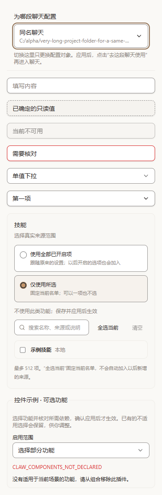
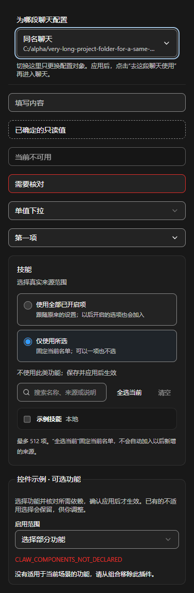
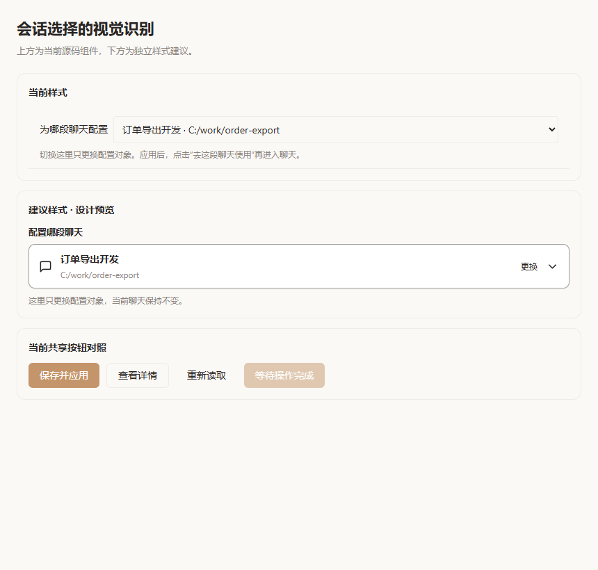
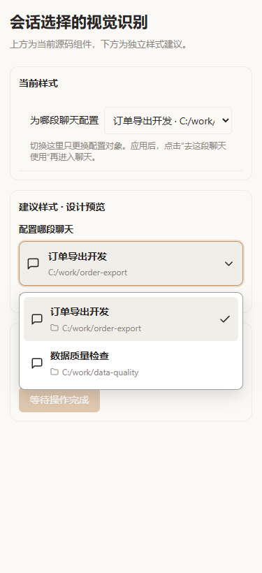

# DevClaw 交互布局与文字优化说明

日期：2026 年 10 月 15 日。范围：`codex/mods-v2` 的自定义助手、灵件制作、组合、执行、运行记录与导览，并核对设置导航的命名。

## 本轮实施进展

下文的问题表保留首次审查时的现象与要求。当前源码已完成 S01–S06、U01–U12
的本轮范围，项目插件专项重组仍按原方案后置。实包已交付至用户指定目录，
原 EXE 的组合执行、导览及 18 个实际预览已通过；完整回归与持续观察见
[平台实施账本](devclaw-sparks-platform-foundation-plan-2026-10-15.md)。

| 范围 | 已实现与验证 |
| --- | --- |
| 控件与目标 | 统一输入轮廓、下拉箭头、焦点与单选标记；聊天标题和目录分层，搜索列表有界，保留失效目标与草稿保护。当前 CSS 明暗主题、375px、键盘和 1001 候选搜索检查通过。 |
| 聊天与任务 | 唯一聊天输入框、明确本次步骤、一次性消费选择、原任务卡保留成果、统一停止状态、按需详情。18 组原交互回归及新增作用域持锁恢复检查通过。 |
| 配置与编辑 | 1–8 功能、1–32 步骤、简单与高级共用草稿、真实版本保存和失败断点恢复。8 组 canonical 浏览器、38 项窄单测通过。固定覆盖值始终可见，不能暗中覆盖前一步结果。 |
| 入口与说明 | 首页按找功能、制作修改和我的设置组织；常用搭配、执行步骤和进阶测试入口收敛。安装状态与聊天应用状态分别读取；导览和离线说明已同步唯一输入路径。 |
| 独立审查 | 两名 medium 审查发现的 4 项 P2 均已修复并复验：持锁后作用域补读、迟到停用响应、失效保存检查点、隐藏固定输入覆盖。 |

详细证据见 `output/platform-foundation-20261015/ui-flow-regression-migration-summary.json`、
`output/ui-controls-20261015/report.json`、
`output/ui-ux-20261015/canonical-combination/post-review-verification.json` 与 `output/review-a-*`。
这些浏览器检查使用真实组件和当前 CSS、受控 IPC 数据，不能代替原生实包与真实授权链验收。

已接入的浅色和深色窄屏控件如下；后文原“建议”对照图保留作改造前记录。





## 主要结论

类似“流程任务单独放在侧栏”的问题仍存在于其他路径。主要表现是：入口按技术对象划分，一个需求要经过多页；保存、授权、应用和开始各有入口，但下一步不连贯；简单操作与高级编辑各自维护状态；运行信息通过多层卡片和滚动区堆叠；导览与实际操作路径不一致。

控件的视觉识别也需要优先处理。选择框、输入框、选项卡、选择卡和文字操作必须让用户一眼看出哪里能点、当前选了什么、是否还能操作。仅优化流程和说明文字不足以解决这些问题。

优化应围绕用户正在做的事组织：**在聊天里提出并完成任务，在管理页制作和配置，按需打开详情。** 底层可以有不同执行器、版本和权限，界面不应要求用户先理解这些结构。

以下为改造前界面源码、说明配图与隔离浏览器检查形成的原始审查。原控件对照图中的建议部分是独立设计预览；现实施状态以上方账本和对应验证证据为准。性能、完整页面对比度及完整运行体验仍按后文场景验收。

## 控件识别与会话选择样式

### 会话选择的具体问题

[会话选择组件](../src/renderer/src/components/customize/ConfigurationTargetPicker.tsx#L18)使用原生下拉框，标签与选中值横向排列。组件有边框和背景，但背景与页面相同、边框很浅，未提供统一的独立下拉图标和悬停表现，容易被当成顶部的一行说明文字。

用真实组件和当前源码编译的样式，检查了默认浅色、深色和 375 像素窄屏：

| 检查项 | 实际表现 | 修改方向 |
| --- | --- | --- |
| 控件轮廓 | 浅色边框为 1 像素 `#eeece7`，背景为 `#faf9f6`，与页面背景相同 | 使用专门的输入控件背景与边框，让控件与分隔线有明显区别 |
| 下拉提示 | `appearance: auto`，系统原生箭头仍存在；没有组件自带的统一箭头 | 提供始终可见的下拉箭头和右侧留白，不能只依赖系统原生外观 |
| 键盘焦点 | 有浏览器默认的 1 像素自动轮廓，未使用共享控件的统一焦点环 | 保留并统一强化焦点；不能为美观直接移除默认轮廓 |
| 值的层次 | 聊天标题与完整目录拼在一行 | 标题为主信息，目录作为次级信息；同名聊天仍可通过目录辨认 |
| 窄屏 | 在本次 375 像素的容器中，标签占据一列，选择框剩余约 183 像素，目录被截断 | 标签移到控件上方，控件占满可用宽度；路径可省略但需有完整查看方式 |

没有证据表明全局 CSS 隐藏了下拉箭头或边框未生效。这里要修正的是交互提示的强度、布局和一致性，不能靠重命名或解释“这是下拉框”解决。

下图上方使用当前会话选择组件，下方展示建议的轮廓、箭头和文字层次；建议部分尚未接入应用。



窄屏下应优先保留聊天名称，展开后显示目录和选中标记。下图的展开列表属于设计预览，不代表原生选择框已经改造。



深色同样检查控件轮廓、背景与状态，见[深色样式对照](assets/ui-ux-20261015/session-control-dark.png)。

### 同类控件需要统一处理

| 编号 | 位置与已确认问题 | 优化要求 |
| --- | --- | --- |
| S01 | 会话选择的轮廓、箭头和焦点依赖独立原生样式，视觉提示弱 | 统一选择控件；标签、触发区、箭头、悬停、焦点和展开状态都清楚可辨 |
| S02 | 会话标题和路径同排，在窄屏争夺宽度 | 收起时显示主次两层信息；长内容按规则截断，展开可看完整值，不丢失目标辨识信息 |
| S03 | [会话选择](../src/renderer/src/components/customize/ConfigurationTargetPicker.tsx#L32)已有目标失效提示，但空候选列表没有专门的禁用与空状态 | 无候选时显示“暂无可配置的本地聊天”和原因；目标失效但仍有候选时保持可选择，继续保留原来的防止错误回退逻辑 |
| S04 | [流程选择](../src/renderer/src/components/chat/ChatFlowControls.tsx#L60)、[组件范围选择](../src/renderer/src/components/customize/ClawComponentSelector.tsx#L105)、[简单组合](../src/renderer/src/components/customize/SimpleClawBuilder.tsx#L32)各自编写下拉样式；简单组合的输入与下拉复用同一基础类 | 所有下拉框遵循相同视觉规则，不让选择框看起来与静态文字或普通输入完全一样；按内容复杂度选简单列表或带搜索的选择器 |
| S05 | [来源选择卡](../src/renderer/src/components/customize/ClawSourceSelector.tsx#L57)主要通过边框和背景颜色表示“全部”或“所选”模式 | 增加明确的单选圆点或选中勾，整卡可点；选中状态不只依赖颜色。下面的真实复选项继续保留，不把它们误当缺失 |
| S06 | [来源搜索框](../src/renderer/src/components/customize/ClawSourceSelector.tsx#L74)输入使用 `outline-none`，外围标签没有对应的 `focus-within` 焦点表现 | 搜索框聚焦时外框明确变化，不能只剩输入光标；错误、只读和不可用状态也要可区分 |

[共享 Select](../src/renderer/src/components/ui/select.tsx#L13)已经包含显式箭头、焦点与禁用样式，应优先复用或提供等效的原生选择控件规范。但它仍使用浅色输入边框和透明背景，**只替换组件名称不能保证解决视觉问题**，还需统一控件颜色、信息层次和状态。

并非所有标签切换都缺少选中表现：灵件页和流程页已有按钮变体，部分切换也已有背景区分。后续应统一选中标记和交互样式，不把已有状态重复列为未实现。

### 选择控件的建议结构与状态

会话选择建议采用上方独立标签、完整触发区域、主要标题、次级目录和右侧箭头。上下文选择可以用两行高度；普通单值下拉仍保持紧凑，不给所有表单机械增加高度。

| 状态 | 用户应看到的表现 |
| --- | --- |
| 未选择 | 明确的占位提示和下拉箭头，不能伪装成已经选定的值 |
| 已选择 | 清晰的名称、必要的目录或来源，展开列表中有选中标记 |
| 悬停 | 背景或轮廓有可见反馈，但静止时也能识别是控件 |
| 键盘聚焦 | 明确焦点环，支持键盘打开、选择、关闭并返回触发位置 |
| 已展开 | 触发框和列表状态关联，列表边界清楚，不被弹层遮挡或裁切 |
| 不可用 | 控件外观与可用状态不同，就近解释原因；不是单纯变淡却让用户猜 |
| 正在加载 | 显示加载反馈，保留已经确定的选择，不清空成另一种默认值 |
| 目标失效或读取失败 | 区分目标不存在与暂时加载失败，提供正确的重新选择或重试入口，不自动切换到别的聊天 |

视觉样式应区分“装饰性分隔线”和“可操作控件轮廓”。建议在主题中增加统一控件背景、边框、悬停、焦点和错误状态规则，明暗主题都验证；不要只把所有页面边框一并加深。

会话选择只改变配置对象，不切换当前聊天；新样式继续遵守草稿保护、忙碌校验、目标失效、同名聊天和迟到请求隔离。列表较长时支持本地搜索与有界展示，不因悬停或每次渲染扫描项目文件、启动模型或连接外部服务。

## 需要优先处理的问题

“优先处理”指直接影响理解和完成任务；“随后优化”指信息层次与阅读体验。这里不将所有样式问题认定为执行故障。

| 编号 | 优先级 | 当前问题与位置 | 用户影响 | 修改建议 |
| --- | --- | --- | --- | --- |
| U01 | 优先处理 | [ChatFlowControls](../src/renderer/src/components/chat/ChatFlowControls.tsx#L133)在侧栏另设“本次任务”输入框和“开始流程”，普通聊天保留原输入框 | 同一个任务有两套输入与提交位置 | 保留一个聊天输入区；用户为本次消息明确选择执行步骤，按钮显示实际提交意图，进度、确认和结果在原任务消息中连续呈现 |
| U02 | 优先处理 | [总览](../src/renderer/src/components/customize/AssistantWorkbench.tsx#L6)及[设置导航](../src/renderer/src/components/customize/CustomizeView.tsx#L124)将添加功能、助手组合、按步骤执行、效果测试并列 | 还没开始任务，就要理解几种产品对象的关系 | 首页按“使用现成功能、制作或修改、管理我的设置”组织；组合与步骤作为具体配置，进阶测试放入相应作品的操作中 |
| U03 | 优先处理 | [总览](../src/renderer/src/components/customize/AssistantWorkbench.tsx#L45)说“确认后就能在当前聊天使用”，[灵件页](../src/renderer/src/components/customize/ModsPanel.tsx#L124)说“确认权限，即可在这段聊天中使用”；但同页又说明安装库不代表目标已应用 | 用户合理地误以为授权完成就已经生效 | 按实际状态显示“已添加、待确认、待应用、已用于某聊天”，提供对应下一步；不能把安装、授权、应用三个状态混写 |
| U04 | 优先处理 | [简单组合](../src/renderer/src/components/customize/SimpleClawBuilder.tsx#L207)要求恰好两个插件，不足两个提示去添加；顺序配置也固定两步 | 双插件示例变成默认限制，单个功能或更多功能需要换入口 | 默认支持一个或多个功能；“两个插件搭配”作为可选示例。先后执行支持按需要添加步骤，不为凑数量安装插件 |
| U05 | 优先处理 | [ClawPanel](../src/renderer/src/components/customize/ClawPanel.tsx#L491)在进入高级编辑时询问是否覆盖另一份草稿；[简单组合](../src/renderer/src/components/customize/SimpleClawBuilder.tsx#L840)还会先保存步骤再继续高级编辑 | 同一配置出现两份草稿、不同保存阶段，容易不知道哪份会生效 | 一个配置只保留一份编辑草稿；简单与高级只是同份数据的两种视图。保留版本冲突检查和实际应用前预览 |
| U06 | 优先处理 | [应用完成区](../src/renderer/src/components/customize/SimpleClawBuilder.tsx#L765)要求“准备首次任务”，流程再去侧栏填写目标；[流程帮助](../src/renderer/src/components/customize/FlowUsageGuide.tsx#L30)描述保存后再到流程任务开始 | 保存和应用完成后仍不断跳转，任务入口难找 | 应用后给出清楚的“去这段聊天使用”；带上一次性的功能或步骤选择，聚焦唯一输入框，由用户发送。只有保存模板时不擅自应用或启动 |
| U07 | 优先处理 | [导览文案](../src/renderer/src/components/customize/simple-tour-tasks.ts#L40)说回聊天发送任务，[演示界面](../src/renderer/src/components/customize/SparksTourExamples.tsx#L146)也展示发送后执行；实际流程仍有独立提交入口 | 跟着演示操作也可能只发送普通聊天，无法得到演示效果 | 导览、帮助、按钮与实际流程使用同一操作路径。普通灵件入门使用独立小例，AutoBiz 等项目例子放到对应模块，不作为全局首次使用的前置 |
| U08 | 优先处理 | [聊天提示条](../src/renderer/src/components/chat/ClawSidebar.tsx#L486)主要打开侧栏查看；提示只在执行中或需处理时出现，成功完成后缺少同处连续提示 | 需要另找当前结果，不知道任务是否结束 | 同一任务卡从准备、执行、等待确认一直更新到成功或失败；完成后原位保留成果入口。侧栏用于日志和详细步骤，不承担唯一结果入口 |
| U09 | 随后优化 | [运行详情](../src/renderer/src/components/customize/FlowRunView.tsx#L76)分别显示任务、确认摘要、结果、下一步；[步骤进度](../src/renderer/src/components/customize/FlowStepProgress.tsx#L58)又显示当前内容和整组步骤 | 任务说明与确认内容容易重复，信息密度大 | 默认只显示当前状态、一段关键内容和一个主操作；任务原文、完整成果和已完成步骤按需展开。不是删掉真实成果，也不隐藏失败原因 |
| U10 | 随后优化 | 侧栏可滚动，任务原文、确认正文、实时内容和步骤列表又分别设置滚动上限 | 窄侧栏中出现多层滚动，鼠标停在不同位置会滚动不同区域 | 默认采用一条主要纵向阅读路径，全文展开后再使用有界专用阅读区；保留虚拟化、大小上限和延迟读取，不靠无限渲染解决布局 |
| U11 | 随后优化 | [停止入口](../src/renderer/src/components/chat/ClawSidebar.tsx#L522)叫“停止流程”，[详情](../src/renderer/src/components/customize/FlowRunView.tsx#L72)叫“取消运行”；侧栏又分“流程任务、设置、其他记录” | 相同动作不同名字，“其他记录”无法帮助用户判断该去哪找 | 同一动作统一为“停止任务”；显示“正在停止”和最终结果。按具体任务关联记录，命令历史、技术日志进入详情，不再要求先猜记录类型 |
| U12 | 随后优化 | [派生面板](../src/renderer/src/components/customize/PluginDerivationPanel.tsx#L294)同区安排阶段、修改、来源、文件、检查、安装和使用入口；[正式复用](../src/renderer/src/components/customize/DevelopmentReusePanel.tsx#L515)又有一套阶段操作 | 制作过程中按钮和说明多，找不到当前该做什么 | 每个阶段突出一个主操作，已完成阶段收成状态摘要，来源、源码、诊断放入详情。安装、权限和不可逆操作的真实确认仍保留；项目插件专项重组后置 |

## 建议统一的使用方式

### 聊天负责完成任务

聊天输入区是唯一任务输入位置。需要固定步骤时，用户通过输入区工具入口选择已保存步骤，输入区显示“本次使用：代码检视”，提交按钮显示“按此步骤执行”。选择可以取消，普通发送保持普通聊天，不因某次使用流程而改变后续所有消息。

发送后，聊天中出现同一张任务卡：

```text
检查订单导出功能
正在检查代码 · 第 2 / 4 步
已发现一个空列表处理问题，正在核对测试。

查看详情                         停止任务
```

需要确认时，同一位置说明“确认什么、会影响什么、确认后继续哪一步”，提供相应操作。完成后原卡显示结果与成果入口，失败时显示具体原因及下一步。配置页和侧栏可以打开详细信息，但不新增另一份任务输入，也不让用户回头寻找结果。

任务卡通过真实运行标识关联执行状态，不能把每次状态变化写成一条新的助手回答。流式文字和任务进度分别更新，避免重复回答或重建整个消息列表。

### 管理页负责制作和配置

管理入口按用途组织，建议首页保留三个主要方向：

| 入口 | 用户在这里做什么 |
| --- | --- |
| 找功能 | 浏览、添加并选择使用位置；已安装条目直接显示当前状态和可用操作 |
| 制作或修改 | 描述需求、预览修改、确认试用、保存；已有作品从原卡片继续编辑 |
| 我的设置 | 查看实际使用的功能、保存常用搭配、维护执行步骤和版本；技术配置按需展开 |

这些是信息组织建议，功能对象和底层协议可以继续存在。不要为每种对象都再建一种日常工作模式。作品可以独立保存，不强制先绑定某段聊天；应用时明确选择目标，执行时再检查所需工作目录及权限。后者涉及平台支持，应与底座能力同步交付，不能只改文案让原约束失效。

简单与高级共用一份草稿，保存模板和应用到目标是不同意图：保存用于复用，应用前核对具体影响。常用路径可提供“保存并应用”的连续操作，仍保留必要的变更预览和授权确认。应用完成后可直接进入目标聊天，不再另设“准备首次任务”阶段。

## 文字优化规则与示例

主界面只保留当前状态、关键结果、影响范围和下一步。机制解释使用可点击、可键盘操作的帮助提示；不能只靠鼠标悬停。诊断、来源路径、版本摘要和原始日志进入详情。

| 当前表达 | 建议表达或处理 |
| --- | --- |
| 选好后确认权限，即可在这段聊天中使用 | 按实际状态显示“已添加，选择要使用的聊天”或“已用于：订单开发”，不给跨阶段承诺 |
| 助手组合 | 普通路径显示“常用搭配”；名称是否统一调整，需与已保存条目和帮助同步 |
| 按步骤执行，作为设置页标题 | “执行步骤”，说明这里创建和修改；真正开始任务在聊天中 |
| 准备首次任务 | “去这段聊天使用” |
| 保存并正式复用 | “保存并在其他聊天使用”，后续实际目标仍由用户选择 |
| 带运行摘要追问 | “继续处理这个任务”，点击后进入聊天输入，用户确认发送 |
| 取消运行、停止流程 | “停止任务”；请求发出后显示“正在停止”，真实清理后再显示结果 |
| 刷新状态、重新读取、重新核对，作为普通主要按钮 | 页面自动同步；读取失败时显示“重试加载”。结果未知时保留专门的“核对操作结果”，不得误触重做 |
| 基线、候选 | “原版本、新版本”，技术术语在比较规则中保留 |
| MCP 连接器 | “连接工具”，帮助中说明 MCP 协议 |
| 钩子 | “自动触发规则”，帮助中保留 Hooks 名称与开发说明 |
| Java LSP | “Java 代码诊断”，帮助中保留 LSP 名称 |
| 版本摘要、来源指纹、保存修订 | 默认用“版本”和来源名称；精确技术值放详情，不能丢失实际绑定 |
| 其他记录 | 在任务内显示“查看详情”；需要独立目录时明确叫“命令历史”或“技术日志” |

状态描述必须准确：已保存不等于已安装，已安装不等于已授权，已授权不等于已应用，已应用不等于任务已执行。界面每次只突出用户当前需要知道的状态，不同时铺开整套术语。

部分路径会按默认规则直接采用已授权能力，界面应查询并显示实际状态，例如“按默认设置使用”。不要求所有安装都额外创建组合或重复确认，也不因没有保存组合就显示不可用。

失败提示采用“发生了什么、影响是什么、可以做什么”，例如“连接已断开，结果暂未确认。先核对结果，再决定是否重试”。不要只输出错误码，也不要把结果未知统一解释为失败。

当前任务的文件写入、模型用量、对外发送、跨聊天影响及卸载后果，需要在相应操作前清楚展示，不能全部藏进帮助提示。工具执行授权与成果确认仍是不同操作，不能因为统一样式就合并批准。

## 布局与样式统一要求

应用内说明配图中的运行侧栏，可以看到任务正文、确认摘要和步骤状态同时占据窄列，并使用多层边框。


| 项目 | 优化要求 |
| --- | --- |
| 视觉层级 | 页面标题、当前任务、主要操作最突出；辅助说明弱化；一段结果不再同时套外框、内框、状态框和提示框 |
| 按钮层级 | 同一操作阶段一个主按钮；查看、修改、返回为次级；停止和删除按实际后果区分，不让所有操作都同等醒目 |
| 文字阅读 | 任务、结果与必要输入使用清楚的正文大小；小字用于简短辅助信息，不用于长篇操作说明和主要结果 |
| 状态展示 | 状态文字配合图标和颜色，等待确认、失败、未知、已停止与成功可区分；不能只靠颜色判断 |
| 滚动与密度 | 默认展示当前步骤和短摘要，完成项可展开；避免窄侧栏内多层滚动，长日志仍使用有界或虚拟化展示 |
| 操作可达 | 关键操作不埋在长段落之后；窄屏与键盘可操作，帮助可点击展开，焦点与关闭返回位置明确 |
| 反馈与空状态 | 加载保留已知内容，显示局部状态；按钮不可用时就近解释缺少什么；空状态直接提供下一步 |
| 组件一致性 | 共用按钮、标签、表单、确认卡、错误提示和间距规则；扩展页面也使用同一组组件，避免每个灵件各画一套 |

文字替换与布局调整一起实施。例如把“其他记录”改名，却继续让用户在多个地方找同一结果，不算解决问题。

按钮、标签切换与折叠入口也要按用途区分：主动作有明确按钮外形，次动作保留可辨识边界或图标；标签有稳定选中标记；可展开区域有箭头和展开状态。普通正文保持静态文本样式，不把重要操作做成只有悬停后才能发现的文字。已有 HelpHint 的点击、触摸和键盘行为继续保留。

## 已有改进应当保留

以下能力当前已经存在，不应再次列为“尚未支持”：

- [配置目标选择](../src/renderer/src/components/customize/ConfigurationTargetPicker.tsx)可以直接选择其他聊天；后续优化应进一步简化解释和导航，不倒退为来回切聊天。
- [规范来源展示](../src/renderer/src/components/chat/BuiltinInstructionsView.tsx)已经把主要说明移入帮助，保留真实来源与生效边界；“看到了规范”不能改写成“模型保证遵守”。
- [制作面板](../src/renderer/src/components/customize/ModsDevelopmentPanel.tsx)已有确认、失败修复和权限详情分层；本次不再把“没有确认入口”当作已证实的当前缺陷。
- 流程配置与执行记录已有分栏，技术日志已有按需展开；仍需解决的是任务入口与阅读路径。
- 导览已有示例界面，不再属于“只有说明文字没有画面”；需要修正的是与实际操作的一致性及入门示例选择。

## 实施安排与验收

平台底座仍按[底座优先方案](devclaw-sparks-platform-foundation-plan-2026-10-15.md)推进。本说明作为底座的界面与交互约束，近期不启动项目模式或 AutoBiz 的专项重构。

| 实施组 | 交付范围 | 完成条件 |
| --- | --- | --- |
| 控件样式统一 | 优先修正会话选择，再统一下拉、搜索、选择卡、按钮和标签状态 | 用户不阅读说明也能辨认哪里可点、当前选择与不可用原因；明暗主题和窄屏真实验证 |
| 交互收敛 | 统一输入与任务卡；保存、应用、使用连续；一份草稿支持简单与高级 | 从配置到任务结束无需第二次输入同一目标，结果和确认在原任务可找到 |
| 制作与管理 | 按用途重组入口，组合不限制两个功能，制作当前阶段主操作突出 | 一个功能、两个功能、多个功能均可清楚配置，安装授权与实际生效不混淆 |
| 文字与样式 | 统一术语、状态、按钮、卡片和帮助；修正导览与实际流程 | 普通用户可判断当前状态、影响对象和下一步，示例可按真实入口完成 |
| 集中验证 | 使用流程、失败恢复、可访问操作、稳定性和存量回归 | 确认、停止、版本与作用域检查不减弱；性能和界面连续性通过实际验证 |

验收必须覆盖以下场景：

1. 首次进入可直接开始一个小例子，导览可跳过和重新打开，不要求先理解插件、组合和流程的关系。
2. 一个、两个、三个以上功能均能配置；切换高级编辑不生成第二份草稿，返回保留修改。
3. 安装、授权、应用分别显示真实状态；应用到聊天 B 不改变聊天 A，影响其他聊天的操作明确提示。
4. 普通消息按原语义发送；只有用户明确选择本次任务使用步骤才启动流程；选择可取消、失败保留输入。
5. 同一任务从启动、进度、确认到结果连续可见；关闭详情不丢入口，完成后不消失，不产生重复助手回答。
6. 工具授权与成果确认分别说明影响；文件变化后原确认失效，不能因 UI 简化复用过期批准。
7. 停止显示真实过程；未知结果先核对，不把“重试加载”变成重新执行有副作用动作。
8. 375 像素窄屏、键盘、长任务、长结果、多步骤和错误状态可操作；检查对比度、焦点和滚动，不凭截图推定通过。
9. 长会话、会话与模式切换、最小化恢复和热更新无新增消息区消失、闪屏、重复内容或订阅泄漏；保留既有输入性能门禁。
10. 导览、应用内说明和实际按钮同步更新，实测创建、修改、试用、使用、失败修复与再次验证。两个中等强度子 agent 回检交互、文字、实际代码和证据。
11. 会话、流程、模型和组件选择框在静止状态就能认出是控件；覆盖展开、选中、悬停、焦点、禁用、加载、空列表和失效目标；长标题、长路径与同名聊天可以辨认。
12. 标签与选择卡的当前状态不只依靠颜色；搜索框有完整焦点反馈，主要按钮与说明文字可区分；键盘选择及关闭返回保持正确。

现有[配置目标浏览器测试](../tests/configuration-target-browser.spec.ts)验证了选择、草稿及作用域逻辑，但未加载应用 CSS，不能据其通过判断控件外观合格。视觉验收要使用真实组件、当前样式和主题，记录计算样式与截图，再单独验证完整应用中的弹层、布局和系统缩放。

本次控件检查已完成默认浅色 860 像素、深色 860 像素和浅色 375 像素的隔离浏览器对照，页面异常为零，并验证原会话选择仍可切换配置对象。记录位于 `output/ui-affordance-audit-20261015/report.json`；这不替代完整应用及全部主题的验收。

本轮交付优化说明，未修改应用界面代码；上述实施组和验收项不能标为已完成。
