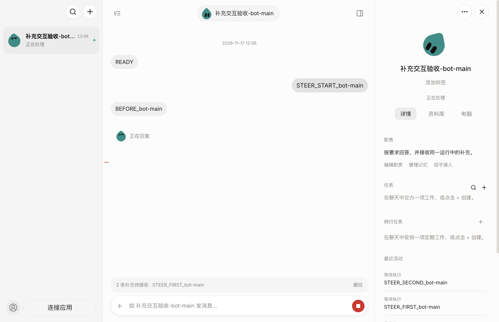
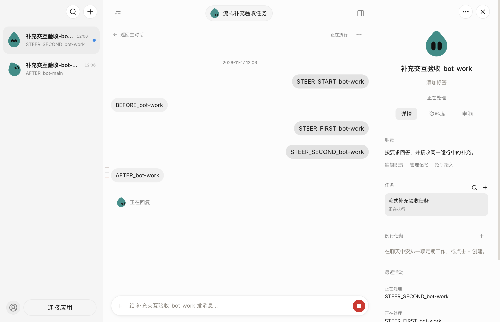

# Steer 提示位置与流式重复消息修复

日期：2026-11-17（Asia/Shanghai）。分支：`codex/merge-uat-into-bot-beta`；基线提交：`98ef8cf3a`。本次代码尚未提交，最终源码指纹见 [source.json](source.json)。

## 问题与根因

用户在主 Bot 回复过程中发送补充时，待接收提示远离输入框；同一模型回复还会短暂显示两份，等运行结束后才恢复。

实际 Electron 诊断确认是流式消息身份和投递通道不一致：

1. 回复最先使用 provider ID 流式显示；steer 在 afterModel 边界将该回复持久化为稳定 ID，并插入补充消息。
2. 原注入通知只广播 `agent:stream`，而 Bot 使用后台托管执行，通过 `scheduler:stream` 更新 UI。Bot 没有及时收到 `message_id_alias` 和 `current_run_user_injected`。
3. 稍后稳定 ID 的快照到达，UI 同时留下原 provider 行与稳定行。最终重新读取历史才消除重复；补充消息也可能直到这时才显示。
4. 前台流另有同类问题：只更新 ThreadContext 的别名，SDK 累积消息帧和 chunk 缓存仍保留旧 ID，下一个帧又把旧行带回来。

不是模型真正执行了两次，也不能按回复文本去重：两条不同回复可以内容相同。失败轮次的 [事件记录](runs/05-diagnostic-buffer/event-trace.json) 保留了上述链路。

## 最终改动

- 待接收提示放在输入框紧上方，与输入框同宽，保留数量、预览和撤回；接收后消失，屏幕阅读器可获知状态变化。
- 运行边界事件沿当前运行的 delivery 投递。前台、后台并行执行分别保持自己的线程和事件通道；没有额外模型调用。
- 后台按别名、已完成回复快照、补充消息的顺序更新；保持 provider ID 与出现次数，区分 provider 重用 ID 和延迟快照。
- 前台同时更新累积消息帧和 chunk 缓存，保留工具、思考与正常消息身份；不等待额外数据库请求才更新已持久化的边界。
- 新增实际应用回归脚本，并纳入现有 Bot 集成测试入口。

## 条件、输入与复现

macOS arm64，Node 22.23.5，真实构建的 Electron、preload IPC、运行时和 SQLite；模型是**受控的本机流式模拟服务**，不是 DeepSeek 实测，也没有连接招乎。测试使用独立配置目录、虚构内容，屏蔽外部请求，不修改用户配置。

每个场景建立新 Bot。主 Bot 从输入框发送 `STEER_START_bot-main`；独立任务通过正式 App IPC 创建并打开，目标为 `STEER_START_bot-work`。模型输出 `BEFORE_<场景>` 后挂起流：

1. 在输入框发送一条补充，再点击撤回；检查提示位置和撤回效果。
2. 连续发送 `STEER_FIRST_<场景>`、`STEER_SECOND_<场景>`；提示应显示两条。
3. 释放第一段流，第二次模型调用复用同一个 provider ID，输出 `AFTER_<场景>` 后继续挂起。
4. 在第二段仍流式执行时，确认四条消息依次为 BEFORE、FIRST、SECOND、AFTER；待接收提示消失，每条只有一份。
5. 全程使用 MutationObserver 观测 assistant 气泡，捕捉中途重复，不能只检查最终结果。
6. 完成运行后核对数据库顺序、撤回内容未落入历史、没有重启原请求，并 reload 检查展示一致。

```sh
node --import tsx scripts/run-bot-integration-e2e.mjs --build-only
BOT_TEST_APP_OUT=<上一步输出的构建目录> node --import tsx tests/bots-steer-stream-app.spec.ts
npx vitest run src/main/bots/peer-feedback.test.ts src/main/bots/steering.test.ts src/main/bots/feature-steering.test.ts src/renderer/src/lib/electron-stream.test.ts src/renderer/src/lib/electron-transport-discard.test.ts src/renderer/src/lib/scheduler-assistant-snapshot.test.ts src/main/agent/stream-converter-snapshots.test.ts --maxWorkers=2
node --import tsx tests/managed-transport-delivery.spec.ts
node --import tsx tests/message-queue-runtime.spec.ts
npm run typecheck:web
npm run typecheck:node
```

## 轮次记录

所有应用轮次分别归档，失败未覆盖。日志时间取文件最后写入时间，不冒充运行起止；早期脚本和完整源码指纹缺失时标记未知，不用最终版本回填。

| 轮次 | 改变与结果 | 记录 |
| --- | --- | --- |
| 1 | 仅修前台 SDK，Bot 仍失败；失败时结果数组尚未保存 | [01](runs/01-foreground-only/record.json) |
| 2 | 先保存失败观测，确认旧回复气泡最大同时出现 2 个 | [02](runs/02-persist-observation/record.json) |
| 3 | 扩大 renderer alias 映射仍失败，该尝试撤回 | [03](runs/03-extended-alias/record.json) |
| 4 | 增加诊断但未采集到 console，仍未解决 | [04](runs/04-diagnostic-console/record.json) |
| 5 | 诊断构建内缓冲事件，定位后台投递缺失；临时插桩已移除 | [05](runs/05-diagnostic-buffer/record.json) |
| 6 | 修复当前运行投递后主 Bot 通过，reload 后测试脚本 `__name` 未定义，独立任务未完成验收 | [06](runs/06-run-delivery/record.json) |
| 7 | 补脚本 reload 初始化后，主 Bot 通过；模拟模型误把任务结果通知当作挂起请求，等待 idle 超时 | [07](runs/07-fixture-report/record.json) |
| 8 | 修正模拟模型的通知识别，两种会话均通过 | [08](runs/08-two-surfaces/record.json) |
| 9 | 最终重建并增加流式中的顺序断言，两种会话通过，进程退出 0 | [09](runs/09-live-order/record.json) |

辅助测试的原始输出见 [checks.json](checks.json)。其中保留初次 TypeScript 类型收窄错误、移除诊断时多余括号导致的构建失败，以及 peer-feedback 测试抽取函数缺少新增依赖的失败；这些均已修正。第 6、7 轮是测试脚本故障，不能作为独立任务通过的证据。

## 最终结果

| 场景 | DOM 观测次数 | 同一回复最大气泡数 | 输入框上方提示 / 撤回 | 流式与持久化顺序 / reload |
| --- | --- | --- | --- | --- |
| 主 Bot | 92 | 1 | 通过 | 通过 |
| 独立任务 | 80 | 1 | 通过 | 通过 |

上述观测次数只是同一运行内的 DOM 变化采样数，不是独立实验样本数。受控挂起时间不代表真实模型响应耗时，未报告为延迟指标。

相关 Vitest 用例 **138/138 通过**；运行时队列用例 **43/43 通过**；托管 delivery 独立测试通过，包括并发运行通道隔离。前后端类型检查通过，最终隔离构建成功。前台流性能回归在 10,000 条历史加 1,000 个尾部 chunk 的夹具中仍为 `prefixReads=0`，没有为每个 token 增加历史扫描；别名重建只发生在消息边界。这是本地夹具与结构性验证，不是生产耗时测量。





## 结论与局限

本轮在实际应用中稳定复现了重复，沿真实事件通道修复后不再出现；补充在原运行中按序接收，不需要用取消重跑掩盖显示问题。前台普通会话的同类缓存问题由单元回归覆盖，实际 App 测试覆盖主 Bot 与独立任务。

没有运行 Windows 包、真实招乎或真实 DeepSeek；不把模拟服务结果计入主动委派或真实模型能力实验。归档日志仅包含隔离测试材料，路径已脱敏。原始失败轮次的缺测、缺失退出码与未覆盖源码指纹保留为未知。
