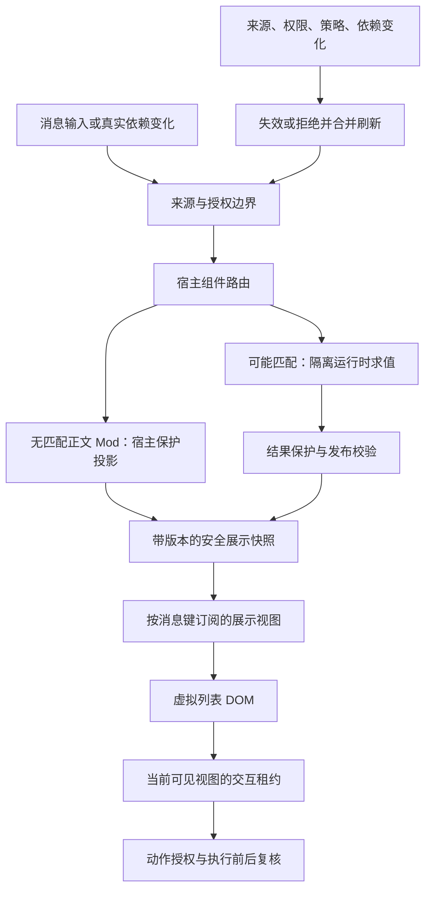

# Mods 整体收敛与重构方案

日期：2026-10-22。适用分支：`codex/mods-v2`。

本方案以 `403affb132e74a2e63bc1b51deab5fad384b7803` 的代码和本轮诊断为基础。
工作区还有未提交的功能、文档和版本变更，实施时必须重新记录实际提交、工作区差异和安装包身份。
本文保留实施设计与验收门槛；源码实施状态及实际证据见
[实施与验证记录](mods-convergence-implementation-2026-10-22.md)。下文的性能数字是验收目标，
不能仅凭源码改造或局部测试认定已经达成。

**本轮执行约束：**用户已授权实施 P0–P6 的源码与测试改造，但当前禁止构建、打包、推送或触发
Actions。下文涉及构建与真实新包的验收均为待授权事项，不能用已有 `out/`、旧安装包或源码单测
替代。P6 可交付工具、契约及回退入口；整包放行和发布退出条件仍必须标为未验收。

## 1. 决策与范围

优先解决的结构问题是：普通文字的显示、插件求值、DOM 挂载和交互授权共享生命周期，
使滚动历史消息反复触发挂载、源码校验、跨进程绘制和占位更新。

目标是让消息阅读主要消耗本地展示和有限的布局成本。插件计算由真实输入、依赖和有效性变化驱动；
虚拟列表回收只释放视图及其交互租约。涉及权限、来源和策略的检查继续保留。

整个重构保留已有消息组件、插槽、Client、动作、Hooks、named state、权限申请、安装和撤权、
会话配置、Creator、组合与发布、业务流程、恢复和开发调试能力。不把“关闭 Mods”、减少安全检查、
延长加载提示时间或扩大并发数作为性能修复。

推进规则：

1. **先消除滚动引发的重复工作，再优化必要工作的单次成本。** P1–P3 是根治主线。
2. **先改内部实现，保留外部契约。** 不要求现有 Mod 同时迁移 SDK，不默认修改业务数据格式。
3. **先复用现有基础设施。** 使用已有 named-state 依赖追踪、线程 selector、ui-resolve 和展示缓存，
   不另建第二套状态总线、权限体系或插件运行时。
4. **分批接入组件，逐项通过验收。** 先普通文字，再工具展示，再交互较重的组件和 Client。
5. 收敛期间暂停新增 SDK 兼容面和新业务适配器；现有能力的缺陷修复照常进行。

## 2. 依据与问题边界

详细证据保存在本地诊断文件：

- `output/performance-audit-20261022.md`
- `output/performance-architecture-comparison-20261022.md`
- `output/chat-interaction-performance/audit-20261022/observations.json`

这些输出未纳入源码版本管理。P0 应将可公开的脚本、场景和脱敏结果汇总成可复现基线，
不要依赖某一台机器上的临时输出作为长期验收依据。

| 已核实问题                                 | 证据与含义                                                                               | 修复阶段 |
| ------------------------------------------ | ---------------------------------------------------------------------------------------- | -------- |
| 普通文字经过 FunctionSite 的异步挂载与绘制 | `FunctionMessageText.tsx`、`FunctionSite.tsx`；不存在正文插件时也可能经过 host-only 路径 | P1       |
| 虚拟列表卸载释放 owner，重挂再次处理       | 400 条合成消息场景产生 1,507 次模拟 API 调用；展示缓存命中仍会新读                       | P2       |
| 未匹配组件仍支付运行源复核成本             | manager 诊断中，导入资源从 0 增至 24 时，一次未匹配 mount 从约 13ms 增至约 49ms          | P1、P3   |
| 小占位变大正文引发列表测量和挂载放大       | 合成场景最大挂载行数从 8 增至 28，LayoutDuration 明显增加                                | P2、P4   |
| Markdown 缓存与限流覆盖不一致              | 普通 StreamingMarkdown 已有节流和 AST 缓存，FunctionMarkdown 未共享完整策略              | P4       |
| 管理与运行职责过于集中                     | manager、session 等大模块跨来源、权限、绘制、动作和交付职责                              | P5       |

证据限制：前端场景使用模拟接口，manager 诊断的发布路径有桩；不能直接相加为真实用户延迟。
历史测试有的使用本机 Node 24；正式门槛须使用 `.nvmrc` 指定的 Node 22 和 npm 10+。
前一轮六组核心测试 136/136 通过，只能证明对应场景，没有替代整包性能和完整回归验收。

DSH 和 Claude Code 的研究支持采用组件匹配快速路径、已完成展示复用、按依赖失效和增量 Markdown。
没有三款产品的同机端到端跑分；DSH 的可信浏览器插件与本工程的安全边界不同，不能直接照搬。

## 3. 目标结构及生命周期

### 3.1 分开管理三类对象

| 对象           | 职责与生命周期                                                                                  | 不能承载的内容                                         |
| -------------- | ----------------------------------------------------------------------------------------------- | ------------------------------------------------------ |
| 安全展示快照   | 已通过相应保护的纯展示数据；由输入和依赖版本决定复用，受数量、字节和过期限制                    | 原始未保护文本、有效授权、可直接调用的回调、运行时对象 |
| 求值记录与订阅 | 知道输入、读取依赖、进行中的任务和待刷新版本；按组件及会话管理，受既有额度限制                  | 无界历史 owner、重复状态系统、通过缓存绕开的源码证明   |
| 交互租约       | 将当前可见视图绑定到当前窗口、owner、drawing/action generation 和运行时 incarnation；卸载即失效 | 从缓存恢复的历史权限、可重放工具执行                   |

快照复用不代表复用一切运行状态。Client 仍遵守现有 DOM/可见性生命周期，
不把隐藏 Client、React 闭包、VM 实例全部常驻来换取滚动速度。
现有组件和全局运行额度保持有效，已完成的被动快照不能冒充活跃 owner。

### 3.2 复用和失效规则

展示身份至少区分：workspace、thread、消息及 block 的稳定身份、component、输入版本、
graph/config、source/runtime incarnation、policy 版本、读取依赖版本，以及实际影响结果的显示上下文。
主进程决定权威版本；renderer 不得自行宣称“仍然安全”。

会话作用域必须同时绑定宿主实际数据库对象与原生 thread incarnation，不能只用可复用的
workspace/threadId 字符串。切换数据库或删除后重建同 ID 会话时，必须退休旧 scope 和全部迟返结果；
renderer 提交的显示键、插件名称或缓存 token 均不能重建该作用域。

- 输入不变、所有相关版本一致、结果可缓存时，滚出再滚入只复用展示。
- “只复用展示”指不重做 guest 绘制，不承诺省略来源复核。当前契约要求重新验证有效性时仍须验证，
  并单独计入必要 guard 成本。能否提前显示旧快照，也严格沿用当前展示缓存允许的范围。
- named-state 使用已有读依赖和版本，消息数据使用已有线程 selector；只通知受影响的订阅者。
  卸载前先从原依赖引擎捕获版本证明、接入失效监听并提交纯展示数据，再释放旧 drawing generation；
  交接期间依赖变化或证明失效时拒绝缓存，不能先释放订阅再补登记。实际卸载 await 后仍要重新复核。
- 动态 matcher、时间、onScreen、视口或未被跟踪的上下文，沿用既有刷新语义，不能假定为静态。
- 静态 UI 树不等于纯计算。只有按现有运行契约可复用、且影响结果的读取都能版本化的求值才进入此类缓存。
  无法证明的旧 Mod 继续按原语义刷新；不能为了优化要求全部作者重写，也不能吞掉可观察的状态写入或副作用。
- 来源或权限失效时，缓存不能继续提供动作能力；对于已展示文本，严格沿用现有失效/隐藏行为。
- 输入更新后，只有现有契约明确允许保留旧展示、且安全版本仍有效的组件可以继续显示旧结果。
  撤权、策略变化、来源变化不得借“保留旧展示”延迟生效。
- 不能证明有效时执行原校验或进入受保护的等待/失败状态，不能先显示原始 fallback。

复制、搜索、导出、模型上下文和可见投影分别保持当前契约。
不能把展示缓存当作对话的权威存储，也不能把“看见结果”当作工具执行已提交的证明。

## 4. 不可降低的功能与安全契约

P0 将下表逐项绑定到现有测试和新增回归用例。实现优化不得通过删测试、改预期或放宽超时来通过。

| 契约           | 必须保持的行为                                                                          | 重点反例                                                             |
| -------------- | --------------------------------------------------------------------------------------- | -------------------------------------------------------------------- |
| 输入与结果保护 | 各自的信任边界继续存在；host-only 也执行必需策略                                        | Mods 关闭但保护开启；缓存中混入原始文本；先闪现后遮挡                |
| 来源真实性     | 当前会被拒绝的文件替换、内容/身份变化、软链接和导入资源变化仍被拒绝                     | 源码检查前后发生改写；只改元数据；相同路径换 inode/文件身份          |
| 授权与配置     | workspace、grant、scope、启用状态、图版本继续由宿主判定                                 | await 中撤权或切换工作区；队列等待期间配置变化                       |
| 交互有效性     | sender/frame、owner、incarnation、drawing/action generation、请求对象身份和去重语义保留 | 旧按钮、旧 AskUserQuestion、窗口关闭后回包、重复点击、旧 worker 回调 |
| 沙箱与资源额度 | VM/Client/IPC/状态/绘制/队列的边界和限额有效，取消不提前虚报资源已释放                  | guest 超时仍执行；逻辑任务取消后继续无限发新任务                     |
| 流程与持久化   | 组合保存、用户配置、动作提交、失败恢复与已有产物校验继续成立                            | 崩溃后重复执行工具；仅 UI 成功但持久化未完成                         |
| 现有开发能力   | 已实现的 Hooks、MCP、Creator、业务适配和受控阶段调试可用                                | 把有限调试能力扩称任意阶段回滚；静默删兼容 API                       |

**源码优化的特殊约束：**不可变快照可以存储已验证数据，但不能自行改变当前“磁盘源码变化导致后续操作拒绝”的行为。
watcher、mtime、TTL 和后台 hash 只能提供失效提示，不能单独替代来源真实性证明。
每个跨 await、排队后执行和最终发布边界的复核必须有等价证明。
无法证明等价的优化留在原实现，不视为阶段完成。

必须明确一个约束：在外部进程可以任意改写文件的情况下，既要求每次操作立即发现磁盘变化，
又要求每次操作完全不验证文件，并不能仅靠内存版本或 watcher 同时实现。
因此，本方案要求消除重复 guest 求值和无意义的挂载流程，减少可证明冗余的扫描；
不把“所有热重访零文件检查”设成通过删掉安全边界才能达到的硬指标。

## 5. 分阶段实施

各阶段均以可单独评审、可回退的 PR 交付。P1–P3 完成前，不以拆大文件或调整加载文案代替性能主线。

### P0：冻结契约、建立可复现基线

**改动：**

- 建立现有能力清单，区分“已实现并验证”“有限支持”“计划中”，记录关键 Mod/业务样例和协议。
- 为匹配摘要、快照可复用性、来源复核边界分别形成简短设计决策记录。
  特别核对哪些 API 读取会影响结果、哪些绘制可能有副作用，未知情况进入保守路径。
- 固定 Node、Electron、构建方式、机器、电源模式、显示刷新率、数据集、Mod 源及安装包 hash。
  对性能基线还需记录 dirty diff 的 hash，避免把其他功能变更误算成提速。
- 扩展现有 `tests/chat-interaction-performance.spec.ts` 和 manager 成本诊断，不新建平行测试平台。
  模拟接口测试用于定位，真实 Electron/打包测试用于放行。
- 为每次显示记录输入到可读的时间、路由、queue wait、source guard、guest eval、policy publish、
  订阅通知、Markdown、布局时间和缓存命中/失效原因。只记录标识、版本、大小和计数，不记录正文或密钥。
- 将“内容加载较慢”的原因细分为排队、校验、guest、策略和发布，保留当前用户可理解的失败体验。
  不靠延长阈值掩盖耗时。
- 将第 4 节契约映射到实际测试；补齐安全有效性变化、缓存重访和队列等待中的竞态用例。

**验收：**相同输入可重复运行旧路径；普通运行不挂 profiler，单独运行 profile 定位；
计数可区分前端模拟调用、真实 IPC、guest 求值和物理在途任务。
完整回归、lint 和已有失败分别归档；历史绿色报告不能代替当前提交结果。

**交付：**基线 manifest、能力与安全矩阵、性能观测扩展、对照报告。
未建立基线前只允许低风险计数与契约测试，不开始大规模移动代码。

本轮初始身份见 `output/mods-convergence-p0-20261022/baseline-manifest.json`，不得被后续采样覆盖。
其 HEAD、dirty diff、Node/Electron、机器和电源、既有输出身份均已记录；AMD 显示适配器报告
144Hz，故现环境数据不能签为下文的固定 60Hz 性能验收。原带 Profiler 的报告只作诊断证据。
安全矩阵和实际执行状态见 [P0 决策与验收记录](mods-convergence-p0-acceptance-2026-10-22.md)。

### P1：无匹配组件快速路径与宿主安全展示

**改动：**

1. 在现有 registration/assembly 中加入宿主验证的组件匹配摘要。
   只有不可变、可静态证明的 literal pattern 才能判定不匹配；动态、通配和未知 matcher 保守进入可能匹配。
   graph/source/config 变化使摘要失效，不能只按 component 永久缓存 false。
2. 在申请 guest site、分配交互 owner 和为绘制准备无关插件之前决定路由。
   仅 AbovePrompt 的 Mod 不应让 AssistantMessage 支付整个插件图的挂载成本。
   认证匹配摘要所需的来源/配置有效性栅栏仍保留；来源发生变化时不能沿用旧摘要放行。
3. 为可静态证明无正文 Mod 的普通文字生成宿主安全投影，复用现有输入/结果保护模块。
   消息首次进入或保护版本变化时执行必要工作；虚拟 DOM 重挂不重新启动 guest 绘制。
4. 接入已有数据投影/线程订阅，不另建原始文本旁路。保留 host-only 的安全语义，
   逐步以纯数据发布替代仅为文字显示而创建的交互槽。
   覆盖空白、10,000 字符分流边界和长文本路径，不能通过调小阈值、绕开 Mods 来制造提速。

**验收：**

- 无匹配 guest 的普通文字，不发生 guest site mount/render/unmount，不触发为绘制而进行的无关来源扫描。
  认证当前图所必需的来源校验单列计数；若原契约要求全图复核，未证明等价前不能擅自缩小范围。
- 已验证的文字可本地展示；尚未验证的文字仍不能闪现。
- Mods 关闭但保护开启、仅 AbovePrompt、多个不相关 Mod、matcher 动态变化均通过对照测试。
- 撤权、策略更新、来源变化和跨异步复核通过第 4 节对应测试。

**回退：**宿主路由开关恢复旧显示链路，保护模块不切换、不关闭。
P1 不修改匹配规则对作者的含义。

### P2：展示与 DOM 生命周期解耦

**改动：**

1. 从现有 `function-site-presentation` 和 ui-resolve 演进出明确的展示投影层，
   复用已有线程状态注册与 selector。renderer 组件按稳定消息/block 键订阅。
2. 主进程保留受限的版本/失效记录，renderer 保留可展示的纯数据。
   首次求值的结果发布后，视图重挂先读有效快照，无需再次执行 siteRender。
3. 将视图清理、交互租约释放、求值取消、订阅释放和展示淘汰拆成明确操作。
   静态快照不携带 action handle、owner 或有效 generation；交互恢复必须取得当前有效绑定。
   离屏缓存不占用伪造的活跃 owner；确需保留的运行订阅照常计入额度。
   额度不足时淘汰并按冷读恢复，不暗中扩大配额。
4. 分三批迁移：普通正文；静态工具结果/CommandOutput 等；包含动作和 Client 的组件。
   CommandOutput 补稳定展示身份。Client 不缓存运行实例，按现有生命周期挂载和销毁。
5. 复用已存在的依赖追踪，投影层只管理展示索引与失效，不复制 named-state 的读依赖引擎。
   onScreen、动态上下文和显式 invalidate 继续按原语义触发。
   依赖的捕获、监听与缓存提交必须先于真实 owner/generation 释放；超限或交接失败时保留原 owner
   路径。旧证明、未观测到的 version 0 和其他消息的订阅不能充当本行的依赖证明。
6. 继承当前展示缓存 96 条、2MiB、单条 128KiB、120 秒上限作为起点，先不扩容换性能。
   增加跨线程总字节上限和可观测淘汰策略；新元数据也计费。
   首批建议全局展示缓存不超过 16MiB，P0 结合现有限额核定，不能突破既有 owner/guest 额度。
   本轮采用 Main 14MiB 与每 renderer 进程共享 2MiB；同进程的多个聊天/试用 provider 共用该
   2MiB，不按 provider 扩容。额外 renderer 进程必须单独统计，不将多进程占用误报为单一 16MiB。

**验收：**

- 同一批静态、已验证、未失效且未淘汰的消息滚出再滚入：新增 guest 求值为 0，
  普通静态文字无新增 site mount/render；无需重新做有效性验证时不出现加载占位帧。
  必须复核的路径保持原检查，在不重复 guest 求值的前提下单独验收复核延迟与展示行为。
- 改动一个 message 或一个 named-state key，只使真实依赖者失效，不引起整个历史列表重新求值。
- 冷读、淘汰、过期、动态视口和 Client 单列验收，不能通过把它们排除出计数来声称全部缓存命中。
- 窗口关闭、会话删除、来源/策略变化后，无残留动作能力；旧回包不能覆盖新版本。
- 新旧路径对相同确定性输入的最终安全展示、动作结果和错误语义一致。
  有副作用的 hook/动作不得在“双跑对照”中重复执行。

**回退：**按组件切回旧适配器；清理投影订阅和交互租约。
切换在受控空闲边界完成，不在一次进行中的交互里混用两个 owner。

### P3：压低必要校验成本、合并失效与队列工作

**改动：**

1. 先由 P1/P2 减少校验触发次数，再剖析仍然必要的挂载、交互和发布。
   将 grant/config、source identity/content、graph、policy 等检查分层列出输入、边界和有效期。
2. 对同一个受保护操作内部重复的校验，仅在能证明中间无可变状态、无 await、无副作用边界时共享结果。
   跨 await、排队后执行和最终发布继续复核；不能跨独立操作把真实性结果当永久缓存。
3. 将可证明等价的编译、序列化、解析、准备性 hash/IO 移出 Electron 主线程。
   最终来源真实性和版本提交栅栏仍保留；worker 结果需绑定来源身份与版本，旧结果不能发布。
   若最终证明仍昂贵，继续调整减少触发和可验证算法，不能弱化现有来源变化拒绝语义。
4. 一次求值在途时合并重复失效，保留一个最新待处理版本；仅对已声明可合并的展示任务使用。
   工具、动作、流程提交和有副作用的调用不丢弃、不自动重放。
5. 优先级区分当前输入/可见内容/后台预热。保留既有物理并发上限，
   超时和逻辑取消只有在底层确认退出后才释放对应物理并发额度。
6. 事件派发继续复用现有无 relevant guest 快速路径；不要把它当成新实现重复建设。

**验收：**

- 所有 source-adoption/source-retention 竞态测试保持原预期；覆盖 worker 校验期间替换文件和撤权。
- 高密度流式输入中，每个可合并展示键最多一个在途和一个最新待处理版本；内存和物理任务均有上限。
- 未受影响组件不求值；过期结果不发布；交互和流程事件不丢失，重复执行次数为 0。
- 正常性能场景下，Mods 引入的单次主线程任务不得超过 50ms；长资源场景必须输出 source guard 成本，
  任何主线程 >100ms 的归因事件阻止该场景放行。

**回退：**分别关闭校验去重、worker 准备和刷新合并，恢复原 guard/执行路径。
不提供“跳过来源检查”的应急开关。

### P4：统一 Markdown 渲染与布局节奏

**改动：**

1. 让 FunctionMarkdown 与普通文字共享受控的解析、缓存和增量处理能力。
   保留当前长度自适应节流、长文本预览及已有完成态 AST 缓存；避免第二层重复节流扩大延迟。
2. 对可安全冻结的前缀保持稳定结构，只更新活动尾部；完成时进行完整语义校正。
   reference、列表、表格、数学、代码围栏等跨块语法不能仅凭行数冻结。
3. AST 缓存命中后仍有转换、高亮和 DOM 工作，分别计数；按需高亮，避免每次重读整段大文本。
   链接、HTML、代码和图片继续经过当前清洗与授权规则。
4. 优先为正文提供稳定测量容器；处理 `display:contents` 的 Range 测量。
   可见性和尺寸观察聚合，同一帧合并读写，避免每个槽重复扫描祖先链。
5. 使用已验证布局记录改善占位高度，减少“短占位 → 长内容 → 虚拟窗口扩张”。
   现有 Virtuoso key、布局修复和初始 presentation gate 保留，证据充分后再缩短 gate。
   不用固定更长等待时间换视觉稳定，也不无限扩大 overscan。

**验收：**

- Markdown 增量结果与完成态基准等价，包含跨 chunk 和跨块语法；复制、选中、搜索、导出保持原契约。
- 流式场景减少累计解析字节和未变前缀重建，不只比较 parser 单次耗时。
- 滚动不出现可见跳动、选区丢失、自动滚动争抢；挂载行数受视口/overscan 约束，
  不随历史总条数增加或出现本轮 8→28 的占位放大模式。
- 通过第 6 节的可读时间、帧间隔和输入响应门槛。

**回退：**增量解析和测量优化分别切回现有实现，展示数据和安全管线不回退到未保护正文。

### P5：模块、能力与交付流程收敛

P1–P4 的内部边界随实现建立；P5 再完成集中拆分和清理，避免先做一次无收益的大迁移。

| 收敛模块           | 负责                                                  | 不再负责                   |
| ------------------ | ----------------------------------------------------- | -------------------------- |
| 来源接纳与运行租约 | 来源证明、grant/config、incarnation、撤销和有效性栅栏 | 消息 DOM、业务流程 UI      |
| 展示投影           | 匹配路由、版本化结果、订阅、失效、容量                | 授权弹窗决策、流程提交     |
| 隔离求值与调度     | guest/worker、并发、超时、取消、物理资源              | 对外宣称业务已提交         |
| 交互与能力执行     | 当前动作绑定、intent、审批、持久化与审计              | 静态展示缓存               |
| 作者与交付         | Creator、配置、组合、打包、诊断、能力清单             | 运行中正文热路径           |
| 业务适配器         | AutoBiz、GenericHost 等现有宿主差异                   | 通用运行时内硬编码具体业务 |

**改动：**

- manager 保留兼容入口和编排职责，按上述边界逐块抽取；不同时改变公开 API、数据格式和算法。
- 建立包内依赖约束和明确 DTO，禁止 renderer 越过 bridge 取得运行对象，禁止业务适配器反向渗入核心。
- 以注册信息、实际导出和契约测试生成能力清单，区分已支持、有限支持、未支持。
  不把静态作者类型子集或尚未实现的依赖类型聚合宣称为完整兼容。
- 收敛重复入口和术语：安装、启用、授权、会话绑定、组合/模板/项目配置在 UI 上形成清楚的状态投影，
  底层状态仍独立，不把“已启用”当成“已授权”。
- 受控文件阶段调试明确适用范围；保留已实现能力，不在本次重构承诺任意上下文、Hooks、MCP 或业务系统回滚。
- 文档区分当前能力、历史验收与后续计划；新文档引用固定提交和测试范围。

**验收：**现有 Mod 和业务样例不改源码可通过；现有配置和恢复记录可读；
Creator→保存组合→安装→授权→会话执行→故障恢复链路通过。
模块依赖检查生效，运行热路径不依赖 Creator/文档/业务 UI 模块。

**回退：**逐模块还原兼容 facade 后面的实现；无强制数据迁移，不需要用户重建 Mod。

### P6：整包放行、灰度与旧路径退出

**改动与验收：**

- 在最终提交上执行完整功能、安全、打包和性能矩阵；记录安装包与测试脚本 hash。
- 先内部典型会话，再受控用户，再默认启用。阶段选择宿主控制，不能由 Mod 修改安全开关。
- 保留一个发布周期的旧显示适配器作为回滚路径；协议握手处理版本不一致，不混用新旧 action DTO。
  应用升级回滚使用兼容安装包，不能假定跨版本热切换天然安全。
- 关闭或切换路径必须排空/失效旧交互，避免双重订阅、双重 hook 和工具重复执行。
- 优先保持纯内存展示缓存；如确需持久化，只存非权威数据并做版本校验，另行评审迁移和回退。
- 第 6 节全部通过，并完成至少 2 小时往返滚动、切会话、增删/撤权 Mod 的浸泡测试。
  回到空闲后物理任务、owner、Client 和句柄回到预期基线；缓存保持预算内。
- 稳定后移除旧显示路径及相关 flag，保留同一套安全管线、回归测试和必要观测。

未通过安全契约不灰度；未通过性能主线不宣称“根治完成”。
本轮未获得构建与打包授权，P6 的最终新包、升级/降级演练及 2 小时浸泡均保持待验收。

## 6. 统一验收矩阵与量化门槛

### 6.1 场景矩阵

| 维度       | 必测内容                                                                                                                                                                                                         |
| ---------- | ---------------------------------------------------------------------------------------------------------------------------------------------------------------------------------------------------------------- |
| 显示模式   | Mods 关闭/保护关闭；Mods 关闭/保护开启；Mods 开启但无匹配；仅 AbovePrompt；正文静态替换；动作；Client                                                                                                            |
| 数据规模   | 400 条基线；2,000 与 10,000 条历史按既有分页加载；短文本、30KiB/64KiB+、代码/表格/数学、多 block                                                                                                                 |
| 插件与来源 | 已安装目录可为 20 个；同一有效链实际启用来源为 0/1/8，单来源编译文件总数（含 entry）为 1/25/128，对应额外资源 0/24/127，且总源码≤2MiB；另测 20 个活跃来源及 256 个导入文件被原有上限拒绝，不将非法规模当性能样本 |
| 生命周期   | 首次冷读、有效快照重访、超过容量淘汰、TTL 到期、恢复、切窗口、关闭会话                                                                                                                                           |
| 操作       | 拖动滚动条、连续滚轮、首尾跳转、流式输出时滚动/输入、选中复制、展开工具、点击动作                                                                                                                                |
| 失效与故障 | 相关/无关状态更新、源码改写、撤权、策略变更、动态 matcher、guest 120ms/超时、崩溃和迟到回包                                                                                                                      |

无需运行所有维度的完整笛卡尔积。P0 固定常规发布场景与风险覆盖组合，
所有安全边界及冷/热/淘汰/动态场景必须有明确覆盖，不能只测最容易的静态文字。

### 6.2 拟定门槛

以下针对固定基准机器、60Hz 显示、正常构建、无调试 profile 的受控场景。
时间从输入/可见请求开始，到正确版本且已经过必要保护的内容完成首次可用绘制；骨架和旧版本不算可读。
耗时目标在 P0 固定测量口径，之后变更门槛必须记录原因和原结果，不因实现困难直接放宽。

| 指标                            | 发布门槛                                                            | 使用边界                                                                                                                                                                                    |
| ------------------------------- | ------------------------------------------------------------------- | ------------------------------------------------------------------------------------------------------------------------------------------------------------------------------------------- |
| 安全与功能                      | 契约测试 100% 通过，既有样例无功能回退                              | 对所有模式生效                                                                                                                                                                              |
| 静态有效快照重访                | 新增 guest 求值=0；无需有效性复核时加载占位帧=0；可读时间 P95≤100ms | 容量内、未过期、版本有效；必要 guard 单列计时，仍不得跳过；Client 和动态输入另测                                                                                                            |
| 无匹配正文开销                  | guest 绘制生命周期调用=0；没有为绘制而进行的无关来源扫描            | 认证图/来源的必要校验单独计数，并保持原边界                                                                                                                                                 |
| 首次本地历史页                  | P95≤800ms                                                           | 400 条基线所需首屏；已有本地数据、无刻意慢 hook；不等待全部历史加载                                                                                                                         |
| 首次安全文字额外延迟            | 相对相同保护基线 P95 增量≤40ms                                      | 无匹配正文 Mod；不把模型网络耗时混入，也不放宽已有 TTFT 约束                                                                                                                                |
| 滚动帧间隔                      | P95≤20ms、P99≤50ms；无归因 Mods 的 >100ms 事件                      | 正常场景；模拟慢 guest 单独测试，原生输入仍须可响应                                                                                                                                         |
| 输入响应                        | 按键到输入框绘制 P95≤50ms                                           | 流式输出与滚动并行                                                                                                                                                                          |
| 开启未匹配 Mod 的渲染主线程成本 | CDP renderer TaskDuration 相比相同保护的无 Mod 基线增量≤15%         | 仅 renderer 主线程；同步报告 Electron Browser/Tab/Utility 等实际进程 CPU 与工作集，缺失进程或 worker/QuickJS 归因须标未测，不能宣称总应用 CPU 达标                                          |
| 精确失效                        | 单 message/key 更新不触发无关组件求值                               | 覆盖 2,000/10,000 条历史，工作量不随未变历史总数线性增长                                                                                                                                    |
| 队列与清理                      | 可合并键≤1 在途+1 最新待处理；物理任务不超既有限额；重复工具执行=0  | 超时、取消、恢复同样生效                                                                                                                                                                    |
| 内存与资源                      | 各缓存和 owner 有硬上限；浸泡结束无活跃资源泄漏                     | 相同空闲状态及缓存占用下比较热身后初末各 10 分钟 renderer JS heap 中位数差≤max(10MiB,10%)；同时核对 Main/Utility/worker、QuickJS/WASM 与句柄/物理任务，不以单 renderer 计数证明全应用无泄漏 |

首次加载及故意慢 hook 不能靠增加长时间占位宣告通过；它们分别报告路由、排队、求值与保护耗时。
对于动态/淘汰场景，允许必要重新求值，但仍必须满足安全性、调度有界和输入响应要求。
端到端时间始终包含 source guard；guard 分项是归因，不从总耗时中扣除。CDP 累积 TaskDuration
与嵌套 trace 事件不能相加当总 CPU。未强制 GC 的 `JSHeapUsedSize` 只能称 heap 使用量，不能称
GC 后 live heap；若需诊断 GC，另开独立内存轮次，不与延迟采样混用。比较前后缓存填充、
清空、空闲时长及进程身份必须一致，缺少 Main/guest/资源数据则内存验收不完整。

### 6.3 复现与测试执行

- 确定性调用计数、依赖失效和安全竞态进入每个相关 PR 的回归测试。
- 耗时验收在指定机器运行新旧各 5 次，交替顺序，每次不少于 30 次交互，保留全部结果。
  不选最快一轮、不丢长尾；性能采样与全量测试不要同时竞争 CPU。
- 统一使用 nearest-rank 分位数：排序后取第 `ceil(p×N)` 项；保留原始值，不静默丢异常样本。
  每个 after 轮次分别通过，不用汇总大样本掩盖单轮失败。热重访每轮至少 30 次；首次冷读每轮
  至少 6 个独立新 fixture/session，五轮合计每个版本至少 30 个，重访不能充作冷读样本。
  淘汰、过期和动态求值独立分类，不并入有效热命中率。基线未达到目标不阻止对照采集。
- 分三个成本层级：PR/CI 运行确定性调用数、安全竞态与真实原生粗粒度 smoke；固定机器独立
  运行上述耗时矩阵；整包候选获授权后才运行完整包内回归及至少 2 小时浸泡，不对每个 PR
  机械重复十次浸泡。CI 虚拟机通过不代表固定机器 P95 或无泄漏验收通过。
- 模拟接口、真实主进程、打包应用三层结果分别呈现。
  浏览器里 mock 的 0ms guest 通过，不等于主进程来源校验通过。
- 每个行为变更新增对应回归：先窄测试，再 `npm test`；执行 `npm run typecheck`、
  `npm run build` 和相关 browser/packaged suites。收尾阶段在最终提交重跑完整检查。
  当前轮次仅执行授权的源码与窄测试，完整回归由主代理统一；build/packaged/Actions 等待新授权。
- `npm run lint` 若存在原有失败，记录固定基线，要求本次改动无新增问题；不能下调规则来获得绿色。
  任何失败、未跑或环境不符明确标识，不能以历史报告替代。
- 真实模型验证只评估 Creator、现有业务流程与恢复质量，单列成本与成功率；
  模型偶然一次成功不替代确定性运行时验收，也不混入纯渲染性能门槛。

## 7. 实施拆分与依赖

建议按以下顺序提交；这是工作包划分，不是未经估算的人日承诺。

| 工作包 | 内容                                  | 前置与放行要求                       |
| ------ | ------------------------------------- | ------------------------------------ |
| PR-01  | 能力/安全矩阵、观测、固定基线         | P0 完成                              |
| PR-02  | 静态匹配摘要与宿主组件路由            | matcher 和来源变化测试               |
| PR-03  | 无匹配正文的宿主安全投影              | P1 门槛；保护开启也通过              |
| PR-04  | 展示协议、版本、按键订阅、容量与清理  | 不切全部 UI；协议和失效测试          |
| PR-05  | 普通正文迁移并验证热重访              | P2 第一批门槛                        |
| PR-06  | 工具结果、动作和 Client 分批迁移      | 原交互生命周期、旧动作拒绝和额度测试 |
| PR-07  | guard 分层与操作内等价去重            | 原来源竞态用例不变                   |
| PR-08  | 可移出主线程的准备工作、刷新合并      | P3 门槛；物理资源清理                |
| PR-09  | 共享 Markdown 增量处理                | 语义等价、长文本与流式门槛           |
| PR-10  | 测量聚合、占位与列表稳定              | P4 门槛；选区和滚动回归              |
| PR-11  | manager 拆分、能力清单、作者/业务边界 | P5 全链路兼容                        |
| PR-12  | 整包矩阵、浸泡、受控放量与退出条件    | P6 放行；旧路径后续单独删除          |

PR-07 的剖析可提前进行，但上线收益必须在 P1/P2 后重新测量。
PR-09 可以开发独立纯解析原型，不能绕开前序安全展示协议直接接生产正文。
每个包如果过大，继续拆小；不把 12 个包合成一次不可回退的替换。
PR-09 的最终完成态必须与完整 Markdown 解析 oracle 一致；中间流式分段需显式验证引用链接、
脚注、列表、代码围栏等跨段依赖。无法证明等价的输入保留重解析路径，不能把固定前缀近似
包装成无条件增量等价。解析输入字节减少不等同全部解析/渲染复杂度为 O(增量)。

里程碑：

- **M1：无正文 Mod 的用户恢复快速、安全的普通消息阅读。** P0+P1，通过真实整包场景。
- **M2：有正文 Mod 的静态历史阅读不再随 DOM 重挂重复计算。** P2+P3，通过竞态和长会话。
- **M3：流式、长文本和布局通过体验门槛。** P4，性能主线才可宣布完成。
- **M4：模块与交付收敛完成，可持续维护。** P5+P6，能力文档与运行事实一致。

## 8. 实施时的主要代码与测试入口

下列均为已有文件；新增投影模块和新增回归测试在对应 PR 内设计，不假定它们已经存在。

| 领域             | 入口                                                                                                                                                                                                                             |
| ---------------- | -------------------------------------------------------------------------------------------------------------------------------------------------------------------------------------------------------------------------------- |
| 消息与绘制视图   | `src/renderer/src/components/chat/FunctionMessageText.tsx`、`FunctionSite.tsx`、`MessageBubble.tsx`                                                                                                                              |
| 队列、展示、测量 | `src/renderer/src/lib/function-site-queue.ts`、`function-site-presentation.ts`、`function-site-geometry.ts`、`function-site-visibility.ts`                                                                                       |
| Markdown         | `src/renderer/src/components/chat/StreamingMarkdown.tsx`；FunctionMarkdown 的静态格式化入口                                                                                                                                      |
| 宿主路由与管理   | `src/main/ipc/mods-display-capability.ts`、`src/main/mods/v2/manager.ts`、`host-only-sites.ts`、`panes.ts`                                                                                                                       |
| 来源与依赖       | `src/main/mods/v2/source-adoption-fence.ts`、`configuration-source-cache.ts`、`named-state.ts`                                                                                                                                   |
| 现有绘制基础     | `src/main/mods/v2/ui-resolve-*.ts`；现有 thread-state registry/selector                                                                                                                                                          |
| 性能             | `tests/chat-interaction-performance.spec.ts`（模拟传输诊断）、`src/main/mods/v2/runtime-source-site-cost.integration.test.ts`（真实来源成本）、`tests/chat-history-interaction-e2e.spec.ts`（真实 Electron/SQLite/滚动条及分页） |
| 来源边界         | `source-adoption-fence.test.ts`、`runtime-source-sites.integration.test.ts`、`runtime-source-handoff.integration.test.ts`                                                                                                        |
| 绘制与动作       | `sites.test.ts`、`host-only-sites.test.ts`、`platform-action-persistence.test.ts`、renderer 的 function-site 系列测试                                                                                                            |
| 恢复与作者链     | `runtime-recovery.integration.test.ts`、`creator-composition-save.integration.test.ts`、`creator-user-config.integration.test.ts`                                                                                                |
| 打包回归         | `tests/function-sites-empty-runtime-packaged.spec.ts`、`tests/mods-runtime-recovery-packaged-e2e.spec.ts`、现有业务组装打包测试                                                                                                  |

本方案的完成标准是：保留现有功能和安全边界的同时，静态历史阅读不再重复支付插件运行成本，
必要的动态工作有界且不阻塞输入；这些结果在固定版本的真实安装包上能够重复验证。

### 8.1 回退演练与验收工具

统计与合法规模校验复用 `tests/support/performance-acceptance.ts`，其测试入口为
`tests/browser/performance-acceptance.test.ts`。真实历史脚本默认 400 条，可用
`CHAT_HISTORY_MESSAGES=2000|10000` 选择大数据集，`CHAT_HISTORY_REPETITIONS=1..30` 每次建立
独立私有 fixture，冷读与后续热交互分别记录。大规模不是默认 CI 矩阵，未执行不得填通过。

回退必须覆盖：无匹配/静态展示正在求值、待用户确认的动作、物理任务尚未完成、迟到回包与
旧 DTO 不兼容；验证停止新 lease、原批准不复活、未知动作不重播、物理结束才释放资源。
工具中的 `rollbackRegressionEntries` 只指向真实既有套件，不冒充已经测试新旧适配器热切换。
新协议源码接线与受控回退栅栏已经建立；实际新包适配器切换、升级/降级演练仍为 P6 待授权项目，
未完成不得退出旧路径。
