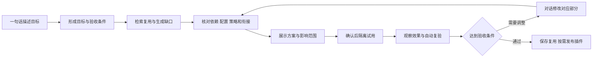

# Mods 创造者模式与插件完整性改造方案

日期：2026 年 10 月 16 日。

状态：评审修订稿。本次按“先修完整性、先交付一句话创造闭环，再提炼公用契约和完善发布”的顺序调整。本文只定义改造范围、接口责任、实施顺序与验收标准，不表示所列新增能力已经实现。

平台代码范围：`C:/ai/CmbCoworkAgent-mods-v2`，分支 `codex/mods-v2`。
AutoBiz 对照源码：`C:/ai/autobiz_kanban`，保持只读。本文记录方案评审基线；后续已授权的 S0/S1 实施范围、冻结条件与验证进度见 [S0/S1 执行记录](mods-creator-s0-s1-execution-2026-10-16.md)，不据此提前实施 S2 或 S6。

## 一 目标与架构决策

用户通过一句话描述目标，创造者理解需求，复用或生成 Mods，组合能力、策略与配置，确认后试用，通过对话继续修改和复验，最终生成可安装、可导出的插件。普通使用者安装插件后，绑定自己的知识源、工具和项目参数即可运行。

首个交付目标是当前聊天中可用的“一句话描述 → 组合或生成 → 必要确认 → 看到实际效果 → 局部修改 → 保存复用”。完整业务插件导出是后续独立交付，不要求先完成全部平台抽象才能改善日常使用。

平台提供跨业务共用的执行与验证机制。创造者负责需求到方案的组织，Mods 提供具体能力，插件负责发布与复用，Hooks 负责事件触发的处理。AutoBiz 的业务阶段、知识拼接规则、产物语义及 Python 校验继续由插件维护。

本方案确定以下边界：

1. 复用现有 Agent 执行链、能力协议、权限系统、项目运行时和安装器，不建立第二套 Agent 主循环或平行业务状态机。
2. 创造者的规划、检索、修复策略可以逐步成为可替换的官方扩展；可信工具适配、作用域、授权、持久化和结果核验由平台执行。初期保留原生创作工具注册与默认策略，不以扩展安装成功作为恢复创作能力的前提。
3. 公用底座不解释 AutoBiz 的 `PRD.md`、`plan.json`、checkpoint 名称或订单字段。插件通过公开协议提供这些含义。
4. 组合、配置、业务运行与发布分别记录状态；静态检查通过、试用已准备、正在排队均不能代表实际效果已验证。
5. 自由组合以明确契约为基础。系统可以验证声明、文件、交接和执行证据；业务含义由插件校验器与明确的人工验收共同保证。
6. 本轮先确定方案。阶段状态回退、从中间阶段重跑等后续能力不提前开发。
7. 组合计划只引用现有动作、运行入口、配置和校验器，不引入独立的流程解释器、业务调度循环或能自行推进阶段的状态副本。现有运行器继续持有执行、取消、租约和恢复责任。

### Mods 的优势与本方案的取舍

| 目标 | 发挥的 Mods 能力 | 必须保留的边界 |
| --- | --- | --- |
| 聊天框上方增加天气和工具计数 | 组合界面、网络动作和真实工具事件观测 | 不要求创建业务流程，不修改原聊天执行链。 |
| 给 AutoBiz 增加质量检查和 worktree 进度 | 复用原业务阶段，叠加检查、观测和显示 Mod | 不把原 Python 业务重写进平台，不把展示能力变成业务阶段。 |
| “卡片增加耗时，其他保持原样” | 按稳定模块身份修改对应实现或配置，复验受影响部分 | 不重跑无关业务；按真实安全切换点生效，不承诺任意时刻热替换。 |
| “把这套搭配保存下来，另一个项目也用” | 保存命名组合，随后按需发布独立插件 | 本地组合、正式安装与可移植包分别记录；新项目重新绑定环境和授权。 |

Mods 不必都是流程节点。观测、界面、输入输出变换和业务动作可以按需组合；同一业务运行可使用不同展示或观测能力。方案的价值必须体现为局部修改和复用成本降低，不能只把自然语言转换成另一种固定流程图。

## 二 现有实现与真实缺口

### 现有能力应继续复用

| 范围 | 代码基础 | 已具备的能力与边界 |
| --- | --- | --- |
| 创造者入口 | `src/main/agent/mod-authoring-runtime.ts`、`src/main/ipc/mods-development.ts`、`src/renderer/src/components/customize/creator-mode-entry.ts` | 原生创造者模式与 `mod_authoring`、`mod_composition` 工具，包含 SDK 目录、组合和项目制作指引。 |
| Mod 制作 | `src/main/mods/devtools/development-service.ts`、`authoring-store.ts`、`authoring-version-repository.ts` | 源码保存、版本、检查、提交、真实试用与状态。`submit` 返回的检查结果明确不等同于效果已验证。 |
| 组合与复用 | `creator-composition.ts`、`creator-composition-history.ts`、`creator-reuse.ts` | 真实来源目录、组合暂存、轮末空闲应用、选择撤回、复用安装及过程记录。当前聊天组合不能直接等同于可导出的完整插件。 |
| 源码版本撤回 | `creator-trial-undo.ts`、`development-service.ts` | 停止首次试用，或将前一版源码作为新版本提交；不撤销文件、网络和进程效果。 |
| 项目插件制作 | `project-authoring-session.ts`、`project-development-session.ts`、`project-contract.ts` | 项目草稿、编译、检查、隔离目录准备与打包。开发视图的 `executed: false` 表示准备完成；合同测试不执行真实业务脚本和模型。项目草稿仍有进程内会话和恢复边界。 |
| 通用能力与界面 | `src/shared/mods/v2/platform-capabilities.ts`、`src/main/mods/v2/platform-capabilities*.ts`、`platform-surfaces.ts`、`platform-behaviors.ts` | 类型化发现、状态、订阅、受控动作、界面与行为扩展，以及来源、版本和作用域校验。 |
| 配置 | `src/shared/mods/v2/user-config.ts`、`src/main/mods/v2/user-config-values.ts`、`user-config-secrets.ts` | 配置声明、校验、值和敏感项处理。需要统一插件、项目、任务及创造者的配置绑定。 |
| 业务阶段组装 | `src/shared/business-mods.ts`、`src/main/plugins/business-mod-assembler.ts`、`business-mod-selection.ts` | 资源物化、来源摘要、依赖、原校验声明、生成、安装和导出；共享内核及业务协议仍有 AutoBiz 专用适配。 |
| 项目与产物 | `src/main/harness-board/project-runtime/`、`src/shared/project-runtime/stage-check-receipt.ts` | 来源快照、作用域、阶段检查、状态提交、产物交接及凭据。不能将某条特定桥接链的证明扩展为所有插件的通用保证。 |
| AutoBiz 阶段回退 | 插件 `hooks/rollback_stage.py`、`parallel_batch_lifecycle.py` | 已有原业务阶段回退、代码基线及产物处理逻辑；应作为未来阶段调试的业务适配基础，不等同于跨插件的通用调试闭环。 |
| Hooks | `src/main/hooks/scope.ts`、`runner.ts`、`src/main/plugins/runtime-source-scope.ts` | 原插件及 Skill Hook 作用域、执行、环境与记录；需要补充必执行检查和组合冲突语义。 |

### AutoBiz 审计基线

以当前 AutoBiz 源码在内存中选择全部八个业务模块重新组装，得到以下结果：

| 检查 | 观察结果 | 改造含义 |
| --- | --- | --- |
| 文件及内核 | 来源快照 1,179 个文件，生成包 208 个文件，共享内核声明 130 个资源 | 文件数量差异不直接表示业务信息丢失，应按依赖闭包核对。 |
| Hooks | 12 个 PreToolUse、3 个 PostToolUse 处理器保留 | 配置存在是必要条件，还需证明适用范围和实际执行。 |
| 配置 | `apiVersion`、`agentsRepo`、`knowledge_config`、`supported_deploy_units`、`inspectCommands`、`checkpointSuffixState` 与来源一致 | 非流程配置已保留，但引用可用性、运行数据位置与可移植性仍需检查。 |
| 动态阶段 | `dynamicStages` 从 1 个变为 0 个 | 选中的详细设计成为固定节点；原条件启用、跳过交互未原样保留。 |
| 知识依赖 | 来源和生成包均没有 `sys` 知识库及 `knowledge-sync` Skill | 属于既有外部依赖或缺失入口，不能声称是组装删掉了源内容；当前生成检查没有给出相应诊断。 |
| 内部 Python 导入 | 对生成文件中可静态识别的已有内部 Python 模块引用，未发现声明遗漏 | 该检查不覆盖动态导入、运行环境、知识库、任意文件引用和业务正确性。 |
| 诊断 | 此次完整组装 `diagnostics` 为空 | “生成成功”尚未覆盖上述行为变化和运行条件。 |

还存在需要统一处理的链路缺口：知识加载可在部分 `loaded: false` 时返回 `ok: true`；同步脚本会写回受来源校验保护的配置；workflow 独立子运行时没有直接接收父会话已解析的知识提示；Python 的 `toolConfig.task.enabled` 没有被平台归一化完整保留；阶段运行模式主要在创建会话时初始化；提示词变换主要验证结构，不保证必需段落被保留。

这些问题既包括原插件与平台之间的既有适配问题，也包括新组装路径的语义缺口，应在兼容基线中分别标记来源。

### 先修复可定位的完整性问题

S0 按以下问题建立正常与拒绝对照，使用现有服务或范围明确的兼容适配修复，不等待统一扩展契约完成：

| 优先问题 | 首轮修复与验收 |
| --- | --- |
| 必需知识未加载却整体成功 | 区分必需与可选来源；必需项缺失阻断对应业务入口，可选降级留下真实记录。 |
| 同步改写受保护插件配置 | 将同步缓存和机器绑定写到可变数据目录，保留旧配置读取适配；同步后来源校验仍有效。 |
| 配置和父子上下文交接不完整 | 保留 `toolConfig.task.enabled` 等已声明字段，在实际生效点核对；分别验证 task、workflow 和 coordinator 的角色必需上下文。 |
| 动态分支被静默固定 | 保留可支持的条件、跳过与确认语义；暂不支持时给出差异诊断，不显示无条件等价。 |
| 必需依赖和原检查缺失而生成无诊断 | 指明缺失来源、校验器和触发点；不通过删脚本、补假能力或降低检查获得“成功”。 |

原审计计数只作为一次观察。实施基线需记录平台与 AutoBiz 的提交或受控源码快照摘要、所选模块、检查方式和证据位置；当前可变工作树的文件数量不能作为长期兼容证明。本轮文档修订不重新执行该审计，也不将上述问题记为已修复。

## 三 职责与对象关系

下表是职责视图，不是五级调用栈，也不要求建设五套服务。创造者是制作入口，Mod 是能力组合单位，插件是发布与复用单位，Hook 是扩展机制；平台承载它们并复用原执行器。

| 层次 | 必须负责 | 不承担的业务语义 | 主要修改位置 |
| --- | --- | --- | --- |
| 平台公用底座 | 能力身份、接口、作用域、依赖验证、配置绑定、策略约束、上下文交接、检查执行、产物版本、试用与发布记录 | AutoBiz 阶段、知识库 XML 拼接、数仓字段与 SQL 规则 | 现有平台能力、配置、Hooks、项目运行时、制作及安装服务 |
| 创造者模式 | 目标澄清、检索复用、缺口生成、组合规划、配置补齐、效果调试、修复复验、发布组织 | 代替宿主签发授权、伪造检查结果或判定没有依据的业务正确性 | `mod-authoring-runtime.ts`、开发工具服务、创造者状态与界面 |
| Mods | 提供动作、界面、上下文源、校验器、事件处理等可复用实现，并声明依赖与影响 | 自行扩大会话、目录或凭据权限 | 现有 Mods 描述、SDK、提供器及模块资源 |
| 插件 | 发布身份、版本、能力组合、策略默认值、配置声明、完整依赖与兼容性、测试和升级规则 | 携带用户凭据、旧任务执行权或机器专属项目绑定 | 现有插件清单、业务目录、项目运行声明、打包和安装流程 |
| Hooks | 在事件上执行已声明处理，输入输出、顺序、权限、失败语义和结果可核对 | 用一次偶然工具调用替代必须发生的阶段检查 | `scope.ts`、`runner.ts`、传统脚本与函数扩展适配 |

Mod 与 Hook 不是一对一关系。一个 Mod 可以提供多个 Hook、动作和界面。插件内的规则通过策略选择和约束这些实现。

## 四 公用契约与现有协议的演进

### 采用现有协议作为入口

保留 `devclaw.capabilities/v1`、`cmb.mods/v2`、Claw 组件与动作导出、`devclaw.project-runtime/v1`、业务 Mods 目录及现有配置声明。先增加适配读取与统一检查，不替换已经运行的执行链。

当前多份 v1 解析器严格拒绝未知字段。新增语义不能直接塞进旧 JSON 并假定兼容。候选方案是小型、可选、版本化的扩展契约索引，暂定文件名 `devclaw.extension-contract.json`，只补充现有协议缺少的依赖、上下文、策略与验收引用。S0/S1 优先使用现有协议和局部适配；S2 经轻量场景与业务场景验证后，再冻结确实需要的文件、字段和版本。本方案中的名称不代表现有 API。

索引引用已有能力、动作、组件、流程和校验器，避免复制同一份业务定义。读取适配器在宿主中生成绑定记录与检查计划，执行仍委托现有运行器；不增加节点调度、独立阶段提交或平行恢复循环。只使用普通旧能力的插件继续按旧协议运行。

新增旁挂 JSON 本身不能保证旧客户端理解或拒绝新语义。S2 必须定义最低支持平台、索引与来源摘要的绑定、安装及所有相关执行入口的兼容检查。旧客户端会忽略必需语义的包，不能保留可绕过检查的旧自动执行入口；无法证明拒绝路径时，不向该版本分发此类包。兼容矩阵分别记录可读取、可安装和可执行范围，不只显示一个整体兼容标记。

### 按实际能力使用契约

以下契约是可选能力的集合，不是每个 Mod 都必须填写的统一大清单：

| Mod 或交付形态 | 需要的最小声明 | 不强制引入 |
| --- | --- | --- |
| 天气、计数和进度展示 | 身份、真实渲染或事件接点、必要权限、配置、订阅清理和可观察验证 | 业务阶段、产物图、业务状态机。 |
| 输入输出变换 | 身份、接点、读写字段、顺序、冲突、结果语义与验证 | 独立流程定义和任务调度器。 |
| 业务动作或阶段 | 原动作或阶段引用、必需输入和上下文、前后检查、产物与失败语义 | 另一份与原运行器竞争的阶段状态。 |
| 可移植插件 | 上述已选能力的实现或锁定依赖、默认值、兼容与绑定说明、安装和验收材料 | 用户凭据、会话执行权和原机器绑定。 |

### 必须明确的契约

| 契约 | 最小语义 | 验证责任 |
| --- | --- | --- |
| 能力与依赖 | 稳定提供者、模块及动作身份，协议版本、源码摘要、必需与建议依赖、外部环境 | 平台验证真实存在与版本；创造者检索选择，不能凭模型文字发明来源。 |
| 配置 | 类型、默认值、作用域、敏感项、覆盖与合并规则、变更影响、迁移 | 平台解析和绑定，插件定义业务字段；值与包分开。 |
| 策略 | 规则来源、适用阶段及角色、必需条件、允许覆盖的字段、授权修改者 | 平台执行约束，插件制定业务规则，创造者提议改动。 |
| 上下文 | 来源引用、版本及摘要、必需性、角色范围、允许的降级及变换 | 平台记录采集、解析、选择、变换和请求交付；插件解释知识内容。 |
| 处理器与检查 | 事件或阶段入口、处理类型、先后依赖、可写字段、结果、失败语义与副作用 | 平台保证契约执行；业务校验器判断业务条件。 |
| 产物 | 生产者、类型与 schema 版本、消费者、输入摘要、输出摘要、检查和新鲜度 | 平台管理版本与证据；插件负责解析、转换与业务校验。 |
| 调试与验收 | 精确候选版本、隔离目标、输入、预期观察、检查结果和副作用 | 平台管理试用与记录；创造者对照目标复验，业务确认按策略保留。 |

身份使用包身份、模块 ID、版本及内容摘要。安装 UUID、当前会话 ID 和本机绝对路径由宿主绑定，不能写成可移植插件的依赖身份。

## 五 平台公用底座改造

### 依赖闭包与能力发现

在既有目录和能力发现上补充资源、Skill、Hook、校验器、知识源及运行环境的闭包验证。每个必需引用必须解析到一个确定提供者，缺失、歧义、版本不兼容或资源被排除时返回具体诊断。

发现和静态预览不执行插件脚本、不触发知识同步、不调用模型。环境检测和真实连接检查是显式的受控动作；权限不足显示“待确认”，不冒充已可用。

语义检索可以由创造者扩展实现。宿主负责能力目录的真实身份和精确绑定，不在底座硬编码需求关键词到 AutoBiz 模块的映射。

### 配置与策略解析

复用 `user-config-values.ts`、`user-config-secrets.ts`、`composition-config-patch.ts` 及既有配置界面。为现有工作区配置增加稳定的插件谱系与模块身份映射，并支持明确的用户、项目和单次任务绑定。

普通可配置字段的解析顺序为：插件默认值、用户对该插件的设置、项目绑定值、被允许的本次运行覆盖。仅在字段声明允许覆盖时采用更具体值。组织或项目强制约束单独校验，不参与“后值覆盖前值”。

数组、对象合并、显式删除、空值与缺省值必须有一致规则。对话修改、表单修改、导入和自动配置共用服务；不能存在一条绕过校验的模型专用写入路径。

每次执行冻结有效配置版本。修改参数只影响新执行或经过确认的安全切换点；无关模块开关变化不得使原生会话或非参与运行失效。权限或来源改变继续按原规则停止对应参与者。

局部变更按模块、配置字段和真实依赖计算影响。例如仅修改进度显示，不改业务输入、业务配置和阶段状态，也不触发整条业务重跑。包完整性与现有授权继续有效校验；若当前共享版本粒度无法安全分离，明确等待原运行器的安全点，不能通过跳过摘要检查获得“即时更新”。

### 上下文与角色交接

提供通用 Context Provider：插件读取知识、项目资料和必要规范，返回内容引用、版本、摘要、装载状态及适用角色。内容本身可保持插件定义的 Markdown、XML 或结构化格式。

宿主签发运行作用域，提供者不能靠声明取得其他项目或目录的访问权。装载凭据至少区分：已发现、已读取、已解析、已选入当前角色、经允许变换后提交给最终请求适配器、缺失或降级。

必需上下文缺失时阻断对应阶段。可选知识可以按插件声明降级，但降级结果进入运行记录。返回 `ok: true` 或生成非空提示词不能替代逐项必需性检查。

提示段落声明追加、受控变换或允许替换的范围。宿主在最终请求适配边界核对必需引用与摘要，记录被合法变换后的版本。模型接口接收记录不代表模型一定理解或遵守内容，不生成此类证明。

为普通 task、workflow 独立子运行时、coordinator worker 分别建立交接适配。按角色选择最小必需上下文；受限角色可省略非必要记忆，但不能静默省略其任务必需约束。

目录分别表达只读插件资源、可变插件数据、共享产物、任务代码根和 worktree 根。移动代码根不得意外移动 Feature 身份或产物目录，也不能将父目录写权限交给子任务。

### 检查执行与结果凭据

区分平台强制约束、插件声明的必需业务检查和普通扩展 Hook。必需检查在宿主准入或提交边界执行，不能仅依赖可短路的中间件链。

检查结果包含来源与版本、规则、目标、输入摘要、结果、诊断和执行标识。通过条件必须匹配本次目标及有效版本；缺失、超时、异常、已取消和未知结果都不等同于通过。业务人工认可记录为独立状态。

复用 `StageCheckReceipt` 与现有阶段提交链，在兼容适配层补齐来源、输入绑定和执行状态。旧凭据不提升为新协议下更强的证明。

### 产物与流程执行

保留现有 `stateOwner`。AutoBiz 继续由原状态机持有业务状态，平台通过读取、检查与受控提交适配器操作；不另建一份可独立前进的镜像状态。

组合检查同时处理步骤依赖、输入生产者、类型版本、条件可达性、跳过路径和人工确认。字符串路径相同不代表业务 schema 兼容。需要转换时显式加入转换动作或 Mod。

下游运行绑定实际输入摘要。上游更新后，依赖旧输入的检查和完成凭据失效或标记过期，不自动删除原产物，也不凭文件仍存在认定可继续。

复用原运行记录、租约及恢复机制。只有提供器声明且实现幂等性的动作才允许自动重试；网络请求、发布等外部结果不明时进入待核对状态，不统一承诺回滚。

## 六 创造者模式改造

### 统一用户闭环

一句话是任务入口，不要求用户同时知道模块名、参数名或组装页面。系统仅询问无法从已有配置和事实确定、且影响结果的信息，例如知识库来源、真实数据授权或发布目标。

### 制作任务与业务运行分开记录

扩展当前制作会话为持久的创作任务，关联需求版本、能力目录快照、组合计划、配置修订、候选源码、试用和验收。业务运行继续使用原运行记录，创作任务只引用结果。

创作记录保存需求、候选及操作引用，不另行持有一套能推进业务的状态机。草稿、试用、组合、配置、业务运行和安装结果仍由原服务持有；通过版本和操作标识关联并派生视图，不能由创造者写一个“成功”覆盖原服务结果。

默认界面只呈现“正在准备、需要确认、已应用、需要调整、结果待核对”等用户状态，具体进程和技术细节按需展开。状态需要同时说明候选和当前运行版，例如“新版检查未通过，旧版仍在运行”；“已应用”也不等于业务验收通过。重试、取消和核对继续调用原服务，不通过修改显示状态触发动作。

重启恢复先核对草稿、候选及执行结果，再恢复 UI。持久化计划或先前成功不等于当前授权；未完成外部动作不因恢复而自动重放。项目草稿需从当前进程内保存补充为持久版本引用。

第一版持久记录只需关联需求修订、目标作用域、已选模块与来源、配置修订、草稿版本、原服务操作标识、观察结果和预算消耗。执行时由原宿主重新绑定有效授权；不保存可跨重启复用的旧执行权，也不复制完整聊天或业务产物作为第二份事实来源。

### 复用现有工具并增加统一组织层

继续使用 `mod_authoring` 的目录、源码、检查、提交、试用、版本及项目制作动作；继续使用 `mod_composition` 的真实目录、暂存、保存、应用和撤回；继续调用原安装和导出服务。

统一组织层将它们连接为同一创作任务，并为完整业务插件提供适配入口。不能把 AutoBiz Python 插件直接交给只支持受限纯函数项目的编译器，再通过删脚本、删 MCP 或改为虚构阶段来获得通过。

“创建 Mod”“组合已有能力”“创建完整插件”是同一目标下的执行策略，由创造者选择。普通用户不必预先选择技术路径。复用失败时保留诊断和现有成果，不退回要求用户手工重搭整个流程。

S1 先接通受支持函数 Mods 的真实试用、组合、局部修改和本地复用。无 AutoBiz 的文档审查场景同阶段接入已有能力；不支持的动作明确诊断。完整项目插件从起点运行的隔离样本链在 S3 接通原项目执行入口，补足真实执行与观察适配，不能将 `project_dev` 的目录准备称为已试用，也不能以等待 S6 为由只交付静态预览。

### 自动修复、观察与交互预算

复用当前作者工具每轮最多三个候选、操作次数和时间等现有约束。创作任务还需记录跨轮累计的修复次数、模型与工具调用、时间及费用预算；不能通过自动新开轮次绕开限制。预算值在实施时结合基线明确，达到上限、用户停止、作用域失效或结果未知时停止自动推进并保留成果。

验收条件来自用户目标与可信观察：界面内容和事件、真实动作结果、输入输出关系、独立宿主检查，以及明确的人工业务认可。模型生成的样例或测试只能作为一类材料；模型同时编写实现与预期，再自行宣布全绿，不构成完整效果证明。

日常路径不要求打开模块、搭配或步骤管理页，也不要求复制修复文本。复用已有有效批准；仅在范围、来源、目标、权限或授权有效性等实际条件要求时再次确认。多个确认项尽量合并呈现，但网络、安装等原宿主审批不能由模型代替或因减少点击而跳过。

创造者策略可替换时，模型与规划器使用相同原生工具和结果接口。策略扩展缺失或损坏应回到默认创作与诊断入口，不能同时丢失安装、停止、修复和恢复能力。

### 对话修改按影响范围处理

| 用户意图 | 实际修改 | 需要复验 |
| --- | --- | --- |
| 这次换一份 CSV | 单次任务输入 | 输入校验及依赖该输入的业务阶段 |
| 默认最多两个 worktree | 插件或项目配置 | 字段、运行影响及调度行为 |
| 增加重复订单校验 | 业务策略与校验 Mod | 校验正反例、失败阻断及下游失效 |
| 进度卡片增加耗时 | 界面或观测 Mod | 事件订阅、显示、清理及不干扰主任务 |
| 回到上版显示效果 | 源码或组合版本 | 候选检查、当前作用域及试用切换 |
| 从 SQL 阶段重新调试 | 业务输入快照与执行计划 | 满足阶段调试条件后重跑，不与源码撤回混同 |

已明确授权范围内的迭代由宿主按精确新版本重新检查并应用。扩大权限、访问新的目标或更改必需策略时展示增量并取得相应确认。审批由可信界面和原服务处理，模型不能给自己批准。

局部修改同时返回“修改什么、保留什么、复验什么、何时生效”。保留项通过版本、配置或原运行记录核对；只更新界面时不重跑业务，不因新建 Mod 而覆盖用户原有组合。需要失效的检查按真实依赖处理，不把所有历史结果一律标绿或一律作废。

## 七 Mods 与插件发布形态

### Mod 的最小交付要求

每个可组合 Mod 声明用途、适用范围、稳定身份、入口、依赖、配置、读写影响及验证方法。按实际能力引用动作、上下文提供器、校验器、Hook 或界面；不要求每个 Mod 实现全部类别。

声明顺序和冲突关系时使用稳定模块身份。并行组合不能只靠安装顺序或插件名称排序决定行为。未声明动作的旧 Skill 仍可保留旧入口，不自动伪装为可结构化调用的动作。

业务阶段同时提供输入输出及前后置检查。观测和展示 Mod 可以独立复用，不与某个阶段完成状态绑定。新增 worktree 展示通过通用运行事件和平台界面接口接入，AutoBiz 适配器只负责解释其批次字段。

### 插件发布内容

插件包包含身份和版本、所选 Mods 的实现或精确依赖、业务策略默认值、配置 schema、流程与产物契约、界面和动作入口、兼容范围、锁定清单及可移植的验收用例。

默认独立生成包应携带必要的非敏感代码和资源。无法随包分发的知识、服务或环境以外部依赖明确列出，并提供绑定流程。在线引用和离线物化属于不同发布方式，分别显示可用条件。

不导出安装批准、用户凭据、真实任务产物、工作树租约、原项目状态和本机绝对路径。知识可打包时使用经用户允许的明确快照；不因“完整插件”自动复制企业知识和私人配置。

生成插件和保存当前聊天组合分别作为独立交付状态。发布时将会话选择编译为可移植依赖，重新校验来源及版本；不能直接把含安装 UUID 的 Claw 选择对象当作独立插件包。

### 用户配置与策略归属

创造者偏好独立于生成插件，例如默认技术栈、交互方式和修复预算。业务配置由生成插件声明，例如知识源、并行数和输出位置。一次任务的数据和范围属于运行输入。

插件作者制定原始业务规则，团队制定其约束，用户在有权修改的范围内提出调整。创造者将自然语言要求编译为待审策略差异；平台校验来源和修改权限，并执行生效规则。

修改策略发布新版本并保存前后差异。必要检查不能通过更换字段、遗漏声明或删除来源引用而静默取消。合法定制通过明确的策略版本和授权完成，不永久固定所有插件业务规则。

## 八 Hooks 改造

### 三类处理逻辑

| 类型 | 示例 | 默认组合语义 |
| --- | --- | --- |
| 约束与检查 | 状态转移、产物完整性、写入范围 | 汇总必需结果，失败不能被后续成功覆盖。平台强制约束始终执行。 |
| 输入输出变换 | 任务描述增强、提示词补充、工具参数调整 | 明确顺序、可写字段和合并方式；冲突不能静默由最后一个值覆盖。 |
| 观测 | 工具次数、耗时、worktree 进度 | 默认不改变业务结果；丢失和错误可观察，不能伪造成功事件。 |

事件处理器和阶段检查分别绑定。进入发布前必须发生的业务检查直接绑定阶段准入或提交，不依靠用户刚好执行一次 `write_file`。

### 平台执行链

在原 `scope.ts` 与 `runner.ts` 上补充处理器契约、顺序解析和冲突诊断。新增声明只在明确版本的模式中启用；原传统 Hook 默认行为保留，迁移时提供行为对比。

传统 `updatedInput` 当前是各处理器读取原输入后合并。新变换链可选择顺序传递已变换输入，或按声明字段聚合；两种语义需显式区分，不能悄悄改变全部旧 Hook 的输入。

必需业务检查绑定原宿主准入与提交边界：验证调用目标与授权，准备上下文，执行必需前置检查，进入允许的扩展与动作链，核对真实动作结果，执行必需后置检查，提交结果凭据。这是围绕当前受控操作的检查序列，不负责业务节点调度或另起恢复循环。动作和检查发生异常时记录明确失败阶段。

可替换中间件不能通过不调用 `next`、伪造处理结果或覆盖 `blocked` 来绕过必需检查。需要修改业务规则时更新有权修改的策略版本，而不是修改平台强制约束。

三类处理不能合并为“全部强制 Guard”。平台权限与作用域约束由宿主保证；插件必需业务检查跟随经授权的策略来源和版本；普通变换仍可在声明范围内接管行为，观测仍以不干扰业务为默认。

准入检查必须覆盖变换后的实际目标和参数，发生相关变换后在原动作执行边界重新核对。宿主以真实执行记录签发结果凭据，区分已执行、合法接管或未执行；`next` 未调用或 Mod 返回成功对象，都不能冒充原动作已经完成。后置检查和提交使用该真实记录及当前输入摘要；插件校验器的输出须经原受控调用及来源、输入、产物核验后进入记录，不能仅凭模型或非受控调用输出的一段成功 JSON 签发凭据。不得先允许不受控副作用，再用末尾校验充当执行前的权限保证。

### AutoBiz 保留方式

首轮保留现有 Python 脚本及校验语义，只增加包装和声明。将 `state_checkpoint`、写入与运行产物约束、证据检查等列入明确的迁移清单，逐个判断触发点、失败语义和必需性。

`persistAfterInterrupt` 只表示原作用域内的持续行为，不代表无条件放行或跨项目复用。原版、衍生版和组装版同一运行只采用已绑定来源；子 agent、结束回调和恢复沿用同一冻结身份。

## 九 AutoBiz 专项适配

### 知识库与配置

1. 将 `agentsRepo`、部署单元映射及知识选择声明为知识提供器配置；保留原系统级、单元级、工作区及领域上下文的拼接规则。
2. 将知识库缓存和同步清单迁到平台分配的可变数据目录，按插件谱系、知识源和版本隔离；同步不再改写只读插件包中的 `board_config.json`。
3. 为旧配置保留占位符兼容适配，解析完成后形成类型化路径绑定。导出前检查绝对路径及未解析引用，不执行全包字符串替换。
4. 为缺少的 `knowledge-sync` 定义真实提供者或更正入口；绑定不到时显示具体原因，不生成一个只有名称的假能力。
5. 为必需与可选知识分别定义策略。远端失败回退本地时记录来源；必需项没有内容时停止，不能仅以整体 `ok` 放行。
6. 调试可采用本地受控知识快照；真实内网连接和凭据使用单独验收，不能由本地样例替代。

### 上下文与阶段策略

保留项目、Feature、部署单元、产物目录、工作目录及 worktree 的区别。Context Provider 输出清单和摘要，原提示文本作为内容，不以摘要代替模型需要读取的正文。

贯通 Python 输出的 `agentConfig` 与平台运行策略，明确 `agentMode`、task 工具开关、角色文件及询问策略在会话创建、阶段切换和子任务启动时的生效点。配置归一化不得静默丢字段。

workflow 子运行时显式接收角色需要的已验证上下文引用，并在自身请求边界记录实际交付。只有读取本地 AGENTS 文件而没有继承插件知识，不能判定继承完整。

### 流程与产物

保留 AutoBiz 原状态机、`update_checkpoint.py`、`stage_gate.py`、产物前后检查和证据实现。共享内核仍可集中提供这些脚本，不要求先拆成八份重复脚本。

组装编译器保留可表达的动态详细设计分支、跳过规则、人工确认和原跳转参数。不支持的结构显示行为差异并阻断自动宣称等价；用户明确选择固定流程时才能将条件分支固定化。

原有 `extract.degrade` 仅作为修复说明。必需输入缺失时应进入补齐、转换、明确的外部输入绑定或被允许的策略调整，不能把一段自然语言当成已满足依赖。

数仓 MODEL、SQL 及质量结果按真实消费者连接。接入原 Code 时明确其输入绑定或新增转换 Mod；禁止以“节点在前面”代替“产物被消费”。保留现有数仓示例中的输入摘要及业务待审状态。

### 兼容策略

保留当前 `autobiz-v1` 适配及已审查来源校验，作为受支持的旧提供器。新增公开适配协议后，让 AutoBiz 通过插件声明和授权注册业务提供器，再逐项迁移。

不能直接删除固定内核摘要或白名单来获得“任意插件兼容”。迁移后由包摘要、提供器身份、权限、协议版本和检查凭据承担原保障，并用反例证明无法绕过。

## 十 对话调试与阶段调试

| 级别 | 目标 | 现状与改造 |
| --- | --- | --- |
| L1 源码与组合调试 | 修改界面、提示、参数和当前组合，以真实界面或动作观察效果 | S1 先交付函数 Mod 与组合闭环；S3 扩展完整项目从起点的样本运行，复用已有版本、试用、撤回和原运行器。 |
| L2 目标阶段隔离试用 | 基于既有业务阶段的输入快照，独立调试目标阶段 | S6 新增阶段快照绑定与隔离执行适配；现有 `project_dev` 只准备目录，不足以完成此验收。 |
| L3 从上游状态分支重跑 | 恢复受控起点、修改一个 Mod、重跑受影响阶段 | AutoBiz 已有 `rollback_stage.py`，通用闭环仍是后续目标；需要接入一致的阶段输入快照、产物凭据、状态适配和副作用检查。 |

S1 的函数 Mod 真实试用、受控动作验证，以及 S3 在新隔离目标中从起点运行样本，均不依赖恢复某个既有中间阶段。L2/L3 专指带业务阶段快照的隔离调试或分支重跑；不能把所有真实执行都归入 S6，导致早期闭环只有目录和静态合同结果。

L2/L3 调试基线绑定插件和 Mod 版本、配置与策略版本、上下文摘要、输入产物摘要、状态及代码基线。先停止并等待相关物理任务结束，再准备独立调试目标。

优先创建调试分支或沙箱，保留原运行。恢复输入文件不等于恢复数据库、发布或网络副作用。无法隔离、结果不明或没有补偿协议的动作明确标记待核对。

修改后计算受影响范围，执行对应正反例与真实运行；只有输入及依赖仍一致的已验证结果可以复用。恢复不是把 checkpoint 文本改回旧值，也不是直接复用旧会话授权。

AutoBiz 回退优先调用其原回退计划与执行逻辑，保留对代码基线、活动批次、后续产物和 `UI_CONTEXT.json` 等已确认输入的处理。平台只提供统一调试生命周期与隔离目标，不在主程序重写这些业务规则。原地回退与独立分支试用分别展示影响，不能把会删除或重置后续产物的动作包装成无影响的“预览”。

## 十一 一句话创造的完整示例

### 首批交付：组合、局部修改与本地复用

用户需求：“聊天框上面显示工具计数和天气预报，保留我现在的功能。”

1. 读取当前组合与真实目录，优先复用已有界面、天气和观测能力，只生成缺少的部分；地点等影响效果且无法推断的信息才询问。
2. 形成可观察条件：天气来自真实受控请求，计数对应真实工具事件，原有功能保留；明确网络审批和刷新方式。
3. 复用原检查与试用服务，核对依赖、必要配置和精确候选，取得必要确认后在安全点应用，显示实际效果；不要求用户选择流程步骤。
4. 用户说“卡片加上耗时”，只修改显示或观测模块，验证计数、显示和订阅清理，不重新执行业务任务；如果原运行仍占用切换点，明确等待而不伪称已更新。
5. 用户说“保存成日常开发组合”，保存真实来源和可重用设置；切回普通模式继续使用。另一个聊天套用时核对该目标的来源、配置和授权。
6. 用户说“撤销刚才的显示修改”，走原源码或组合撤回能力，不撤销此前真实网络请求、工具写入或其它外部动作。

同阶段增加不依赖 AutoBiz 的文档审查场景：组合已有审查能力与结果展示，用受控文档和正反例观察实际结果；局部调整展示时保留审查输入和已核验结果。两种场景均不用新增平台业务分支，不能仅以天气示例通过替代业务场景验收。

### 后续交付：完整业务插件

用户需求：“制作一个订单数仓开发插件，使用团队知识库，最多三个 worktree，显示每个工作树进度，质量检查后由我确认发布。”

1. 创造者读取现有用户与项目配置，确认真实知识源、数据授权和发布目标；已知参数不重复询问。
2. 形成验收条件：知识装载完整；模型与 SQL 输入一致；质量失败不能发布；每个 worktree 的阶段、耗时和异常可见。
3. 检索 AutoBiz 内核、数仓阶段、质量检查及通用进度展示，固定提供者版本，识别需要生成的转换或展示部分。
4. 编译依赖、流程、输入输出、角色上下文和配置；显示分支变化、缺失条件、权限和预期写入。
5. 用户确认后使用受控样本及隔离目标试用，执行真实阶段与校验，显示实际产物和运行事件。
6. 用户说“增加重复订单检查”，创造者修改校验与策略版本，保留其他配置，复验通过例和失败例。
7. 用户说“卡片增加耗时”，仅修改观测展示 Mod，验证订阅、清理和主任务互不影响。
8. 达到验收条件后按用户意图准备独立插件；发布能力通过 S4 验收后，导出实现、契约、默认值与用例，安装者重新绑定自己的知识和凭据。业务产物发布与插件包发布分别确认，不将两者混为一个操作。

上述业务编排由插件实现，平台只处理能力、上下文、检查、产物和运行等通用对象。

## 十二 实施阶段与工作包

### 交付顺序

先修已确认的完整性问题，同时准备轻量创造者闭环；随后根据两类真实场景提炼最小公用契约，再完成复杂业务适配与可移植发布。不得把先做完整通用平台、再回头改善用户操作作为依赖关系。

| 阶段 | 工作包 | 交付内容 | 阶段验收门槛 |
| --- | --- | --- | --- |
| S0 完整性修复与基线 | W0；W1–W6 中已定位的修复部分 | 固定来源证据，修复必需知识放行、配置及上下文交接、受保护配置写回、动态分支与依赖诊断；保留原执行器和旧协议。 | 每项正常与拒绝回归通过；不支持的行为明确诊断，不虚报原版等价；记录当前用户操作与耗时基线。 |
| S1 一句话创造最小闭环 | W7 首批；W2/W8 的现有配置与本地复用接线 | 用原工具完成组合或生成、必要确认、真实可见效果、对话局部修改、撤回、命名保存及目标聊天复用；持久记录引用原服务结果。天气/计数与非 AutoBiz 文档审查均进入验收。 | 不打开技术管理页即可完成；局部修改保留其他组合，不重跑无关任务；失败保留旧版、草稿和准确状态；新目标重新核对有效授权。 |
| S2 最小契约与跨场景验证 | W1–W5 的通用部分；W7 绑定适配 | 仅补已验证缺口，冻结按需声明、稳定身份、配置绑定、上下文引用、Guard 与真实结果凭据、兼容门禁；以轻量场景和业务场景验证同一适配边界。 | 旧 v1 行为保留；新语义缺失或不支持时拒绝相关执行；非 AutoBiz 场景无需内核特判，不存在新调度循环或平行业务状态。 |
| S3 完整业务插件真实闭环 | W6；W3–W5 集成；W7 项目试用接线 | 将 S0 修复接到最小公共协议；保留 AutoBiz 原 Hooks、知识规则、动态分支、产物消费和状态持有者；接通从起点执行的隔离样本链及真实观察。 | 原版与组装版正常及拒绝路径对照、父子 agent 和多 worktree 连续性通过；项目试用实际执行，不能仅返回目录已准备。 |
| S4 可移植发布与升级 | W8 发布部分 | 将已验证组合编译为插件包，完成依赖锁定、导出、重新安装、配置迁移和未知结果核对；本地组合与可移植包分别显示。 | 在新用户目录或另一台电脑重新绑定后可用；不导出原凭据、批准和任务状态，不覆盖用户已有配置。 |
| S5 整体验收与稳定性 | W0–W8 集成验收 | 贯通两个业务范围、失败恢复、策略替换回退、兼容门禁和性能测量；此阶段不再新增公用引擎或要求所有 Mod 补全业务契约。 | A01–A16、A18–A25 及 A17 的 L1 部分通过；安装包证据、失败记录和交互指标齐备，完整插件可发布。 |
| S6 阶段调试 | W9 阶段快照与分支试用 | L2 及满足条件的 L3 调试，受影响范围计算 | 不篡改原运行、不复用过期检查、不自动重放未知副作用。 |

首个可交付闭环是 S1 的本地创作与复用，不等待 S5；完整业务插件执行在 S3、可移植发布在 S4 分别交付，S5 做集成与稳定性放行。S6 保持独立后续目标。“从起点运行真实隔离样本”与“恢复到中间阶段再运行”分别验收，后者不能成为前者的等待理由。

S0 修复与 S1 的界面、记录和现有工具接线可按文件责任准备；受完整性问题影响的场景，必须先通过对应修复验证才能启用，不能作为另一条绕过检查的快捷路径。S2 不推翻已交付的服务，只将确有共性的适配收敛为契约。共享类型、Hooks 执行入口、Agent 启动和发布事务指定唯一集成负责人，阶段通过以集成结果为准。

### 首批闭环的执行责任

调用关系保持为“创造者调用原生制作/组合工具 → 原服务检查与准备 → 原可信界面取得必要确认 → 原运行器在安全点执行 → 宿主观察并返回原结果 → 创作界面汇总”。创作组织层可保存待办意图、版本和操作引用，但不能自行执行任意计划 JSON、推进业务 checkpoint、重新实现动作取消，或根据一个显示状态自动重放动作。

S1 的最小交付材料包括一次新建、一次组合复用、一次局部修改、一次拒绝或失败、一次撤回和一次恢复的连贯记录；同时保存前后模块选择、有效配置、实际观察和人工点击计数。不能只用工具返回或管理页截图证明用户闭环完成。

## 十三 主要代码修改清单

以下为实施定位，工作包编号标识职责，不表示必须按 W1 至 W9 串行完成。新增公共文件名和最终字段在 S2 经场景验证后确定；S0/S1 优先复用现有入口。本轮未创建这些功能实现。

| 工作包 | 首批与后续阶段 | 主要现有文件 | 计划修改 |
| --- | --- | --- | --- |
| W0 | S0 基线；S1/S5 交互与整体验收 | 现有制作、组合、业务集成与 Electron 回归 | 固定来源和行为对照，记录点击、耗时、修复预算与失败恢复；不把模型样例当作真实业务认可。 |
| W7 | S1 优先接线；S2/S3 适配完整项目 | `src/main/agent/mod-authoring-runtime.ts`、`src/shared/mods/development.ts`、`src/main/mods/devtools/development-service.ts`、`creator-composition.ts`、`creator-reuse.ts`、`project-authoring-session.ts`、`src/main/ipc/mods-development.ts`、创造者现有界面 | 引用原服务的持久创作记录、局部对话变更、准确状态与真实效果；补齐项目从起点试用的执行观察，不建立新运行器。 |
| W1 | S0 缺失诊断；S2 契约与兼容门禁 | `src/shared/plugin-capabilities.ts`、`src/shared/business-mods.ts`、`src/shared/mods/claw-components.ts`、`src/main/plugins/manifest.ts`、`business-mod-manifest.ts`、`business-mod-assembler.ts`、`business-mod-selection.ts`、能力读取及安装入口 | 依赖适配、提供者身份、外部条件和行为差异；按需补充声明、摘要绑定及实际安装/执行兼容检查。 |
| W2 | S0 字段完整性；S1 局部配置；S2/S4 作用域与迁移 | `src/shared/mods/v2/user-config.ts`、`src/main/mods/v2/user-config-values.ts`、`user-config-secrets.ts`、`src/main/mods/devtools/composition-config-patch.ts` | 配置保留与字段差异，随后统一谱系身份、合并、迁移、敏感引用、策略修改权限及有效版本。 |
| W3 | S0 交接修复；S2/S3 公共适配 | `src/main/harness-board/service.ts`、`src/main/agent/standard-thread-turn.ts`、`runtime.ts`、`src/main/plugins/runtime-source-scope.ts` | 完整配置与上下文交接、最终请求观察、各类子任务和 worktree 目录约束。 |
| W4 | S0 原检查保留；S2/S3 检查契约 | `src/main/hooks/scope.ts`、`runner.ts`、`updated-input.ts`、`src/main/mods/v2/dispatcher.ts`、项目检查入口 | 区分权限 Guard、业务必需检查、普通变换与观测；校验实际参数，绑定真实执行结果，保留传统兼容路径。 |
| W5 | S0 分支修复；S2/S3 依赖与产物适配 | `business-mod-workflow.ts`、`src/main/harness-board/project-runtime/composition-artifact.ts`、`project-checkpoint.ts`、`composition-stage-check-store.ts`、`src/shared/project-runtime/stage-check-receipt.ts` | 动态路由、输入消费关系、摘要新鲜度与原状态持有者的提交适配，不新增状态副本。 |
| W6 | S0 原链修复；S3 完整业务迁移 | AutoBiz `board_core/board_config.json`、`mods/business/manifest.json`、`hooks/agents_repo.py`、`sync_agents.py`、`render_session_context.py`、`render_collected_session_context.py`、`paths.py`、原 Hooks 及校验器 | 知识数据目录、真实同步入口、完整声明与配置、必需知识、原检查与阶段适配。 |
| W8 | S1 复用原本地保存/安装；S4 可移植包 | `src/main/plugins/business-mod-assembly-service.ts`、`derivation-source.ts`、制作安装与项目打包服务、相应 IPC | 先复用原命名组合和正式安装，再完成会话组合到包的可移植编译、依赖锁定、导出升级与安装恢复。 |
| W9 | 仅 S6 | 现有试用版本、项目开发会话、Flow 恢复、项目运行记录服务及 AutoBiz `hooks/rollback_stage.py` | 目标阶段快照与分支调试；复用基础记录和插件原回退逻辑，补充业务输入快照与隔离恢复适配。 |

平台仓库现有 `autobiz-business-assembly-protocol.ts`、`autobiz-composition-protocol.ts` 和专用 checkpoint 适配逐步转为兼容适配器。是否从主程序资源迁入官方适配插件，以公共协议具备同等校验和回归结果为前提，S0/S1 不直接移除。

## 十四 验收矩阵

| 编号 | 场景 | 必须观察到的结果 |
| --- | --- | --- |
| A01 | 生成完整 AutoBiz 及 AutoBiz 加数仓插件 | 声明资源、原检查、配置及流程差异可核对；未声明缺失不显示全绿。 |
| A02 | 未同步知识库，且本地回退文件缺失 | 必需知识阻断，明确到来源和部署单元；不得仅以 `ok: true` 放行。 |
| A03 | 知识回退与知识更新 | 来源可见；运行绑定确定版本，新运行按策略刷新，旧检查不会误用。 |
| A04 | 插件导出后移动目录或换电脑 | 不引用原机绝对路径；环境和账号缺失进入绑定步骤。 |
| A05 | 更新插件及重复安装 | 保留用户配置并执行 schema 迁移；不能导入旧执行权，未知安装结果先核对。 |
| A06 | 两个变换 Hook 修改同一字段 | 显式顺序或冲突诊断；原增强内容不能无提示丢失。 |
| A07 | Mod 不调用 `next`，或覆盖原拒绝结果 | 必需 Guard 仍按策略执行，不能由普通变换取消。 |
| A08 | Python 缺失、检查异常、超时或取消 | 必需检查不通过或待核对，不按普通观察错误忽略。 |
| A09 | 原版、衍生版和组装版同时安装 | 本运行只采用绑定来源的业务 Hooks，其他允许的观测仍可工作。 |
| A10 | task、workflow、coordinator 及 worktree 子任务 | 角色必需上下文、Feature 身份及产物目录正确；代码根与权限边界正确。 |
| A11 | 动态详细设计和人工确认 | 分支可达，跳过需满足契约；固定化选择显示行为差异。 |
| A12 | 数仓节点插入原 Code 前 | 下游确实绑定并读取数仓产物，或显示缺少转换；位置顺序不能代替消费证明。 |
| A13 | 上游输入或规则发生变化 | 旧校验和下游结果标记过期，保留原证据，不直接沿用绿色状态。 |
| A14 | 提示词 Mod 删除必需知识段落 | 不允许的变换在执行前被拒绝；合法变换保留明确新版本与来源。 |
| A15 | 一句话创造并对话修改 | S1 即完成天气/工具计数与文档审查场景：自动复用、配置、生成、真实试用和观察；不要求用户打开技术管理页或先选择步骤。 |
| A16 | 重启创作任务、迟到响应、配置变化 | 草稿和状态可恢复；不假定授权、不串会话、不重复执行未知动作。 |
| A17 | L1 撤回与 L2/L3 阶段调试 | S1 验收 L1 撤回；L2/L3 留在 S6，满足快照与隔离条件；从起点真实试用不可延后，外部副作用不虚假撤销。 |
| A18 | 观测和显示能力 | 记录真实子任务工具调用与工作树进度；停用清理订阅，不放大主任务耗时或重建整段聊天。 |
| A19 | 无 AutoBiz 的文档审查插件 | S1 通过原服务接通真实审查与展示，S2 按实际能力验证公共依赖、上下文或检查契约；不强制无关业务字段，无需修改平台内核增加业务特判。 |
| A20 | 更换创造者的模型或规划策略 | 运行、权限、配置、产物及安装机制保持同一公开接口。 |
| A21 | 已有业务运行中仅修改耗时卡片 | 只修改相关界面或观测 Mod，保留其它选择、配置和业务状态，复验事件、显示与清理；不重新跑业务，在原安全点应用。 |
| A22 | 自动修复超预算、用户停止或结果未知 | 每轮与跨轮预算均生效；停止自动推进并保留草稿与准确结果，不通过自动开新轮绕过限制，不重放未知动作。 |
| A23 | 新契约缺失、不支持或被旧平台忽略 | 最低平台与实际安装/执行入口的兼容检查可证；必需语义不生效时不能经旧入口继续运行，旁挂 JSON 不被当成兼容保障。 |
| A24 | 创作界面失败、重启或操作响应迟到 | 状态来自原服务的版本与操作记录；明确区分新版失败/旧版可用，不由显示状态推进 checkpoint，也不复制一份可独立前进的业务状态。 |
| A25 | 可替换创造者策略扩展缺失或损坏 | 默认原生创作和诊断入口仍可用，停止、安装核对与恢复不依赖损坏扩展；策略不能自行签发授权或成功凭据。 |

S0 先完成 A02、A03、A09–A11、A14 中已确认问题的正常与拒绝回归；对应场景不得带着已知完整性缺陷进入 S1。S1 首验 A15、A16、A18、A19、A21、A22、A24 和 A17 的 L1 部分。S2 补齐通用契约及 A06–A08、A13、A14、A23；S3 覆盖 A01、A10–A12 的完整业务链；S4 首验 A04/A05；S5 做 A20/A25 及上述场景的集成与稳定性复验。各阶段复用已验证材料，但版本或依赖改变时重新验证相关结果。

每项行为变更添加对应边界和失败回归。按协议单测、真实模块集成、原插件对照、实际 Electron 安装包递进验证。全量检查按仓库要求执行，环境问题、跳过项和重跑保留原结果。

静态、隔离合同、受控模型和真实业务验收分别记录。最终交付记录具体插件及候选摘要、有效配置、知识来源、策略、运行和检查结果，不用演示样例结果替代真实业务认可。

## 十五 性能与生命周期约束

能力检索和组合规划读取有界目录；不在每个 token、每条历史消息或每次进度变化时重新扫描和校验整个插件包。

将包完整性、上下文装载和业务检查放在明确的版本及执行边界，并按可信版本缓存；来源、配置和授权变化有针对性地失效，不能只为提速跳过校验。

worktree 进度和工具计数通过真实执行事件提供，区分请求次数、执行尝试和成功次数。订阅支持退订、丢事件后的权威补读和有界缓冲，避免轮询整个项目目录。

复用已修复的会话展示与缓存作用域，不因创造者状态变化重挂整段聊天。界面试用失败只隔离所属区域，可信输入、停止与恢复入口可用。未完成必要性能验证前不承诺 Token 或时延下降比例。

### 用户效率与交互验收

S0 先记录现状，S1 开始对相同输入、相同授权起点和相同可用模型测量。首次环境绑定与已有绑定分开记录；工具计数区分请求、实际尝试和成功，修复与复验成本计入总成本。

| 指标 | 记录方式与首批验收 |
| --- | --- |
| 技术管理页访问与手动配置 | 天气/计数、文档审查、局部修改及命名组合复用，默认路径无需进入模块、搭配和步骤管理页；配置由原服务校验。 |
| 人工点击与询问 | 记录总次数、必要授权及绑定次数、重复确认次数；已知参数不重复问，不把模型操作拆成用户反复点击。安全或有效性条件要求的新确认保留。 |
| 首次可见效果时间 | 从用户发送到实际界面、动作结果或审查成果出现；不能以生成完代码、prepared 或 queued 作为结束时间。 |
| 自动修复与模型成本 | 记录每轮及跨轮候选数、模型/工具调用、用量、耗时与可得费用；未知价格不记为零，预算触顶可停止。 |
| 局部修改影响 | 修改显示卡后业务重跑次数应为零；保留项及仅复验项有记录；安全切换等待与实际生效分别计时。 |
| 失败与重启恢复 | 核对草稿、旧版可用状态、迟到响应和已完成动作；不丢未发送输入，不重放未知副作用，不伪造恢复成功。 |

不提前设定未经测量的成功率或耗时降幅。先记录首次成功、在预算内修复成功、失败保留成果等基线，再制定数值目标；单个受控模型演示不代表真实模型的普遍创作成功率。

## 十六 完成标准与评审结论

本方案的架构判断是：以现有 Mods 和执行器交付组合、局部修改与复用，平台按真实缺口补齐验证边界，创造者使用公开能力组织目标，插件封装业务与发布，Hooks 承担明确的事件处理。AutoBiz 验证复杂兼容性，非 AutoBiz 的文档审查从 S1 就进入闭环，避免到实施末尾才检查通用性。

S0/S1 的首批交付必须达到：

- 已定位的知识、配置、上下文和动态行为完整性问题得到修复或明确阻断，不能靠新界面隐藏。
- 用户一句话完成支持范围内的组合或生成，取得必要确认后看到真实效果，无需先理解 Mods、Hook 或技术管理页。
- 对话局部修改只影响相关模块和检查，保留原组合与业务运行；具备原服务支持的撤回、保存、目标聊天复用及准确恢复。
- 自动修复有预算，创作记录引用原事实，失败能展示旧版是否仍可用，不增加第二套运行器或业务状态机。
- 天气/计数与文档审查均有真实可观察证据、操作计数和失败材料，不能只交付静态预览。

S3/S4 交付完整业务插件执行与发布，S5 集成放行时还必须达到：

- AutoBiz 知识源、上下文、原产物检查和动态行为有明确保留或经确认调整的记录。
- 对话可以修改业务输入、配置、策略或代码，并按影响范围真实复验，业务认可与模型自检分别记录。
- 当前聊天的试用和组合能生成可独立安装、导出和重新绑定配置的插件。
- 缺失、冲突、失败及未知结果能正确停止与恢复，不能靠伪造成功继续。
- 新业务插件和新创造者策略无需增加平台业务特判。
- 旧版兼容和策略扩展回退可验证，交互与运行成本有基线，局部展示修改不导致无关业务重跑。

后续实施先推进 S0 的完整性修复和 S1 的最小闭环，在两类场景中提炼 S2 契约，再完成 S3 复杂业务与 S4 发布，S5 集成放行。S6 阶段调试保持单独目标。验收重点是用户操作减少、能力可组合、局部修改不破坏既有运行和成果可复用；新契约或流程页面数量不作为完成度。

## 附录 代码依据

- [创造者运行指引](../src/main/agent/mod-authoring-runtime.ts)、[制作服务](../src/main/mods/devtools/development-service.ts)、[当前聊天组合](../src/main/mods/devtools/creator-composition.ts)、[复用安装](../src/main/mods/devtools/creator-reuse.ts)。
- [项目制作会话](../src/main/mods/devtools/project-authoring-session.ts)、[项目开发准备](../src/main/mods/devtools/project-development-session.ts)、[隔离合同测试](../src/main/mods/devtools/project-contract.ts)。
- [通用能力协议](../src/shared/mods/v2/platform-capabilities.ts)、[业务 Mod 定义](../src/shared/business-mods.ts)、[插件能力声明](../src/shared/plugin-capabilities.ts)、[配置声明](../src/shared/mods/v2/user-config.ts)。
- [业务组装](../src/main/plugins/business-mod-assembler.ts)、[路由生成](../src/main/plugins/business-mod-workflow.ts)、[步骤闭包](../src/main/plugins/business-mod-selection.ts)、[原内核校验](../src/main/plugins/autobiz-business-assembly-protocol.ts)。
- [项目上下文构建](../src/main/harness-board/service.ts)、[标准会话入口](../src/main/agent/standard-thread-turn.ts)、[Agent 与 workflow 子运行时](../src/main/agent/runtime.ts)、[初始会话策略](../src/main/services/thread-service.ts)。
- [Hook 作用域](../src/main/hooks/scope.ts)、[Hook 执行](../src/main/hooks/runner.ts)、[输入合并](../src/main/hooks/updated-input.ts)、[提示词结构校验](../src/shared/mods/v2/prompt-composition.ts)、[来源作用域](../src/main/plugins/runtime-source-scope.ts)。
- [阶段检查凭据](../src/shared/project-runtime/stage-check-receipt.ts)、[阶段提交入口](../src/main/harness-board/project-runtime/project-checkpoint.ts)、[源码试用撤回](../src/main/mods/devtools/creator-trial-undo.ts)。
- AutoBiz：`C:/ai/autobiz_kanban/board_core/board_config.json`、`mods/business/manifest.json`、`hooks/hooks.json`、`hooks/render_collected_session_context.py`、`hooks/render_session_context.py`、`hooks/sync_agents.py`、`hooks/paths.py`、`hooks/stage_gate.py`、`hooks/business_mod_checks.py`、`skills/autodev/hooks/artifact_check.py`。

既有实施记录继续保留在 [平台底座优先实施方案](devclaw-sparks-platform-foundation-plan-2026-10-15.md) 和相关制作、组合方案中。本文约束下一阶段改造，不改写既有交付状态，也不将待补齐事项计为已完成。
