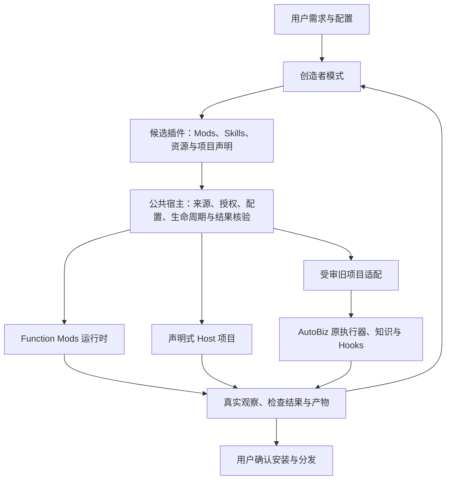

# Mods 平台能力建设与插件创造赋能评估报告

版本：1.5.9；报告日期：2026 年 10 月 19 日。评估范围为本地 `codex/mods-v2` 的当前实现、受影响路径补验及明确标明版本的历史证据。

功能代码已先行提交并推送：[`68d67719`](https://github.com/seanchen1993/CmbCoworkAgent/commit/68d67719be69ffa698417017a6018a14b54493ee)，中文提交说明记录了实现、验证和交付边界。本报告与验收摘要另行提交；未推送其他分支，未替换用户已有安装应用。

## 一 建设目标与总体判断

Mods 是应用的可编程扩展机制。应用通过统一扩展接口开放界面、行为、工具、上下文和流程等能力，用户或开发者通过脚本新增、调整、组合或替换功能，并将经验证的组合保存、安装和发布为插件。平台承担执行、授权、资源管理和可信结果核验；插件承担业务规则、知识、阶段定义和具体交互。

本轮建设已经超出 AutoBiz 外围界面调整，形成了通用 Function Mods、原生能力接口、创造者接线、配置与保存复用、声明式 Host 项目及受审旧项目适配等实现。非 AutoBiz 的文档审查、天气及通用 Host 项目具有独立执行路径，因此不能将整个平台概括为 AutoBiz 专用开发。

同时，当前“业务 Mods 组装”路径仍固定生成 board/legacy 项目并使用 `autobiz-v1` 适配。完整业务隔离试用、原业务必需 Hooks 和部分产物交接也保留 AutoBiz 协议限定。这些限制意味着当前尚未形成适用于任意业务状态机的无差别组装器。通用扩展底座与 AutoBiz 兼容适配必须分别说明、分别规划。

本轮实现能够在明确范围内支撑插件创造与项目集成，但不能把业务组装层视为已经完全通用化。后续应优先收敛旧内核适配契约，并用另一独立业务内核验证；不宜继续以 AutoBiz 新场景为由增加宿主特例。

与 Claude Code Mods 相比，本工程已经实现主要扩展机制的有界桌面适配，并增加适用于本应用的项目、知识、检查及产物衔接能力；尚不能表述为完整 API 兼容、全运行环境等价或全面优于 Claude Code。

## 二 当前能力的分层与职责

| 层次 | 主要职责 | 不应承担的业务职责 |
| --- | --- | --- |
| 平台公共底座 | 事件分发、原生 UI、工具与模型入口、来源与授权、配置、生命周期、预算、观测、真实结果凭据 | 固定 PRD、SQL、数仓等业务阶段；替插件判断业务是否合格 |
| 创造者模式 | 理解需求、检索现有能力、组织生成或组合、请求配置与确认、发起真实试用、汇总反馈、局部修改、保存发布 | 自行授予权限、自报检查通过、另建业务状态机、重复执行结果未知的动作 |
| Function Mods | 在已开放接口内观察、变换或接管事件；组织交互和展示；提供可组合功能 | 绕过宿主权限、伪造原生检查或直接依赖平台内部数据库与 React 状态 |
| 插件 | 封装 Mods、Skills、Agents、MCP、资源、配置及项目声明，作为安装和分发单元 | 把本机凭据、已有批准或活动任务状态当作可移植内容导出 |
| Hooks 与检查 | 普通事件处理、传统 Hook 执行及业务必需检查；按各自合同衔接 | 将普通变换、观察错误和必需业务拒绝混为同一种可忽略结果 |
| 兼容适配器 | 将已有执行器、配置、检查和状态持有者接到公共协议 | 以修改适配器名称代替真实兼容证明 |

业务策略主要由插件作者或组织制定，例如必需知识、检查规则、人工门禁及产物要求。创造者可根据需求生成或修改这些声明，并通过真实试用验证；平台负责执行通用约束，并对必需语义缺失、来源不匹配和未获授权的操作拒绝执行。用户仍决定自己的配置、目录、账号与批准。

运行关系如下，三种执行路径复用宿主的来源、授权、配置和结果核验边界。

## 三 三条用户路径及其实际边界

当前工程同时存在事件运行时中的 Function Mods，以及用于组装 Skill、配置、流程和资源的业务模块。它们复用部分来源、依赖、安装和检查机制，但不是完全相同的执行单元。业务目录被拆分或声明了模块，并不自动意味着其所有业务逻辑已经成为通用 Function Mods。

### 1 普通功能 Mods 创造与复用

普通创造者会话可通过原制作、组合、配置和复用服务生成或调整 Function Mods，经必要的原生确认后隔离试用，验收后再确认正式安装，命名保存组合并应用到另一个聊天。文档审查等案例不依赖 AutoBiz 内核。

通用插件导出服务可以导出包含 Mods 的插件。现有文档与天气案例的实际验收证明了制作、保存、安装和跨聊天应用；该事实不等于这些案例在同一次运行中也完成了 ZIP 导出、异机导入的全部验证。

命名常用组合主要保存已有能力的选择与配置，生成独立插件则要封装源码、资源、声明及依赖。项目步骤组合还涉及运行和产物输入输出，不能仅以同一个“组合”名称视为同一操作。创造者应根据需求选择入口，并让用户明确最终得到的是聊天配置、独立插件还是项目流程。

### 2 通用 Host 项目

Host 项目通过声明阶段 Skill、动作、上下文、产物和检查，调用原 Skill 执行入口并保存宿主检查凭据。项目组合服务按运行模式进入 Host 或 legacy 路径，Host 并非仅有接口定义。

目前 Host 阶段主要是声明式线性流程。复杂分支、任意 DAG 和任意旧业务状态机自动迁移，不能由该实现直接推导。Host 项目制作与旧业务 Mods 组装也是不同入口。

### 3 AutoBiz 业务 Mods 组装

业务组装器合并选中业务模块、共享内核、资源、配置及流程声明，当前输出仍为 `legacy/plugin` 和 `autobiz-v1`。已审内核身份进一步决定必需 Hooks 与可验证产物的支持范围。

因此，AutoBiz 向数仓场景衍生可以复用既有业务内核，通过模块、知识、提示词、检查和产物契约表达差异。新的业务若能由现有 Host 阶段、Skill 与检查契约表达，可采用 Host 路径而不增加 AutoBiz 适配；若要迁入另一套旧状态机或加入公共契约尚未表达的执行语义，则仍需适配，不能只换名称或添加一个 JSON 文件。

## 四 创造者模式与用户配置

创造者调用原生工具和现有服务，依次完成需求理解、能力选择、生成或组合、配置补齐、必要确认、真实试用、效果观察、对话修改及保存安装。创作记录引用原操作结果，不根据界面显示状态自行推进业务 checkpoint。

“一句话创造”表示用户可以用自然语言进入上述工具链，不代表任意复杂需求均可一次生成合格插件。现有受控模型验收主要证明接线、执行、批准和校验合同；真实外部模型独立理解需求、选择模块和修复代码的成功率，仍需另外评估。

目前创造工具仅在本地普通主聊天的创造者模式开放，项目模式和非主 agent 会话并不直接开放同一套制作工具。用户可先准备 Host 或受支持的旧项目候选，再通过原生入口补齐配置、知识和来源批准，发起真实试用。`project_dev` 主要准备开发目录，`project_test` 执行隔离产物检查；二者自身不证明模型或完整业务已运行。

用户配置由插件的 schema 声明字段、类型、默认值和可选项。普通值、目录和敏感项经相应原生入口处理；敏感值经系统保护存储，系统保护不可用时拒绝敏感项持久化；状态读取脱敏，模型不能替用户提交秘密。配置和候选绑定插件身份、来源、工作区和版本，跨异步操作重新核对有效状态。

插件发布携带配置定义及受支持迁移，不携带发布者的本机凭据、目录授权或任务执行权。新环境需要重新绑定配置。未声明的任意环境变量，不会自动变成安全配置字段；旧业务动态环境逻辑仍应通过明确适配保留。

当前对话优化支持代码与组合的局部修改和 L1 撤回；撤回不撤销已发生的文件、网络或其他外部副作用，结果未知的动作必须先核对。从业务中间阶段恢复输入快照、隔离重跑及自动计算受影响阶段属于 S6，按既定要求暂缓，不能与从起点真实试用或崩溃恢复混称为已完成能力。

## 五 AutoBiz 知识 上下文 Hooks 与产物的连续性

AutoBiz 的业务语义继续由原插件配置和 Python 执行链持有。Mods 化不能只保留阶段名称和提示词，还必须保留配置解析、知识来源、角色上下文、工具前后检查、阶段提交及下游输入消费。

Hooks 没有因 Mods 而消失。普通事件扩展负责观察、变换与交互；传统 Hooks 继续由原执行器运行；必需业务检查另受宿主强制约束，并产生与真实调用关联的凭据。新插件可通过公共检查契约声明规则，旧 AutoBiz 则需要保留受审适配及原脚本，不能简单把所有 Hook 改名为 Mod 就认为已经保持等价。

| 衔接环节 | 当前实现方式 | 校验边界 |
| --- | --- | --- |
| 配置与占位符 | 保留原 `board_config.json` 命令及宿主支持的占位符，按当前项目、Feature、工作区和部署单元调用原命令 | 动态环境值与任意 shell 分支不能靠静态扫描完整证明 |
| 用户配置与知识目录 | 合并模块配置声明，经原生配置入口绑定；知识数据与不可变包隔离 | 源码目录与数据目录不能重叠；只读绑定不得被同步器写入 |
| 知识加载 | 原同步及上下文提供器生成加载状态，宿主核对选中或必需单元的实际加载结果 | 不能只凭总 `ok` 或目录存在放行；缺失必需知识必须阻断 |
| 节点及子任务上下文 | 保留原渲染器、角色及 agent 资源，通过真实运行上下文接入主子任务 | 来源、Feature、角色及目录归属需正确，不能通过任意 thread 字符串模拟继承 |
| 最终模型请求 | 对已登记的必需内容及来源，在原模型边界核验 | 普通变换删除必需内容时拒绝；内容存在不等于模型理解或业务正确 |
| 工具前后 Hooks | 原执行器执行精确来源的必需检查，普通 Mods 的短路不能跳过这些检查 | 找不到、异常、超时、取消或结果未知均不能伪造成功凭据 |
| 阶段与产物 | 将真实运行、阶段契约、包摘要和实际产物字节绑定到凭据 | 输入、规则或产物变更后，旧凭据不能继续证明当前状态 |
| 下游消费 | 明确输入映射，受控复制已核产物，复制前后检查摘要；消费者真实读取并执行自己的检查 | 相同文件路径和步骤顺序不能代替 schema 转换或消费证明 |

上述保护对已支持、已审查的适配协议有效。当前 AutoBiz 可验证交接范围是已检查的业务设计报告，明确不包含源代码验收；设计报告通过不能扩大为整个工程通过。不能将其扩展为任意 Python、任意知识服务和任意旧插件均已自动兼容。原业务检查清单及源码 profile 变更，需要重新审查和回归。

校验还可能属于阶段迁移边，而非单个界面节点。例如，原 PRD 的一项必需验证在离开 `prd_done`、进入后续阶段时才产生。新增或组合步骤必须保留这条迁移关系，并将凭据绑定到真实调用来源和原检查契约；不能只看到 `prd_done`，就认定全部 PRD 检查已经完成。

例如，在“设计报告”之后插入“数仓建模检查”，新增模块需要声明消费哪份已核设计报告、采用什么输入映射或格式转换、使用哪些知识与规则、输出什么产物，以及下游阶段如何消费。原 PRD 的必需检查不会因为插入该模块而自动取消；新增检查也必须由真实执行产生自己的凭据。平台能够保证所声明合同的执行和来源一致性，不能自动推断任意脚本中未声明的信息依赖。

## 六 AutoBiz 与数仓场景的前后对比

| 事项 | 原有方式 | Mods 化后的变化 | 当前限制 |
| --- | --- | --- | --- |
| 衍生新场景 | 复制并调整完整插件，容易将共用内核与业务差异混在一起 | 选择共用内核与业务模块，以知识、Skill、配置、检查和产物声明表达数仓差异 | 仍继承 board/legacy 内核，并非独立通用状态机 |
| 增加界面能力 | 通常需要修改宿主 React、IPC 或为插件增设特例 | 已开放的数据可以由展示 Mod 组织为卡片、列表或交互 | 新数据源仍须公共接口支持 |
| 插入步骤 | 容易只验证顺序与文件存在，缺少可靠消费关系 | 声明依赖、上下文和输入输出，以真实凭据连接消费者 | 需要显式转换契约，不自动理解任意产物语义 |
| 修改提示词或知识 | 容易在衍生版本间遗漏原配置和加载过程 | 配置、来源和必需上下文参与核验，修改后形成新候选 | 动态分支仍需实际执行，静态检查不代表全部分支已验证 |
| 保存与分发 | 工作目录及本机配置容易混入复制内容 | 将经验证组合保存为插件，锁定依赖并重新绑定目标环境 | 部分可选旧原生校验策略的可移植边界需单列 |
| 调试 | 中间阶段调试往往需要业务专用工具或重跑 | 当前可局部修改扩展和从起点隔离试用；阶段快照调试已有后续设计 | S6 未开发，不能宣称任意阶段回退已可用 |

实际价值是把可复用扩展和业务差异从宿主发布中分离，减少重复维护和平台改动范围。当前并不意味着完整 AutoBiz 已被无依赖地替换为任意组合的通用语言。

## 七 worktree 进度展示如何由插件 DIY

平台提供 `native.workflow/runs/1.0.0` 公共观测接口，从原工作流管理器与运行存储读取数据，并保留当前聊天作用域、分页、订阅清理及真实取消语义。Mod 无需直接访问内部数据库。

需要区分两类既有实现。AutoBiz 的业务进度 Mod 通过受控只读收集器读取原调度器、Git 和业务进度证据，经原生本机命令批准后展示；后续通用 `native.workflow` 则直接投影宿主原工作流运行事实。两者应按实际执行器选择来源，不能把旧业务收集器自动视为通用原生工作流接口，也不能新增另一套调度状态来补齐显示。

当前投影包括运行状态和阶段，子 agent 标签、状态及时间，worktree 的分支、目录、提交、dirty 和 cleanupPending 等信息。已支持路径中的子任务工具调用另经原工具事件与 trace 关联统计，`outputTokens` 不能当作工具次数或费用；不能据此宣称所有类型子任务均已获得同等观测覆盖。

插件作者可以完成以下工作：

1. 用该公共引用读取当前工作流并订阅变化，对较大结果按分页查询。
2. 用 UI 接口绘制自己的进度卡或 worktree 列表，按通知重新读取并刷新显示。
3. 停用时释放订阅；需要取消时调用原生受控动作，等待原工作流结算。

此前新增此类界面通常需要平台开发者接数据并修改宿主页面。现在，在公共数据已具备的前提下，插件侧可以独立调整展示、筛选和交互，并与 AutoBiz 组合，用户无需等待宿主 UI 发布。

这种变化主要发生在扩展边界和交付方式上。旧插件通过已有公开接口、脚本或外部页面，也可能实现部分效果；Mods 将事件、原生展示和能力组合收敛到统一机制，不应将所有业务效果都描述为此前无法实现。

原 AutoBiz 进度界面验收证明了真实原生入口、一次精确命令批准、原调度器与 Git 及收集结果的展示；该案例使用受控任务输入，不等同于完整模型 Code、Review、UTest 和合并全部通过。通用原生工作流另有真实 agent、worktree 与隔离及退订的验收，两组证据分别计量。

这项变化有明确边界：领域专有进度百分比、尚未开放的工具参数或新的内部状态，仍需先通过有界公共接口发布。插件不能通过读取内部表或伪造会话身份取得任意数据。平台负责开放稳定原语，插件负责组织业务体验。

## 八 个性化开发审查

本次审查定位了十处具体耦合，属于定点代码审查，不能据此给出全仓“个性化代码占比”或逐行新增归属。

| 类型 | 现有位置及表现 | 评价与处理方向 |
| --- | --- | --- |
| 通用内核 | 原生能力、UI、行为、事件分发、创造者配置及预算等定点入口未按 AutoBiz 名称选择业务权限 | 继续保持业务无关，不把新场景名称写入通用分发器 |
| 合理兼容准入 | `composition-legacy-preflight.ts`、`autobiz-required-hooks.ts`、能力目录中的受审 profile 与 checkpoint 适配 | 当前用于保留原执行链及防止遗漏检查；抽离前必须具备等价可信校验，不能直接删除 |
| 公开业务组装限定 | `business-mod-assembler.ts` 固定 legacy 与 `autobiz-v1`；`creator-business-trial.ts` 要求 board 配置 | 属于实际通用性不足。应明确当前支持范围，后续以适配契约收敛，不能宣传为任意内核组装 |
| 旧项目上下文与观测布局 | `extension-context.ts` 的 board 入口及 `service.ts` 的 `.autobizdevops` 监视路径 | 可保留在旧适配层；新业务应使用公共 Context Provider 与观测协议 |
| 通用证据中的业务默认 | `completion-evidence.ts` 特别采集 AutoBiz 状态文件 | 抽象边界泄漏。后续改为声明式、受控的证据引用，同时保留新鲜度及来源核验 |
| 可选原生校验器源依赖 | `autobiz-source.ts` 的本地源仓与固定 Git 对象 | 单列可分发性限制，明确与项目原 Hooks 路径的关系；应迁移到受审可分发适配资源 |

不宜继续让每个新业务都增加宿主条件分支。较合理的方向是保留统一执行、授权、配置、上下文、检查及产物契约，将业务阶段、知识和验证器留在插件或受审适配包，并通过至少两个独立业务内核验证接口，避免只将 AutoBiz 字段换名后称为通用。

后续收敛应有明确的工程边界：适配包声明配置解析、上下文提供器、状态读取、生命周期、检查及产物映射；公共宿主执行来源、权限、资源和真实结果核验。业务作者可制定规则，但普通 Mod 自报 `passed` 不能冒充宿主凭据或替代必需检查。宿主凭据证明其绑定来源和版本的规则被实际执行，不证明自定义规则本身充分正确；规则质量仍需作者或组织审查。受审执行资源及必需规则版本变更后，需要重新准入和回归。迁出旧逻辑时，应先证明原知识与 Hooks 链等价，再移除宿主中的业务分支，不能以削弱校验换取表面通用性。

## 九 与 Claude Code Mods 的比较

比较基于已有固定版本 2.1.302 审计和官方公开说明；该版本仅表示取得时的基线，不表示当前始终最新。公开文档与固定版本声明分别使用，不以传统 settings Hooks 文档代替 Mods 的完整 ABI。

| 比较维度 | 当前判断 |
| --- | --- |
| 事件处理、`next`、接管与异常恢复 | 已实现主要机制的有界语义适配；不据此推导所有事件和分支等价 |
| 面板、交互控件、原生内容包装 | 已有本应用原生 UI 路径；并非逐项复制 Claude 所有表面和控件 |
| 工具、模型、子 agent、上下文与配置 | 已接原运行器和真实结果；支持集合及权限模型存在产品差异 |
| 一句话创作、试用、修改与安装 | 已有原工具与原生确认闭环；目标项目与业务类型仍有入口范围 |
| SDK 与事件版本 | 目录仍有较早版本标记，`prompt.change` 等新增声明未证明有同名生产入口；`mcp.connect` 内部实现与公开目录存在分歧 |
| 明确不可用接口 | `env.set`、部分 telemetry、audio、session 接口等不能仅凭类型名当作可用能力 |
| 运行环境与组织治理 | 当前重点验收本地 Electron；CLI、VS Code、云会话及组织治理规则未证明全面等价 |
| 权限与隔离 | 本应用采用受控 Guest、原生能力和精确来源授权；Guest 约束不能扩大为所有外部 Python 或进程均已操作系统沙箱化。Claude 官方说明的 Mod 权限模型不同，应按合同比较，不作未经验证的安全排名 |
| 本应用项目扩展 | 项目配置、必需知识与检查、产物消费、完整候选隔离试用是本工程面向项目模式的扩展 |

“做得更好”应限定为对本应用场景更适合的设计，例如将扩展与已有项目身份、角色上下文和业务结果凭据绑定。当前没有同任务、同环境的 Claude 性能、费用或成功率对照，不能给出全面优越结论或兼容百分比。

这些项目能力属于本应用的一体化实现与验收范围，并非断言 Claude Code 或其插件无法实现类似效果。对齐应以已公开接口、事件行为及实际运行结果为依据，而非要求不同产品使用相同内部运行时或打包结构。

对已有 Claude 扩展，不能承诺原包直接迁入。Read、Write、Edit、Bash 已有宿主有界适配，但 Grep、Glob、MultiEdit 的原协议以及全部模型别名、effort 和多服务商参数尚未证明等价；同名本地能力也不自动具有相同输入输出合同。迁移时仍需核对支持目录、权限、组件和实际执行结果。固定版本审计包含静态提取和选定原生行为探针，不声称还原全部原始 TypeScript。

官方参考：[Mods 概览](https://code.claude.com/docs/en/plugins/mods)、[Mods 参考](https://code.claude.com/docs/en/plugins/mods/reference)。

## 十 对应用整体效果的提升

### 执行约束与可靠性

应用可把必要知识、权限、检查、预算和真实产物衔接成可执行约束，减少只靠提示词约定和模型自报完成的情况。真实结果和失败状态可观察、可恢复，也有利于定位失败环节。这里的恢复不自动重放结果未知的外部动作，也不撤销已发生的副作用。这是 harness 的改进方向，其业务效果仍需以真实项目验收衡量。

### 用户 DIY 与开发交付

具备公共原语的功能可以在插件层独立开发、组合和发布，降低宿主改动和发版耦合。非技术用户通过创造者提出需求，技术作者通过相同接口提供可复用模块。模块可替换、配置可绑定、来源和执行结果可核验，比复制整套插件更利于维护。

这一收益取决于接口覆盖与契约质量。尚未开放的信号、新业务内核、验证器可信准入等仍有平台工作；不能承诺所有个性需求都不再需要平台开发。

### Token 与费用

按任务选择相关知识和角色上下文、复用已核产物、减少无效重试，可能降低重复上下文和失败重跑的消耗。创造者请求的操作、候选、时长及实际模型尝试预算也限制无边界自动修复；跨轮请求保持可信出生关联，不能简单通过新开一轮重置原累计尝试。

Mods 本身不会自动节约 token。额外模型 Hook、重复上下文注入或过度多 agent 编排也可能增加成本。当前没有完整业务成本对照，费用缺少可信价格时仍为 unknown；无法保证的硬金额限制不能显示为已经生效。工具请求、成功结果、模型逻辑调用和真实 HTTP 尝试必须分别统计，usage coverage 不完整时保留未知，不用模拟请求换算实际费用收益。

## 十一 性能测量与适用范围

ASAR 摘要以 `b6c5acd3` 开头的正常构建包，已完成原严格短测、2,400 条长历史及持续运行验收，分别对应短测与历史结果及持续运行结果。持续运行使用原不低于 60 分钟 ACTIVE 门槛，包含 20 次真实流式 HTTP 请求、每次 40 片，111 次实际交互采样，原验收错误数为零。最终活动采样时刻与验收结束时刻不同，不将最后一次采样误作持续运行精确终点。

本节持续运行、长历史和交互对照结果归属于标明的历史 `b6c5acd3` 构建；正常最终包 `4db680cb` 的功能与来源补验不自动构成这些性能项目在新包上的重新测量。除另列实际复测记录外，不将旧包性能通过转记为最终包性能通过。

一次固定顺序的旧包 `7d63b471` 到新包 `b6c5acd3` 探索性观测，各采集 20 次流式请求。首次可见内容 p50 从约 5,604ms 降至 5,026ms，p95 从约 6,209ms 降至 5,722ms；非发送的输入填入并清空操作 p50 从约 306ms 降至 161ms，p95 从约 392ms 降至 213ms。

该对照受顺序、缓存及时间等因素影响，属于探索性结果，不能表述为稳定因果收益、物理键盘延迟或所有应用场景同比提升。注册表与面板守卫另有组件测量，不能把组件改善比例直接写成全应用改善比例。

历史完整业务长链在受控模型服务下，实际运行了原生 agent、工具及两个 worktree 生命周期，功能链通过；其 Code 阶段约 25.58 分钟，整体约 32.36 分钟，未达到当时的 Code 90 秒及整体 15 分钟性能目标。该结果与上述会话交互、长历史及持续运行验收分别计量，不能用后者替换前者的未达项。

独立性能复查还发现大文本完整性链和预算历史编解码具有明显成本。本轮未采用不能证明等价的凭据合并，也未用跨 CAS 缓存削弱预算。原全量中的超时与预算失败保留，最终放行以修正后完整回归结果为准。

## 十二 验收状态与交付记录

当前版本的交互比较覆盖天气和文档两类功能、技术界面与创造者对话两条路径，以及新目录和已有目录两种绑定，共四个 profile、八个单元。八个操作单元及四次原生正常退出均已完成，并另以只读补验核实同一任务的两个安装源与原 ZIP 的全部文件内容一致。“新目录”指该隔离测试中的首次目录绑定，“已有目录”指同一隔离测试内另一个新聊天再次绑定同一目录；两者均使用原生目录选择。它们不表示首次机器环境部署或保留历史的既有聊天。

首次结果可见时间与随后必需的 trace、效果及退出核验分开计量；原生文件编辑批准计入实际点击和耗时，不测量人的思考时间。公共来源批准和目录选择支撑单列，不当作非技术用户完整首次配置成本。比较使用同一实现包字节、同一当前版本和受控模型，不是历史 S0 对照或统计性用户研究。

原套件在全部八格完成后，误将包含编译及来源信息的原生授权摘要当作跨安装目录的内容摘要，因而整体退出为失败。原失败保持原记录；修正后的独立只读补验已对原 ZIP 与四个实际安装源核对完整清单和文件字节，同时保留各目录的原生批准摘要、真实工具结果关联和四次正常退出。补验未重新运行应用，不冒充一次完整套件首次通过。

| 功能及目录绑定 | 路径 | 实际点击 | 目标效果首次可见 | 单元总耗时 | 主会话 trace 记录 / HTTP 尝试 |
| --- | --- | --- | --- | --- | --- |
| 天气・新目录 | 直接配置 | 11 | 7.39 秒 | 10.91 秒 | 3 / 3 |
| 天气・已有目录 | 直接配置 | 11 | 6.95 秒 | 9.57 秒 | 3 / 3 |
| 天气・新目录 | 创造者对话 | 6 | 8.00 秒 | 22.01 秒 | 7 / 7 |
| 天气・已有目录 | 创造者对话 | 6 | 7.48 秒 | 17.33 秒 | 6 / 6 |
| 文档・新目录 | 直接配置 | 10 | 6.00 秒 | 9.53 秒 | 2 / 3 |
| 文档・已有目录 | 直接配置 | 10 | 4.94 秒 | 7.27 秒 | 2 / 3 |
| 文档・新目录 | 创造者对话 | 5 | 5.27 秒 | 18.75 秒 | 6 / 7 |
| 文档・已有目录 | 创造者对话 | 5 | 4.98 秒 | 14.31 秒 | 5 / 6 |

本次预置相同实现，并预先固定技术界面与对话路径；保存或应用阶段，所选技术界面路径为 7 次点击，创造者对话为 2 次。这不是全部入口的最少操作数比较；其他点击包含目录选择、实际发送及天气场景的一次原生编辑批准。创造者减少了手工配置操作，但增加了模型与工具编排，总耗时也更长。因此，该结果支持“降低配置操作负担”，不支持“对话创造必然更快”或“自动节约 token”。表中 trace 数是原主会话追踪已覆盖的模型调用数，不代表应用全部逻辑调用；独立 Mod 的模型请求可能另外出现在 HTTP 记录中。trace 与 HTTP 数量的差额不能直接视为重试次数；未取得真实供应商 usage 与价格，费用保持未知。单元内没有修复重跑，不排除此前失败套件的调试成本，也不据单样本推导统计性收益。

最终联合检查已于 2026 年 10 月 19 日完成，完整回归、独立回归及静态核验在冻结源码上串行执行，未自动重试，未放宽原有超时或删除嵌套测试。

| 核验项目 | 实际结果与边界 |
| --- | --- |
| 原 pretest 与完整 Vitest | pretest 退出 0；1,502 个文件通过、8 个文件跳过、0 个失败，共 1,510 个文件；14,909 项通过、56 项跳过、0 项失败，共 14,965 项。跳过项保留原状态，不计作通过 |
| 原有独立回归 | 原 16 组全部正常退出，未过滤组内用例 |
| Node 与 Web 类型 | 原项目类型检查通过 |
| 附加类型配置 | queue、fault、Full10、A12、near-bottom、G4-history 六项通过，保留原配置选项 |
| 新增实际包夹具类型 | UX 原项目配置通过，其中 `noImplicitAny=false`；A04 严格目标作用域无新增问题，原传递依赖仍有 51 项问题，不表述为全仓 strict 零错误 |
| 全量 ESLint | 退出 1，仍有 171 项既有问题：170 项为未改文件 HEAD 基线，1 项为已复核的既有变更行问题；新增 0 项。全量 lint 未通过 |
| 工作区与暂存差异检查 | 已跟踪工作区 `git diff --check` 通过。完整暂存检查另报 157 行原样 CRLF 样本及 5 项原有非功能空白问题，已逐项复核并保留冻结字节；不能表述为暂存检查零问题 |
| 源码冻结 | 最终验证前后完整输入指纹均为 `d7afc357b5bd7767d0afe5947271418a1f11d6e1bf857bee707df3dc5f02bc30`；测试期间源码变化列表为空 |
| 正常构建与安装包 | 构建及 NSIS 均退出 0；原包装检查因 Windows 归档条目分隔符误判而失败，保留该失败；随后独立只读归档检查通过，未通过重建替换原产物 |
| 精确导出包业务补验 | 同一 ZIP 在最终正常包上通过新用户目录绑定、PRD、后续阶段进入及原生取消；只证明该部分链 |
| 四组八格交互比较 | 八格实际效果及四次正常退出完成；原套件末尾身份误比失败保留，独立只读完整内容核验通过，未重新运行应用 |

原完整测试通过与上述静态负债、历史失败分别记录，技术检查不等于业务认可或生产发布许可。验收数据及证据摘要见 [可复核验收摘要](mods-platform-validation-2026-10-19.json)。

首轮历史全量结果为：1,496 个文件通过，5 个文件失败，8 个文件跳过；14,867 项通过，4 项失败，72 项未执行。其中 16 项来自主题检查 beforeAll 超时，不能当作允许跳过。

第二轮全量已正常退出：1,500 个文件通过、1 个文件失败、8 个文件跳过；14,887 项通过、1 项失败、56 项跳过。唯一失败为 AutoBiz 合并配置联合验证用例的原 5 秒限时超时；一次分段诊断确认限时触发时仍停留在通用来源快照读取，尚未进入业务组装和攻击检查。通用快照读取已改为单次调用内最多 8 个内容读取任务，保持目录元数据遍历、顺序、容量限制、来源核验和异常结算约束，不增加跨调用授权或内容缓存。实际联合回归 24 项全部通过，原业务组装用例耗时约 1.7 秒，仍采用原 5 秒限时。

组件前后各一次观测读取相同的 1,179 个文件、18.4 MB，并得到相同摘要，耗时分别约 8.9 秒与 0.54 秒。样本顺序固定，缓存与时间条件未受控，不能据此宣称稳定因果改善比例。原五个失败文件在第二轮均已通过，但这不能用于回写历史失败原因；最终第三轮全量已通过，结果见上表。

原生期限测试已将不确定的 2ms 入场前置竞争改为明确的单调时钟与 ACK gate 两种边界用例，保留生产期限、错误和帧清理断言，窄测 13 项通过。其余历史失败未确定唯一原因，保留原记录；此次最终完整回归通过，不以此前窄测替代全量结果。

已有真实包功能证据覆盖多类普通创造者与项目路径。打包功能验收使用受控模型响应，驱动真实运行器、工具、原 Hooks、文件与状态提交；它证明软件执行和约束，不代替外部模型生成质量评估。历史包结果、受影响路径补测和最终包结果分别记录，不能表述为同一最终包一次完成全部功能验收。业务认可与生产发布评价独立于本地技术检查，不因测试通过自动获得。

业务发布案例与数仓交接案例原本使用不同 ZIP，不能将两组结果拼接为同一产物执行证明。本轮已在正常构建包 `4db680cb` 上，对创造者实际导出的同一份 ZIP `c7725ee4` 完成新用户目录补充验证：重新绑定知识目录，执行 PRD 及其后续迁移检查，核对实际 PreToolUse/PostToolUse、两项业务验证凭据、模型请求知识与后续阶段进入，再由原生取消结算。PRD 约 75.09 秒，取消约 0.36 秒，总耗时约 125.86 秒，原限时均保留；安装源和保留执行源各 215 个文件的元数据及字节未变化。该案例只验证 PRD 与真实后续阶段进入，不是全部七个节点执行完成。原测试曾误要求包未声明的 Stop；原失败保留，修正后以单独补充结果记录，不称首次执行通过。

可选 `autobiz-validator` 原生完成策略默认关闭，与包内原 Hooks 的正常项目路径不同；其本地源仓依赖不属于已证明跨机可用的能力。

新用户目录验证不等于另一台纯净电脑验证。补充案例以 Node、Python、Git 及知识收集器依赖已具备为前提，不能证明纯净机器的全部环境部署。精确导出包的原知识脚本已有缺依赖时运行 npm 安装的路径；预置依赖的案例不验证这条自动安装路径，也不应将“未测”直接写成“没有实现”。

维护脚本也需与运行时区分：部分历史 AutoBiz 来源加工或素材打包 CLI 仍有开发机默认路径，部分素材库生成器依赖另行提供的历史源包或验收材料。这些路径未被证明是普通平台运行的必需依赖，但也不应承诺所有维护脚本在纯净检出后均可直接重建全部历史素材。

## 十三 下一步迭代重点

1. 开展真实业务试用与问题收敛。当前完整回归和功能代码推送已完成；试用重点应放在真实模型质量、配置理解、复杂知识分支和长链时延，保留既有静态检查负债的独立治理清单。
2. 收敛业务适配边界：显式区分 Function Mods、Host 项目与 board/legacy 组装，逐步将 AutoBiz 特定配置、验证器与证据布局移到受审适配包。
3. 补强可移植依赖：消除可选校验器对开发机源仓的隐含依赖，验证另一独立业务内核，不以复用 AutoBiz 名称或目录替代适配。
4. 对齐能力目录与实际入口：固定 SDK 版本逐项核对新增事件、可用接口和诊断结果，优先解决目录与运行行为不一致的问题。
5. 按真实项目测量成功率、人工干预、失败重试、token 与费用，建立可复现对照，继续改善已测热点。
6. S6 阶段调试保持后续目标。平台在已有来源、配置与检查失效机制上，补齐阶段输入快照、隔离分支、受影响阶段计算及未知副作用处理等原语；调试 Mod 再组织“选择阶段、修改、从该阶段试跑、比较结果”的交互。插件负责业务快照与产物转换声明。旧模式也可以专门开发此类工具，Mods 的收益是将可复用原语和业务调试策略分离，不是由一个脚本凭空获得回退能力。当前不宣称已支持阶段回退重跑。

## 附录 主要源码与证据定位

通用制作及保存：[mod-authoring-runtime.ts](../src/main/agent/mod-authoring-runtime.ts)、[creator-reuse.ts](../src/main/mods/devtools/creator-reuse.ts)、[creator-user-config.ts](../src/main/mods/devtools/creator-user-config.ts)。

Host 与项目组合：[host-service.ts](../src/main/harness-board/project-runtime/host-service.ts)、[composition-service.ts](../src/main/harness-board/project-runtime/composition-service.ts)、[project-tooling.ts](../src/main/mods/devtools/project-tooling.ts)。

业务组装与兼容：[business-mod-assembler.ts](../src/main/plugins/business-mod-assembler.ts)、[autobiz-required-hooks.ts](../src/main/plugins/autobiz-required-hooks.ts)、[creator-business-trial.ts](../src/main/mods/devtools/creator-business-trial.ts)。

知识及必需检查：[extension-context.ts](../src/main/harness-board/extension-context.ts)、[context-integrity.ts](../src/main/harness-board/context-integrity.ts)、[required-business-checks.ts](../src/main/hooks/required-business-checks.ts)、[stage-check-receipts.ts](../src/main/hooks/stage-check-receipts.ts)。

产物与消费：[composition-legacy-proof.ts](../src/main/harness-board/project-runtime/composition-legacy-proof.ts)、[composition-autobiz-handoff.ts](../src/main/harness-board/project-runtime/composition-autobiz-handoff.ts)、[composition-workspaces.ts](../src/main/harness-board/project-runtime/composition-workspaces.ts)。

工作流观测：[platform-native-providers.ts](../src/main/mods/v2/platform-native-providers.ts)、[platform-workflow-provider.ts](../src/main/mods/v2/platform-workflow-provider.ts)、[observation.ts](../src/main/agent/workflow/observation.ts)。

技术对照：[mods-claude-2.1.302-alignment-2026-10-17.json](../docs/mods-claude-2.1.302-alignment-2026-10-17.json)；通用性、信息连续性、兼容与性能的定点审计结果保存在本地验收目录，本报告配套的 [验收摘要](mods-platform-validation-2026-10-19.json) 固化关键结果、版本摘要及本地原始记录索引。原始日志、临时目录、安装包和凭据不纳入 Git。

试用产物位于本工作树的 `output/mods-v2-validation/20261019-foundation-snapshot-final-r205/win-unpacked/`，主程序为 `CMBDevClaw.exe`。该目录是独立正常构建产物，未覆盖原安装目录。最终 ASAR SHA-256 为 `4db680cb77e1683805f1240594dbdd62d4297b5ce4228f7cf648b421bcebecee`。运行业务案例前仍需具备相应 Node、Python、Git 及知识依赖，用户目录与敏感配置需重新绑定。
