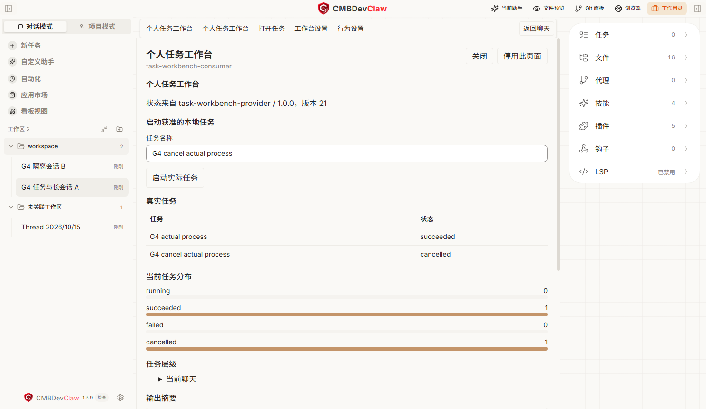

# DevClaw 可编程与可组装平台升级汇报

汇报日期：2026 年 10 月 16 日。适用对象：产品、技术与业务负责人。

## 汇报摘要

**核心结论：DevClaw 正从功能固定的应用，演进为用户能够制作功能、开发者能够扩展应用、已有能力能够重新组合的平台。**

灵件是实现这一变化的扩展机制。应用把界面、行为、工具和流程等能力，通过统一接口开放出来，让脚本能够新增、调整、组合或替换已开放的功能。用户可以描述需求，由 AI 生成实现，再通过预览、授权和试用确认效果；开发者也可以直接编写和交付灵件。

这项变化同时体现在插件复用上：对于已经声明业务灵件、运行内核兼容的插件，用户可以挑选需要的部分，加入其他来源或自己制作的模块，生成独立的新插件。平台负责共同的运行、权限、状态、版本与资源管理，业务作者专注自己的差异能力。

| 汇报亮点 | 当前可以看到的效果 | 带来的改变 |
| --- | --- | --- |
| 应用具备可编程扩展机制 | 脚本通过 SDK 响应事件、调用能力、提供界面，并定制已开放行为 | 一部分个性化需求可以独立交付，不必每次修改主程序 |
| 插件可以按业务灵件重组 | 当前分支具备选择模块、补齐依赖、预览、生成、安装和 ZIP 导出链路 | 从复制整套插件，走向复用已有业务模块、组装新的业务插件 |
| 功能可以独立交付 | 两个独立作者包组成真实任务工作台，不修改宿主源码 | 一部分功能需求由主程序开发转为插件开发 |
| 用户可以参与创作 | 描述需求、查看修改、确认试用、核对实际结果，再保存使用 | 个性化需求有了可操作的制作路径 |
| 插件可以相互协作 | 提供方执行任务，使用方读取状态、订阅变化、启动和取消任务 | 能力开发与界面开发可以分工，已有能力可以复用 |
| 流程可以交接真实成果 | 前序检查通过的文件交给后续流程，保留各自检查和审批 | 组合建立在实际产物与明确规则上，减少手工搬运 |
| 扩展过程可以观察和撤回 | 看见进度、失败、确认和结果；冲突先预览，停用恢复原实现 | 自由定制具备版本、权限和运行管理基础 |

**当前定位：平台底座和代表性跨插件协作场景已有打包应用验证；业务灵件重组在当前工作树已有实现和导出样例，其独立安装、原业务完整执行及最新安装包覆盖仍需单独验收。全部原生业务开放、完整回归与长期稳定性验收尚未完成。**

## 产品形态发生了什么变化

### 从固定功能到可编程扩展

过去，界面和行为主要由应用开发团队统一设计并随主程序发布。现在，对于已经开放的部分，灵件可以响应文件编辑等真实事件、提供新的工作台、连接工具，或调整应用的处理方式。业务能力能够通过明确接口被其他灵件发现和调用。

“可编程”意味着能够定义和改变功能，“可组装”意味着已有能力能够再次搭配和交付。全范围扩展是后续覆盖目标；当前已有多类接口和代表性场景，不表示应用每个位置都已开放。

### 从使用已有功能到制作自己的功能

过去，用户主要在应用已有功能中选择。现在，用户可以描述“文件修改后给我提醒”“把我的任务做成一个工作台”等需求，由助手生成实现，通过预览、明确授权和真实试用核对效果，再保存、修改或复用。

这使个性化需求有机会以小功能形式持续积累。用户不必先理解 Electron、IPC 或页面接线；开发者仍需为生成内容的业务逻辑和实际效果把关，不能把生成成功当作任务完成。

例如，用户提出“修改文件成功后，在旁边列出改了哪些文件”。助手制作一个订阅文件编辑事件的灵件，用户查看修改并确认试用；之后真实写入成功，面板便更新记录。生成阶段使用模型，运行阶段由脚本响应真实事件，不需要每次都让模型猜测是否改过文件。

### 从整套复制插件到挑选灵件组装新插件

一个项目插件可以把需求梳理、规格整理、代码开发、检查等业务能力声明为不同灵件。每个灵件携带自己的技能、必要资源、输入输出、依赖和检查要求；公共运行内核保留执行、Hooks 和状态管理。

例如，从已声明业务灵件的 AutoBiz 中选择“需求梳理＋规格整理”，再加入自有的“文档质量检查”，组装成“我的需求文档助手”。新包只配置所选业务步骤及必需依赖，带有独立名称、版本、来源记录和实际实现文件，能够走检查、安装和导出路径。它不是给原插件换名，也不是只保存几个插件的启用开关。

当前实现要求一个精确版本的共享内核，其他来源必须与之匹配。任意旧插件自动拆解、不同内核无条件混装，以及一句话自动完成任意业务模块提取，仍不能宣称已经支持。

### 从插件并列安装到独立能力可以协作

两个插件不必互相了解对方的内部目录和私有状态。一个公开有版本的业务能力，另一个按公开接口读取、订阅或调用。提供方可以专注业务，消费方可以专注界面或流程。

已实现的“任务能力提供方＋个人任务工作台”就是这一路径：前者真正启动本地进程、处理文件和资源，后者展示任务列表、状态、输出并发起取消。它们是两个独立包，不是一个大插件内部的页面切换。

### 从主程序集中增加界面到插件提供交互界面

平台支持页面、导航、侧栏、操作入口和设置五类扩展位置，以及表格、树、图表、列表、日志、表单等受控组件。开发者可以把业务结果做成可交互工具，不再局限于输出一段聊天文字。

这些是新增界面与接入机制，不代表现有所有原生页面都已支持整体替换。自定义工作台打开时保留原聊天界面，返回后草稿继续存在。

### 从孤立运行到有状态有结果的协作

能力接口区分读取、变化通知、执行、查询结果和取消。页面展示以真实执行状态为依据，取消以资源退出为依据；不能把模型说“完成了”当成运行成功。

项目组合进一步保留前序文件、检查和审批，再交给下一套流程。前序拒绝、失败或交接内容变化，会阻止后续继续使用失效成果。

### 分清三种组合，避免混淆交付物

| 用户想做什么 | 组合后的产物 | 当前含义 |
| --- | --- | --- |
| 让当前聊天一起使用几个功能 | 会话搭配 | 保存选择和设置，继续依赖已安装来源；不生成新插件 |
| 从已有业务灵件制作自己的插件 | 独立插件包 | 复制所选实现、补齐依赖和公共内核，生成新身份，可安装或导出 ZIP |
| 让两套完整项目流程先后协作 | 项目流程组合 | 各流程保留原检查与状态，按明确规则交接成果；不等于拆开原流程 |

## 当前已经落地的重点能力

| 能力 | 当前实现 | 适合如何汇报 |
| --- | --- | --- |
| 统一能力协议 | 9 个平台 SDK 方法覆盖发现、读取、订阅、拉取事件、退订、发布、执行、取消和状态查询 | 插件可以通过统一协议协作，减少逐个定制连接 |
| 自建页面和工作台 | 五类界面位置，复用统一组件和受控动作 | 插件开始具备完整交互能力，不只是技能说明或命令 |
| 行为定制 | 处理顺序、冲突预览、明确应用、委托原实现、停用恢复；已接通输入建议和通知呈现 | 已证明可替换行为的机制，更多处理点按业务逐步接入 |
| 自然语言创作与真实试用 | 生成与修改、用途和目标确认、分级试用、新权限重审、候选检查失败保留可用版本 | 在正式安装前验证真实效果，减少反复安装后才发现不可用 |
| 灵件与组合使用 | 官方三例、本工程五例；目标聊天选择、按需搭配和顺序任务 | 使用者可以选择现成能力，也可以进一步组合和修改 |
| 业务灵件组装新插件 | 来源模块选择、自有模块导入、必需依赖补齐、顺序和资源冲突检查、新包生成及导出 | 对已声明且内核兼容的插件，复用业务模块形成独立新插件；当前工作树实现，完整业务验收另计 |
| 项目作者脚手架 | 轻量、全栈、数据三类模板；节点声明编译为运行协议、产物检查和合同样例 | 标准项目插件可以把更多精力放在技能、节点与业务要求 |
| 既有插件复用 | 独立副本、业务要求生成建议、修改前后预览、公开动作和完整流程组合 | 复用存量业务资产，按版本接入，不要求全部推倒重写 |
| 运行与结果展示 | 聊天内任务卡、具体步骤、确认、结果、历史与诊断 | 使用过程更连贯，任务状态和最终成果可以追查 |

## 技术栈和实现机制

应用主体采用 Electron、TypeScript 和 React。Electron 负责桌面窗口与本地能力，React 负责界面；样式与交互组件使用 Tailwind 和 Radix，前端状态使用 Zustand。模型和工具执行复用 LangChain、LangGraph、DeepAgents 与 MCP 接入，构建使用 electron-vite 和 Vite。

灵件机制由以下几部分串起来：

| 环节 | 当前技术与机制 | 通俗解释 |
| --- | --- | --- |
| 编写与编译 | TypeScript 或 JavaScript，esbuild 编译，源码和配置形成版本摘要 | 把作者或 AI 写出的功能代码变成可加载的脚本，并确认具体版本 |
| 隔离运行 | Electron utility process 承载 QuickJS，通过 quickjs-emscripten 使用 WebAssembly 脚本引擎 | 扩展代码在专门的运行环境工作，由宿主提供允许使用的能力 |
| 功能扩展 | 事件处理链、SDK、宿主侧权限与作用域校验 | 脚本注册“发生什么时做什么”，通过接口访问文件、工具、模型、状态和界面 |
| 界面扩展 | 脚本返回声明式组件树，宿主校验后由 React 渲染，按钮动作回到脚本 | 灵件描述需要什么界面，应用统一显示并接收操作 |
| 能力协作 | 有版本的业务接口、状态、事件订阅、动作执行和取消 | 一个灵件提供能力，另一个展示或调用它，双方不必依赖私有实现 |
| 更新与组装 | 候选版本检查、授权、旧资源清理、新版本激活；按声明物化业务模块和依赖 | 修改后按受控流程在当前会话试用；选好的业务灵件可以形成独立插件包 |

整体链路是：用户描述需求 → AI 生成灵件源码 → 编译与检查 → 用户确认试用 → 脚本调用宿主能力 → React 展示界面与真实运行结果。更新灵件与主程序开发时的 Vite 页面热更新是两套机制，不能混为一谈。

这套运行机制与具体模型分开。AI 帮助制作和修改脚本；脚本运行后可以直接处理事件、维护状态和发起已授权动作。需要推理的任务仍可通过模型接口执行。

## 对开发者和使用者已经带来的成效

### 对应用开发团队

平台集中实现能力注册、跨包调用、权限、版本、事件、界面入口和资源清理。对已经开放的业务类型，新功能作者可以通过插件交付，不必每次都修改主进程、preload、页面入口和主程序打包逻辑。

因此，平台团队的工作重点可以从逐个需求接线，逐步转为维护公共能力和稳定契约。新增原生业务处理点仍需要平台开发；这里减少的是重复接入工作，不是取消所有宿主开发。

### 对插件开发者

最直接的收益是业务能力可以按模块积累和复用。原作者把完整插件中的适合复用部分声明为灵件，后续开发者可以选择已有模块，只补充自己的差异能力，再组装成独立插件。形成的新包仍保留灵件目录，可继续参与下一次组合。

以 AutoBiz 为例，新的业务版本不必先复制整套研发流程再逐项删改：可以复用需求和规格灵件，新增本场景的检查或交付灵件，保留需要的原 Hooks 和阶段验证。公共内核负责运行规则，业务模块负责业务内容，两者分工有助于减少重复维护。

当前可以按以下几类开发任务复用：

| 开发任务 | 作者主要维护 | 平台提供的公共部分 |
| --- | --- | --- |
| 将插件开放为可复用灵件 | 模块边界、技能与资源、依赖、输入输出及检查声明 | 模块目录读取、选择、依赖补齐与组装预览 |
| 用现有灵件制作新插件 | 选择已有模块、增补差异能力、核对顺序和业务效果 | 独立文件物化、新身份、来源与摘要记录、检查、安装和 ZIP 导出 |
| 常规项目流程 | 技能、节点顺序、必需产物、结构规则和人工确认点 | 模板编译、运行状态、版本、记录、产物检查和确认流程 |
| 交互型业务插件 | 业务实现、公开能力、界面与设置声明 | 隔离运行、跨包发现与调用、事件、组件、权限和生命周期管理 |
| 复用旧插件形成业务版本 | 来源选择、业务要求、差异核对和版本验证 | 独立副本、修改建议、安装检查、公开能力发现及组合入口 |
| 组合已有能力或流程 | 选择能力、顺序、必要参数与产物映射 | 输入校验、来源版本绑定、作用域、执行记录和交接核对 |

常规项目插件已经有“主要写技能和节点”的路径。业务测试标准、专用协议、企业认证、复杂调度等仍由作者实现或适配；既有 AutoBiz 的 Hooks 和阶段权威不会被通用脚手架自动替换。

**插件价值应优先表述为“整包资产变成可复用业务灵件，既有灵件可以组成新的业务插件”；公共 Harness 降低重复接入成本，是实现这一价值的基础。** 当前没有工时对照数据，不汇报提升百分比或节省人天；新组装链路也不借用其他场景的测试结果宣称业务执行完成。

### 对插件使用者

- 现成功能在应用内挑选，本工程示例和外部官方示例明确来源，减少手动找文件与导入。
- 对已经开放业务灵件的插件，挑选所需步骤、加入自有模块、预览并生成自己的新插件，不必接受原包全部业务流程。
- 会话选择具备搜索、箭头、标题与目录分层，配置其他聊天不必先离开当前聊天。
- 组合按需要选择功能和步骤，简单与高级共用草稿；安装、权限与实际使用状态分别核对。
- 任务使用聊天中的唯一输入区。固定步骤只用于用户明确选择的本次消息，普通提问保持原来的使用方式。
- 当前任务在聊天原卡片中持续显示进度、确认和结果，详细记录按需展开。
- 新版本、行为冲突和未知结果有明确处理路径，避免让用户通过反复点击猜测是否生效。

这些是已经落地的操作改进；首次双包授权、工作台重复标题、部分英文状态等体验仍可继续简化，不以“已经完全傻瓜化”概括当前状态。

## 目前能展示的最终效果

### 场景一 从 AutoBiz 灵件组成自己的需求文档插件

当前工作树入口为“自定义助手 → 添加功能 → 自己制作 → 从 Mods 组装”。选择已声明业务灵件的 AutoBiz 来源，勾选需求梳理与规格整理；再添加自有模块来源，选择文档质量检查，核对顺序并预览。依赖由平台补齐，冲突会阻止生成。确认后生成独立插件，再检查、安装或导出 ZIP；启用后可新建项目使用。

已有两份导出样例：“需求＋规格”和“需求＋规格＋自有文档质量检查”。它们说明同一份业务资产可以组合出不同产品。现有本地导出脚本未执行真实安装与原业务运行，不能把这两份 ZIP 讲成已完成业务端到端验收；新链路也尚未证明纳入此前安装包。现场使用前需完成同包完整流程验证。

### 场景二 两个独立插件组成任务工作台

使用者在同一聊天分别添加并核对任务能力提供方、个人任务工作台。工作台启动真实本地任务，显示读取文件后的输出和实际状态；第二项任务可在执行中取消，等待资源退出后显示取消结果。返回聊天时，原草稿保留。

它展示的重点是：**业务能力可以独立提供，界面可以独立开发，两者通过平台组合成用户可用的工具。** 此场景无需项目模式或 AutoBiz，也无需商业模型调用。

图中为打包应用的实际任务完成与取消记录。它证明平台执行与组合链路，不用来证明模型生成业务代码的质量。

### 场景三 文件编辑引发真实提醒

从编辑提醒入口明确发起示例文件写入，按原批准链确认；实际写入完成后，订阅该能力的界面收到完成记录。只打开页面不会自动写文件，失败或被拒绝的写入不会冒充成功。

它展示的重点是：**扩展可以响应宿主真实事件，制作提醒、结果卡片或后续处理，不必靠解析模型回复猜测发生了什么。**

### 场景四 组合项目流程并交接成果

在项目对话的“项目能力”中，先选择文档流程，再选择数据流程，显式把前序文档交给后序输入。每套流程保留自己的状态、检查和人工确认，下游读取实际交接文件。

当前资料包已准备“需求文档→数据口径与转换方案”示例，商业模型完整排练仍需会前完成。该示例生成方案与报告，不代表已经执行 ETL。

另有已审 AutoBiz 版本的构建输出受控回归记录：使用本地固定模型，保留四次原工具审批及后续文档阶段人工确认，将 15 份已检查资料和 1 份声明范围内的源码变更正文交给后续文档流程；篡改交接内容会被拒绝。这验证原执行链与真实交接机制，不代表商业模型质量、企业验收或最新 ASAR 的同包验证。

## 建议的现场汇报安排

| 时间 | 内容 | 观众应记住的结论 |
| --- | --- | --- |
| 约 2 分钟 | 讲清“固定应用→可编程、可组装平台”，用编辑提醒说明制作功能，再以灵件组装说明复用 | 用户可以制作功能，已有能力可以再次组合；按具体场景说明验收状态 |
| 约 4 分钟 | 真实工作台：启动、完成、取消、返回聊天 | 两个独立功能包可以组合成真实工具 |
| 约 2 分钟 | 行为冲突预览、选择应用、停用恢复；编辑提醒作为备选 | 扩展具备明确的使用、冲突和撤回机制 |
| 约 3 分钟 | 已完成排练的项目交接，或展示明确标注的历史受控记录 | 旧流程与新能力可以在保留检查的前提下协作 |
| 约 2 分钟 | 用 AutoBiz 灵件组装例子说明开发者收益、当前阶段及下一步 | 从复用整包走向复用业务模块，继续完成新链路独立运行验收 |
| 约 2 分钟 | 提问与切换余量 | 区分已经实现与后续全范围目标 |

普通入口以当前界面为准：**自定义助手 → 添加功能 → 挑选使用**；也可从总览 **找功能 → 挑选灵件** 进入。平台工作台无需现场从零制作，先演示确定性的真实效果；自然语言创作使用已排练的生成与确认记录，明确说明来源。

项目片段会前应使用实际选择的模型跑到人工确认，现场核对成果再批准。若没有完成排练，保留为后续能力说明，不把静态检查包讲成已经跑完的业务成果。

操作细节复用[工作台现场步骤](../demo-kit/platform-workbench-20261016.md)和[项目交接步骤](../demo-kit/project-mode-20261016.md)。既有演示文稿与讲稿位于[演示材料目录](../../output/deliveries/mods-leadership-demo-20261016/开始这里.md)。

## 可直接使用的汇报讲稿

今天汇报的重点，是 DevClaw 正从功能固定的应用，走向可编程、可组装的平台。对于已经开放的能力，我们可以通过灵件新增界面、调整行为、接入工具和组合流程。用户描述需求，AI 帮助制作功能，开发者也可以直接交付扩展，不必让每个个性化需求都等待主程序改版。

用户制作功能有一条具体路径：说明需求，查看生成的修改，确认权限并试用，再核对实际效果。例如，文件修改成功后自动展示修改记录，靠的是真实文件事件和脚本处理，不是模型在回答里说已经完成。生成成功和效果正确仍需分别确认。

原来我们已经有技能、工具和插件。这次进一步解决的是这些能力怎样协作。一个插件可以专门负责执行任务，另一个负责界面，通过统一接口读取状态、接收变化、发起操作。今天的个人任务工作台就是两个独立插件组成的，它实际处理本地文件和进程，完成和取消都有真实结果。

对应用开发团队，这意味着一部分功能需求不必每次都改主程序的多层接线。平台把权限、版本、状态、事件、界面入口和资源清理集中做好，功能作者可以专注业务实现。新的业务处理点仍需要平台接入，但已开放的公共能力可以反复使用。

对插件开发者，最重要的变化是可以复用已有业务模块，只开发自己的差异部分。比如复用 AutoBiz 的需求和规格灵件，加入自己的文档质量检查，组成一个只负责需求文档的新插件。当前源码已有选择、预览、生成、检查、安装和导出的链路，并已生成示例包；完整运行验收还需单独完成。组装要求来源明确、内核兼容，必要依赖和所选阶段检查不能随意删掉。模板和公共 Harness 则进一步减少重复接入工作。

对使用者，变化是可以按自己的工作选择能力，而不必接受整套固定业务流程。临时使用可以保存聊天搭配；需要形成自己的业务工具，可以从兼容灵件生成独立插件。两者是不同交付物。任务仍从聊天开始，进度、确认和结果在同一任务卡里查看，版本升级、行为冲突和停止有明确状态。

项目协作还可以进一步把两套完整流程连接起来。前序生成并检查通过的成果，明确交给后续流程读取，检查和审批仍然有效。这减少了手工搬运，也让结果来源可以追查。

这次变化体现在两个方面：应用能力可以通过脚本持续扩展，插件中的业务能力可以选择、增补、重组和独立交付。平台底座和代表性协作场景已经跑通，新的业务组装链还需完成对应的独立安装和完整执行验收。下一步扩大原生能力覆盖，继续改善制作和使用体验，并用真实业务的完成率与复用成本衡量效果。

## 常见提问的建议回答

**和原来的插件有什么本质区别？**

应用自身提供了脚本运行和扩展接口，灵件可以响应事件、提供交互界面、调用工具并定制已开放行为。插件中的已声明业务灵件还可以被选择、加入新模块并组装成独立插件；不同作者的能力可以通过公开接口协作。

**组合新插件是不是把几个插件同时启用？**

不是。聊天搭配只是保存使用设置；业务灵件组装会生成所选实现、必要资源、公共内核和新插件身份，可以安装、导出。当前只接受声明明确、内核兼容的业务灵件，任意旧插件自动拆分与自由混装仍是后续目标。

**是不是所有功能都可以不改主程序直接做？**

已开放能力范围内的需求可以独立交付。新原生业务处理点仍需平台接入；当前五种界面扩展位置不等于任意原生页面整体替换，行为替换当前接通输入建议和通知呈现。

**插件开发是不是只写技能就够？**

常规项目模板主要写技能与节点，还要定义必要产物和检查。复杂业务、专用连接和交互型插件仍需业务代码或适配。平台减少公共工程工作，作者继续负责业务正确性。

**普通用户真的能用一句话完成制作吗？**

已经有描述需求到生成、确认、真实试用和保存的路径。生成结果仍需检查，真实效果取决于模型和业务实现；不能把“一句话发起制作”讲成“任意需求一次生成且保证正确”。

**是否兼容 Claude 社区？**

有兼容接口、诊断和三个官方示例的应用内入口，能够复用已支持的模式。按实际版本和兼容范围判断，不承诺所有社区包无需修改即可运行。

**性能与存量功能是否全面验收？**

已有相关模块测试、浏览器场景和实际安装版的短功能验证。最新完整测试链和 60 分钟持续观察尚未收口，不能据局部通过作全面结论；复杂旧插件也按具体版本验证。

## 下一阶段与收益衡量

近期继续扩大应用原生能力的扩展接口，稳定脚本运行与更新，简化“描述需求→试用→保存”的制作体验。同时完成业务灵件组装的独立安装与原业务完整执行验收，扩大可复用模块来源。保留会话搭配、业务插件组装、完整流程协作三条清晰路径。

完整目标是：应用的各类界面、行为、工具和流程都有合理的扩展方式；用户能够描述需求制作功能，挑选已有能力，并组装、交付和持续升级自己的工具。插件按适当业务边界开放灵件，平台核对依赖、输入输出、检查和冲突。公共 Harness、权限与状态管理支撑整个闭环。

选择一项真实需求做对照，记录新增功能的开发与接入耗时、需要修改的宿主模块、现有能力复用数量、首次使用完成率、返工次数和故障恢复耗时。把结构性能力转成可测量的研发与业务收益，再对外发布效率数字。

## 附录 实现与验证依据

源码核对基准为 2026 年 10 月 16 日 `codex/mods-v2` 当前工作树，包含未提交实现。Git HEAD 为 `c7c7bb4f`，仅提交号不能复现当前全部功能。下列演示记录对应 ASAR `51c4e78b16b4933125e6094154a96754097b269fa762ac31832e2ac984ab4fe8`；其与指定 Downloads 安装文件一致的校验来自上一轮交付检查。本轮只核查源码和整理材料，不新增安装包回归结论。

| 汇报内容 | 实现依据 |
| --- | --- |
| 桌面和模型技术栈 | [依赖声明](../../package.json) |
| 脚本编译与隔离运行 | [编译加载](../../src/main/mods/v2/loader.ts)、[独立进程](../../src/main/mods/v2/runtime-client.ts)、[QuickJS 运行](../../src/main/mods/v2/guest-runtime.ts) |
| 事件处理与宿主校验 | [事件分发](../../src/main/mods/v2/dispatcher.ts)、[调用来源与权限](../../src/main/mods/v2/host-call.ts) |
| 版本化平台能力与实际调用 | [SDK 方法](../../src/main/mods/v2/sdk-capabilities.ts)、[协议](../../src/shared/mods/v2/platform-capabilities.ts)、[实现](../../src/main/mods/v2/platform-capabilities.ts)、[session](../../src/main/mods/v2/session.ts) |
| 页面与五类入口 | [界面协议](../../src/shared/mods/v2/platform-surfaces.ts)、[主进程接线](../../src/main/ipc/mods-platform.ts)、[工作台 UI](../../src/renderer/src/components/platform/PlatformWorkspace.tsx) |
| 行为顺序与替换 | [当前两个处理点](../../src/shared/mods/v2/platform-behaviors.ts)、[行为执行](../../src/main/mods/v2/platform-behaviors.ts) |
| 真实文件编辑事件 | [完成事件](../../src/main/mods/v2/platform-native-file-edits.ts)、[编辑提醒作者包](../../examples/sparks-edit-reminder/README.md) |
| 独立作者包互用 | [任务提供方与消费方](../../examples/sparks-task-workbench/README.md) |
| 真实试用与升级 | [生命周期实现](../../src/main/mods/v2/development-session.ts)、[作者说明](../sparks/platform-authoring-lifecycle.md) |
| 技能和节点脚手架 | [三类模板](../../src/main/mods/devtools/project-template.ts)、[编译器](../../src/main/mods/devtools/project-harness.ts) |
| 派生与原验证链 | [修改建议约束](../../src/main/plugins/derivation-proposal.ts)、[完整流程适配](../../src/main/plugins/derivation-flow-composition.ts) |
| 业务灵件重组与独立交付 | [模块声明](../../src/shared/business-mods.ts)、[组装器](../../src/main/plugins/business-mod-assembler.ts)、[生成安装导出](../../src/main/plugins/business-mod-assembly-service.ts)、[实际界面](../../src/renderer/src/components/customize/BusinessModAssemblyPanel.tsx) |
| 聊天内任务与选择对象 | [任务卡](../../src/renderer/src/components/chat/ChatFlowTaskCards.tsx)、[会话选择](../../src/renderer/src/components/customize/ConfigurationTargetPicker.tsx) |

验证记录分别对应不同范围和构建：

| 证据 | 已确认结果 | 使用口径 |
| --- | --- | --- |
| [业务组装本地脚本](../../output/run-business-mod-assembly-local.ts)与[导出样例目录](../../output/business-mod-assembly-20261016-v3) | 生成需求＋规格、再加入自有文档质量检查的两份 ZIP；脚本记录 `businessExecuted: false`，完整包验证回调为空 | 证明实际组装和导出；不证明真实安装、原业务执行、当前安装包覆盖或完整包验收；[真实 E2E 测试源码](../../tests/business-mod-assembly-e2e.spec.ts)存在不代表已经通过 |
| [本次演示汇总](../../output/demo-readiness-20261016/demo-validation.json) | 104 项相关窄回归、14 个实际 React 配合受控 preload 的浏览器场景、Node/Web 类型检查和构建通过 | 不相加为全工程测试数，不等于完整回归通过 |
| [最新候选实包](../../output/demo-readiness-20261016/packaged-functional-evidence.json)与[安装目录原 EXE](../../output/demo-readiness-20261016/target-functional-evidence.json) | 同一 `51c4e78b…` ASAR 的 12 项短功能验证分别通过；真实进程、取消、文件事件、跨会话拒绝及行为恢复，模型请求 0 | 是同组场景在两种运行位置的验证，不说成 24 个不同场景；不证明商业模型业务质量 |
| [作者完整闭环](../../output/platform-foundation-20261015/g3-packaged-delivery-evidence.json) | `87a349…` 实包的真实读写、增权重审、失败保旧、恢复、停止、正式使用与重启不重放，12 个检查标签通过 | 是上一平台候选的完整作者链路，不冒称新安装包重新跑过全部流程 |
| [AutoBiz 交接](../../output/deliveries/autobiz-context-20261016-final/acceptance.json) | 构建输出和受控模型下，15 份资料、1 份源码变更正文、原四次工具审批及篡改拒绝 | 是协议、真实工具和文件交接验证，不是商业模型、企业验收或最新 ASAR 的同包验证 |
| [持续观察停止记录](../../output/platform-foundation-20261015/run-WyrdaI-stopped-by-user-for-demo.json)与[实施账本](../devclaw-sparks-platform-foundation-plan-2026-10-15.md) | 有效观察约 26 分钟、20 轮流式对话和 48 个实际滚动样本；完整测试链与 60 分钟观察未完成 | 保留阶段结果，不能宣称长期稳定性和全工程回归已全面通过 |

工作台截图取自上述安装版验证；业务灵件组装为当前工作树实现，不能借用工作台的安装版验证背书。项目新示例的商业模型排练、业务质量及长期稳定性继续单独验收。
