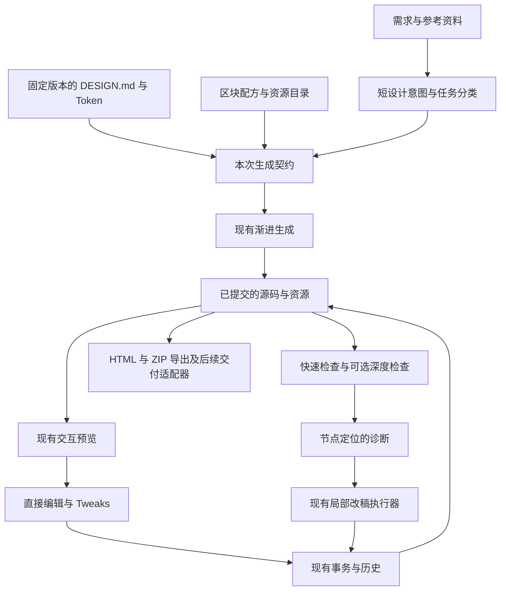

# GitHub 高星设计项目调研与 Design 融合报告

**对象：CMBDevClaw 的 Design 模式 · 成稿：2026-11-04 · GitHub 数据快照：2026-11-03，Asia/Shanghai**

本次通过 8 组 GitHub Topic 搜索获得 179 个不重复候选，再定向补查 43 个仓库，共形成 **222 个候选、78 个重点项目、12 个融合方向**。重点项目均超过 1,000 Stars。这里的“全景”覆盖与当前产品相关的主要设计工程方向，不代表穷尽 GitHub；公开源码项目与采用自定义许可的项目也单独保留作比较。

**核心建议：先把现有 Design 做成“遵守设计规范、可复用组件、能验证结果”的工作台。优先投入结构化 Token、区块配方、质量检查；随后增强源码映射、结构编辑和多页交互。**

本报告把上游已声明的功能与本项目的融合建议分开。星数、默认分支、最近推送与许可证识别来自公开 GitHub API；功能依据 README 和官方文档；优先级与工作量是结合本地代码作出的工程判断，没有把上游宣传数字当作本项目收益。

## 阅读导航

- [一、最值得做的决策](#decisions)
- [二、你的 Design 已经具备什么](#baseline)
- [三、78 个项目全景](#landscape)
- [四、12 个可融合的方向](#opportunities)
- [五、接到现有代码的实现蓝图](#implementation)
- [六、实施顺序与验收](#roadmap)
- [七、许可证与维护筛选](#constraints)
- [八、调研方法、证据与局限](#method)

<a id="decisions"></a>

## 一、最值得做的决策

### 1.1 建议的产品重心

你的产品已经贯通“需求 → AI 生成 → 真实页面预览 → 人工微调 → AI 局部改稿 → 导出”。下一阶段的竞争力应来自三件事：同一设计系统下的多次生成保持一致；高频页面不用每次重新发明；生成结果能够解释哪里合格、哪里需要修复。

外部项目提供了几条很清晰的实现路线：shadcn/ui 用注册表分发可编辑源码；Style Dictionary 处理 Token 转换；Puck 用组件配置约束编辑；Onlook 将页面元素映射回源码；axe-core 和 Playwright 提供可运行的检查工具。这些机制能分别接入当前链路。[shadcn Registry](https://ui.shadcn.com/docs/registry)、[Style Dictionary](https://styledictionary.com/info/tokens/)、[Puck 配置](https://puckeditor.com/docs/api-reference/configuration/component-config)、[Onlook 架构说明](https://github.com/onlook-dev/onlook#how-it-works)、[axe-core](https://github.com/dequelabs/axe-core)、[Playwright 视觉比较](https://playwright.dev/docs/test-snapshots)。

### 1.2 优先级总表

P0 表示首轮应验证；P1 表示随后增强；P2 表示有明确场景再投入。优先级针对融合方向，不等于建议整库引入。工作量为熟悉现有架构的一名工程师完成最小闭环的粗估，不含正式上线、跨平台适配与长期维护。

| 优先级 | 融合方向 | 主要参考 | 对用户的直接价值 | 最小闭环粗估 |
| --- | --- | --- | --- | --- |
| P0 | 结构化 Token 与主题联动 | Style Dictionary、tweakcn、Tokens Studio | 改品牌色、排版和密度时，整页一致变化 | 3–5 人日 |
| P0 | 可复用区块配方与注册表 | shadcn/ui、Puck、HyperUI | 表格、筛选区、空状态等有可靠起点 | 4–6 人日 |
| P0 | 设计规则与质量报告 | shadcn/lint、axe-core、Playwright | 知道哪里违反规范，并能定向修复 | 4–6 人日 |
| P0 | 按产物类型选择生成策略 | UI UX Pro Max、Taste Skill | 后台、移动端、官网不再使用同一种审美套路 | 2–3 人日 |
| P1 | 网页规范提取升级 | design-extract、Dembrandt | 参考站点转成带证据和置信度的设计资产 | 4–7 人日 |
| P1 | 编辑能力声明与源码映射 | Onlook、Puck | 清楚哪些文字、样式、实例能稳定编辑 | 5–8 人日 |
| P1 | 受约束的结构编辑 | GrapesJS、Puck、Craft.js | 插入、排序、复制区块时保留布局和行为 | 6–10 人日 |
| P1 | 多状态与多页交互原型 | Storybook、Zag、XState、React Flow | 把正常、空、错、加载与跨页流程讲完整 | 6–10 人日 |
| P1 | 本地素材和声明式图表 | Lucide、Iconify、ECharts、Vega-Lite | 图标一致、图表可编辑、导出更可靠 | 3–6 人日 |
| P2 | 页面总览与需求草图 | Excalidraw、Mermaid、React Flow | 在生成前检查信息架构和页面关系 | 5–8 人日 |
| P2 | 动效预设与参数控制 | Motion、Anime.js、Lottie | 有节制地添加可关闭、可复用的交互反馈 | 3–5 人日 |
| P2 | 演示、视频与工程交付适配 | reveal.js、Marp、HyperFrames、Mitosis | 同一设计资产适配不同交付形式 | 每类 5–10 人日起 |

### 1.3 第一批最值得读的项目

建议先看 **shadcn/ui、Style Dictionary、shadcn/lint、Puck、Onlook、design-extract、Dembrandt、axe-core、Playwright、UI UX Pro Max、Excalidraw、open-design**。其中前九项主要影响工程机制，UI UX Pro Max 影响生成策略，Excalidraw 影响需求表达，open-design 适合做同类产品比较。下一节保留了完整项目清单及各自适用边界。

<a id="baseline"></a>

## 二、你的 Design 已经具备什么

以下结论基于当前工作区中的源码与文档。本次只增加调研材料，没有改动产品实现，也没有重跑产品测试。

| 领域 | 已有证据 | 真正值得补的部分 |
| --- | --- | --- |
| AI 生成与首屏体验 | 小型闭合 HTML 骨架、语义区块渐进补齐、草稿与定稿隔离 | 按任务路由配方；用测量控制额外检索和校验成本 |
| 参数微调 | 声明式 defaults/schema/bindings、宿主面板、overrides、撤销重做、独立运行适配 | 从单页参数提升为具有语义和主题关系的 Token |
| 直接编辑 | 稳定节点 ID、文字槽、样式和删除；HTML、部分 JSX/Vue、声明式数据映射 | 明确编辑能力、组件实例身份及受控结构命令 |
| AI 局部改稿 | 目标上下文、CSS 依赖、hash/CAS、范围校验、事务、journal、预览 ACK | 区块配方和规则诊断进入同一条有界补丁链路 |
| 设计系统 | 内置和个人规范、不可变版本、网页样式提取；规范正文可包含色彩与排版定义 | 统一机器可读模型、Token 引用、状态与断点证据 |
| 模板 | HTML/ZIP/目录、多入口发现、静态资源复制、隔离预览和资源包导出 | 从整页模板深入到区块与组件；声明框架、依赖和编辑能力 |
| 浏览器校验 | 控制台、结构、Tweaks、交互探针、局部样式和布局比较 | 系统化无障碍检查、规范漂移、视口矩阵与质量展示 |
| 需求表达 | 需求上下文、追问、批注、圈画和节点锚点 | 页面地图、业务状态矩阵、可跳转的流程关系 |

源码入口：[生成提示词](/Users/liuxuyang/WebstormProjects/feature_design/src/main/services/design/generation-prompt.ts:29)、[Tweaks](/Users/liuxuyang/WebstormProjects/feature_design/src/shared/design-tweaks.ts:8)、[编辑命令](/Users/liuxuyang/WebstormProjects/feature_design/src/shared/design-edit.ts:24)、[局部上下文](/Users/liuxuyang/WebstormProjects/feature_design/src/main/services/design/patch-context.ts:97)、[规范库](/Users/liuxuyang/WebstormProjects/feature_design/src/main/services/design/system-library.ts:36)、[样式提取](/Users/liuxuyang/WebstormProjects/feature_design/src/main/services/design/system-style-snapshot.ts:27)、[浏览器诊断](/Users/liuxuyang/WebstormProjects/feature_design/src/main/services/design/browser-validation-feedback.ts:7)。

两个特别影响选型的事实：

1. **awesome-design-md 已经导入。** 本地 `brand-*` 规范来自该项目，下一步应提高它们的执行一致性和可检索性。重复导入更多品牌 Markdown 的收益有限。[本地来源记录](/Users/liuxuyang/WebstormProjects/feature_design/design-systems/_awesome-src/README.md:1)
2. **使用 DESIGN.md 的会话具有单方案约束。** 下文的多页、状态矩阵和历史比较均围绕当前规范下的一份正式设计展开；不会默认向这种会话添加 A/B 风格分支。[现有策略](/Users/liuxuyang/WebstormProjects/feature_design/src/shared/design-variation-policy.ts:11)

<a id="landscape"></a>

## 三、78 个项目全景

以下星数为 **2026-11-03 的 API 整数快照**，没有混用网页展示的四舍五入数字。“最近推送”是仓库 `pushed_at`，可能包含机器人或维护操作，不能单独证明核心维护质量。每行的“融合点/方式”是本报告判断；项目链接指向上游仓库。

许可证先保留 API 识别结果，再对关键异常进行人工核对。表中带“自定义”“混合”“附加条件”的条目应结合第七节阅读。宽松许可也只描述所核对的项目主体，不自动覆盖图片、字体、品牌资产、付费组件和所有依赖。

### 3.1 AI 设计与参考提取（10 项）

| 项目 · Stars | 主体许可 / 最近推送 | 可融合的想法或实现 | 方式与优先级 |
| --- | --- | --- | --- |
| [nextlevelbuilder/ui-ux-pro-max-skill](https://github.com/nextlevelbuilder/ui-ux-pro-max-skill) · **144,589** | MIT<br>2026-11-02 | 按行业、页面类型检索配色、字体、结构与反模式，遵守已选设计系统。 | P0 · 检索资料 |
| [VoltAgent/awesome-design-md](https://github.com/VoltAgent/awesome-design-md) · **125,384** | MIT<br>2026-10-28 | 本地 brand-* 已引用该来源；下一步结构化、加版本和规则，避免重复导入。 | P0 · 已有资产 |
| [Leonxlnx/taste-skill](https://github.com/Leonxlnx/taste-skill) · **109,232** | MIT<br>2026-11-03 | 按真实内容确定视觉方向，多宽度检查；对长流程和 Token 成本作裁剪。 | P0 · 提炼规则 |
| [nexu-io/open-design](https://github.com/nexu-io/open-design) · **105,656** | Apache-2.0<br>2026-11-03 | 规范、模板、技能、资源分层为可版本化资产；你的项目已有相关基础。 | P1 · 产品对标 |
| [abi/screenshot-to-code](https://github.com/abi/screenshot-to-code) · **80,998** | MIT<br>2026-10-27 | 参考截图驱动重建与迭代；借鉴输入组织，复用你已有截图生成链路。 | P1 · 借鉴 |
| [onlook-dev/onlook](https://github.com/onlook-dev/onlook) · **27,094** | Apache-2.0<br>2026-10-21 | 元素插桩、源码索引与可视编辑协同，重点补强框架实例映射。 | P1 · 借鉴机制 |
| [OpenCoworkAI/open-codesign](https://github.com/OpenCoworkAI/open-codesign) · **8,153** | MIT<br>2026-11-01 | 本地会话、多格式交付；README 中 UI Kit 分解标为分支功能，不能当成稳定能力。 | P2 · 产品对标 |
| [stagewise-io/stagewise](https://github.com/stagewise-io/stagewise) · **6,832** | AGPL-3.0<br>2026-11-02 | 把选中元素、控制台和浏览器状态带给 Agent；整库集成另评估 AGPL。 | P2 · 借鉴机制 |
| [Manavarya09/design-extract](https://github.com/Manavarya09/design-extract) · **4,479** | MIT<br>2026-11-02 | 规范提取扩展到多视口、状态、DTCG 和对照报告，先验证局部能力。 | P1 · 借鉴或适配 |
| [dembrandt/dembrandt](https://github.com/dembrandt/dembrandt) · **3,922** | MIT<br>2026-11-01 | 计算样式聚类、置信度、Token 导出与漂移检查，提升现有网页提取。 | P1 · 借鉴或适配 |

### 3.2 可视化编辑与搭建（10 项）

| 项目 · Stars | 主体许可 / 最近推送 | 可融合的想法或实现 | 方式与优先级 |
| --- | --- | --- | --- |
| [excalidraw/excalidraw](https://github.com/excalidraw/excalidraw) · **135,089** | MIT<br>2026-11-03 | 需求草图、页面关系和反馈附件；让白板与正式 HTML 产物各司其职。 | P2 · 按需接入 |
| [penpot/penpot](https://github.com/penpot/penpot) · **62,015** | MPL-2.0<br>2026-11-03 | 布局、组件与设计交付机制；优先研究导入互操作，完整平台集成成本高。 | P2 · 互操作参考 |
| [tldraw/tldraw](https://github.com/tldraw/tldraw) · **51,212** | 自定义 tldraw license<br>2026-11-03 | 无限画布与对象交互；当前为自定义许可，不能按宽松开源 SDK 纳入。 | P2 · 授权后评估 |
| [GrapesJS/grapesjs](https://github.com/GrapesJS/grapesjs) · **26,370** | BSD-3-Clause（core 条款核对）<br>2026-11-03 | 组件模型、样式面板与区块编辑；不直接替换当前源码和事务模型。 | P1 · 借鉴机制 |
| [alibaba/lowcode-engine](https://github.com/alibaba/lowcode-engine) · **15,874** | MIT<br>2025-03-10 · 较早 | 物料、属性面板与协议化搭建；完整低代码平台超出当前轻量产物路线。 | P2 · 机制参考 |
| [puckeditor/puck](https://github.com/puckeditor/puck) · **13,610** | MIT<br>2026-10-29 | 用组件字段、权限、插槽与渲染配置约束区块配方，React 路线可做 PoC。 | P0 · 借鉴并试点 |
| [webstudio-is/webstudio](https://github.com/webstudio-is/webstudio) · **9,137** | AGPL core / 专有动画子包<br>2026-11-03 | CSS 属性与响应式编辑体验；核心 AGPL，可选动画包为专有许可。 | P2 · 机制参考 |
| [prevwong/craft.js](https://github.com/prevwong/craft.js) · **8,761** | MIT<br>2025-02-14 · 较早 | React 节点编辑与序列化；推送较早，作为可视搭建机制参考。 | P2 · 机制参考 |
| [plasmicapp/plasmic](https://github.com/plasmicapp/plasmic) · **7,142** | MIT<br>2026-11-03 | 将现有代码组件注册给可视编辑器，供企业组件库接入设计配方。 | P1 · 借鉴机制 |
| [GoogleChromeLabs/ProjectVisBug](https://github.com/GoogleChromeLabs/ProjectVisBug) · **5,765** | Apache-2.0<br>2026-08-03 · **已归档** | 检查、选中、排版和样式操作的交互；已归档，不作为新增长期依赖。 | P2 · 历史参考 |

### 3.3 设计系统与工程协议（7 项）

| 项目 · Stars | 主体许可 / 最近推送 | 可融合的想法或实现 | 方式与优先级 |
| --- | --- | --- | --- |
| [shadcn-ui/ui](https://github.com/shadcn-ui/ui) · **127,254** | MIT<br>2026-11-03 | 组件源码、区块、依赖与主题变量可分发；静态 HTML 需要相应适配。 | P0 · 注册表与配方 |
| [storybookjs/storybook](https://github.com/storybookjs/storybook) · **91,436** | MIT<br>2026-11-03 | 组件变体、状态和文档；普通 HTML 先用轻量场景协议。 | P1 · 组件场景 |
| [BuilderIO/mitosis](https://github.com/BuilderIO/mitosis) · **14,454** | MIT<br>2026-10-28 | 从受约束组件模型生成多框架代码，不承诺任意现有源码无损转换。 | P2 · 受控导出 |
| [jnsahaj/tweakcn](https://github.com/jnsahaj/tweakcn) · **10,513** | Apache-2.0<br>2026-09-03 | 主题参数、预设与组件预览，接到现有 Tweaks，不必整体嵌入应用。 | P0 · 交互借鉴 |
| [style-dictionary/style-dictionary](https://github.com/style-dictionary/style-dictionary) · **4,875** | Apache-2.0<br>2026-10-28 | 统一 Token 解析、引用与 CSS 输出，保留规范版本和页面覆盖。 | P0 · 工具接入 |
| [shadcn-ui/lint](https://github.com/shadcn-ui/lint) · **3,303** | MIT<br>2026-11-02 | 规则诊断提供修复方向；Tailwind 源码可接工具，HTML 使用对应检查器。 | P0 · 规则借鉴 |
| [tokens-studio/figma-plugin](https://github.com/tokens-studio/figma-plugin) · **1,629** | MIT<br>2026-11-02 | JSON Token 的编辑、引用与同步；可优先支持格式而非整个 Figma 插件。 | P1 · 互操作参考 |

### 3.4 组件与交互模式（11 项）

| 项目 · Stars | 主体许可 / 最近推送 | 可融合的想法或实现 | 方式与优先级 |
| --- | --- | --- | --- |
| [ant-design/ant-design](https://github.com/ant-design/ant-design) · **100,059** | MIT<br>2026-11-03 | 中文后台表格、筛选、表单与状态，优先做已构建静态模板包。 | P1 · 企业配方 |
| [mui/material-ui](https://github.com/mui/material-ui) · **99,296** | MIT<br>2026-11-03 | 成熟组件与主题机制；按用户框架提供配方，不与其他整套 UI 混装。 | P1 · 组件适配 |
| [DavidHDev/react-bits](https://github.com/DavidHDev/react-bits) · **51,134** | MIT + Commons Clause<br>2026-10-31 | 创意组件与背景效果；Commons Clause 对组件/工具再分发的限制需核对。 | P2 · 视觉参考 |
| [saadeghi/daisyui](https://github.com/saadeghi/daisyui) · **42,731** | MIT<br>2026-10-31 | 语义化 CSS 组件与主题，适合预构建后供静态 HTML 使用。 | P1 · HTML 配方 |
| [tailwindlabs/headlessui](https://github.com/tailwindlabs/headlessui) · **28,805** | MIT<br>2026-04-13 | 无样式交互组件与可访问行为；与现有 Radix 路线择一。 | P1 · 按框架选用 |
| [magicuidesign/magicui](https://github.com/magicuidesign/magicui) · **23,063** | MIT<br>2026-11-03 | 挑少量官网展示组件，检查各条依赖，避免给后台默认添加装饰动效。 | P2 · 精选配方 |
| [radix-ui/primitives](https://github.com/radix-ui/primitives) · **19,466** | MIT<br>2026-10-14 | 项目壳层已有多项 Radix；补强弹窗、菜单、焦点和键盘契约。 | P1 · 已有基础 |
| [adobe/react-spectrum](https://github.com/adobe/react-spectrum) · **16,006** | Apache-2.0<br>2026-11-03 | React Aria 的键盘、触摸、无障碍及国际化模式，适合高质量交互配方。 | P1 · 行为参考 |
| [markmead/hyperui](https://github.com/markmead/hyperui) · **12,275** | MIT<br>2026-10-25 | HTML/Tailwind 区块可用于配方起点，仍需构建 CSS 并接入本地资源。 | P0 · 区块配方 |
| [carbon-design-system/carbon](https://github.com/carbon-design-system/carbon) · **9,600** | Apache-2.0<br>2026-11-03 | 企业界面的密度、数据表达和组件状态，补充品牌风格之外的业务规则。 | P1 · 企业规范 |
| [chakra-ui/zag](https://github.com/chakra-ui/zag) · **5,246** | MIT<br>2026-11-03 | 跨框架状态机行为，借鉴组件状态、事件和可访问性契约。 | P1 · 交互模型 |

### 3.5 画布与图形编辑（11 项）

| 项目 · Stars | 主体许可 / 最近推送 | 可融合的想法或实现 | 方式与优先级 |
| --- | --- | --- | --- |
| [pixijs/pixijs](https://github.com/pixijs/pixijs) · **48,621** | MIT<br>2026-10-30 | 高性能二维图形渲染，仅在图形/游戏类产物有明确需求时引入。 | P2 · 独立产物 |
| [fabricjs/fabric.js](https://github.com/fabricjs/fabric.js) · **31,537** | MIT<br>2026-11-03 | 对象化 Canvas、文字和图像编辑，适合海报类产物，不替代网页 DOM。 | P2 · 按场景选用 |
| [GraphiteEditor/Graphite](https://github.com/GraphiteEditor/Graphite) · **27,825** | Apache-2.0<br>2026-11-03 | 程序化二维图形与非破坏编辑，适合未来创意工具方向。 | P2 · 产品参考 |
| [svg/svgo](https://github.com/svg/svgo) · **22,786** | MIT<br>2026-10-26 | SVG 压缩和清理；为引用中的 ID、样式和交互保留必要配置。 | P1 · 工具接入 |
| [rough-stuff/rough](https://github.com/rough-stuff/rough) · **21,343** | MIT<br>2024-07-28 · 较早 | 手绘风 SVG/Canvas，适合低保真草图及线框模板。 | P2 · 草图工具 |
| [konvajs/konva](https://github.com/konvajs/konva) · **14,911** | MIT（正文核对）<br>2026-10-31 | 场景图、图层和图形交互，可用于专门的画布产物。 | P2 · 按场景选用 |
| [taye/interact.js](https://github.com/taye/interact.js) · **12,939** | MIT<br>2026-08-01 | 拖拽、缩放、吸附与 SVG 交互，适合少量工具层能力。 | P2 · 按需接入 |
| [daybrush/moveable](https://github.com/daybrush/moveable) · **10,765** | MIT<br>2024-06-03 · 较早 | 拖拽、缩放、旋转和吸附；网页编辑必须转成布局/源码命令。 | P2 · 交互参考 |
| [SVG-Edit/svgedit](https://github.com/SVG-Edit/svgedit) · **7,894** | MIT<br>2026-08-05 | 矢量图形编辑，可作为图标/插图工具，不与页面编辑强行共用模型。 | P2 · 独立产物 |
| [steveruizok/perfect-freehand](https://github.com/steveruizok/perfect-freehand) · **5,791** | MIT<br>2026-04-13 | 改善现有圈画笔迹，先做独立轮廓生成，不改变批注锚点模型。 | P1 · 小模块试点 |
| [daybrush/selecto](https://github.com/daybrush/selecto) · **2,232** | MIT<br>2024-06-17 · 较早 | 框选和多选交互；复用现有节点身份，注意旧依赖兼容。 | P2 · 交互参考 |

### 3.6 流程与交互原型（6 项）

| 项目 · Stars | 主体许可 / 最近推送 | 可融合的想法或实现 | 方式与优先级 |
| --- | --- | --- | --- |
| [mermaid-js/mermaid](https://github.com/mermaid-js/mermaid) · **90,992** | MIT<br>2026-11-03 | 需求流程、状态和结构图，源文本可版本化并作为设计输入。 | P1 · 文本图适配 |
| [xyflow/xyflow](https://github.com/xyflow/xyflow) · **38,881** | MIT<br>2026-11-03 | 页面缩略图、用户流程和交互跳转图；优先于泛化无限画布。 | P1 · 页面关系 |
| [statelyai/xstate](https://github.com/statelyai/xstate) · **30,403** | MIT<br>2026-11-03 | 用状态和事件描述表单、加载、提交与错误，不必替换全局状态库。 | P1 · 状态协议 |
| [bpmn-io/bpmn-js](https://github.com/bpmn-io/bpmn-js) · **9,720** | bpmn.io 自定义条款（含水印）<br>2026-10-30 | 需要标准 BPMN 的业务流程原型；保留 bpmn.io 要求的水印。 | P2 · 按业务选用 |
| [jgraph/drawio](https://github.com/jgraph/drawio) · **9,155** | Apache-2.0<br>2026-10-30 | 已有图表资产的嵌入与交换；这是 drawio 仓库的星数，不混用桌面仓库。 | P2 · 格式互操作 |
| [mockoon/mockoon](https://github.com/mockoon/mockoon) · **8,467** | MIT<br>2026-11-01 | 本地模拟接口可支撑复杂原型；简单场景先用产物内固定数据。 | P2 · 开发验证 |

### 3.7 动效与演示（9 项）

| 项目 · Stars | 主体许可 / 最近推送 | 可融合的想法或实现 | 方式与优先级 |
| --- | --- | --- | --- |
| [heygen-com/hyperframes](https://github.com/heygen-com/hyperframes) · **78,078** | Apache-2.0<br>2026-11-03 | 复用 HTML 制作视频；单独管理渲染任务、帧时钟与依赖许可。 | P2 · 交付适配 |
| [juliangarnier/anime](https://github.com/juliangarnier/anime) · **74,244** | MIT<br>2026-11-02 | 普通 HTML/SVG 动画候选，封装为有时长与缓动参数的预设。 | P2 · 首选候选 |
| [hakimel/reveal.js](https://github.com/hakimel/reveal.js) · **72,512** | MIT<br>2026-09-30 | 将现有 HTML deck 模板接入可播放演示与演讲者视图。 | P2 · 演示适配 |
| [motiondivision/motion](https://github.com/motiondivision/motion) · **34,840** | MIT<br>2026-11-03 | 给受控组件添加布局和交互动画，采用按需导入和减弱动画选项。 | P2 · 首选候选 |
| [airbnb/lottie-web](https://github.com/airbnb/lottie-web) · **32,339** | MIT<br>2025-09-01 · 较早 | 用 JSON 动画补充少量空状态与反馈，资源自身许可单独记录。 | P2 · 播放适配 |
| [greensock/GSAP](https://github.com/greensock/GSAP) · **30,105** | 自定义 GSAP Standard License<br>2026-04-13 | 滚动与时间轴能力强，但视觉动画编辑器用途需核对现行标准许可。 | P2 · 用途核对 |
| [motion-canvas/motion-canvas](https://github.com/motion-canvas/motion-canvas) · **19,663** | MIT<br>2026-07-02 | 代码描述解释性动画，适合讲解视频而非一般页面编辑。 | P2 · 独立产物 |
| [theatre-js/theatre](https://github.com/theatre-js/theatre) · **12,847** | Apache-2.0 core / AGPL-3.0 studio<br>2024-08-14 · 较早 | 可视时间轴与参数动画；core 和 studio 许可不同，维护日期较早。 | P2 · 机制参考 |
| [marp-team/marp](https://github.com/marp-team/marp) · **12,717** | MIT<br>2026-11-02 | Markdown 到演示的路线，可用于重内容的汇报稿；需选择具体 core/CLI。 | P2 · 文稿适配 |

### 3.8 素材与数据表达（10 项）

| 项目 · Stars | 主体许可 / 最近推送 | 可融合的想法或实现 | 方式与优先级 |
| --- | --- | --- | --- |
| [mrdoob/three.js](https://github.com/mrdoob/three.js) · **117,476** | MIT<br>2026-11-03 | 明确需要三维场景时作为专用模板运行时，保持普通页面轻量。 | P2 · 独立产物 |
| [d3/d3](https://github.com/d3/d3) · **113,860** | ISC<br>2026-11-03 | 独特交互可视化再使用；普通统计图优先减少手写复杂度。 | P2 · 定制图表 |
| [tailwindlabs/tailwindcss](https://github.com/tailwindlabs/tailwindcss) · **98,056** | MIT<br>2026-11-02 | 宿主已使用；为生成产物明确构建后的 CSS 和设计 Token 契约。 | P0 · 已有基础 |
| [apache/echarts](https://github.com/apache/echarts) · **67,671** | Apache-2.0<br>2026-10-13 | 业务图表采用 spec/data/theme 分离，导出带本地运行资源。 | P1 · 图表适配 |
| [pmndrs/react-three-fiber](https://github.com/pmndrs/react-three-fiber) · **33,456** | MIT<br>2026-10-21 | React 三维场景适配，需要显式工程运行条件和性能预算。 | P2 · 独立产物 |
| [lucide-icons/lucide](https://github.com/lucide-icons/lucide) · **25,484** | ISC / Feather 派生部分 MIT<br>2026-11-03 | 壳层已使用 Lucide；把同一图标风格、本地资源和语义目录扩展到产物。 | P0 · 扩展已有能力 |
| [tabler/tabler-icons](https://github.com/tabler/tabler-icons) · **22,532** | MIT<br>2026-10-29 | 另一套完整图标选择，整页统一风格，避免与 Lucide 随机混用。 | P1 · 替代图标集 |
| [iconify/iconify](https://github.com/iconify/iconify) · **6,382** | MIT 程序 / 图标集分别许可<br>2026-11-02 | 统一检索和使用多种图标；逐集合维护许可并按需本地化。 | P1 · 资源目录 |
| [argyleink/open-props](https://github.com/argyleink/open-props) · **5,563** | MIT<br>2026-10-11 | 现成 CSS 自定义属性刻度，可补齐间距、阴影、缓动的起点。 | P1 · Token 参考 |
| [vega/vega-lite](https://github.com/vega/vega-lite) · **5,539** | BSD-3-Clause<br>2026-11-02 | 让模型输出受约束图表规格，方便修改数据、主题和检查合法性。 | P1 · 声明式图表 |

### 3.9 设计质量与回归（4 项）

| 项目 · Stars | 主体许可 / 最近推送 | 可融合的想法或实现 | 方式与优先级 |
| --- | --- | --- | --- |
| [microsoft/playwright](https://github.com/microsoft/playwright) · **99,176** | Apache-2.0<br>2026-11-03 | 项目已依赖 Playwright；补视口/状态矩阵、截图对照和离线导出验证。 | P0 · 扩展已有能力 |
| [dequelabs/axe-core](https://github.com/dequelabs/axe-core) · **7,743** | MPL-2.0<br>2026-11-02 | 补充可访问名称、对比度等自动检查，诊断映射到现有节点。 | P0 · 检查接入 |
| [garris/BackstopJS](https://github.com/garris/BackstopJS) · **7,194** | MIT<br>2026-10-10 | 参考图、当前图与差异图的评审体验；已有 Playwright 不必重复引入运行器。 | P1 · 报告借鉴 |
| [reg-viz/reg-suit](https://github.com/reg-viz/reg-suit) · **1,306** | MIT<br>2026-10-27 | 视觉基线与差异报告的组织机制；本地方案先不依赖其云存储链路。 | P2 · 报告借鉴 |


<a id="opportunities"></a>

## 四、12 个可融合的方向

### 4.1 让设计系统成为可执行的资产包

**上游事实。** shadcn 的 Registry 可以描述源码文件、依赖与主题变量；Style Dictionary 支持将 Token 转换到不同平台；open-design 的新式设计系统包在 DESIGN.md 之外加入 manifest、tokens.css、组件、资源和来源信息。[Registry 文档](https://ui.shadcn.com/docs/registry)、[Token 文档](https://styledictionary.com/info/tokens/)、[open-design](https://github.com/nexu-io/open-design#why-opendesign)

**融合建议。** 沿用当前设计系统的不可变版本，在每个版本旁增加经过校验的 Token 和资源清单。DESIGN.md 继续表达原则、语气和例外；Token 处理颜色、字号、间距、圆角等确定值。生成时给模型相关摘要和配方，避免把整个组件库塞进上下文。

**最小实现。** 在规范保存时产生可选的 `tokens.json` 和 `manifest.json`；主进程校验类型、引用和循环；转换成 CSS 变量供当前 HTML 使用。预览更新、导出与下一轮 AI 改稿全部引用同一份已提交版本。旧 Markdown 规范继续可用，不要求一次性迁移。

**适用边界。** 现有规范中的 YAML 可作为迁移输入，但不能把任意自然语言自动推断成确定 Token。品牌语义、Logo 和字体授权应记录来源。验收看同一规范下三个不同页面的 Token 使用情况，而不只看编辑面板是否好看。

### 4.2 将 Tweaks 升级为有语义的主题编辑

**上游事实。** tweakcn 提供面向 Tailwind CSS / shadcn/ui 的可视化主题编辑；Tokens Studio 将设计 Token 保存在 JSON 中并支持同步。[tweakcn](https://github.com/jnsahaj/tweakcn)、[Tokens Studio](https://github.com/tokens-studio/figma-plugin)

**融合建议。** 现有 Tweaks 已经能实时改参数，应继续使用它的交互和历史机制，新增“背景/表面/正文/品牌/危险”等语义槽，以及字号比例、内容密度、亮暗主题。把当前“改一个具体色值”的行为提升为“调整一种设计角色”。

**最小实现。** 建立 Token → CSS 变量 → Tweaks 控件的映射。允许页面对 Token 作局部覆盖，并在面板中区分“修改本页”“保存为规范新版本”；引用关系由宿主管理。长文本、中文字体回退和亮暗模式要随主题一起检查。

**验收重点。** 更新品牌色能联动按钮、链接和选中状态；正文色不会意外改变危险操作颜色；撤销恢复引用关系；旧会话仍解析原规范版本。tweakcn 的 UI 可借鉴，但本项目没有必要整体嵌入一个独立主题应用。

### 4.3 把设计原则转成能给模型纠错的规则

**上游事实。** shadcn/lint 为 Tailwind v4 项目提供可配置设计规则，诊断中包含问题和基于组件契约的修复建议；它并不要求使用 shadcn/ui。[项目说明](https://github.com/shadcn-ui/lint)

**融合建议。** 从已有 DESIGN.md 中挑选少量可确定验证的规则：只能使用批准的颜色与间距；Button 的尺寸通过 size 变体改变；表单字段必须有可识别标签。规则应提供节点、期望值和修复方向，让局部执行器能直接使用。

**最小实现。** 增加 `design-rules.json`，先做颜色、排版和间距三类。HTML/CSS 产物通过已有 AST 和浏览器计算样式检查；将来有真正的 Tailwind 源码工程时再接 shadcn/lint，避免拿一个 JSX/Tailwind 工具直接扫描所有 HTML。

**反馈形态。** “primary-button 使用了未登记的 13px 内边距；该配方允许 compact/default/large，请选择已有尺寸”比“页面不够高级”更可执行。用户可允许局部例外，规则随规范版本固定。上游的效果数字需要在本项目复测后才能引用为收益。

### 4.4 从“抓取样式”走向“带证据的规范提取”

**上游事实。** design-extract 声明支持 DTCG Token、多视口、状态样式及比较；Dembrandt 基于浏览器计算样式提取设计值，并提供置信度、Token 导出和漂移检查。[design-extract](https://github.com/Manavarya09/design-extract)、[Dembrandt](https://github.com/dembrandt/dembrandt)

**你的基础。** 当前已经能从真实页面提取颜色、字体、间距和代表性组件；生成的文档也明确指出单一视口无法确定断点与交互规范。[现有实现](/Users/liuxuyang/WebstormProjects/feature_design/src/main/services/design/system-style-snapshot.ts:105)

**融合建议。** 每个提取值保留来源元素、视口、状态和观察次数。把高频视觉值聚类为候选刻度，再由用户确认语义名称；区分“观察到的值”和“推测的设计规则”。增加常见视口的复采样与 hover/focus 对照，先限于当前页及用户选择的相关页。

**最小实现。** 先输出 JSON 证据旁车和置信度，再增加两到三个视口采样。复用当前 capture 的登录、取消、超时和受限页面处理。页面打开的某一状态不代表完整设计系统；自动导出的品牌规范应保持草稿身份。

### 4.5 用源码映射和能力说明提高直接编辑的可靠性

**上游事实。** Onlook 的架构在预览运行、代码索引与元素插桩之间建立映射，使选中元素可以回到源码；Puck 的配置允许对不同组件定义字段和权限。[Onlook](https://github.com/onlook-dev/onlook#how-it-works)、[Puck 配置](https://puckeditor.com/docs/api-reference/configuration/component-config)

**融合建议。** 继续使用现有节点身份与 revision/hash，将 `canStyle`、`canDelete` 等能力扩展为明确的编辑操作集合。对重复组件区分“实例数据”与“共享定义”，并向用户展示限制原因。对无法可靠定位的外部脚本 DOM，提供 AI 源码改稿入口。

**最小实现。** 在编辑索引中加入映射来源、实例 key、可操作字段和限制原因；仍通过主进程生成候选并事务提交。第一阶段优先提升受控 HTML、已声明绑定的 React/Vue；真正的多文件 TSX/Vue SFC 工程作为独立适配器。

**验收重点。** 点击第二张重复卡片，只修改其文案；组件重绘、重开、撤销与导出后结果一致。对映射歧义拒绝猜测。Onlook 的云容器、账户和托管平台不必进入当前 Electron 本地链路。

### 4.6 建立区块配方库，再做受约束的插入与排序

**上游事实。** Puck 用组件配置与数据进行渲染；GrapesJS 将组件模型作为导出的数据来源，并区分编辑视图；Craft.js 提供构建 React 页面编辑器的基础。[Puck](https://github.com/puckeditor/puck)、[GrapesJS 组件模型](https://grapesjs.com/docs/modules/Components.html)、[Craft.js](https://github.com/prevwong/craft.js)

**融合建议。** 在现有整页模板下增加“区块配方”：筛选工具栏、搜索表格、详情摘要、双栏表单、空状态、错误重试、定价区、移动底栏等。每份配方带内容槽、样式 Token、插槽约束、交互约定和导出依赖。先做 8–12 个高频区块验证，不追求庞大市场。

**最小实现。** 首先允许 Agent 检索并读取配方，产物仍写现有 HTML。然后在已识别区块之间支持插入/排序。新命令包含目标容器、插入位置、预期 hash 和依赖清单；结构调整统一经过事务、journal、校验及一次必要的预览重建。

**实施边界。** 当前 `design-edit/1` 没有插入、复制和移动操作，必须增加经过版本化的命令并处理撤销，不能让拖拽直接覆盖运行时 DOM。也不宜同时维护 GrapesJS、Puck 和当前编辑器三套页面真相。Craft.js 的最近推送较早，优先研究机制。

### 4.7 按任务选择设计策略，并把审美规则压到合理预算内

**上游事实。** UI UX Pro Max 将样式、行业、配色、字体与反模式组合为检索资料；Taste Skill 从需求和素材出发选择设计方向，并进行多宽度浏览器检查。[UI UX Pro Max](https://github.com/nextlevelbuilder/ui-ux-pro-max-skill)、[Taste Skill](https://github.com/Leonxlnx/taste-skill#how-v2-works)

**融合建议。** 先判断后台、消费产品、内容页、品牌官网、移动应用、演示文稿，再选择信息密度和内容结构。使用 DESIGN.md 时以既定规范为最高视觉输入；未指定规范时，给出一条明确方向和少量相匹配的规则即可。

**最小实现。** 生成前形成一个短的 `design-intent`：目标用户、核心动作、内容结构、密度、素材策略、禁止的套路。以检索方式附加相关配方，不把整个技能库展开。后台任务优先表格、筛选、状态和可读性；品牌任务再考虑强视觉素材。

**成本边界。** Taste Skill 的 README 自述流程可能耗时较长、Token 量较大；这不是本项目实测，也不适合作为每次生成的默认成本。借鉴任务判断和少量复检即可。当前已有宿主浏览器校验，应由宿主集中执行，避免模型再次重复跑整套浏览器流程。

### 4.8 增加能解释问题的质量报告与定向修复

**上游事实。** axe-core 提供自动化无障碍检查；Playwright 可以比较截图；BackstopJS 和 reg-suit 展示了参考图、当前图和差异报告的组织方式。[axe-core](https://github.com/dequelabs/axe-core)、[Playwright](https://playwright.dev/docs/test-snapshots)、[BackstopJS](https://github.com/garris/BackstopJS)、[reg-suit](https://github.com/reg-viz/reg-suit)

**融合建议。** 在已有结构、运行时和交互诊断上补充：可访问名称、对比度等自动检查；批准 Token 的使用情况；常用视口下的新溢出；改稿前后的非目标区域变化。报告区分“确定错误”“待人工确认”“设计偏好”，不合成为含义模糊的万能审美分。

**最小实现。** 保留首屏与当前快速校验链路，增加可取消的深度检查任务。每个问题带 ruleId、节点、证据、严重程度和建议操作；点击定位；用户可选择一批问题交给现有 patch executor。超时、资源加载失败等基础设施错误不交给模型无限修复。

**验收重点。** 固定浏览器、字体、视口、时间、数据和动画状态后再比较截图，降低噪声。自动检测通过不等于完成全部无障碍验证，键盘路径和真实辅助技术使用仍有人工部分。模型视觉评价单独保存，不能替代确定性错误报告。

### 4.9 把单页扩展为可检查的状态与页面关系

**上游事实。** Storybook 用独立场景展示组件；Zag 将交互行为组织为状态机并支持不同框架；XState 描述状态与事件；React Flow 提供节点连接编辑。[Storybook](https://github.com/storybookjs/storybook)、[Zag](https://github.com/chakra-ui/zag)、[XState](https://github.com/statelyai/xstate)、[React Flow](https://github.com/xyflow/xyflow)

**融合建议。** 为表单、表格和详情页准备正常/加载/空/错误等可选择场景；再记录页面间的导航关系。评审时能一键切换“空数据”“提交失败”，不用临时修改源码或依赖真实接口碰巧失败。

**最小实现。** 在 artifact 的旁车元数据中登记 pages、scenarios 和示例数据，复用现有模板多入口能力；页面状态通过显式适配器切换。React 组件故事可以使用 Storybook；普通 HTML 产物先使用轻量场景协议，无需启动完整 Storybook。

**验收重点。** 正常与异常状态共享相同规范；状态切换不写坏业务数据；ZIP 导出仍能演示导航。对复杂后台流程，先做状态矩阵和页面链接，再决定是否需要可视化状态机。不要因此替换现有全局 Zustand 状态。

### 4.10 增加需求草图与页面总览，控制画布范围

**上游事实。** Excalidraw 提供手绘风格白板；Mermaid 用文本描述图；React Flow 支持交互式节点图；perfect-freehand 提供手写笔迹轮廓。[Excalidraw](https://github.com/excalidraw/excalidraw)、[Mermaid](https://github.com/mermaid-js/mermaid)、[React Flow](https://github.com/xyflow/xyflow)、[perfect-freehand](https://github.com/steveruizok/perfect-freehand)

**融合建议。** 用页面卡片表达“列表 → 详情 → 编辑 → 成功”，节点连接携带用户动作，卡片关联当前页面、版本与批注。生成前可检查信息架构；生成后成为导航总览。草图可以作为需求附件，不必成为正式页面的数据模型。

**最小实现。** 页面总览优先使用 React Flow 或普通缩略图网格；自由草图按需嵌入 Excalidraw。当前圈画已经存在，短期仅改善笔迹、箭头和锚点体验也有价值。不要同时引入多个完整画布内核。

**边界。** tldraw 的交互和记录模型值得研究，但现行自定义许可要求生产使用满足其授权条件；不应当作 MIT 画布 SDK 直接纳入。[tldraw 许可证](https://github.com/tldraw/tldraw/blob/main/LICENSE.md)

### 4.11 统一图标、图表和素材的声明与本地交付

**上游事实。** Lucide、Tabler 和 Iconify 提供图标资源或统一使用工具；ECharts 与 Vega-Lite 提供可配置或声明式数据可视化。[Lucide](https://github.com/lucide-icons/lucide)、[Tabler](https://github.com/tabler/tabler-icons)、[Iconify](https://github.com/iconify/iconify)、[ECharts](https://github.com/apache/echarts)、[Vega-Lite](https://github.com/vega/vega-lite)

**融合建议。** 产品壳层已经使用 lucide-react，应把一致性延伸到生成产物：图标用固定集合、语义名称和尺寸；图表用数据与规格分离；素材记录来源和许可。不要让模型每次编写大量重复 SVG 或从多个在线 CDN 混用图标风格。

**最小实现。** 给 Agent 一个小型可检索目录；选择的资源复制到设计目录并进入 ZIP。图表保存 `spec + data + theme`，数据修改不会重建全部页面。优先选一种图表方案验证，ECharts 适合常见业务图，Vega-Lite 适合受约束的声明式生成。

**验收重点。** 离线打开导出包仍有图标、字体回退和图表；用户能替换样例数据；未知数据不伪装成真实业务指标。Iconify 的程序许可不代表它聚合的每个图标集合都采用同一许可，应逐集合记录。

### 4.12 用适配器扩展动效、演示和视频交付

**上游事实。** Motion 和 Anime.js 提供动画能力；Lottie 播放可序列化动画；reveal.js 和 Marp 面向演示文稿；HyperFrames 提供 HTML 到视频的工作流；Mitosis 将受约束的组件模型生成到不同框架。[Motion](https://github.com/motiondivision/motion)、[Anime.js](https://github.com/juliangarnier/anime)、[Lottie](https://github.com/airbnb/lottie-web)、[reveal.js](https://github.com/hakimel/reveal.js)、[Marp](https://github.com/marp-team/marp)、[HyperFrames](https://github.com/heygen-com/hyperframes)、[Mitosis](https://github.com/BuilderIO/mitosis)

**融合建议。** 当前 HTML 产物先获得“进入、展开、反馈、数字变化”少量动效预设，把时长、缓动和减弱动画选项纳入参数。演示与视频采用独立产物类型和渲染任务，复用规范、资源及版本，避免让所有 HTML 都承担视频时间轴或框架转换能力。

**最小实现。** 第一轮只加 CSS/WAAPI 或单一 MIT 动画库的预设；演示导出先验证现有 deck 模板与 reveal.js 的适配。需要视频时，另建可取消的渲染队列，固定帧时钟、字体和资源。HyperFrames 的 Apache 主体许可不自动解决其动画依赖、字体、音频与编码器的分发问题。

**边界。** Mitosis 的生成能力适合按其模型创作的受控组件，不应宣传为“任意 HTML/React/Vue 无损互转”。GSAP 不适合作为本轮默认视觉动画编辑器底座，具体限制见第七节。

<a id="implementation"></a>

## 五、接到现有代码的实现蓝图

### 5.1 建议的数据流



图中的生成、预览、事务、局部改稿和 HTML/ZIP 导出已经存在；新增部分集中在输入契约、可复用资产、诊断维度和后续交付适配器。

### 5.2 三种资产应有各自职责

| 资产 | 建议保存内容 | 执行原则 |
| --- | --- | --- |
| 设计系统版本 | DESIGN.md、结构化 Token、规则、字体/图标引用、来源 | 会话固定版本；升级显式产生新版本 |
| 区块配方版本 | 源码/模板、插槽与属性、框架/运行条件、交互契约、资源 | 检索后按需读入；实例化到设计目录 |
| 产物版本 | 正式源码、Tweaks overrides、所用系统/配方、场景、资源、质量报告引用 | 延续现有数据库提交、文件投影和导出一致性 |

设计系统说明、模板说明和技能说明都是输入资料；导入公开仓库文件不应把其中的任意指令升级为宿主权限或执行许可。

### 5.3 一个最小设计资产包的示意

以下是**建议的新结构**，不是当前已经支持的目录协议，也不是 shadcn 或 DTCG 的原样 Schema：

```text
my-design-system/
  manifest.json
  DESIGN.md
  tokens.json
  rules.json
  recipes/
    search-table/
      recipe.json
      template.html
      preview.png
  assets/
  LICENSES/
```

`manifest.json` 可以最小化到以下概念字段：

```json
{
  "schemaVersion": 1,
  "id": "enterprise-neutral",
  "revision": "1",
  "tokens": "tokens.json",
  "rules": "rules.json",
  "recipes": ["recipes/search-table/recipe.json"],
  "provenance": {
    "repository": "https://github.com/example/design-assets",
    "commit": "implementation-must-resolve-an-exact-commit",
    "license": "MIT"
  }
}
```

这里的 URL 和 commit 是说明性占位；真正安装时必须解析并固定真实来源，不应直接采用示例值。配方需要再描述 `framework`、`runtime`、`editableCapabilities`、`slots`、`states` 和依赖；对纯静态资源可延续当前模板导入策略。

### 5.4 推荐改造入口

| 现有入口 | 建议新增责任 | 关键兼容要求 |
| --- | --- | --- |
| [design-system.ts](/Users/liuxuyang/WebstormProjects/feature_design/src/shared/design-system.ts:4) | 可选 Token/规则/配方引用和来源摘要 | 现有 ID、libraryId、version 语义不变 |
| [system-library.ts](/Users/liuxuyang/WebstormProjects/feature_design/src/main/services/design/system-library.ts:36) | 原子保存资产包、验证相对路径与引用 | Markdown-only 旧版本持续可读 |
| [system-style-snapshot.ts](/Users/liuxuyang/WebstormProjects/feature_design/src/main/services/design/system-style-snapshot.ts:27) | 输出观察证据、置信度、多视口信息 | 明确未知值，不把猜测写成事实 |
| [generation-prompt.ts](/Users/liuxuyang/WebstormProjects/feature_design/src/main/services/design/generation-prompt.ts:29) | 接入短设计意图和按需配方 | 保留首写骨架和宿主集中校验 |
| [design-tweaks.ts](/Users/liuxuyang/WebstormProjects/feature_design/src/shared/design-tweaks.ts:389) | Token 引用与页面覆盖的协调 | 保留旧参数键、绑定、撤销与导出 |
| [design-edit.ts](/Users/liuxuyang/WebstormProjects/feature_design/src/shared/design-edit.ts:24) | 版本化的结构命令与能力声明 | 旧命令继续可用；新命令需要独立校验 |
| [direct-edit.ts](/Users/liuxuyang/WebstormProjects/feature_design/src/main/services/design/direct-edit.ts:191) | 受控区块插入、移动与实例级约束 | 不写回整个运行时 DOM；仍校验 hash |
| [browser-validation-feedback.ts](/Users/liuxuyang/WebstormProjects/feature_design/src/main/services/design/browser-validation-feedback.ts:7) | 无障碍、Token 规则、证据与严重程度 | 扩展 issue 类型和修复路由，避免把超时当代码错误 |
| [patch-context.ts](/Users/liuxuyang/WebstormProjects/feature_design/src/main/services/design/patch-context.ts:97) | 注入目标相关规则和配方摘要 | 延续上下文预算、依赖 hash 和范围检查 |
| [artifact-package.ts](/Users/liuxuyang/WebstormProjects/feature_design/src/main/services/design/artifact-package.ts:6) | 带入所需 Token、场景与许可清单 | 导出基于已提交版本，资源离线可解析 |

建议把新规则执行器、配方注册表、素材目录和交付适配器放在 `services/design` 的独立模块中，经由现有运行编排调用，避免继续把所有逻辑堆入主 IPC 文件。

### 5.5 一个具体使用流程

用户输入“做一个企业客户管理后台”，选中已有企业规范。系统根据任务类型检索筛选工具栏、客户表格和状态配方，形成小型契约后交给现有渐进生成。用户看到首屏后调整密度；系统只更新对应 Token/overrides。定稿完成快速检查后，深度报告指出一个图标按钮缺少名称、移动视口有横向溢出；用户选择修复，已有局部执行器只读取对应节点和规则。最后导出包含图标、字体回退、场景数据和许可清单的资源包。

这条链路每一步都有已有能力承接，新增价值可以逐项测量。

<a id="roadmap"></a>

## 六、实施顺序与验收

### 6.1 首轮：做一个可比较的闭环

建议第一轮用 **10–15 人日**验证一个企业后台场景；这是压缩后的 PoC 范围，并不包含上表全部 P0 能力的完整产品化。

| 顺序 | 交付 | 范围控制 | 完成标准 |
| --- | --- | --- | --- |
| 1 | 基线样本与日志 | 选 12 个固定需求，记录模型、版本、规范与运行条件 | 能比较生成用时、Token、检查问题和人工修改 |
| 2 | 一份结构化规范 | 语义颜色、基础字号、间距、圆角；固定两个密度 | 同规范的三类页面遵守同一刻度；旧版本可重开 |
| 3 | 八个区块配方 | 先供模型检索，不做通用拖拽搭建器 | 实例化后可用现有文字/样式编辑和导出 |
| 4 | 三类质量检查 | 可访问名称、Token 使用、新增溢出 | 问题可定位，修复后复检；超时不造成循环改稿 |
| 5 | 与现有链路集成 | 一次完整生成、微调、局部修复、重开、导出 | 源码、预览与导出保持一致，失败保留正式版本 |

实施中应优先复用当前测试夹具和浏览器工具。无需为了静态报告新增产品测试；上表描述的是后续实际实现时的验证任务。

### 6.2 第二轮：按收益扩展

先看首轮是否减少手工修正和规范偏差，再投入结构编辑与状态场景。推荐顺序是：参考提取证据 → 编辑能力说明 → 区块插入/排序 → 场景切换 → 页面导航。每一步保持已有 HTML 与静态模板工作方式可用。

画布、视频和任意框架工程不是首轮依赖。只有真实设计任务需要时，再从第十二方向选择一种新产物类型验证。

### 6.3 应测量的指标

| 目标 | 指标与取法 | 解释边界 |
| --- | --- | --- |
| 首屏体验 | 请求开始 → 首份可预览草稿的 P50/P95 | 增加检索和检查不应无意拖慢首屏 |
| 定稿效率 | 请求开始 → 首个通过快速检查的正式版本 | 深度质量报告另记，不混淆时间点 |
| 修改效率 | 选中操作 → 预览 ACK；本地编辑与 AI 改稿分开统计 | 接口未报告用量时不能记作 0 成本 |
| 规范一致性 | 可映射样式中使用批准 Token 的比例；例外单独列出 | 并非页面所有 CSS 值都应 Token 化 |
| 交互完整性 | 需求中声明的关键动作与异常场景完成数 | 自动点击通过不能证明整个业务流程正确 |
| 质量改善 | 同一规则集的错误减少数；人工复核误报率 | 美感偏好与确定错误分开 |
| 编辑可靠性 | 重绘/重开/撤销/导出后仍保持修改的用例数 | 重复组件和共享绑定应单独覆盖 |
| 交付可靠性 | 离线资源解析、关键交互、源码与导出版本一致 | 有真实后端依赖的产物单独标记 |

初始评估可先用 12 个任务分别运行现有与候选流程，共 24 次；记录真实模型用量和环境。差异受模型随机性影响明显时，再增加复跑。设计质量由独立人工判断补充，报告中不预先承诺“提升某个百分比”。

<a id="constraints"></a>

## 七、许可证与维护筛选

### 7.1 直接影响本项目的许可差异

| 项目 | 已核对的事实 | 对融合的影响 |
| --- | --- | --- |
| tldraw | 当前主体采用自定义 tldraw license；开发与生产授权条件不同 | 可研究交互；生产集成须匹配其授权条件，不能标成 MIT |
| React Bits | MIT + Commons Clause，限制组件、工具和某些导出物本身的售卖/再分发 | 对设计工具的内置素材库和模板包分发尤其相关，本轮以参考为主 |
| GSAP | 标准许可免费覆盖许多用途，同时限制与特定可视化动画搭建能力竞争的用途；FAQ 区分 AI 生成代码 | 不能把所有使用 GSAP 的 AI 工具都说成被禁止；本项目若做可视动画编辑器，应先核对具体用途 |
| Theatre.js | core 为 Apache-2.0；studio 为 AGPL-3.0 | 将动画播放 runtime 与内嵌时间轴编辑器分开评估 |
| Webstudio | core 为 AGPL；可选动画组件包另有专有 EULA | 不能把仓库所有包统一视作 AGPL 或宽松许可 |
| stagewise | 主体为 AGPL-3.0 | 浏览器上下文与源码协同机制可参考；整库集成需要评估分发形态 |
| bpmn-js | 自定义 bpmn.io 条款含水印保留条件 | 流程建模可用，但不能当作纯 MIT 去除标识 |
| Penpot、axe-core | API 识别主体为 MPL-2.0 | 适合分别评估互操作与库集成；发布修改时核对具体文件义务 |
| GrapesJS | API 为 NOASSERTION；根 LICENSE 指向 core，core 条款为 BSD 三条款式许可 | 报告按 core 的 BSD-3-Clause 条款记录；Studio SDK 单独评估 |
| Lucide、Iconify | Lucide 主体 ISC 并含 Feather 派生部分的许可；Iconify 的程序与图标集合许可不同 | 保留来源/版权；不要用一个包许可概括所有图标素材 |

来源：[tldraw](https://github.com/tldraw/tldraw/blob/main/LICENSE.md)、[React Bits](https://github.com/DavidHDev/react-bits/blob/main/LICENSE.md)、[GSAP](https://gsap.com/community/standard-license/)、[Theatre.js](https://github.com/theatre-js/theatre#license)、[Webstudio](https://github.com/webstudio-is/webstudio#license)、[stagewise](https://github.com/stagewise-io/stagewise#license)、[bpmn-js](https://github.com/bpmn-io/bpmn-js/blob/develop/LICENSE)、[Penpot](https://github.com/penpot/penpot)、[axe-core](https://github.com/dequelabs/axe-core)、[GrapesJS core](https://github.com/GrapesJS/grapesjs/blob/dev/packages/core/LICENSE)、[Lucide](https://github.com/lucide-icons/lucide/blob/main/LICENSE)、[Iconify](https://github.com/iconify/iconify#license)。

这些是选型事实和工程处理建议，不是对所有版本及分发场景作出的最终许可结论。实际引入时应固定版本，记录主体、子包和素材来源。

### 7.2 维护状态应怎样使用

API 快照中 ProjectVisBug 已归档，适合作为设计检查器交互的历史参考。Craft.js、Alibaba Lowcode Engine、Moveable、Selecto、Rough.js、Theatre.js、Lottie Web 等条目的最近推送明显早于其他活跃项目；这不自动等于不可用，但增加了验证 React 19、现代浏览器、Electron 与当前构建链兼容性的必要性。具体日期在全景表和数据文件中。

新出现的高星技能库和生成工具也需要检查示例质量、核心贡献者、发布记录、依赖与问题响应。高星证明关注度；它不能替代兼容验证，更不能证明产品效果。

### 7.3 暂不建议投入的建设

| 建设 | 暂缓原因 | 当前更合适的行动 |
| --- | --- | --- |
| 重写一个完整 Figma/Penpot | 矢量编辑、约束布局、协作、字体与格式兼容的投入很大 | 保持真实 HTML/源码产物，按需做导入互操作 |
| 同时嵌入多套页面编辑内核 | 会出现不同节点身份、历史、导出和数据模型 | 每个能力选一个适配方案，保持现有事务为提交入口 |
| 为所有生成结果安装 npm 工程 | 当前模板设计为静态、隔离运行，工程预览是另一种生命周期 | 有真实需求再提供显式 project 产物类型 |
| 默认全量视觉模型反复打分 | 成本和等待增加；审美评分容易缺少稳定依据 | 确定性检查优先，视觉评审有界、按需执行 |
| 大量追加品牌规范 Markdown | 已经有对应来源的品牌集合 | 优先转成可执行资产和高频区块配方 |
| 默认 3D、粒子、复杂滚动动效 | 常见后台与原型任务收益低，影响可读性和资源成本 | 仅在明确创意任务中启用对应模板与运行库 |
| 直接出售或分发来源不清的组件集合 | 仓库主体许可不代表每个模板和素材许可 | 注册表记录逐项来源、版本及许可 |

<a id="method"></a>

## 八、调研方法、证据与局限

### 8.1 检索方法

首先通过 GitHub Repository Search，按 Stars 降序读取以下主题：design-tools、visual-editor、design-system、ui-components、animation、design-to-code、prototyping、accessibility。不同主题阈值为 1,000 / 3,000 / 5,000 / 10,000 Stars，查询中均排除 fork；为保留维护风险样本，没有统一排除 archived。每条查询读取前 75 项，实际命中量均低于该上限。

随后定向补查 43 个主题标签覆盖不足但与本产品相关的仓库，例如 shadcn/ui、Excalidraw、GrapesJS、截图转代码、图形交互、数据可视化与回归工具。八组主题得到 179 个去重候选，补查后为 222 个；精选 78 个进入正文。筛选考虑产品关联、机制可迁移性、许可及集成成本，因此不是按星数简单取前 78 名。

`design-system` 会混入后端“系统设计”、`accessibility` 会混入与网页设计无关的项目。此类条目只保留在候选数据中，没有作为本产品推荐。通用算法、原生移动框架及整个 3D/视频生态也未逐一展开。

### 8.2 证据文件

| 文件 | 内容 |
| --- | --- |
| [repository-data.csv](/Users/liuxuyang/WebstormProjects/feature_design/docs/research/design-open-source-2026-11-03/repository-data.csv) | 78 项的精确 Stars、许可证识别、最近推送、链接与调研判断，可筛选 |
| [repository-data.json](/Users/liuxuyang/WebstormProjects/feature_design/docs/research/design-open-source-2026-11-03/repository-data.json) | 更完整的元数据、README 来源、人工许可补充、融合建议 |
| [candidate-catalog.json](/Users/liuxuyang/WebstormProjects/feature_design/docs/research/design-open-source-2026-11-03/candidate-catalog.json) | 222 个去重候选及是否入选 |
| [search-log.json](/Users/liuxuyang/WebstormProjects/feature_design/docs/research/design-open-source-2026-11-03/search-log.json) | 八条准确查询、API URL、命中量与 incomplete_results |
| [metadata-retry-log.json](/Users/liuxuyang/WebstormProjects/feature_design/docs/research/design-open-source-2026-11-03/metadata-retry-log.json) | 六个仓库因公开 API 限流而改用搜索接口补齐的记录 |

每个重点项目都有 API 元数据和 README 来源。关键方向另结合官方文档、许可证正文与本地模块进行比较；没有对全部上游源码逐行审计，也没有安装运行 78 个项目。所有性能、兼容性、工作量和收益仍需后续 PoC 验证。Stars 与维护信息会变化，本报告保留 2026-11-03 的统一快照，2026-11-04 成稿时未重新刷新全量数据。

### 8.3 可直接转入下一轮的三个课题

1. **设计资产包 v1**：选一个现有企业规范，新增最小 Token、规则与八个配方，跑通生成、微调、保存和导出。
2. **质量报告 v1**：复用隐藏浏览器增加三类检查，接上节点定位和有界局部修复，用固定任务对比现有流程。
3. **结构编辑 v1**：基于稳定区块身份支持插入、排序和撤销，明确 HTML 与受控框架实例的支持边界。

这三个课题分别验证资产复用、结果可信与人工控制，能作为后续是否投入多页画布和更广交付格式的依据。
