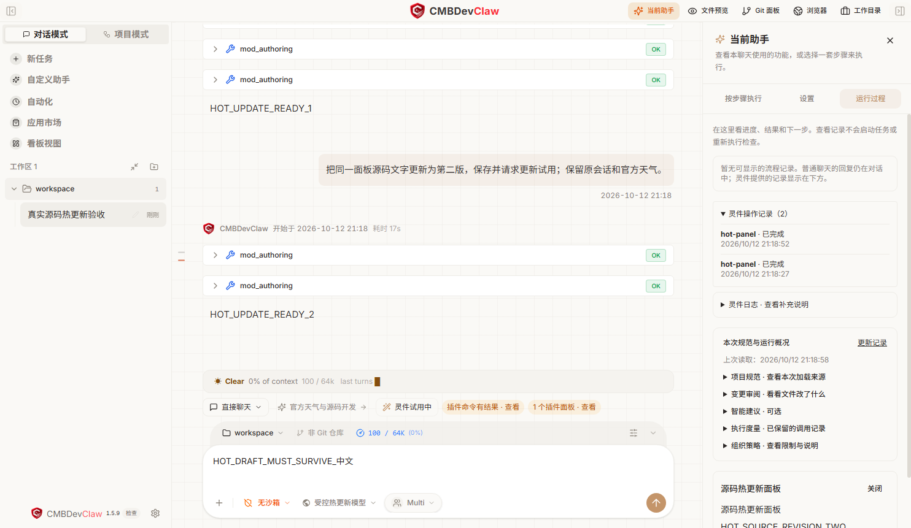

# DevClaw Sparks 官方说明

**Mods 是 DevClaw 的可编程扩展机制。** 平台通过统一接口开放界面、行为、工具和流程等能力，允许用户或开发者通过脚本新增、调整和组合功能。界面中的功能单元称为“灵件（Sparks）”，可安装、分发的完整交付包称为“插件”。可用范围以当前接口、精确版本与实际授权为准。

日常使用时，在 **普通模式** 的聊天框直接描述需求，点击 **发送消息**。
在原任务卡或输入框旁的 **任务进展** 查看 **当前任务**、待确认事项和 **结果**，无需先配置模块或任务方案。

要创建、修改或组合 Mods 和插件，在输入框旁切换 **创造者模式**，直接描述希望新增的功能或项目流程。
新功能会检查真实源码，并在需要时展示当前版本的用途和权限，点击 **确认并应用到这段聊天** 后试用。
组合已有功能时，助手会读取实际可用版本并保留已有选择；缺少授权或存在冲突时会说明原因。

插件可以包含 Skills、Mods、Hooks、配置和资源。普通技能描述任务做法；Mods 提供可编程的界面、工具、行为或共享能力。项目插件另外声明阶段、输入输出和检查规则，不要求每个阶段都改写为 Mod。

| 创造目标 | 推荐路径 |
| --- | --- |
| 新增或修改一个界面、命令或工具扩展 | 创造者描述需求 → 检查候选 → 确认试用 → 根据效果继续对话修改 |
| 让多个 Mods 协作 | 发现实际能力 → 核对调用契约与配置 → 组合试用 → 保存复用 |
| 创建或修改项目插件 | 创造者描述业务步骤 → 生成组合和产物检查 → 隔离试用 → 保存插件 → 项目模式使用 |

可以从小功能开始，无需先改造完整项目插件。例如：

- 独立 Mod：“在输入框上方显示文件读取次数，初始为零，每次读取完成后加一。”试用后继续说“再显示最近一次调用的工具名称”，修改同一份候选。
- 多个 Mods：“制作文本规范化能力，再制作一个调用该能力的质量检查命令。”提供方公开能力契约，调用方使用实际可用的能力引用；更新提供方时需要核对契约兼容性。
- 项目插件：“制作资料整理、质量复核、报告交付三个环节的插件。”实际试用后，可继续要求替换中间的复核环节，保留前后输入输出，再保存并从项目模式新建项目运行。

这些是不同的创造目标：独立扩展不必声明项目阶段，阶段技能也不必各自包装为 Function Mod。依赖缺失、版本变化或撤销授权时，需要重新核对组合；不能沿用旧版本的执行与检查结果。

多个独立插件需要协作时，创造者会先准备提供能力的插件，确认保存后再准备调用方，并保留已有选择。每个独立包分别核对用途和权限；用户无需选择接口或手动填写依赖标识。共享能力通过公开的版本化契约调用，只有两个实际来源都已就绪，才可验证组合效果。创作工作区会保留试用状态和保存入口，调用记录及用量可按需展开。

若发送前提示“当前聊天的功能组合需要核对”，本次消息尚未发送，输入会保留。点击“重新核对组合”处理当前依赖或授权，再发送原消息。平台不会把无法确认输入规则当作没有规则，也不会自动绕过插件要求的检查。

新项目插件的公共机制见[原生项目插件创作](native-project-authoring.md)。已有业务插件的共享内核选择与兼容边界见[业务 Mods 组装与执行适配](business-mod-assembly.md)。AutoBiz 是复杂业务示例；其业务规则由插件及适配器负责，不定义所有项目插件的流程。

需要自己挑选或管理插件时，再打开 **自定义设置 → 基础功能 → 灵件与使用设置**。也可以从 AutoBiz 等已有插件创建自己的版本。

从总览也可点 **找功能 → 挑选灵件**，进入 **挑选使用**。示例卡片分别说明用途、依赖和来源；添加前请核对所需权限。

| 本工程示例 | 实际用途 |
| --- | --- |
| 任务能力提供方 | 公开真实本地任务的状态、启动与取消动作；先在选定聊天核对并使用 |
| 个人任务工作台 | 再在同一聊天核对并使用，组合提供方，查看实际任务、输出和取消结果；默认需要系统 Node |
| 前缀提醒、精简提醒 | 到“行为设置”预览冲突，每个处理点选择一个后明确应用；停用恢复原生通知与输入建议 |
| 编辑提醒 | 订阅真实文件编辑完成记录；示例写入需原批准，仅创建新文件 |

首次使用聊天插件时，在同一入口核对来源、填写配置并确认使用；该来源已经就绪后直接显示使用入口。实际命令仍按最终参数批准。工作台的两个插件各自核对，提供方的授权不代替调用方的授权。
演示准备与复演步骤见[工作台操作](../demo-kit/platform-workbench-20261016.md)及[项目插件交接](../demo-kit/project-mode-20261016.md)。

手动配置时，在页面顶部的 **为哪段聊天配置** 中直接选择聊天，无需先离开设置切换会话。
核对后点 **应用到所选聊天**。需要使用时，再点 **去这段聊天使用**。
切换配置对象时，未保存的编辑会提示你先保存或确认放弃。

## 选择你要做的事

| 你想做什么 | 操作入口 |
| --- | --- |
| 完成日常任务 | 普通模式 → 描述需求 → 发送消息 |
| 用一句话创建、修改或组合功能 | 创造者模式 → 描述需求 → 发送消息 |
| 查看任务进度、确认和成果 | 聊天原任务卡；任务进展 → 当前任务 / 结果 |
| 保存已试用的功能供其他聊天复用 | 灵件试用面板 → 保存并在其他聊天复用… |
| 查看文件改动 | 聊天中输入 `/diff`，选择“内置 · 查看改动” |

“我已添加”管理插件。“查看流程定义”读取当前安装版本声明的步骤，无需选择聊天、绑定项目或启用插件。项目进度在具体项目中查看；普通使用仍从项目模式选择插件并新建项目。创造者用于生成或修改插件，“常用搭配”用于保存聊天选用的扩展，二者都不是运行项目的前置步骤。

以下入口用于手动配置：

| 你想做什么 | 操作入口 |
| --- | --- |
| 体验现成的小功能 | 自定义设置 → 基础功能 → 灵件与使用设置 → 挑选使用 |
| 从 AutoBiz 创建独立插件 | 自定义设置 → 基础功能 → 灵件与使用设置 → 自己制作 → 从已有插件创建 |
| 手动搭配插件 | 自定义设置 → 高级特性 → 搭配管理 |
| 查看已安装插件的流程定义 | 灵件与使用设置 → 我已添加 → 插件卡片 → 管理 → 查看流程定义 |
| 使用项目插件 | 项目模式 → 新建项目 → 选择插件；也可从已启用项目插件的“去使用”进入 |
| 管理已经添加的功能 | 自定义设置 → 基础功能 → 灵件与使用设置 → 我已添加 |
| 为下一条消息选用固定任务方案 | 任务进展 → 高级设置 → 高级：为下一条消息使用预设任务 |
| 编辑固定任务方案、查看其执行记录 | 自定义设置 → 高级特性 → 聊天任务模板 → 流程配置 / 执行记录 |
| 查看规范和技术记录 | 任务进展 → 结果 → 排查详情，或输入 `/runs` |

输入 `/` 可以查看快捷入口。名称与插件命令相同时，选择带“内置”的条目。

“流程配置”用于编排步骤，“执行记录”查看所选聊天已经运行的任务。
页面中的问号可悬停或点击查看说明，结果与操作保留在主界面。

## 聊天任务模板与插件的关系

两者都可以安排执行顺序。聊天任务模板基于 Flow；项目流程中的公开动作、上下文和检查也复用同一 Flow 执行底座。

- **聊天任务模板**是为单次任务选择的编排配置，可保存修订、执行历史和审批记录，也可引用已授权插件的技能、动作并执行适用的 Hooks。保存或选择模板后，仍须在聊天中发送任务才会启动。
- **插件**是能力和资源的版本化交付包，可以包含技能、Mods、Hooks、工具和知识，不一定包含流程。项目插件还声明或适配长期阶段状态、配置、知识绑定及产物合同；具体执行仍须核对来源与权限。

例如，“检视并测试”执行 **检视 → 原生测试 → 汇报 → 人工确认**，记录本次任务结果，不会自动推进 AutoBiz 阶段。AutoBiz 的阶段推进还须满足其原产物、Hooks 和状态规则。已有项目流程时，直接从项目入口使用，无需再配置一份相同的聊天任务模板。

模板可以使用插件能力，但不会自动把业务资源封装为插件；插件中的流程也须使用受支持的声明与入口，不能仅放入任意 `flow.json` 就自动加载。

## 高级：从 AutoBiz 创建自己的插件

1. 在 **自己制作 → 从已有插件创建** 中选择 AutoBiz，或选择本地插件文件夹。
2. 填写新名称，点 **创建我的插件**。
3. 在 **告诉我你想怎么改** 描述需求，点 **生成修改建议**。助手会把业务要求补充到新插件的技能说明中。
4. 展开文件查看 **修改前 / 修改后**，核对后点 **确认保存修改**；预览不会修改副本。
5. 想自己挑选项目步骤，点 **添加自选步骤选项**。查看配置变化，核对后点 **确认添加自选步骤选项**；不支持自选的插件继续使用原来的流程。
6. 点 **检查能否安装 → 安装新插件**。
7. 启用新插件，点 **新建项目**，选择独立项目目录。

新插件保留原有脚本、Hooks 和阶段检查。原插件及已有项目继续按原配置使用；原项目的运行状态不会复制到新项目。

**示例：数据开发助手。** 输入“增加数据口径、转换 SQL 和数据质量报告要求，保留原有检查”，查看修改前后的内容，再确认保存。无需手工编辑技能文件，原有脚本和检查规则会保留。需要修改代码或原有规则时，可展开高级修改，并重新验证。

取消、失败或切换聊天会保留本次应用会话中的需求草稿；返回后可重新生成。副本变化后旧建议不能保存。

继续修改已安装插件时，打开已创建的插件，点 **修改这个插件（创建新版本草稿）**。应用会从实际安装版本创建独立草稿，自动命名；描述修改、核对预览并保存，再检查能否安装，最后点 **发布并安装新版本**。旧版本和已有项目保留，新版本需单独启用并新建项目，Hooks 仍按原有方式审批。

点 **检查来源更新** 才会读取和比较来源文件；普通打开草稿不会扫描来源。发现来源变化后，可点 **从最新来源制作** 创建新草稿。当前修改会保留，但不会自动合并到最新来源；来源被移除或不可读时，需要恢复或重新选择来源。

[查看完整操作示例](plugin-cookbook.md) · [制作全新的项目插件](project-plugin-cookbook.md)

## 搭配两个插件

在 **创造者模式** 直接描述，例如：“把文件编辑提醒和用量面板一起用在这段聊天，保留其他功能。”
助手会核对可用功能并提交组合，已授权的变更在当前轮次结束、聊天空闲后应用。

需要手工选择时，打开 **自定义设置 → 高级特性 → 搭配管理**。上方的 **AutoBiz 和其他已安装插件** 列出原包和衍生版本的技能、启用状态与项目入口，可点 **管理插件** 或 **管理并启用插件** 前往对应设置。这个目录不表示原生插件已加入聊天组合；当前尚不能把它们勾选为普通聊天中的多插件技能组合。

下方对已提供可组合功能的插件，选择需要的使用方式：

- **一起使用**：同时添加两个插件的功能。例如，用 Weather 显示会话用量趋势，同时用 Blast Radius 确认高风险命令。
- **先后执行**：选择两个插件公开的操作，填写必要参数，再连接前一步的结果。例如，先读取需求文件，再交给检视插件。

点 **保存并核对应用**，检查要启用的功能后确认。应用完成后，点 **去这段聊天使用**，在聊天的唯一输入框填写任务，点击 **发送消息**。
保存或绑定步骤不会自动执行。需要固定任务方案时，先在 **任务进展 → 高级设置 → 高级：为下一条消息使用预设任务**
明确选用，再回到同一个聊天框填写任务并点击 **发送消息**。模型目前没有自动启动已保存 Flow 的工具。

新插件的项目创建后，可在完成卡片中直接点 **选择这个项目的步骤**。已有项目也可打开 **灵件与使用设置 → 我已添加**，在项目插件卡片点击 **查看项目流程**。页面列出当前目录绑定该插件的项目，并提示项目记录版本与当前安装来源的差异；进入前会重新核对当前安装源码，不表示保留或恢复了旧版本。固定模板展示其实际步骤，并提供原项目入口；提供自选模板的版本才允许调整节点，再点 **检查并预览步骤**，核对补齐的必要前置节点与最终顺序。再点 **在项目里创建需求**，进入原需求表单的工作流页，填写名称和工作目录后创建。原 Hooks、阶段检查和人工审批照常执行。此方式使用同一项目绑定插件的原生流程，不把不同插件的阶段与状态混为一条链。

公开操作与项目原生节点是不同能力。已提供可组合功能但没有公开操作的插件，可以一起使用其适用功能，但不能作为公开操作流程步骤。原生插件使用上方项目入口；同时提供两类能力的插件分别显示其适用入口。不能同时占用的位置会显示冲突说明。

## 添加并试用内置示例

**灵件与使用设置 → 挑选使用** 提供用量天气、修改回放和危险命令提示等内置示例，无需下载或手动导入。首次点 **添加并使用**，核对权限后确认。重入页面会核对真实安装和当前聊天状态：已安装可点 **用于当前聊天**，已应用显示 **正在使用**，同名内容不同或界面占用冲突会要求先核对。

| 示例 | 用途 |
| --- | --- |
| Weather · 用量天气 | 在输入框上方用天气图标展示会话用量趋势 |
| Replay · 修改回放 | 文件编辑后查看修改前后的差异 |
| Blast Radius · 危险命令确认 | 对匹配的高风险命令展示影响范围，供你继续或取消 |

Weather 和 Replay 使用同一个界面位置，切换时会提示替换；Blast Radius 可以与它们搭配。

## 看进度、找原因

配图记录的是早期任务卡和输入组件的本地交互示例，并非你的任务执行记录；其中旧的步骤选择和发送文案以本节文字为准。

输入任务只用聊天中的唯一输入框。默认在普通模式描述需求，点击 **发送消息**。
当前进展、人工确认和最终结果在原任务卡中持续更新，也可打开 **任务进展 → 当前任务 / 结果**。
全部步骤、历史尝试和技术记录按需展开；停止任务不会撤销已经完成的操作。

高级固定任务方案只用于明确选用后的下一条消息。在 **任务进展 → 高级设置 → 高级：为下一条消息使用预设任务**
核对 **本次使用的步骤**，再回到聊天点击 **发送消息**。选择或取消都不会执行任务，也不会改写输入。
成功启动后恢复普通发送，下一条任务需要重新选用；预检失败会保留输入和选择，核对原因后再发送。
想恢复默认聊天时，可点 **取消本次选择** 或 **改为普通发送**。已保存或绑定的 Flow 不会自动启动。

其他插件的命令和面板在 **任务进展 → 高级设置** 查看；规范、运行概况和技术日志在 **结果** 中按需展开。

**任务进展 → 高级设置** 显示这段聊天的功能选择。组合不可用时会显示原因；未选择专用组合时，沿用本项目已授权的默认功能。
专用组合的选择按聊天生效；项目权限和插件的通用参数由同一项目中的聊天共享。

任务失败后，按提示修复并重新验证。原失败记录会保留，新的执行另有记录；刷新记录不会重新执行任务。

| 快捷入口 | 用途 |
| --- | --- |
| `/diff` | 查看项目文件改动 |
| `/instructions` | 查看本次使用的项目规范 |
| `/runs` | 查看运行记录 |
| `/policy` | 查看限制和待确认事项 |
| `/create` | 打开制作入口 |
| `/help` | 打开官方说明 |

这些入口用于查看信息和打开功能，不会将命令发送给模型。

## 跟着示例练习

在创造者模式中打开 **使用指引**，按锚点说明定位应用图标、模式切换、输入框和任务进展。进入创作工作区后，还可打开工作区指引，查看候选、试用、验收与保存位置。指引可以跳过或关闭，之后从同一入口重新打开。

需要了解具体操作结果时，可打开演练示例。指引和演练不会代替用户发送消息、批准工具、运行试用或安装插件。

## 深入了解

[创建与修改](create.md) · [安装与复用](reuse.md) · [项目能力](project-platform.md) · [排查问题](troubleshooting.md) · [开发参考](reference.md)

新建 **通用开发流程** 使用应用内置步骤，无需空白插件占位，也不会自动推进 AutoBiz 阶段。原有已保存的旧流程继续使用原插件授权和阶段配置；迁移时新建通用流程并逐项核对。流程详情中的 **保存修订** 表示保存次数对应的记录，不是插件版本。

## 插件制作闭环

参见[插件制作、试用、验收与保存](creator-plugin-workflow.md)，包含原始插件首次模块化、
原创作会话中的试用反馈、阶段验收和独立插件交付。
