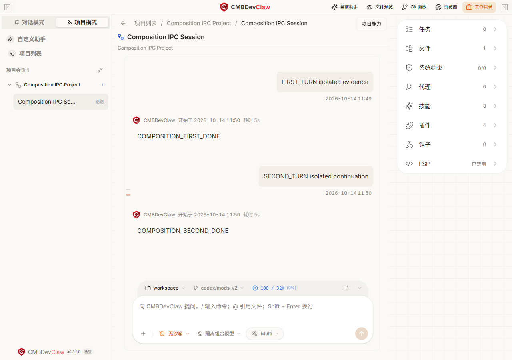
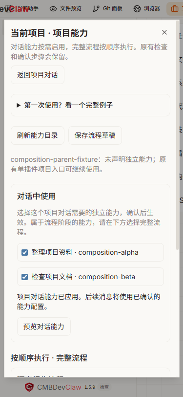
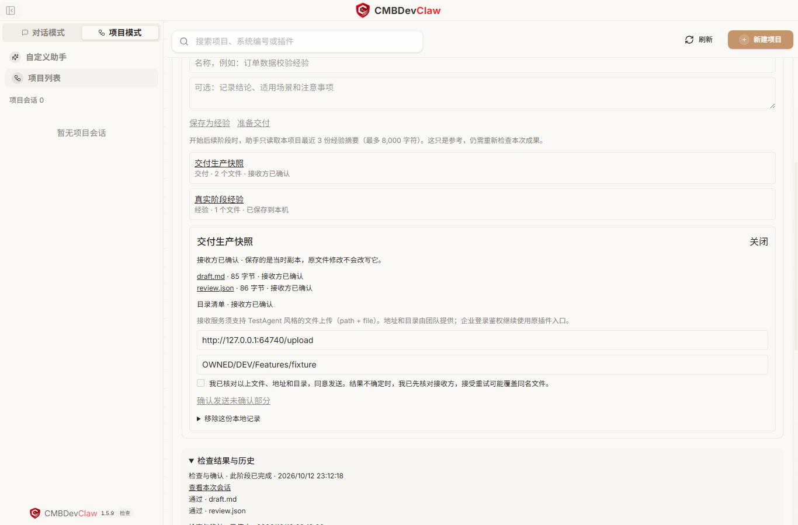

# 内置功能与项目模式

内置功能随应用提供，无需另行安装。

## 在一个项目里搭配多个插件

打开 **项目模式**，进入项目对话或需求对话，点击标题栏的 **项目能力**。

- **对话中使用**：为这个项目增加技能。例如同时选“整理需求”和“检查文档”，点击 **预览对话能力**，核对后 **确认应用对话能力**。之后在项目里描述任务，助手即可使用这些能力。
- **按顺序执行**：把完整流程排成先后顺序。例如先生成文档，再审核文档。填写这次要完成的任务，为后一个流程选择前一个流程的结果，预览确认后开始。

选项旁会显示来源插件。只能在项目中使用的功能，不会混入普通聊天的组合。属于原流程某个阶段的技能仍受原检查约束，不能当作独立技能跳过阶段执行。

项目能力入口与选择面板如下。先在项目会话标题栏打开 **项目能力**，再勾选需要的对话能力。

### 已有插件没有完整流程选项怎么办

打开 **自定义设置 → 基础功能 → 灵件与使用设置 → 自己制作**，参考已安装插件创建一个新副本。
在副本修改面板点击 **用于完整流程组合**，核对新增配置后点 **确认保存完整流程配置**。
无需手写配置文件。确认保存只准备配置，不会开始任务。

保存后依次 **检查能否安装 → 安装新插件 → 启用新插件**，再回到目标项目的 **项目能力** 查看可用的完整流程。
已安装的副本要先创建新版本再修改。原项目仍继续使用原插件。

完整流程只提供给页面标为可用的插件版本；AutoBiz 等旧插件也按具体版本判断。暂不支持时，按页面提示使用原项目入口。

### 例子：先写文档，再审核

1. 安装提供“文档编写流程”和“文档审核流程”的两个插件。插件需要声明可组合的流程；没有声明的旧插件仍从原项目入口使用。
2. 在 **项目能力 → 按顺序执行** 中，依次添加这两个流程。
3. 在任务说明中填写“为订单导出功能编写使用说明，并检查操作步骤是否完整”。
4. 在审核流程的资料选项里，选择编写流程产出的文档。页面会提示缺少的必需资料。
5. 预览顺序、输入和结果，确认后开始。保存草稿只保存配置，不会执行任务。
6. 在 **运行过程** 查看进度。需要确认的阶段会等待你的批准；前一步失败，后一步不会继续。
7. 点击 **查看结果** 阅读已检查的产物。关闭再打开面板，可以继续查看同一次运行。

每个完整流程保留原来的检查和审批。它们各自保存进度，只交接明确选择的结果文件，不会覆盖原项目的流程状态。

### 例子：AutoBiz 开发，再整理项目文档

1. 安装并启用 AutoBiz 和 `project-docs-lite`。AutoBiz 使用“项目能力”中标为可用的完整流程版本；没有可用选项时，先按上面的步骤准备副本。
2. 如需先整理需求，在 **对话中使用** 勾选 `project-docs-lite` 的 **整理项目需求**，预览并确认应用，再在当前项目对话中补充需求。
3. 在 **按顺序执行** 中，先添加 AutoBiz 完整流程，再添加 **起草并审核需求文档**。填写共同任务，例如“实现订单导出功能，并根据以下需求起草和审核操作文档”，把文档需要的需求与约束写在任务说明中。
4. 在文档流程的资料下拉中，显式选择新 AutoBiz 组合副本的 `verified-context`，再预览并启动。原检查与审批保留；前一步失败或资料交接未通过时，后一步不会开始。
5. AutoBiz 终态通过后，宿主将原流程声明且通过检查的业务、设计和报告正文打成固定资料包，包含原路径、SHA256、原检查和冻结版本证据。点击 **查看结果** 可预览；原目录仍可打开。旧副本或旧运行没有这一出口，不自动补交。
6. 新副本同时声明源码交接范围（示例为 `src`）：宿主在模型启动前冻结范围内文件的基线，终态交接新增/修改代码正文、哈希及删除记录。文档流程实际读取业务资料和这些代码，记录引用的路径、摘要、基线范围和缺口；原检查与人工批准保留。这是范围内源码字节交接，不代表范围外代码、逐文件或独立业务质量验收。没有映射资料时，结果必须说明仅根据任务文字起草。

已启动的步骤即使失败，也可以尝试打开运行文件夹定位已有文件。浏览文件不会重新执行任务，也不会把未声明的文件自动交给下一步。

运行需要补充决定时，项目能力面板会显示原因，可选择继续、开启新会话或终止。提交后点击 **核对并恢复**，查看原流程的后续结果。
停止不会撤销已经产生的修改。刷新目录或核对运行状态只读取记录；核对恢复继续处理已有运行。结果尚未核实时先看已有结果，不要另开任务重做；确认需要新一轮执行时，再重新预览并明确启动。

## 六项内置功能在哪里

在聊天输入框旁打开 **任务进展 → 结果 → 排查详情：规范与运行记录**，查看本次规范与运行概况。
查看记录不会发送模型请求；“智能建议”的分析按钮例外，会明确产生模型用量。

| 功能 | 打开位置与用法 | 结果代表什么 |
| --- | --- | --- |
| 项目规范 | 展开“项目规范 · 查看本次加载来源” | 按宿主加载顺序查看来源、作用范围、纳入或截断情况。尚无本轮记录会显示待核对，不会重新扫描后冒充已经加载。模型请求时的核对另列，装配记录不等于最终请求完全未被改变。 |
| 变更审阅 | 展开“变更审阅”，选择比较范围后点“查看改动” | “工作区全部改动”相对 Git HEAD；本次执行、本阶段（含重试）、本项目（所有阶段）分别使用实际开始快照。本地项目附带本次执行的历史检查记录，并行任务或外部编辑的归属仍需核对。 |
| 组织策略 | 展开“组织策略 · 查看限制与说明” | 查看实际人工确认、工具限制、原插件检查和组织策略的结果与下一步；展开可核对时间和规则来源。无记录表示未知。这里不能绕过审批。 |
| 执行度量 | 展开“执行度量 · 已保留的调用记录” | 查看保留样本的成功、失败、未确认和已知用量；已有原项目执行账本或关联托管记录时，同时显示执行与重复运行情况。执行结束不等于业务验收通过，未知费用不算零。 |
| 扩展开发助手 | 聊天输入框旁切换创造者模式；高级管理在自定义设置 → 基础功能 → 灵件与使用设置 → 自己制作 | 描述需求、检查源码、确认当前版本试用并核对效果。项目模板也可自然语言制作，详见[制作项目模板](project-plugin-cookbook.md)。 |
| 项目提示 | 看“下一步建议”；需要时展开“智能建议 · 可选” | 规则建议依据已有记录，不调用模型。智能建议默认关闭，开启后还需点击“分析已有记录”，不会执行建议中的操作。 |

智能建议只发送保留的调用统计和可用的阶段检查数量、执行及审批状态，不发送文件正文或任务目标。界面列出每日次数、间隔、输出和超时限制；
可以“停止分析”、取消勾选或关闭面板，也可“忽略这条建议”。同样的记录不会反复产生分析费用；再次查看时，情况已变化的旧建议会失效。建议不是检查回执，也不会代替人工确认。

原项目的执行账本与关联托管快照分开显示，不相加。没有账本记录不代表没有执行；
托管快照的耗时和服务请求重试也不能代替人工确认等待时间、模型用量或业务验收结果。

变更审阅只读文件和 Git 信息，不会提交或还原代码。非 Git 目录、尚无首次提交、超限或缺少基线时，
按页面解释核对范围。普通聊天、应用重启或基线淘汰后，本轮范围可能不可用；此时仍可明确选择工作区范围。
重命名可能显示为删除和新增，二进制只报告变化，不把敏感文件正文纳入审阅。

例如，第一阶段第一次执行前已有 `notes.md`，失败后重试又修改了一次：选择“本次执行”只比较这次重试，
选择“本阶段”包含该阶段前一次失败中的改动，选择“本项目”还可包含更早阶段的改动。
这些范围必须有本应用会话内实际留存的起点；没有就显示不可用，绝不把此刻的文件补作最初状态。
关联检查写明“当时通过／当时未通过”。即使检查当时通过，后来编辑了文件也应从项目入口重新检查。
本地任务的比较起点在原启动检查之前留存，包含检查产生的改动。同一分支正常提交仍可比较；
切换分支后会拒绝混合比较。旧插件会话当前只能显示模型执行开始后的范围，页面会明确提示其此前启动检查未纳入，
不能拿它代替原插件的完整阶段或业务批次验收。

## 选择插件并创建项目

1. 先在原插件管理入口安装项目模板。可使用源码示例 `project-docs-lite`，或按[制作项目模板](project-plugin-cookbook.md)打包后导入。
2. 在主侧栏打开 **项目模式**，点击 **新建项目**，选择已安装并启用的项目插件。新版原生插件与兼容插件使用同一项目入口，不需要寻找另一套任务面板。
3. 按所选插件填写项目名称、任务目标和成果工作目录，再点 **创建项目**。原生插件无需企业项目编码、系统 ID 或企业登录；兼容插件继续使用其原有的必要配置和检查。
4. 创建只保存配置。核对阶段和目标后，点 **开始当前阶段** 才会调用助手。需要人工确认的阶段会先显示审批；可批准或拒绝。
5. 如果阶段依赖其他插件，页面会列出助手结束后按序调用的插件功能。它们必须已安装且获准，并匹配模板锁定的版本；选择动作本身不会新增授权。

创造者安装并启用新插件后，点击交付卡的 **开始使用 → 进入项目创建**，会在同一入口定位该插件；也可直接在 **项目模式 → 新建项目** 中选择。安装和创建不自动执行阶段或授予权限。创建后的项目在项目列表中保留，重新打开仍使用原来锁定的插件版本和阶段记录。

插件授权按工作目录生效。制作模板的聊天、隔离试用目录和正式成果目录可能不同：在目标目录对应的普通聊天，通过“灵件与使用设置 → 我已添加”确认提供者版本及授权，再开始项目阶段。

建议第一次在新空目录练习。以两阶段文档模板为例，第一阶段生成 `draft.md`，检查通过后点
**进入下一阶段**；第二阶段确认后生成 `review.json`，检查通过再点 **确认完成任务**。
聊天中的一句“完成了”不能推进项目阶段。

## 拒绝、停止和失败后怎么修复

| 当前情况 | 下一步 |
| --- | --- |
| 还没批准 | 核对当前阶段与后续插件功能；不希望执行就点“拒绝本次执行”。以后可重新准备。 |
| 正在执行 | 用“查看本次会话”回看过程；需要中止就点“停止本次步骤”。停止不会撤销已经写入的文件或外部操作。 |
| 文件检查没通过 | 展开“检查结果与历史”，按列出的文件和检查项修复。再开始当前阶段；没有动作依赖的阶段也可“只检查已有成果”。 |
| 插件缺失或版本变化 | 恢复模板锁定的提供者版本并经原入口授权，再重新开始。系统不会自动改绑同名新版。 |
| 结果需要核对 | 先看原会话与真实成果，再点“核对上次执行结果”。只在持久结束记录和成果一致时恢复已知结果；只有文件、没有结束记录时仍会保持未确认，不自动重跑。 |

“只检查已有成果”只执行文件存在或受限 JSON Schema 检查，不运行模型。
阶段包含必需公开动作或动作型业务检查时不提供这个按钮，避免把已有文件冒充动作执行成功。动作型检查由原执行链读取实际产物并保存真实结果；修改知识、配置、规则或输入后，历史通过不能代替新检查。
在“检查结果与历史”中点对应步骤的“查看公开动作结果”，可读保存的动作输出与锁定数据结构。查看不会执行或修复流程；当前授权或版本不符时隐藏输出并说明原因，旧结果不能当作新的执行授权。
文件存在检查接受空文件；结构检查证明 JSON 满足声明，并不证明内容质量。

修复后形成新步骤记录，原失败记录保留。更新列表或更新记录只读取状态。
页面的耗时与重复执行统计基于保留的最多 20 条步骤记录；模型用量看对应会话，费用未知时不估算为零。

## 保存成果、积累经验和交付

在阶段详情中点 **打开成果与经验**，可以保存已通过检查的文件副本：

- **保存为经验**：填写名称和结论。点经验名称可查看副本，再选择另一个本地任务并点“加入所选任务的经验”。目标任务下次开始阶段时会参考最近三份摘要，但仍需重新验证本次成果。
- **准备交付**：只保存副本。打开详情，核对文件，再填写团队提供的接收地址和目录；勾选确认后才发送。试用项目不能对外发送。
- **遇到失败**：成果变化后要重新检查；发送结果不确定时先核对接收方，再明确重试，避免重复覆盖。移除本地记录不会删除原文件或远端文件。

交付时填写团队提供的接收地址。企业登录和专用业务格式继续通过原插件使用；完整步骤见[制作项目插件中的经验与交付示例](project-plugin-cookbook.md)。保存、复用和发送都不会自动推进项目。

## 固定版本、版本比较和回退边界

每个本地任务保存创建时的模板副本。安装插件新版不会替换正在进行的任务。
展开 **任务配置与版本 → 比较已安装版本**，可查看阶段、产物、检查、动作依赖等声明差异；
它不会迁移任务、切换代码或改写成果。声明相同也不证明源码和依赖内容相同。

需要尝试另一版本时，在新目录创建新任务。如需回退，在原插件管理入口安装保留的旧版本包，
再核对依赖和授权。回退代码不回退文件、数据库或外部写入，也不把旧检查结果当成新版通过记录。

关闭并重开应用后可以读取已保存的项目和步骤记录；中断执行必须核对真实结束记录。
阶段会话用于回看，重试请从本地任务入口发起。这里不承诺任意中断都能无缝续跑，
也不把旧企业插件的适配视为完成：已有插件仍按自己的 Hooks、状态和人工确认运行。

[返回概览](README.md) · [制作项目模板](project-plugin-cookbook.md) · [排障与限制](troubleshooting.md)
