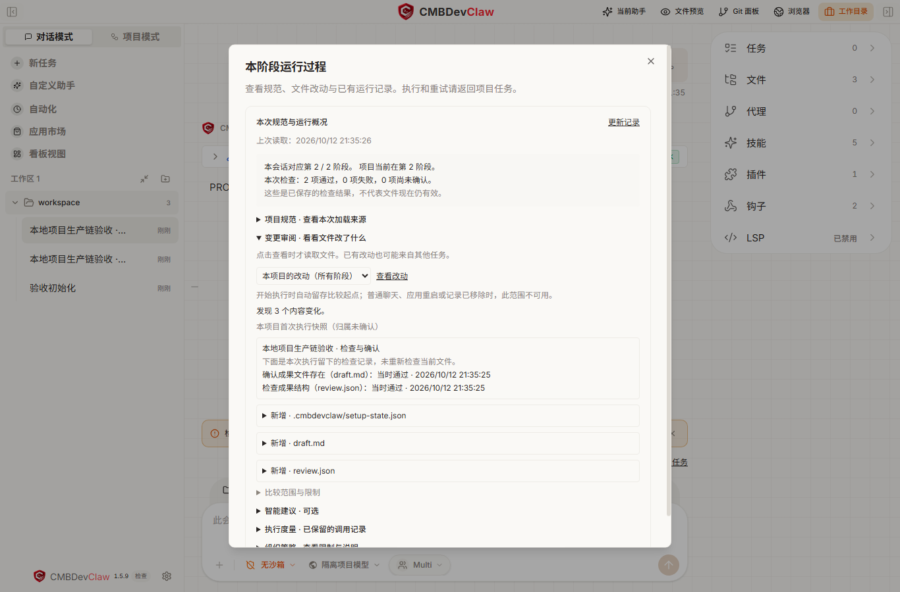

# 排障与限制

遇到问题时，先打开“运行过程”，查看失败原因和下一步。修改后重新验证，确认实际结果。

[返回概览](README.md) · [创建与修改](create.md) · [安装与复用](reuse.md)

## 对照真实运行记录

打开阶段的“运行过程”，
先核对当前阶段、检查时间和结果，再展开“变更审阅”选择范围并点击“查看改动”。
这里的检查是当时留下的记录，不会因打开窗口或点击“更新记录”而重新执行测试；
文件之后被修改时，需要回到项目任务重新检查。比较范围不可用时，按页面提示核对文件。

图片无法显示时，请重新打开说明；仍有问题时，可提供章节名称以便排查。

## 看懂试用状态

| 状态 | 含义 | 下一步 |
| --- | --- | --- |
| `needs-approval` | 需要用户确认当前候选能力 | 核对版本和能力后批准 |
| `queued` | 已排队，可能仍有任务或旧界面资源占用 | 等待当前轮次和安全切换，勿重复提交 |
| `preflight` | 正在准备并检查候选 | 等待检查结果 |
| `retiring` | 正在停止和清理旧版本 | 等待真实清理完成 |
| `active` | 候选已成为运行版本 | 核对 activeRevision 并实际使用 |
| `failed` | 本次候选处理失败 | 查看具体错误和是否仍有旧版运行 |
| `stopped` | 试用已停止 | 继续普通使用，或重新明确发起试用 |
| `unknown` | 运行或清理结果不能确认 | 核对实际效果；不要当作成功或已回滚 |

候选版本和生效版本可能不同。判断新版是否运行，应查看生效版本与实际界面或命令，不能只看
“最近保存的版本”。

## 常见问题

| 现象 | 检查与处理 |
| --- | --- |
| 没有创作工具 | 确认是关联本地目录的普通聊天，已开启应用、项目及本会话创作 |
| 找不到新名称入口 | 当前界面部分仍显示旧名，按[名称映射](README.md)查找 |
| 类型或编译失败 | 阅读文件与位置诊断，按当前 SDK 改写；不要假设其它产品的接口全部适用 |
| 检查通过却无法试用 | 对比试用能力范围；正式 SDK 存在不代表试用允许 |
| 一直显示排队 | 先等当前轮次结束；检查是否仍在执行命令、等待批准或清理旧资源 |
| 出现过期来源或会话错误 | 确认当前工作区和候选，重新读取状态；不要用旧卡片重复操作 |
| 更新后计数归零 | 模块局部变量在重载后重置；需要保存时明确使用隔离存储 |
| 停止后看不到原生工具结果 | 展开原工具卡片再查看；区分卡片折叠与内容被删除 |
| 安装成功但新会话没效果 | 检查准确版本授权、项目开关、Claw 来源及组件选择、实际触发方式 |
| 结束创作后仍有正式灵件 | 结束创作停止本会话试用；正式来源需在“灵件 → 我已添加”中明确禁用或撤权 |
| 重启后试用没恢复 | 历史仅供核对，执行权不自动恢复；重新建立受支持的试用请求，不能直接重放 unknown |

## 处理未知结果

保存错误信息、当时的版本和已经发生的操作。检查是否有命令执行、文件变化或外部请求；
不能仅凭错误提示就断言它们没有发生。使用可用的停止和核对操作；安装工作台中使用对应的
中断操作核对入口。

不要删除记录或重复点击来“清除”未知状态。版本回退也不会撤销已发生的业务效果。

## 容量满了怎么办

| 内容 | 管理方式 |
| --- | --- |
| 会话试用源码 | 新一轮创作会自动回收已确认不再使用的旧副本，保留最近版本与运行引用；正在清理或结果未知时继续保护相关材料 |
| 正式源码草稿 | 高级源码编辑器中打开“管理源码历史与草稿容量”，明确清理旧历史或删除草稿；保留当前编辑文本，不卸载已安装灵件 |
| 正式安装版本 | 安装面板中打开“查看空间用量，清理旧版本”，读取后核对项目及所选版本，再明确确认清理 |
| 固定任务评测报告 | 评测页选择可清理的已结算报告，再确认永久清理；运行中、待确认或仍有 Skill 引用的报告受保护 |
| Skill 冻结记录 | Skill 评测中打开“全局记录容量”；未采纳且已结算的记录可丢弃，已完成采纳或回退的记录需另行确认放弃应用内恢复能力 |

源码草稿每个项目最多 16 个、每个草稿最多 16 份保留修订；清理旧历史后保留最近两份，修订号
继续递增。删除后重新使用同一草稿 ID，修订号也不会回到旧值，以免旧窗口覆盖新内容。
准备版本仍受 16 个与 4 MiB 限额约束；安装版本、待核查材料和所有项目共用的容量以面板读数为准。
换聊天或重启不会绕过全局限额。

当前安装、最近可回退版本和仍有运行引用的版本不能清理。若旧记录互相引用，界面会同时勾选
必须一起清理的版本；请核对全部勾选项。清理未确认时先重新读取，不会自动重试。
放弃 Skill 历史不会修改当前 Skill，备份目录仍保留。确认时和本次成功回执会显示路径，
请按需先保存路径或复制材料；关闭页面后不会保留该条历史的应用内回退入口。这不是自动导出。
不要手工删除运行或待核查材料。

## 当前范围

会话开发仅支持普通本地聊天、每会话一个组件及[明确允许的事件与接口](events-and-api.md)。
外部模型、文件、网络、进程和自定义工具注册需要正式集成，仍受宿主约束。
本说明没有承诺 CLI、远端、IM 或后台任务具备同样的创作与绘制体验。

界面定制使用明确的渲染接点；它不能任意替换整个应用、权限引擎或所有内置功能。
检查与预览不会自动验证真实业务质量。组合、流程评测和结果回退也不意味着能自动修复所有问题。

## 提供问题信息

记录应用构建、使用入口、所选项目、候选与生效版本、操作步骤和完整错误文本。
如能提供不含业务数据的最小源码示例，更容易定位。移除凭据、个人信息和无关日志后再分享。
